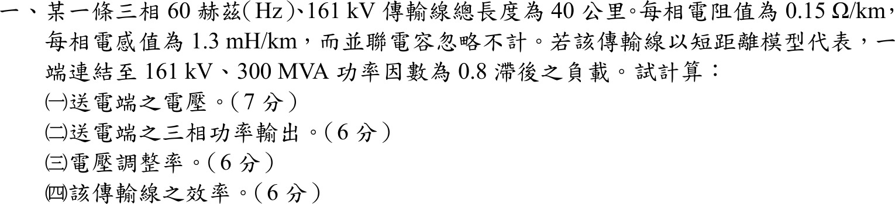
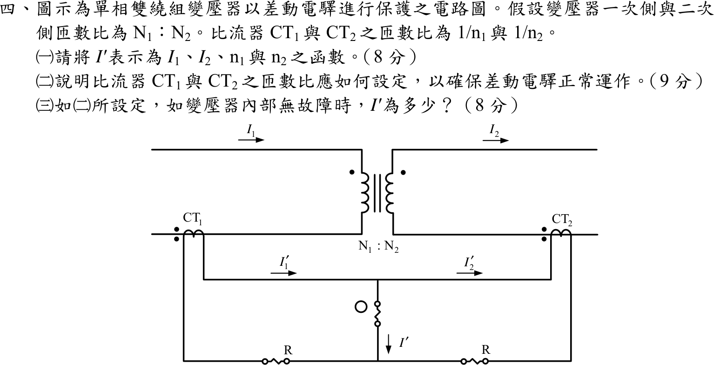

# 106 年電機工程技師｜電力系統逐題詳解

> 本頁由題級 canonical 筆記組合；每題保留官方裁切圖、校驗狀態與可追溯的推導。

## 題目導覽
- [[#一、106 年電力系統第 1 題|第 1 題：106 年電力系統第 1 題]]
- [[#二、106 年電力系統第 2 題|第 2 題：106 年電力系統第 2 題]]
- [[#三、106 年電力系統第 3 題｜三匯流排潮流與無效功率流向|第 3 題：三匯流排潮流與無效功率流向]]
- [[#四、106 年電力系統第 4 題|第 4 題：106 年電力系統第 4 題]]

---

## 一、106 年電力系統第 1 題

> 題級識別：EE-106-05-1
> canonical 來源：[[canonical/EE-106-05-1.md]]
> 題級校驗狀態：verified

### 已知與所求

三相 60 Hz、161 kV 輸電線長 40 km，每相 \(0.15\ \Omega/\mathrm{km}\)、\(1.3\ \mathrm{mH/km}\)，並聯電容忽略（短線模型）；受電端接 161 kV、300 MVA、功因 0.8 落後的負載。求（一）送電端電壓；（二）送電端三相功率輸出；（三）電壓調整率；（四）傳輸效率。

### 考場標準作答

#### 步驟 1：每相線路參數與受電端量

設三相平衡、受電端線電壓維持 161 kV。短線模型忽略並聯電容，每相只剩串聯阻抗 \(Z=R+jX\)，送電端電流等於受電端電流；化為每相 Y 等效電路，取受電端相電壓為 \(0^\circ\) 參考。

\[
R=0.15\times40=6\ \Omega
\]
\[
L\ell=1.3\ \mathrm{mH/km}\times40\ \mathrm{km}=52\ \mathrm{mH}=0.052\ \mathrm H
\]
\[
X=\omega L\ell=2\pi(60)(0.052)=376.991\times0.052=19.604\ \Omega
\]
受電端相電壓（取為參考相量）：
\[
V_R=\frac{161}{\sqrt3}=92.95\ \mathrm{kV}\ \Rightarrow\ V_R=92.95\angle0^\circ\ \mathrm{kV}
\]
線電流大小：
\[
|I|=\frac{S}{\sqrt3V_{LL}}=\frac{300\ \mathrm{MVA}}{\sqrt3\times161\ \mathrm{kV}}=1.0758\ \mathrm{kA}=1075.81\ \mathrm A
\]
功因 0.8 落後，\(\theta=\cos^{-1}0.8=36.87^\circ\)，\(\sin\theta=0.6\)，電流落後 \(V_R\)：
\[
I=|I|(\cos\theta-j\sin\theta)=1075.81(0.8-j0.6)
\]
\[
I=860.65-j645.49\ \mathrm A=1075.81\angle-36.87^\circ\ \mathrm A
\]

#### （一）送電端之電壓（7 分）

\[
V_S=V_R+(R+jX)I
\]
線路壓降 \((R+jX)I=(6+j19.604)(860.65-j645.49)\)，實部與虛部分開乘：
\[
\text{實部}=R\,(860.65)+X\,(645.49)=6(860.65)+19.604(645.49)=5163.90+12654.19=17818.09\ \mathrm V
\]
\[
\text{虛部}=X\,(860.65)-R\,(645.49)=19.604(860.65)-6(645.49)=16872.18-3872.94=12999.24\ \mathrm V
\]
\[
(R+jX)I=17.82+j13.00\ \mathrm{kV}
\]
\[
V_S=92.95+(17.82+j13.00)=110.77+j13.00\ \mathrm{kV}
\]
化為極座標：
\[
|V_S|=\sqrt{110.77^2+13.00^2}=\sqrt{12269.99+169.00}=\sqrt{12438.99}=111.53\ \mathrm{kV}
\]
\[
\angle V_S=\tan^{-1}\frac{13.00}{110.77}=\tan^{-1}0.1174=6.69^\circ
\]
\[
\boxed{V_S=111.53\angle6.69^\circ\ \mathrm{kV/相}},\qquad V_{S,LL}=\sqrt3(111.53)
\]
\[
\boxed{V_{S,LL}=193.18\ \mathrm{kV}}
\]

#### （二）送電端之三相功率輸出（6 分）

短線無並聯分路，沒有充電無功。負載功率：
\[
P_R=S\cos\theta=300(0.8)=240\ \mathrm{MW},\qquad Q_R=S\sin\theta=300(0.6)=180\ \mathrm{Mvar}
\]
電流平方：
\[
|I|^2=(1.07581\ \mathrm{kA})^2=1.157367\ \mathrm{kA^2}
\]
線路三相有功損失與無功消耗：
\[
P_{loss}=3|I|^2R=3(1.157367\ \mathrm{kA^2})(6\ \Omega)=20.83\ \mathrm{MW}
\]
\[
Q_{line}=3|I|^2X=3(1.157367\ \mathrm{kA^2})(19.604\ \Omega)=68.07\ \mathrm{Mvar}
\]
送電端：
\[
\boxed{P_S=P_R+P_{loss}=240+20.83=260.83\ \mathrm{MW}}
\]
\[
\boxed{Q_S=Q_R+Q_{line}=180+68.07=248.07\ \mathrm{Mvar}}
\]

#### （三）電壓調整率（6 分）

短線無並聯分路，負載移除後線路無電流、無壓降，無載受電端電壓 \(=|V_S|\)：

\[
\mathrm{VR}=\frac{|V_S|-|V_R|}{|V_R|}\times100\%
\]
\[
\mathrm{VR}=\frac{111.53-92.95}{92.95}\times100\%=\frac{18.58}{92.95}\times100\%=0.1999\times100\%
\]
\[
\boxed{\mathrm{VR}=19.99\%}
\]

#### （四）該傳輸線之效率（6 分）

\[
\eta=\frac{P_R}{P_S}\times100\%=\frac{240}{260.83}\times100\%=0.9201\times100\%
\]
\[
\boxed{\eta=92.01\%}
\]

### 驗算

以複功率回推送電端線電壓：
\[
|S_S|=\sqrt{260.83^2+248.07^2}=\sqrt{68032.29+61538.72}=359.96\ \mathrm{MVA}
\]
\[
V_{S,LL}=\frac{|S_S|}{\sqrt3\,|I|}=\frac{359.96\ \mathrm{MVA}}{\sqrt3\times1.07581\ \mathrm{kA}}=\frac{359.96\ \mathrm{MVA}}{1.86336\ \mathrm{kA}}=193.18\ \mathrm{kV}
\]
與相量法相同；\(P_S\) 亦等於 \(3\,\mathrm{Re}(V_SI^*)=260.83\) MW。

### 失分點

- \(X=\omega L\ell\) 要乘 40 km 並把 mH 換成 H：\(0.49\ \Omega/\mathrm{km}\times40=19.60\ \Omega\)，不是 \(0.49\ \Omega\)。
- 電壓調整率用相電壓比相電壓（或線電壓比線電壓）；以 193.18 kV 對 92.95 kV 比較會得 107.82%。
- 效率是有功比 \(P_R/P_S\)，不是視在功率比；送電端 \(Q_S\) 含線路電抗消耗，不可直接取負載 180 Mvar。

---

## 二、106 年電力系統第 2 題

> 題級識別：EE-106-05-2
> canonical 來源：[[canonical/EE-106-05-2.md]]
> 題級校驗狀態：verified

### 已知與所求

100 MVA 基準標么阻抗圖：發電機 \(G_1\) 的 \(j0.1\) 與變壓器 \(j0.1\) 接 Bus 1，\(G_2\) 的 \(j0.2\) 與變壓器 \(j0.2\) 接 Bus 2；線路 \(1\text{-}2\) 為 \(j0.8\)、\(1\text{-}3\) 與 \(2\text{-}3\) 各 \(j0.4\)。電阻與並聯電容忽略，發電機 EMF 為 1 p.u.。無載運轉，Bus 1 經接地阻抗 \(0.11\) p.u. 發生三相平衡接地故障（按純電抗網路取 \(Z_f=j0.11\)，見「條件與疑義」）。求（一）Bus 3 電壓；（二）Bus 1 故障電流；（三）Bus 1 電壓。

### 考場標準作答

#### 步驟 1：建立正序阻抗網路

三相平衡故障只需正序網路；無載運轉，故障前各匯流排電壓皆等於 EMF：\(V^{(0)}=1\angle0^\circ\) p.u.。

- 發電機 EMF 視為短路接地（求阻抗時電壓源短路）。
- Bus 1 對地支路：\(G_1\) 與其變壓器串聯，\(j0.1+j0.1=j0.2\)。
- Bus 2 對地支路：\(G_2\) 與其變壓器串聯，\(j0.2+j0.2=j0.4\)。
- 線路：\(1\text{-}2\) 為 \(j0.8\)；\(1\text{-}3\)、\(3\text{-}2\) 各 \(j0.4\)。

（以下各阻抗皆為純電抗，計算時先略去 \(j\)，最後補回。）

#### 步驟 2：求 \(Z_{11}\)（Bus 1 看入的戴維寧阻抗）

Bus 1 到 Bus 2 有兩條並聯路徑：直接線路 \(0.8\)，以及經 Bus 3 的 \(0.4+0.4=0.8\)：
\[
Z_{12,\mathrm{eq}}=0.8\parallel0.8=\frac{0.8\times0.8}{0.8+0.8}=0.4
\]
再串 Bus 2 對地支路，得 Bus 1 經網路到地的阻抗：
\[
Z_{\mathrm{net}}=0.4+0.4=0.8
\]
與 Bus 1 自身對地支路 \(0.2\) 並聯：
\[
Z_{11}=0.2\parallel0.8=\frac{0.2\times0.8}{0.2+0.8}=\frac{0.16}{1}=0.16\quad\Rightarrow\quad Z_{11}=j0.16
\]

#### 步驟 3：求轉移阻抗 \(Z_{21}\)、\(Z_{31}\)

在 Bus 1 注入 1 p.u. 電流，各匯流排電壓的數值即為 \(Z_{k1}\)：

- Bus 1 電壓：\(V_1=1\times Z_{11}=0.16\)。
- 流入網路側的電流：\(I_{\mathrm{net}}=\dfrac{V_1}{Z_{\mathrm{net}}}=\dfrac{0.16}{0.8}=0.20\)。
- 這股電流經兩條並聯路徑到 Bus 2，再經 Bus 2 對地支路入地，故 \(V_2=I_{\mathrm{net}}\times0.4=0.20\times0.4=0.08\)。
- 兩條並聯路徑阻抗相等（皆 \(0.8\)），各分一半：經 Bus 3 的電流 \(0.10\)，所以 \(V_3=V_1-0.10\times0.4=0.16-0.04=0.12\)。

\[
Z_{21}=j0.08,\qquad Z_{31}=j0.12
\]

#### （二）Bus 1 故障電流（8 分）

\[
I_f=\frac{V^{(0)}}{Z_{11}+Z_f}
\]
代入 \(Z_{11}=j0.16\)、\(Z_f=j0.11\)：
\[
I_f=\frac{1\angle0^\circ}{j0.16+j0.11}=\frac{1}{j0.27}=\frac{1}{0.27}\angle-90^\circ=3.70\angle-90^\circ
\]
\[
\boxed{I_f=-j3.70\ \mathrm{p.u.}=3.70\angle-90^\circ\ \mathrm{p.u.}}
\]

#### （一）Bus 3 電壓（9 分）

由疊加原理，故障後狀態 = 故障前狀態 + 只有 \(-I_f\) 注入 Bus 1 的狀態：

\[
V_3=V^{(0)}-Z_{31}I_f
\]
代入：
\[
Z_{31}I_f=(j0.12)(-j3.70)=0.12\times\frac{1}{0.27}\times(j)(-j)=\frac{0.12}{0.27}=\frac{4}{9}=0.44
\]
\[
V_3=1-\frac{4}{9}=\frac{5}{9}
\]
\[
\boxed{V_3=\tfrac{5}{9}\approx0.56\angle0^\circ\ \mathrm{p.u.}}
\]

#### （三）Bus 1 電壓（8 分）

Bus 1 經 \(Z_f\) 接地，其電壓即故障電流流過 \(Z_f\) 的壓降：

\[
V_1=I_fZ_f
\]
代入：
\[
V_1=(-j3.70)(j0.11)=\frac{1}{0.27}\times0.11\times(-j)(j)=\frac{0.11}{0.27}=\frac{11}{27}
\]
\[
\boxed{V_1=\tfrac{11}{27}\approx0.41\angle0^\circ\ \mathrm{p.u.}}
\]

（\(0.41\) 與 \(11/27=0.4074\) 相差 \(0.64\%\)，精確值以分數 \(\tfrac{11}{27}\) 表示。）

### 驗算

改用節點 KCL（以完整精度代入，只顯示兩位小數）：先求 Bus 2 電壓 \(V_2=V_f-Z_{21}I_f=1-\dfrac{0.08}{0.27}=\dfrac{19}{27}\approx0.70\ \mathrm{pu}\)。

Bus 1 發電機供給電流：
\[
\frac{1-0.41}{j0.2}=-j2.96
\]
流向 Bus 2 與 Bus 3 的線路電流：
\[
\frac{0.41-0.70}{j0.8}=j0.37,\qquad \frac{0.41-0.56}{j0.4}=j0.37
\]
故障電流 \(=-j2.96-j0.37-j0.37=-j3.70\)，與 \(I_f\) 相同；另 \(V_1=1-Z_{11}I_f=1-\dfrac{0.16}{0.27}=\dfrac{11}{27}\approx0.41\) 亦吻合。

### 失分點

- \(Z_{11}\) 不是只有 Bus 1 發電機支路 \(0.2\)（會得 \(I_f=3.23\)），要並聯整個其餘網路，結果為 \(0.16\)。
- \(Z_{31}\) 是 Bus 3 對 Bus 1 注入的互阻抗（\(0.12\)），不是 Bus 3 的自阻抗；電壓式為 \(V_3=V_f-Z_{31}I_f\)。
- 三相平衡故障只用正序網路；圖中變壓器接線與中性點接地僅影響不平衡故障，與本題無關。

### 條件與疑義

題面寫「接地阻抗為 0.11 p.u.」未標 \(j\)。本題網路為純電抗（電阻忽略），故取 \(Z_f=j0.11\)。若解讀為純電阻 \(0.11\) p.u.，則 \(|I_f|=1/|0.11+j0.16|=5.15\) p.u.，\(|V_1|=5.67\times10^{-1}\)、\(|V_3|=0.60\) p.u.。

---

## 三、106 年電力系統第 3 題｜三匯流排潮流與無效功率流向

> 題級識別：EE-106-05-3
> canonical 來源：[[canonical/EE-106-05-3.md]]
> 題級校驗狀態：verified

### 已知與所求

承上題的網路（線路電抗 \(x_{12}=0.8,\ x_{13}=0.4,\ x_{23}=0.4\) pu，取自上題圖），Bus 3 增加負載 \(S_L=1+j0.9\) pu；Bus 1 為無限匯流排 \(V_1=1\angle0^\circ\)；Bus 2 為發電機匯流排 \(P_2=1\) pu、\(|V_2|=1\) pu。求（一）導納矩陣（8 分）；（二）潮流方程式（8 分）；（三）Bus 1 的有功輸出（4 分）；（四）Bus 2–3 線路無效功率流向（5 分）。

### 考場標準作答

#### 步驟 1：網路與匯流排型態

發電機與變壓器電抗在匯流排之外（Bus 1、Bus 2 的電壓直接給在匯流排上），不入潮流 \(Y_{bus}\)；線路無並聯電納。Bus 1 為平衡（無限）匯流排（\(V_1\) 已知）、Bus 2 為 PV 匯流排（\(P_2\)、\(|V_2|\) 已知）、Bus 3 為 PQ 匯流排（\(P_3=-1\)、\(Q_3=-0.9\)）。

令未知量為 \(\delta_2\)、\(\delta_3\)、\(V_3\)（\(V_3\) 表示 \(|V_3|\)），\(V_2=1\angle\delta_2\)、\(V_3=V_3\angle\delta_3\)。

#### （一）導納矩陣（8 分）

\[
y_{12}=\frac{1}{j0.8}=-j1.25,\qquad y_{13}=\frac{1}{j0.4}=-j2.5,\qquad y_{23}=\frac{1}{j0.4}=-j2.5
\]
\[
Y_{11}=y_{12}+y_{13}=-j(1.25+2.5)=-j3.75
\]
\[
Y_{22}=y_{12}+y_{23}=-j(1.25+2.5)=-j3.75
\]
\[
Y_{33}=y_{13}+y_{23}=-j(2.5+2.5)=-j5
\]
\[
Y_{12}=-y_{12}=j1.25,\qquad Y_{13}=-y_{13}=j2.5,\qquad Y_{23}=-y_{23}=j2.5
\]
\[
\boxed{
Y_{bus}=\begin{bmatrix}
-j3.75&j1.25&j2.50\\
j1.25&-j3.75&j2.50\\
j2.50&j2.50&-j5.00
\end{bmatrix}\ \mathrm{pu}}
\]

#### （二）潮流方程式（8 分）

網路無電阻，\(Y_{ik}=jB_{ik}\)（\(B_{12}=1.25\)、\(B_{13}=B_{23}=2.5\)、\(B_{22}=-3.75\)、\(B_{33}=-5\)）；PV 匯流排列 \(P\) 式、PQ 匯流排列 \(P\)、\(Q\) 兩式，共三式解三個未知量。

一般式推導：\(Y_{ik}^*=-jB_{ik}\)，\(V_iV_k^*=|V_i||V_k|e^{j(\delta_i-\delta_k)}\)，而 \(-je^{j\theta}=\sin\theta-j\cos\theta\)：
\[
S_i=\sum_k(-jB_{ik})|V_i||V_k|e^{j(\delta_i-\delta_k)}
\]
\[
P_i=\sum_kB_{ik}|V_i||V_k|\sin(\delta_i-\delta_k),\qquad Q_i=-\sum_kB_{ik}|V_i||V_k|\cos(\delta_i-\delta_k)
\]
逐項代入（\(k=i\) 的 \(\sin0=0\)；\(\cos0=1\)）：

- \(P_2\)：\(k=1\) 項 \(1.25(1)(1)\sin\delta_2\)；\(k=3\) 項 \(2.5(1)V_3\sin(\delta_2-\delta_3)\)。
- \(P_3\)：\(k=1\) 項 \(2.5V_3\sin\delta_3\)；\(k=2\) 項 \(2.5V_3\sin(\delta_3-\delta_2)\)。
- \(Q_3\)：\(-[2.5V_3\cos\delta_3+2.5V_3\cos(\delta_3-\delta_2)+(-5)V_3^2]\)。

負載為負注入：\(P_3=-1\)、\(Q_3=-0.9\)。
\[
\boxed{
\begin{aligned}
P_2&=1.25\sin\delta_2+2.5V_3\sin(\delta_2-\delta_3)=1\\
P_3&=2.5V_3\sin\delta_3+2.5V_3\sin(\delta_3-\delta_2)=-1\\
Q_3&=5V_3^2-2.5V_3\cos\delta_3-2.5V_3\cos(\delta_3-\delta_2)=-0.9
\end{aligned}}
\]
解出 \(\delta_2,\delta_3,V_3\) 後，平衡匯流排的 \(P_1\)、\(Q_1\) 與 Bus 2 的 \(Q_2\) 再由同一般式算出。

#### （三）Bus 1 有功輸出（4 分）

網路無電阻、無有功損失，三個匯流排注入的實功總和必為 0：

\[
P_1=1.25\sin(0-\delta_2)+2.5V_3\sin(0-\delta_3)=-1.25\sin\delta_2-2.5V_3\sin\delta_3
\]
\[
P_1+P_2+P_3=(-1.25\sin\delta_2+1.25\sin\delta_2)+(-2.5V_3\sin\delta_3+2.5V_3\sin\delta_3)+2.5V_3\big[\sin(\delta_2-\delta_3)+\sin(\delta_3-\delta_2)\big]=0
\]
\[
P_1=-(P_2+P_3)=-(1-1)
\]
\[
\boxed{P_1=0\ \mathrm{pu}}
\]
此結果與電壓根無關。

#### （四）Bus 2–3 線路無效功率流向（5 分）

\(Q_{23}>0\) 即由 Bus 2 流向 Bus 3；運轉點由（二）以牛頓–拉夫森法解出（平坦起始 \(1\angle0^\circ\)）。

線路潮流公式（\(S_{23}=V_2I_{23}^*\)，\(I_{23}=\dfrac{V_2-V_3}{jx_{23}}\)）：
\[
P_{23}=\frac{|V_2||V_3|\sin(\delta_2-\delta_3)}{x_{23}},\qquad Q_{23}=\frac{|V_2|^2-|V_2||V_3|\cos(\delta_2-\delta_3)}{x_{23}}
\]
以牛頓法解（二）三式，得兩個正電壓根：

| 分支 | \(\delta_2\) | \(\delta_3\) | \(\lvert V_3\rvert\) |
| --- | --- | --- | --- |
| 高電壓 | \(13.93^\circ\) | \(-10.09^\circ\) | 0.6869 |
| 低電壓 | \(17.30^\circ\) | \(-22.01^\circ\) | 0.3967 |

高電壓根：
\[
\delta_2-\delta_3=13.93^\circ-(-10.09^\circ)=24.02^\circ,\qquad \cos24.02^\circ=0.9134,\qquad \sin24.02^\circ=0.4071
\]
\[
Q_{23}=\frac{1-0.6869\times0.9134}{0.4}=\frac{1-0.6274}{0.4}=\frac{0.3726}{0.4}=0.9315\ \mathrm{pu}
\]
\[
P_{23}=\frac{0.6869\times0.4071}{0.4}=\frac{0.2796}{0.4}=0.6991\ \mathrm{pu}
\]
低電壓根：
\[
\delta_2-\delta_3=17.30^\circ-(-22.01^\circ)=39.31^\circ,\qquad \cos39.31^\circ=0.7738
\]
\[
Q_{23}=\frac{1-0.3967\times0.7738}{0.4}=\frac{1-0.3070}{0.4}=\frac{0.6930}{0.4}=1.733\ \mathrm{pu}
\]
兩根的 \(Q_{23}\) 皆為正（\(|V_3|\cos(\delta_2-\delta_3)<|V_2|=1\)）：
\[
\boxed{\text{Bus 2–3 線路無效功率流向：由 Bus 2 流向 Bus 3}}
\]

### 驗算

回代高電壓根：\(P_2=1.25\times0.2407+2.5\times0.6869\times0.4071=0.3009+0.6991=1.0000\)；\(Q_3=5\times0.6869^2-2.5\times0.6869\times0.9845-2.5\times0.6869\times0.9134=2.3592-1.6906-1.5685=-0.8999\approx-0.9\)（\(\sin13.93^\circ=0.2407\)、\(\cos(-10.09^\circ)=0.9845\)）。全精度回代得注入功率 \(S_1=j0.85\)、\(S_2=1+j0.97\)、\(S_3=-1-j0.9\)，\(P_1=0\)、\(P_2=1\)、\(P_3=-1\) 皆成立；無效功率守恆：\(0.85+0.97-0.9=0.91=\sum|I_k|^2x_k\)（以完整精度相加）（三條線路電抗消耗）。低電壓根同樣滿足 \(P_1=0\) 與守恆（\(\sum Q=2.53\)）。

### 失分點

- \(Y_{bus}\) 以線路電抗 \(0.8/0.4/0.4\) 的倒數建立；若沿用其他電抗（如 0.2、0.25）則三個元素全錯。
- 負載為負注入：\(P_3=-1\)、\(Q_3=-0.9\)。
- \(P_1=0\) 來自無損網路的實功守恆，不需解出電壓；但 \(Q_1\)、\(V_3\) 要看採用哪一個根。

### 條件與疑義

題面未指定 Newton 初值或「正常運轉」分支，同一組方程有高、低兩個正電壓根；本題所問的 Y_bus、方程式、\(P_1=0\) 與 Bus 2–3 線路無效功率流向在兩根下相同，答案與分支無關。依通常運轉語境，高電壓根為主要候選，低電壓根亦保留作數值診斷（\(\lvert V_3\rvert\)、\(Q_1\) 才需指定分支，本題不問）。

#### Jacobian 分支診斷

令 \(F=[P_2-1,\ P_3+1,\ Q_3+0.9]^T\)，\(J=\partial F/\partial(\delta_2,\delta_3,V_3)\)：

| 分支 | \(\det J\) | 最小奇異值 |
| --- | ---: | ---: |
| 高電壓 \(\lvert V_3\rvert=0.68692\) pu | \(+10.8587\) | \(1.30072\) |
| 低電壓 \(\lvert V_3\rvert=0.39673\) pu | \(-4.96510\) | \(0.99092\) |

兩根的行列式正負號相反，表示分別位於潮流可解邊界（鼻點）兩側；高電壓根 \(\det J>0\)，對應通常的穩態操作分支，低電壓根 \(\det J<0\)。這是靜態潮流的分支診斷，不等同動態穩定證明，僅用於說明兩根的位置；所問答案不依賴分支選擇。

---

## 四、106 年電力系統第 4 題

> 題級識別：EE-106-05-4
> canonical 來源：[[canonical/EE-106-05-4.md]]
> 題級校驗狀態：verified

### 已知與所求

單相雙繞組變壓器一次側、二次側匝數比 \(N_1:N_2\)，一次電流 \(I_1\) 流入、二次電流 \(I_2\) 流出；CT\(_1\)、CT\(_2\) 匝數比為 \(1/n_1\)、\(1/n_2\)，二次電流 \(I_1'\)、\(I_2'\) 如圖，差動電驛電流 \(I'\)。求（一）\(I'\) 以 \(I_1,I_2,n_1,n_2\) 表示（8 分）；（二）CT 匝數比應如何設定（9 分）；（三）依（二）設定，變壓器內部無故障時的 \(I'\)（8 分）。

### 考場標準作答

#### （一）差動電流 \(I'\)（8 分）

設變壓器理想（忽略激磁電流）、CT 理想（無比誤差）；電流參考方向依題圖：\(I_1\) 流入一次側、\(I_2\) 流出二次側，\(I_1'\)、\(I_2'\) 在電驛上方導線皆向右，\(I'\) 向下流經電驛。CT 匝數比 \(1/n\) 表示二次電流 = 一次電流 \(/n\)；電驛接點有 \(I_1'\) 流入、\(I_2'\) 與 \(I'\) 流出。

CT 二次電流：
\[
I_1'=\frac{I_1}{n_1},\qquad I_2'=\frac{I_2}{n_2}
\]
電驛接點 KCL（流入 = 流出）：
\[
I_1'=I_2'+I'
\]
\[
I'=I_1'-I_2'
\]
\[
\boxed{I'=\frac{I_1}{n_1}-\frac{I_2}{n_2}}
\]

#### （二）CT 匝數比設定（9 分）

正常運轉（內部無故障）時差動電驛不動作，即穿越電流下 \(I'=0\)。

理想變壓器安匝平衡：
\[
N_1I_1=N_2I_2\quad\Rightarrow\quad I_2=\frac{N_1}{N_2}I_1
\]
代入（一）：
\[
I'=\frac{I_1}{n_1}-\frac{N_1}{N_2}\cdot\frac{I_1}{n_2}=I_1\left(\frac{1}{n_1}-\frac{N_1}{N_2n_2}\right)
\]
對任何負載電流 \(I_1\) 都要 \(I'=0\)，括號必須為 0：
\[
\frac{1}{n_1}=\frac{N_1}{N_2n_2}\quad\Rightarrow\quad N_1n_1=N_2n_2
\]
\[
\boxed{\frac{n_1}{n_2}=\frac{N_2}{N_1}\ \ (n_1N_1=n_2N_2)}
\]
即 CT 匝比須與變壓器電流比互相補償：匝數多（高壓、電流小）的一側，其 CT 的 \(n\) 取較小值；並使兩 CT 極性讓穿越電流在電驛接點相減。

#### （三）依（二）設定、內部無故障時的 \(I'\)（8 分）

由（二）\(\dfrac{1}{n_1}=\dfrac{N_1}{N_2n_2}\)：
\[
I'=I_1\left(\frac{1}{n_1}-\frac{N_1}{N_2n_2}\right)=I_1\times0
\]
\[
\boxed{I'=0\ \mathrm A}
\]
電驛不動作。一般情形（不假設安匝平衡），以 \(n_2=\dfrac{n_1N_1}{N_2}\) 代入（一）：
\[
I'=\frac{I_1}{n_1}-\frac{N_2I_2}{n_1N_1}=\frac{N_1I_1-N_2I_2}{n_1N_1}
\]
內部故障時故障電流不經二次側流出，\(N_1I_1\neq N_2I_2\)，\(I'\neq0\)，電驛動作。

### 驗算

代入假設數值（非題目所給）：\(N_1/N_2=2\)（如 22 kV/11 kV）、\(n_2=200\)，則 \(n_1=n_2N_2/N_1=200\times\tfrac12=100\)。若 \(I_1=50\) A，則 \(I_2=2\times50=100\) A，\(I_1'=50/100=0.50\) A、\(I_2'=100/200=0.50\) A，\(I'=0.50-0.50=0\)。若內部故障使 \(I_2\) 只有 80 A，則 \(I_2'=80/200=0.40\) A，\(I'=0.50-0.40=0.10\) A；以一般式 \(\dfrac{N_1I_1-N_2I_2}{n_1N_1}=\dfrac{2\times50-1\times80}{100\times2}=\dfrac{20}{200}=0.10\) A，相同，電驛動作。

### 失分點

- 圖中 \(I_1'\)、\(I_2'\) 在同一導線上皆指向右，電驛節點電流是兩者相減 \(I_1'-I_2'\)，不是相加。
- 電流比 \(I_1/I_2=N_2/N_1\)（與匝數比相反）；把它寫成 \(N_1/N_2\) 會使 \(n_1/n_2\) 條件顛倒。
- \(I'=0\) 在忽略激磁電流與 CT 誤差時成立；實務上以抽頭或輔助 CT 補償標準匝比的差異，並用百分比制動避免誤動作。

---
