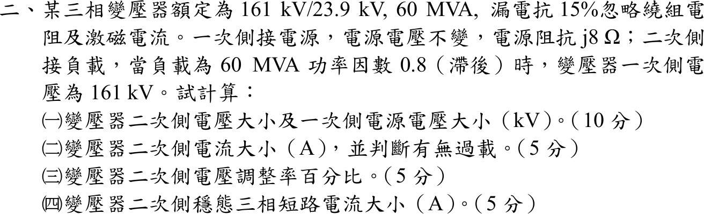

# 107 年電機工程技師｜電力系統逐題詳解

> 本頁由題級 canonical 筆記組合；每題保留官方裁切圖、校驗狀態與可追溯的推導。

## 題目導覽
- [[#一、107 年電力系統第 1 題｜輸電線並聯電容補償|第 1 題：輸電線並聯電容補償]]
- [[#二、107 年電力系統第 2 題｜變壓器電壓調整率與短路電流|第 2 題：變壓器電壓調整率與短路電流]]
- [[#三、107 年電力系統第 3 題｜同步發電機併網|第 3 題：同步發電機併網]]
- [[#四、107 年電力系統第 4 題｜三相四線／三線不平衡負載|第 4 題：三相四線／三線不平衡負載]]

---

## 一、107 年電力系統第 1 題｜輸電線並聯電容補償

> 題級識別：EE-107-05-1
> canonical 來源：[[canonical/EE-107-05-1.md]]
> 題級校驗狀態：verified


### 已知與所求

線路阻抗 \(0.02+j0.2\) pu；受電端負載 \(P=1.6\) pu、功因 0.8 落後，受電端電壓 \(|V_R|=1\) pu，電容器組補償虛功 \(Q_C=1.2\) pu（與負載並聯於受電端）。求（一）線路電流與有功損失；（二）送電端電壓；（三）電容器組阻抗；（四）送電端送出之 \(P\)、\(Q\)。

### 考場標準作答

觀念：電容器組與負載並聯在受電端，線路電流只看到兩者合成的淨複功率；先求受電端淨功率，再用複功率與相量關係逐項求電流、壓降、送電端功率。畫法：以受電端為節點，負載與電容器並聯接地，線路阻抗 \(0.02+j0.2\) 串在送電端與受電端之間；取 \(V_R=1\angle0^\circ\) 為參考相量。

#### 1. 受電端淨功率

負載虛功：
\[
Q_L=P\tan(\cos^{-1}0.8)=1.6\tan(36.87^\circ)=1.60\times0.75=1.20\ \mathrm{pu}
\]
電容器供應 \(1.2\) pu 虛功，淨複功率：
\[
S_R=1.6+j(Q_L-Q_C)=1.6+j(1.20-1.2)=1.60\ \mathrm{pu}
\]

#### （一）線路電流與損失

觀念：受電端電壓與淨複功率已知，由 \(S_R=V_RI^*\) 反推線路電流；有功損失只發生在線路電阻。
\[
I=\Big(\frac{S_R}{V_R}\Big)^*=\Big(\frac{1.60}{1\angle0^\circ}\Big)^*=1.60\angle0^\circ,\qquad \boxed{|I|=1.60\ \mathrm{pu}}
\]
\[
P_{loss}=I^2R
\]
\[
I^2=1.60^2=2.56,\qquad P_{loss}=2.56\times0.02
\]
\[
\boxed{P_{loss}=5.12\times10^{-2}\ \mathrm{pu}}
\]

#### （二）送電端電壓

觀念：送電端電壓等於受電端電壓加線路壓降，需用複數相加再取大小。
\[
V_S=V_R+IZ=1+1.60(0.02+j0.2)
\]
線路壓降：
\[
IZ=1.60\times0.02+j1.60\times0.2=3.20\times10^{-2}+j0.32
\]
\[
V_S=(1+3.20\times10^{-2})+j0.32=1.03+j0.32=1.08\angle17.23^\circ
\]
\[
|V_S|=\sqrt{1.03^2+0.32^2}\Rightarrow\boxed{|V_S|=1.08\ \mathrm{pu}}
\]

#### （三）電容器組阻抗

觀念：電容器吸收的複功率為 \(-jQ_C\)（對網路供應 \(Q_C\)），在 \(|V_R|=1\) 下由 \(S=|V|^2/Z^*\) 反求阻抗。
\[
Z_C=\frac{|V_R|^2}{(-jQ_C)^*}=\frac{1^2}{(-j1.2)^*}=\frac{1}{j1.2}
\]
\[
\boxed{Z_C=-j\frac56=-j0.83\ \mathrm{pu}}
\]

#### （四）送電端功率

觀念：送電端複功率 \(S_S=V_SI^*\)，實部為送出有功、虛部為送出無功。
\[
S_S=V_SI^*=(1.03+j0.32)(1.60)
\]
各部分：\(P_S=1.03\times1.60=1.65\)，\(Q_S=0.32\times1.60=0.51\)。
\[
\boxed{P_S=1.65\ \mathrm{pu}},\qquad \boxed{Q_S=0.51\ \mathrm{pu}\ (\text{送出，感性})}
\]

### 驗算

功率守恆：\(S_S=S_{load}+S_C+I^2Z=(1.60+j1.20)+(-j1.20)+(5.12\times10^{-2}+j0.51)\)，實部 \(1.65\)、虛部 \(0.51\)，與 \(V_SI^*\) 相同。線路無效功率消耗 \(I^2X=2.56(0.2)=0.51\) pu，即 \(Q_S\) 全部消耗在線路電抗上。

### 失分點

- 電容器與負載並聯在受電端，線路電流看到的是淨功率 \(1.6+j0\)，不是 \(1.6+j1.2\)；用負載視在功率 2.0 pu 算電流會得 \(I=2\)、損失 \(8.00\times10^{-2}\) pu。
- \(Z_C=-jV_R^2/Q_C\) 為容抗（負虛數）；寫成 \(+j0.83\) 即成電感。
- 送電端電壓用 \(V_R+IZ\) 的複數和再取模，不能只加 \(IR\)。

---

## 二、107 年電力系統第 2 題｜變壓器電壓調整率與短路電流

> 題級識別：EE-107-05-2
> canonical 來源：[[canonical/EE-107-05-2.md]]
> 題級校驗狀態：verified



### 已知與所求

三相變壓器 161 kV/23.9 kV、60 MVA，漏電抗 15%，忽略繞組電阻與激磁電流。一次側接電源（電壓不變，源阻抗 \(j8\ \Omega\)），二次側負載 60 MVA、功因 0.8 落後時，變壓器一次側電壓為 161 kV。求（一）二次側電壓及電源電壓（kV）；（二）二次側電流（A），並判斷有無過載；（三）二次側電壓調整率（%）；（四）二次側穩態三相短路電流（A）。

### 考場標準作答

觀念：變壓器（漏電抗 \(X_T\)）與電源阻抗串聯，負載為恆功率；各量換成標么值後，電壓、電流都是同一個單相等效電路的解。基準取 60 MVA、161/23.9 kV。畫法：單線圖由電源電壓 \(E_s\) 串源阻抗 \(Z_s\)，再串 \(X_T\)，接到二次側恆功率負載；以 \(V_2\) 為參考相量，\(I\) 落後 \(V_2\) 一個功因角。

\[
Z_{1b}=\frac{161^2}{60}=432.02\ \Omega,\qquad Z_s=\frac{8}{432.02}=j1.85\times10^{-2}\ \mathrm{pu},\qquad X_T=0.15\ \mathrm{pu}
\]
\[
I_{2b}=\frac{60\times10^6}{\sqrt3(23.9\times10^3)}=1449.41\ \mathrm A
\]
負載 \(S=0.80+j0.60\) pu（恆功率），\(V_1=1\) pu。

#### （一）二次側電壓與電源電壓

觀念：一次側（變壓器一次端）電壓 \(V_1=V_2+jX_TI\) 的模長固定為 1 pu，而 \(I=(P-jQ)/V_2\) 又隨 \(V_2\) 變，所以解 \(|V_1|=1\) 這條方程即得 \(V_2\)。

正解：雙匯流排功率潮流精確公式。取 \(V_2\) 為參考，\(I=(P-jQ)/V_2\)，\(V_1=V_2+jX_TI\) 取模平方：
\[
V_2^4-(V_1^2-2QX_T)V_2^2+(P^2+Q^2)X_T^2=0
\]
\[
V_2^4-\big(1-2(0.60)(0.15)\big)V_2^2+(1)(0.15)^2=0\Rightarrow V_2^4-0.82V_2^2+2.25\times10^{-2}=0
\]
\[
V_2^2=\frac{0.82+\sqrt{0.82^2-4(2.25\times10^{-2})}}{2}=\frac{0.82+\sqrt{0.58}}{2}=\frac{0.82+0.76}{2}=0.79,\qquad V_2=0.89\ \mathrm{pu}
\]
取高電壓根（另一根 \(V_2=1.69\times10^{-1}\) pu 不是正常運轉點）。二次側電壓（以完整精度換算）為 \(\boxed{V_2=V_{2,pu}\times23.9=21.26\ \mathrm{kV}}\)，即 $21.26\text{ kV}$。

電流與電源電壓：
\[
I=\frac{0.80-j0.60}{V_2}=0.90-j6.74\times10^{-1}\ \mathrm{pu}
\]
\[
V_1=V_2+jX_TI=0.99+j1.35\times10^{-1}\ \mathrm{pu}\quad(|V_1|=1)
\]
\[
E_s=V_1+jZ_sI=1.00+j1.52\times10^{-1},\qquad |E_s|=1.01\ \mathrm{pu}
\]
\[
\boxed{E_s=|E_s|\times161=163.37\ \mathrm{kV}}
\]

#### （二）二次側電流

觀念：恆功率負載的視在功率 \(S=\sqrt3V_2I_2\)，電壓降低則電流升高；與額定電流比較即可判斷過載。

\[
I_2=\frac{S}{\sqrt3V_2}=\frac{60\times10^6}{\sqrt3(21.26\times10^3)}=\boxed{1629.10\ \mathrm{A}}
\]
即 $1629.10\text{ A}$，與額定電流之比 \(1629.10/1449.41=1.12\)（112.40%），故**過載**（超載 12.40%）。

#### （三）電壓調整率

觀念：電源電壓不變，無載（\(I=0\)）時二次側電壓就是 \(E_s\)（標么值）；調整率 = (無載 − 滿載) ÷ 滿載。

\[
\mathrm{VR}=\frac{|E_s|-V_2}{V_2}\times100\%
\]
\[
|E_s|-V_2=1.25\times10^{-1}\ \mathrm{pu}\quad(\text{以完整精度相減})
\]
\[
\mathrm{VR}=\frac{1.25\times10^{-1}}{V_2}\times100\%=\boxed{14.05\%}
\]

#### （四）二次側三相短路電流

觀念：二次側短路時 \(V_2=0\)，負載不再流過電流，電源 \(E_s\) 只加在 \(Z_s+X_T\) 串聯阻抗上。

\[
Z_s+X_T=j1.69\times10^{-1}\ \mathrm{pu}
\]
\[
I_{sc}=\frac{|E_s|}{Z_s+X_T}I_{2b}=\frac{1.01}{1.69\times10^{-1}}I_{2b}=6.02\times1449.41
\]
\[
\boxed{I_{sc}=8727.63\ \mathrm{A}}
\]

### 驗算

電源端複功率 \(E_sI^*=0.80+j0.81\) pu；實功等於負載 0.80（無損），虛功等於 \(0.60+|I|^2(X_T+Z_s)=0.60+1.26(1.69\times10^{-1})=0.81\)，與電源電壓計算一致。\(V_2\) 亦可由 \(P=\dfrac{V_1V_2}{X_T}\sin\delta\) 檢驗：\(\sin\delta=0.8(0.15)/0.89=1.35\times10^{-1}\)，\(\cos\delta=0.99\)，\(Q=V_2(V_1\cos\delta-V_2)/X_T=0.60\)（以完整精度代入）。

### 失分點

- 負載是恆功率 60 MVA，\(V_2\) 下降電流隨之上升，不可令電流固定為額定 1 pu 做壓降（得 \(V_2=0.92\) pu，約 21.94 kV，偏高）。
- 電壓調整率的無載電壓是電源電壓經變比的 \(1.01\) pu（含 \(j8\ \Omega\) 源阻抗效應），不是 23.9 kV。
- 短路電流分母要把源阻抗 \(1.85\times10^{-2}\) 與 \(X_T=0.15\) 相加；漏掉 \(j8\ \Omega\) 會得 \(|E_s|/0.15=6.76\) 的偏大值。

---

## 三、107 年電力系統第 3 題｜同步發電機併網

> 題級識別：EE-107-05-3
> canonical 來源：[[canonical/EE-107-05-3.md]]
> 題級校驗狀態：verified


### 已知與所求

同步發電機 24 kV、850 MVA、\(X_s=100\%\)，經升壓變壓器（25 kV/345 kV、850 MVA、漏電抗 20%）併接 345 kV 無限匯流排；忽略繞組電阻與激磁電流，輸出 800 MW 時端電壓為額定值。求（一）以發電機額定為基準的電路模型；（二）發電機輸出無效功率，並判斷是否進相；（三）變壓器輸出至無限匯流排的無效功率，並判斷是否過載。

### 考場標準作答

#### （一）電路模型

基準：850 MVA、發電機側 24 kV，高壓側 \(24\times345/25=331.20\) kV。變壓器低壓側額定 25 kV，與基準電壓不同，需換算：
\[
X_T=0.20\Big(\frac{25}{24}\Big)^2=2.17\times10^{-1}\ \mathrm{pu},\qquad V_\infty=\frac{345}{331.20}=1.04\ \mathrm{pu},\qquad X_s=1.00\ \mathrm{pu}
\]
```
E ∠δg --- j1.00 --- Vt=1.00 --- j2.17×10^-1 --- V∞=1.04 ∠-δ （無限匯流排）
   (內部電勢)    (發電機端)   (變壓器)
```

#### （二）發電機輸出無效功率

\(P=800/850=0.94\) pu，端電壓 \(V_t=1\)。端點到無限匯流排只經過 \(X_T\)（\(X_s\) 僅用於回推內部電勢）：
\[
\sin\delta=\frac{PX_T}{V_tV_\infty}=\frac{0.94(2.17\times10^{-1})}{1.04}=1.96\times10^{-1},\quad \delta=11.31^\circ
\]
\[
V_tV_\infty\cos\delta=1.00(1.04)(0.98)=1.02\ \mathrm{pu},\qquad
Q_G=\frac{V_t^2-V_tV_\infty\cos\delta}{X_T}=\frac{-2.14\times10^{-2}}{2.17\times10^{-1}}=-9.88\times10^{-2}\ \mathrm{pu}
\]
（分子 \(1-1.02\) 以未捨入的 \(V_tV_\infty\cos\delta\) 計算，故為 \(-2.14\times10^{-2}\)；下同。）
\[
Q_G=-9.88\times10^{-2}(850)\Rightarrow\boxed{Q_G=-84.00\,\mathrm{Mvar}}
\]
\(Q_G<0\)：發電機自系統吸收無效功率，為**進相（leading）運轉**。

#### （三）變壓器輸出至無限匯流排的無效功率與負載

\[
Q_\infty=\frac{V_tV_\infty\cos\delta-V_\infty^2}{X_T}=\frac{-6.36\times10^{-2}}{2.17\times10^{-1}}=-2.93\times10^{-1}\ \mathrm{pu}
\]
\[
\boxed{Q_\infty=-2.93\times10^{-1}(850)=-249.20\ \mathrm{MVAR}}
\]
即變壓器高壓側不是送出而是自無限匯流排吸收 249.20 MVAR（其中 84.00 MVAR 供發電機端，165.20 MVAR 消耗在漏電抗）。變壓器兩側視在功率：
\[
S_{LV}=\sqrt{800^2+84.00^2}=804.40\ \mathrm{MVA},\qquad
S_{HV}=\sqrt{800^2+249.20^2}=\boxed{837.91\ \mathrm{MVA}}
\]
較大側 837.91 MVA \(<850\) MVA（負載率 98.58%），**未過載**。

### 驗算

以電流相量檢查：\(V_\infty\angle-\delta=1.02-j2.04\times10^{-1}\)，
\[
I=\frac{V_t-V_\infty\angle-\delta}{jX_T}=\frac{-2.14\times10^{-2}+j2.04\times10^{-1}}{j2.17\times10^{-1}}=0.94+j9.88\times10^{-2}\ \mathrm{pu}
\]
\(V_tI^*=0.94-j9.88\times10^{-2}\)，與 \(P\)、\(Q_G\) 相符；\(|I|=0.95\) pu，\(|I|^2X_T=1.94\times10^{-1}\) pu \(=165.20\) MVAR，恰為 \(Q_G-Q_\infty\)（\(-84.00+249.20\)）。

### 失分點

- 變壓器低壓側額定 25 kV、發電機 24 kV：未換算而取 \(X_T=0.20\)、\(V_\infty=1\)，會得 \(Q_G\approx+75.97\) MVAR（落後），方向與結論皆反。
- \(X_s=1.00\) 屬內部電勢到端點的電抗，端點至無限匯流排的功率流不可再串入。
- 變壓器漏電抗吸收無效功率，高壓側 \(Q\)（\(-249.20\)）與低壓側（\(-84.00\)）不同；判斷過載要看較大的 837.91 MVA，不能只用 804.40 MVA。

---

## 四、107 年電力系統第 4 題｜三相四線／三線不平衡負載

> 題級識別：EE-107-05-4
> canonical 來源：[[canonical/EE-107-05-4.md]]
> 題級校驗狀態：verified


### 已知與所求

Y 接負載 \(Z_a=10\ \Omega\)、\(Z_b=-j10\ \Omega\)、\(Z_c=j10\ \Omega\)，由 \(V_a=220\angle0^\circ\)、\(V_b=220\angle-120^\circ\)、\(V_c=220\angle120^\circ\) V 供電（電源 Y 接、中性點接地，導線阻抗不計）。（一）3Φ4W：求正序、負序、零序電流及中性線電流大小。（二）3Φ3W：求正序、負序電流、最大導線電流及中性點電壓大小。以下取 \(a=1\angle120^\circ\)。

### 考場標準作答

#### （一）三相四線（負載中性點接電源中性點）

觀念：四線制的中性線把負載中性點釘在電源中性點，每相負載承受完整的相電壓，因此各相電流互相獨立，可直接用 \(I=V/Z\)；再用對稱分量變換求序電流。畫法：三相負載各自接在 \(a,b,c\) 與共同中性線之間，電流參考方向由電源流向負載。

各相電流：
\[
I_a=\frac{220\angle0^\circ}{10}=22.00\angle0^\circ,\quad I_b=\frac{220\angle-120^\circ}{-j10}=22.00\angle-30^\circ,\quad I_c=\frac{220\angle120^\circ}{j10}=22.00\angle30^\circ\ \mathrm A
\]
正序：
\[
I_{a1}=\frac{I_a+aI_b+a^2I_c}{3}=\frac{22.00\angle0^\circ+22.00\angle90^\circ+22.00\angle-90^\circ}{3}=\frac{22.00(1+j-j)}{3}
\]
\[
\boxed{I_{a1}=7.33\ \mathrm A}
\]
負序：
\[
I_{a2}=\frac{I_a+a^2I_b+aI_c}{3}=\frac{22.00\angle0^\circ+22.00\angle210^\circ+22.00\angle150^\circ}{3}=\frac{22.00(1+2\cos150^\circ)}{3}
\]
\[
I_{a2}=\frac{22.00(-0.73)}{3}=-5.37\ \mathrm A,\qquad \boxed{|I_{a2}|=5.37\ \mathrm A}\ (\angle180^\circ)
\]
零序與中性線電流：
\[
I_{a0}=\frac{I_a+I_b+I_c}{3}=\frac{22.00(1+2\cos30^\circ)}{3}=\frac{22.00(2.73)}{3}
\]
\[
\boxed{I_{a0}=20.04\ \mathrm A}
\]
\[
\boxed{I_n=I_a+I_b+I_c=3I_{a0}=60.11\ \mathrm A}
\]

#### （二）三相三線（負載中性點浮接）

觀念：三線制沒有中性線，負載中性點電位 \(V_N\) 浮動，須先用彌爾曼定理（節點電壓法，只有一個未知節點）求 \(V_N\)，再求各線電流。畫法：三相負載 Y 接，共同點 \(N\) 不接電源中性點，以電源中性點為參考節點對 \(N\) 列 KCL。

導納 \(Y_a=0.10,\ Y_b=j0.10,\ Y_c=-j0.10\) S，\(\sum Y=0.10\) S。彌爾曼定理：
\[
V_N=\frac{V_aY_a+V_bY_b+V_cY_c}{\sum Y}=\frac{22.00\angle0^\circ+22.00\angle-30^\circ+22.00\angle30^\circ}{0.10}=\frac{22.00(1+2\cos30^\circ)}{0.10}
\]
\[
\boxed{V_N=601.05\ \mathrm V}
\]
線電流 \(I_k=(V_k-V_N)/Z_k\)：
\[
I_a'=\frac{220-601.05}{10}=-38.11\ \mathrm A
\]
\[
I_b'=\frac{220\angle-120^\circ-601.05}{-j10}=\frac{-711.05-j190.53}{-j10}=19.05-j71.11=73.61\angle-75^\circ\ \mathrm A
\]
\[
I_c'=\frac{220\angle120^\circ-601.05}{j10}=\frac{-711.05+j190.53}{j10}=19.05+j71.11=73.61\angle75^\circ\ \mathrm A
\]
\[
\boxed{I_{max}=73.61\ \mathrm A}\ (b、c\text{ 相})
\]
\(\sum I'=-38.11+19.05+19.05=0\)（\(j\) 項相消），故零序為 0。序電流：
\[
I_{a1}'=\frac{I_a'+aI_b'+a^2I_c'}{3}=\frac{-38.11+73.61(\angle45^\circ+\angle-45^\circ)}{3}=\frac{-38.11+2(73.61)\cos45^\circ}{3}
\]
\[
\boxed{I_{a1}'=22.00\ \mathrm A}
\]
\[
I_{a2}'=\frac{I_a'+a^2I_b'+aI_c'}{3}=\frac{-38.11+73.61(\angle165^\circ+\angle195^\circ)}{3}=\frac{-38.11+2(73.61)\cos165^\circ}{3}
\]
\[
\boxed{|I_{a2}'|=60.11\ \mathrm A}
\]

### 驗算

線間電壓 KVL（與 \(V_N\) 無關）：\(Z_aI_a'-Z_bI_b'=-381.05-(-j10)(19.05-j71.11)=330.00+j190.53=381.05\angle30^\circ\)，等於 \(V_a-V_b=220-220\angle-120^\circ=330.00+j190.53\) V。四線制 \(I_n=3I_{a0}\)，三線制 \(I_a'+I_b'+I_c'=0\)，兩者與各自的零序結果一致。

### 失分點

- 四線制中性線電流是 \(3I_{a0}=60.11\) A，不是 0；每相仍分到全額 220 V，所以三相電流都是 22.00 A。
- 三線制零序電流必為 0，但中性點偏移 601.05 V（約 2.73 倍相電壓），使 b、c 相承受 \(|V_{b,c}-V_N|\approx736.14\) V，電流升到 73.61 A。
- 序分量變換中負序是 \(I_a+a^2I_b+aI_c\)；與正序式互換會使 \(I_{a1}\)、\(I_{a2}\) 對調。

---
