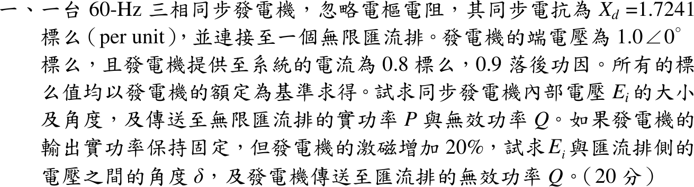
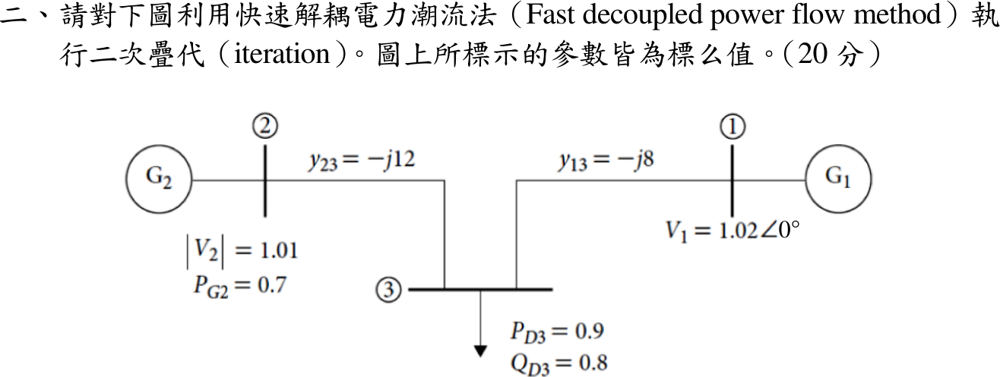
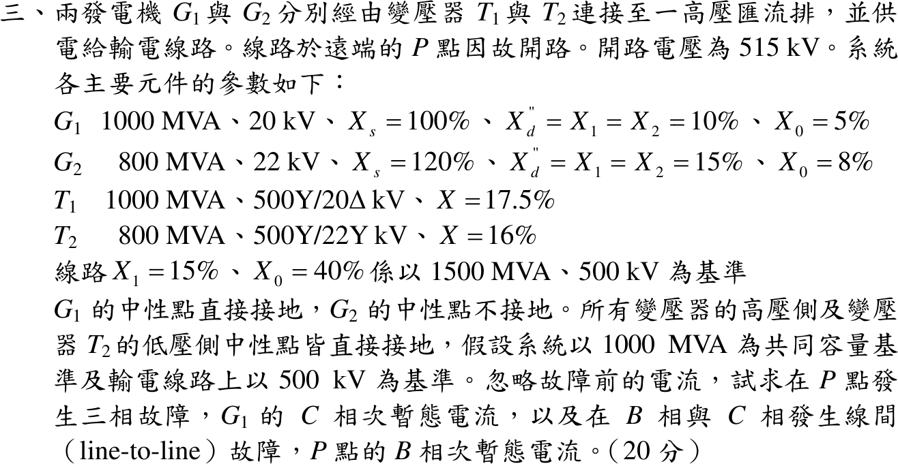
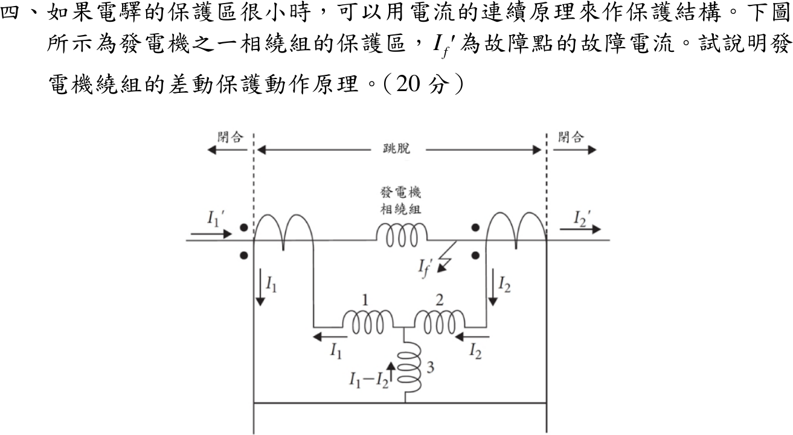
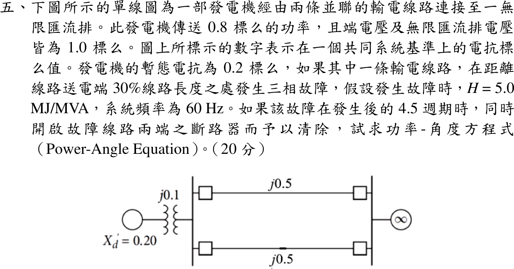

# 108 年電機工程技師｜電力系統逐題詳解

> 本頁由題級 canonical 筆記組合；每題保留 QID、官方裁切、校驗狀態與完整得分型解答。

## 題目導覽
- [[#一、108 年電力系統第 1 題｜同步發電機相量圖與激磁控制|第 1 題：同步發電機相量圖與激磁控制]]
- [[#二、108 年電力系統第 2 題｜快速解耦電力潮流法二次疊代|第 2 題：快速解耦電力潮流法二次疊代]]
- [[#三、108 年電力系統第 3 題｜多機系統三相與線間短路|第 3 題：多機系統三相與線間短路]]
- [[#四、108 年電力系統第 4 題｜發電機繞組差動電驛保護|第 4 題：發電機繞組差動電驛保護]]
- [[#五、108 年電力系統第 5 題｜雙迴線三相故障之功率角方程式|第 5 題：雙迴線三相故障之功率角方程式]]

---

## 一、108 年電力系統第 1 題｜同步發電機相量圖與激磁控制

> 題級識別：`EE-108-05-1`
> canonical 來源：`canonical/EE-108-05-1.md`
> 題級校驗狀態：`verified`

![[01_原始試題/依考科/05_電力系統/images/questions/PE_108年_電力系統_Q01.png]]

> 官方裁切來源：`01_原始試題/依考科/05_電力系統/images/questions/PE_108年_電力系統_Q01.png`

### 已知與所求

圓柱形轉子、忽略電樞電阻，\(X_d=1.7241\) pu，端電壓 \(V=1.0\angle0^\circ\) pu，電流 \(0.8\) pu、功因 0.9 落後（標么值均以機組額定為基準）。
（一）求內部電壓 \(E_i\) 的大小與角度，及送至匯流排的 \(P\)、\(Q\)。
（二）\(P\) 不變、激磁增加 20%（磁路線性，\(E_i\) 增 20%），求 \(E_i\) 與匯流排電壓的夾角 \(\delta\) 及 \(Q\)。

### 考場標準作答

**解題邏輯**：圓柱形轉子、忽略電樞電阻，發電機每相是內部電壓 \(E_i\) 串同步電抗 \(jX_d\)，接到端電壓 \(V=1\angle0^\circ\)（無限匯流排，大小與相角固定）。（一）由端電壓與電流相量，用 \(E_i=V+jX_dI\) 求內部電壓，再以 \(S=VI^*\) 求 \(P\)、\(Q\)。（二）題幹「輸出實功率保持固定」→ \(P\) 不變；磁路線性 → \(E_i\) 隨激磁增 20%；由功率角公式反解新 \(\delta'\)，再代無效功率公式求 \(Q'\)。

#### 步驟 1：每相等效電路與參考方向

- 等效電路：\(E_i\angle\delta\) —— \(jX_d=j1.7241\) —— 端點 \(V=1\angle0^\circ\)（無限匯流排）。
- 電流 \(I\) 由 \(E_i\) 經 \(jX_d\) 流向匯流排（發電機送出方向），\(S=VI^*\) 為送至匯流排的複功率。
- 落後功因：\(I\) 落後 \(V\) 一個功因角 \(\phi\)。

#### （一）內部電壓與 \(P\)、\(Q\)

**邏輯**：發電機端 KVL 為 \(E_i=V+jX_dI\)，把電流相量化成直角式後與 \(V\) 相加，再換回極式即得大小與角度；送出複功率 \(S=VI^*\)。

功因角：
\[
\phi=\cos^{-1}0.9=25.84^\circ,\qquad \sin\phi=\sqrt{1-0.9^2}=\sqrt{0.19}=0.43589
\]
電流相量（極式轉直角式）：
\[
I=0.8\angle-25.84^\circ=0.8\times0.9-j0.8\times0.43589=0.72-j0.34871\ \mathrm{pu}
\]
同步電抗壓降（\(j\times(-j)=+1\)）：
\[
jX_dI=j1.7241(0.72-j0.34871)=1.7241\times0.34871+j1.7241\times0.72=0.60121+j1.24135\ \mathrm{pu}
\]
內部電壓（直角式相加）：
\[
E_i=V+jX_dI=(1+0.60121)+j1.24135=1.60121+j1.24135\ \mathrm{pu}
\]
大小：
\[
|E_i|=\sqrt{1.60121^2+1.24135^2}=\sqrt{2.56387+1.54095}=\sqrt{4.10482}=2.0260
\]
\[
\boxed{|E_i|=2.03\ \mathrm{pu}}
\]
角度：
\[
\delta=\tan^{-1}\frac{1.24135}{1.60121}=\tan^{-1}0.77526
\]
\[
\boxed{\delta=37.78^\circ}
\]

送至匯流排的複功率：
\[
S=VI^*=(1\angle0^\circ)(0.72+j0.34871)=0.72+j0.34871
\]
\[
\boxed{P=0.72\ \mathrm{pu}},\quad \boxed{Q=0.35\ \mathrm{pu}}\ (\text{發電機送出，落後})
\]

#### （二）激磁增加 20%

**邏輯**：\(P=\dfrac{|E_i|V}{X_d}\sin\delta\) 中 \(P\)、\(V\)、\(X_d\) 都不變，所以 \(|E_i|\sin\delta\) 固定（相量圖上 \(E_i\) 尖端沿水平線移動）；\(|E_i|\) 增為 1.2 倍後反解 \(\sin\delta'\)，再用 \(Q=\dfrac{|E_i|V\cos\delta-V^2}{X_d}\)。

新內部電壓：
\[
|E_i'|=1.20|E_i|=1.20\times2.0260=2.4312\ \mathrm{pu}
\]
功率角方程反解：
\[
\sin\delta'=\frac{PX_d}{|E_i'|V}=\frac{0.72\times1.7241}{2.4312\times1}=\frac{1.24135}{2.4312}=0.51059
\]
\[
\delta'=\sin^{-1}0.51059=30.70^\circ
\]
\[
\boxed{\delta'=30.70^\circ}
\]
\[
\cos\delta'=\sqrt{1-\sin^2\delta'}=\sqrt{1-0.51059^2}=\sqrt{1-0.26070}=\sqrt{0.73930}=0.8598
\]
無效功率：
\[
Q'=\frac{|E_i'|V\cos\delta'-V^2}{X_d}=\frac{2.4312\times1\times0.8598-1^2}{1.7241}
\]
\[
Q'=\frac{2.0903-1}{1.7241}=\frac{1.0903}{1.7241}=0.6324
\]
\[
\boxed{Q'=0.63\ \mathrm{pu}}
\]

### 驗算

改用電流相量：\(E_i'\angle\delta'=2.4312(0.8598+j0.5106)=2.0903+j1.2414\)，
\[
I'=\frac{E_i'\angle\delta'-V}{jX_d}=\frac{1.0903+j1.2414}{j1.7241}=\frac{1.2414}{1.7241}-j\frac{1.0903}{1.7241}=0.7200-j0.6324\ \mathrm{pu}
\]
\(S'=VI'^*=0.7200+j0.6324\)，實功與原值相同，\(Q'\) 與上式一致；\(|I'|=0.9583\) pu，功因 \(0.72/0.9583=0.75\) 落後。

### 失分點

- 落後功因的電流角為 \(-25.84^\circ\)；寫成 \(+25.84^\circ\) 會使 \(E_i\) 的角度與大小皆錯。
- 激磁增 20% 是 \(E_i\) 乘 1.2，不是 \(X_d\) 或 \(\delta\) 增加；固定的是 \(P\)（即 \(E_i\sin\delta\) 乘積），不是 \(\delta\)。
- 取 \(\sin\delta'=0.51059\) 的銳角解 \(30.70^\circ\)，鈍角解 \(149.30^\circ\) 屬不穩定區。

---

## 二、108 年電力系統第 2 題｜快速解耦電力潮流法二次疊代

> 題級識別：`EE-108-05-2`
> canonical 來源：`canonical/EE-108-05-2.md`
> 題級校驗狀態：`verified`

![[01_原始試題/依考科/05_電力系統/images/questions/PE_108年_電力系統_Q02.png]]

> 官方裁切來源：`01_原始試題/依考科/05_電力系統/images/questions/PE_108年_電力系統_Q02.png`

### 已知與所求

三匯流排（標么值）：Bus 1 slack，\(V_1=1.02\angle0^\circ\)；Bus 2 發電機（PV），\(|V_2|=1.01\)、\(P_{G2}=0.7\)；Bus 3 負載（PQ），\(P_{D3}=0.9\)、\(Q_{D3}=0.8\)。線路 \(y_{13}=-j8\)、\(y_{23}=-j12\)。以快速解耦法做兩次疊代，起始值取平坦啟動 \(\theta_2=\theta_3=0\)、\(|V_3|=1\)。求 \(\theta_2,\theta_3,|V_3|\)。

### 考場標準作答

**解題邏輯**：快速解耦法把牛頓法的 Jacobian 換成固定的電納矩陣：先由 \(Y_{\mathrm{bus}}\) 取出 \(B'\)（PV、PQ 匯流排的角度方程）與 \(B''\)（PQ 匯流排的電壓方程）。每次疊代分兩個半步：① 以目前電壓算 \(P_2,P_3\)，解 \(B'\Delta\boldsymbol\theta=\Delta\mathbf P/|V|\) 更新角度；② 以「新角度」算 \(Q_3\)，解 \(B''\Delta|V_3|=\Delta Q_3/|V_3|\) 更新電壓，重複兩次。前提：線路無電阻、無並聯元件，故 \(B'\)、\(B''\) 直接取 \(-\mathrm{Im}(Y_{\mathrm{bus}})\) 的子矩陣；平坦啟動 \(\theta_2=\theta_3=0\)、\(|V_3|=1\)；角度以 rad 計算。因兩次疊代的差額很小（相減會抵消有效位數），本題中間值多保留到小數 6 位。

#### 步驟 1：指定注入、\(Y_{\mathrm{bus}}\)、\(B'\) 與 \(B''\)

- Bus 1：slack，\(V_1=1.02\angle0^\circ\)，不列方程。
- Bus 2：PV，\(|V_2|=1.01\) 固定，未知 \(\theta_2\)；\(P_2^{sp}=P_{G2}=0.7\)。
- Bus 3：PQ，未知 \(\theta_3\)、\(|V_3|\)；負載為負注入：\(P_3^{sp}=-0.9\)、\(Q_3^{sp}=-0.8\)。

線路導納 \(y_{13}=-j8\)、\(y_{23}=-j12\)，\(y_{12}=0\)：
\[
Y_{\mathrm{bus}}=\begin{bmatrix}-j8&0&j8\\0&-j12&j12\\j8&j12&-j20\end{bmatrix}
\]
刪去 slack（Bus 1）的列與行、取 \(-\mathrm{Im}\)：
\[
B'=\begin{bmatrix}12&-12\\-12&20\end{bmatrix},\qquad B''=[\,20\,]\ (\text{只留 PQ 的 Bus 3})
\]
無電阻時 \(G_{ik}=0\)，注入功率只剩電納項（\(\theta_{ik}=\theta_i-\theta_k\)）：
\[
P_2=12|V_2||V_3|\sin\theta_{23}
\]
\[
P_3=8|V_1||V_3|\sin\theta_{31}+12|V_2||V_3|\sin\theta_{32}
\]
\[
Q_3=20|V_3|^2-8|V_1||V_3|\cos\theta_{31}-12|V_2||V_3|\cos\theta_{32}
\]
\(B'\Delta\boldsymbol\theta=\mathbf r\) 的解法（\(\mathbf r=[r_2,r_3]^T=\Delta\mathbf P/|V|\)）：第 1 列 \(12(\Delta\theta_2-\Delta\theta_3)=r_2\)；兩列相加 \(8\Delta\theta_3=r_2+r_3\)。所以
\[
\Delta\theta_3=\frac{r_2+r_3}{8},\qquad \Delta\theta_2=\Delta\theta_3+\frac{r_2}{12}
\]

#### 步驟 2：第 1 次疊代

**邏輯**：平坦啟動時所有角度差為 0，\(P_2=P_3=0\)，差額就是指定值；角度更新後再算 \(Q_3\)。

P-θ 半步：
\[
P_2^{(0)}=12(1.01)(1)\sin0=0,\qquad P_3^{(0)}=0
\]
\[
r_2=\frac{P_2^{sp}-P_2^{(0)}}{|V_2|}=\frac{0.7-0}{1.01}=0.693069
\]
\[
r_3=\frac{P_3^{sp}-P_3^{(0)}}{|V_3|}=\frac{-0.9-0}{1}=-0.9
\]
\[
\Delta\theta_3=\frac{0.693069+(-0.9)}{8}=\frac{-0.206931}{8}=-0.025866\ \mathrm{rad}
\]
\[
\frac{r_2}{12}=\frac{0.693069}{12}=0.057756,\qquad \Delta\theta_2=-0.025866+0.057756=0.031890\ \mathrm{rad}
\]
\[
\theta_2^{(1)}=0.031890\ \mathrm{rad}\ (1.827^\circ),\qquad \theta_3^{(1)}=-0.025866\ \mathrm{rad}\ (-1.482^\circ)
\]
Q-V 半步（用新角度，\(|V_3|=1\)）：
\[
\theta_{31}=-0.025866,\quad\cos\theta_{31}=0.999665;\qquad \theta_{32}=-0.025866-0.031890=-0.057756,\quad\cos\theta_{32}=0.998333
\]
\[
Q_3^{(1)}=20(1)^2-8(1.02)(1)(0.999665)-12(1.01)(1)(0.998333)
\]
\[
Q_3^{(1)}=20-8.157266-12.099796=-0.257062
\]
\[
\frac{\Delta Q_3}{|V_3|}=\frac{-0.8-(-0.257062)}{1}=-0.542938
\]
\[
\Delta|V_3|=\frac{-0.542938}{20}=-0.027147,\qquad |V_3|^{(1)}=1-0.027147=0.972853
\]

#### 步驟 3：第 2 次疊代

**邏輯**：用第 1 次的 \(\theta_2^{(1)}\)、\(\theta_3^{(1)}\)、\(|V_3|^{(1)}\) 重算功率差額；\(r_3\) 要除以已更新的 \(|V_3|^{(1)}\)；\(B'\)、\(B''\) 不變（快速解耦法的特點）。

P-θ 半步：
\[
\sin\theta_{23}=\sin0.057756=0.057724,\qquad \sin\theta_{31}=\sin(-0.025866)=-0.025863
\]
\[
12|V_2||V_3|=12(1.01)(0.972853)=11.790978,\qquad 8|V_1||V_3|=8(1.02)(0.972853)=7.938480
\]
\[
P_2^{(1)}=11.790978\times0.057724=0.680622
\]
\[
P_3^{(1)}=7.938480(-0.025863)+11.790978(-0.057724)=-0.205313-0.680622=-0.885935
\]
\[
r_2=\frac{0.7-0.680622}{1.01}=\frac{0.019378}{1.01}=0.019186
\]
\[
r_3=\frac{-0.9-(-0.885935)}{0.972853}=\frac{-0.014065}{0.972853}=-0.014457
\]
\[
\Delta\theta_3=\frac{0.019186+(-0.014457)}{8}=\frac{0.004729}{8}=0.0005911\ \mathrm{rad}
\]
\[
\frac{r_2}{12}=\frac{0.019186}{12}=0.0015988,\qquad \Delta\theta_2=0.0005911+0.0015988=0.0021899\ \mathrm{rad}
\]
\[
\theta_2^{(2)}=0.031890+0.0021899=0.034080\ \mathrm{rad},\qquad \theta_3^{(2)}=-0.025866+0.0005911=-0.025275\ \mathrm{rad}
\]
Q-V 半步（用 \(\theta^{(2)}\)、\(|V_3|^{(1)}=0.972853\)）：
\[
\theta_{31}=-0.025275,\quad\cos\theta_{31}=0.999681;\qquad \theta_{32}=-0.025275-0.034080=-0.059355,\quad\cos\theta_{32}=0.998239
\]
\[
20|V_3|^2=20(0.972853)^2=20\times0.94644296=18.928859
\]
\[
Q_3^{(2)}=18.928859-7.938480(0.999681)-11.790978(0.998239)
\]
\[
Q_3^{(2)}=18.928859-7.935948-11.770214=-0.777303
\]
\[
\frac{\Delta Q_3}{|V_3|}=\frac{-0.8-(-0.777303)}{0.972853}=\frac{-0.022697}{0.972853}=-0.023330
\]
\[
\Delta|V_3|=\frac{-0.023330}{20}=-0.0011665,\qquad |V_3|^{(2)}=0.972853-0.0011665=0.97169
\]

#### 二次疊代結果（20 分）

**邏輯**：角度由 rad 換成度：\(\theta^\circ=\theta\times\dfrac{180^\circ}{\pi}\)；\(|V_2|\) 為 PV 匯流排的設定值，不更新。

\[
\theta_2=0.034080\times\frac{180^\circ}{\pi}=1.9526^\circ,\qquad \theta_3=-0.025275\times\frac{180^\circ}{\pi}=-1.4482^\circ
\]
\[
\boxed{V_2=1.01\angle1.95^\circ\ \mathrm{pu}},\qquad
\boxed{V_3=0.97\angle-1.45^\circ\ \mathrm{pu}}
\]
（\(|V_3|=0.97169\) pu。）

### 驗算

把兩次疊代結果代回完整潮流式：\(P_2=0.698603\)、\(P_3=-0.898984\)、\(Q_3=-0.799041\) pu，與指定值 \((0.7,-0.9,-0.8)\) 的殘差分別為 \(-0.0014\)、\(0.0010\)、\(0.0010\) pu。以牛頓法解到收斂得 \(\theta_2=1.9623^\circ\)、\(\theta_3=-1.4455^\circ\)、\(|V_3|=0.97163\)，兩次 FDLF 的 \(|V_3|\) 相差 \(0.00006\) pu、角度相差不超過 \(0.01^\circ\)。收斂解下 slack 輸出 \(P_1=0.9-0.7=0.2\) pu，與無損系統功率守恆一致。

### 失分點

- 負載是負注入：\(P_3^{sp}=-0.9\)、\(Q_3^{sp}=-0.8\)；寫成正值會使 \(\Delta P_3,\Delta Q_3\) 全部反號。
- \(B'\) 只含 Bus 2、3（刪除 slack），\(B''\) 只含 PQ 的 Bus 3（\(=20\)）；Bus 2 的 \(|V_2|=1.01\) 保持固定。
- 右端要除以目前的 \(|V|\)（第 1 次 \(0.7/1.01\)）；第 2 次的 \(\Delta P_3\)、\(\Delta Q_3\) 要除以已更新的 \(|V_3|^{(1)}=0.972853\)，且 \(Q_3\) 要用本次更新後的角度計算。

---

## 三、108 年電力系統第 3 題｜多機系統三相與線間短路

> 題級識別：`EE-108-05-3`
> canonical 來源：`canonical/EE-108-05-3.md`
> 題級校驗狀態：`verified`

![[01_原始試題/依考科/05_電力系統/images/questions/PE_108年_電力系統_Q03.png]]

> 官方裁切來源：`01_原始試題/依考科/05_電力系統/images/questions/PE_108年_電力系統_Q03.png`

### 已知與所求

\(G_1\)：1000 MVA、20 kV，\(X_d''=X_1=X_2=10\%\)；\(G_2\)：800 MVA、22 kV，\(X_d''=X_1=X_2=15\%\)。\(T_1\)：1000 MVA、500Y/20Δ kV、17.5%；\(T_2\)：800 MVA、500Y/22Y kV、16%。線路 \(X_1=15\%\)（1500 MVA、500 kV 基準）。\(P\) 點開路電壓 515 kV，忽略故障前電流，共同基準 1000 MVA、輸電線 500 kV。求 \(P\) 點三相故障時 \(G_1\) 的 \(C\) 相次暫態電流，以及 \(B\)、\(C\) 相間故障時 \(P\) 點 \(B\) 相次暫態電流。

### 考場標準作答

**解題邏輯**：兩問都是求「次暫態」電流，所以發電機用 \(X_d''=X_1=X_2\)（\(X_s\) 為穩態電抗，不用）。主線：全部阻抗換到 1000 MVA 共同基準 → 化簡出 \(P\) 點的正序戴維寧電抗 \(X_1\)（負序 \(X_2\) 相同）→（一）三相故障只用正序網路求 \(I_f\)，再依電抗反比分流得 \(G_1\) 支路電流，乘 20 kV 側基準電流；（二）\(B\)-\(C\) 線間故障把正、負序網路在 \(P\) 點並聯，求 \(I_{A1}\) 後合成 \(B\) 相電流，乘 500 kV 側基準電流。前提：忽略故障前電流，兩機次暫態電勢都等於 \(P\) 點開路電壓 \(E''_1=E''_2=V_f=515/500=1.03\) pu；兩問都不經大地，零序資料（\(X_0\)、中性點接地方式）用不到。

#### 步驟 1：換算到 1000 MVA 共同基準

換算公式 \(X_{\mathrm{new}}=X_{\mathrm{old}}\dfrac{S_{\mathrm{new}}}{S_{\mathrm{old}}}\)（各元件額定電壓與該側基準電壓相同：\(T_1\) 低壓側基準 20 kV＝\(G_1\) 額定，\(T_2\) 低壓側基準 22 kV＝\(G_2\) 額定，故不需電壓修正）：
\[
X_{G1}=0.10\times\frac{1000}{1000}=0.10,\qquad X_{T1}=0.175\times\frac{1000}{1000}=0.175
\]
\[
X_{G2}=0.15\times\frac{1000}{800}=0.1875,\qquad X_{T2}=0.16\times\frac{1000}{800}=0.20
\]
\[
X_L=0.15\times\frac{1000}{1500}=0.10
\]
故障前電壓：
\[
V_f=\frac{515}{500}=1.03\ \mathrm{pu}
\]

#### 步驟 2：\(P\) 點正序（負序）戴維寧電抗

- 兩電勢相等且同相，求戴維寧電抗時都短路：兩機支路在 \(H\) 與參考點之間並聯，再串線路 \(X_L\)。
- 負序網路結構相同（\(X_2=X_1\) 的發電機、靜止元件 \(X_2=X_1\)），只是沒有電源，故 \(X_2=X_1\)。

\[
X_a=X_{G1}+X_{T1}=0.10+0.175=0.275
\]
\[
X_b=X_{G2}+X_{T2}=0.1875+0.20=0.3875
\]
\[
X_a\parallel X_b=\frac{0.275\times0.3875}{0.275+0.3875}=\frac{0.1065625}{0.6625}=0.160849
\]
\[
X_1=X_L+X_a\parallel X_b=0.10+0.160849=0.260849\ \mathrm{pu},\qquad X_2=X_1=0.260849\ \mathrm{pu}
\]

#### （一）\(P\) 點三相故障時 \(G_1\) 的 \(C\) 相次暫態電流

**邏輯**：三相平衡故障只有正序網路；\(P\) 點故障電流 \(I_f=V_f/X_1\)，流經 \(X_L\) 後在 \(H\) 點依兩支路電抗反比分給 \(G_1\)、\(G_2\)。三相對稱，\(C\) 相大小等於 \(A\) 相大小；\(T_1\) 為 Y-Δ，只使 \(G_1\) 側電流相角移 \(30^\circ\)，標么大小不變。

故障電流：
\[
I_f=\frac{V_f}{X_1}=\frac{1.03}{0.260849}=3.9486\ \mathrm{pu}
\]
分流（反比於支路電抗）：
\[
I_{G1}=I_f\frac{X_b}{X_a+X_b}=3.9486\times\frac{0.3875}{0.6625}=3.9486\times0.584906=2.3096\ \mathrm{pu}
\]
\(G_1\) 側（20 kV）基準電流：
\[
I_{\mathrm{base},20}=\frac{S_b}{\sqrt3\,V_b}=\frac{1000\ \mathrm{MVA}}{\sqrt3\times20\ \mathrm{kV}}=28.8675\ \mathrm{kA}
\]
\[
|I_{G1,C}|=2.3096\times28.8675=66.672\ \mathrm{kA}
\]
\[
\boxed{|I_{G1,C}|=2.31\ \mathrm{pu}=66.67\ \mathrm{kA}}
\]

#### （二）\(B\)-\(C\) 線間故障時 \(P\) 點 \(B\) 相次暫態電流

**邏輯**：以未故障的 \(A\) 相為基準相，線間故障邊界條件 \(I_A=0\)、\(I_B=-I_C\)、\(V_B=V_C\) ⇒ \(I_{A0}=0\)、\(I_{A2}=-I_{A1}\)，正、負序網路在 \(P\) 點並聯；再以 \(I_B=I_{A0}+a^2I_{A1}+aI_{A2}\) 合成相電流。

\[
I_{A1}=\frac{V_f}{j(X_1+X_2)}=\frac{1.03}{j(0.260849+0.260849)}=\frac{1.03}{j0.521698}=-j1.9743\ \mathrm{pu}
\]
\[
I_B=a^2I_{A1}+aI_{A2}=(a^2-a)I_{A1}
\]
\(a^2-a=(-0.5-j0.8660)-(-0.5+j0.8660)=-j\sqrt3\)：
\[
I_B=-j\sqrt3\,I_{A1}=-j\sqrt3\,(-j1.9743)=-\sqrt3\times1.9743=-3.4196\ \mathrm{pu}
\]
\(P\) 點（500 kV）基準電流：
\[
I_{\mathrm{base},500}=\frac{1000\ \mathrm{MVA}}{\sqrt3\times500\ \mathrm{kV}}=1.1547\ \mathrm{kA}
\]
\[
|I_{P,B}|=3.4196\times1.1547=3.9486\ \mathrm{kA}
\]
\[
\boxed{|I_{P,B}|=3.42\ \mathrm{pu}=3.95\ \mathrm{kA}}
\]

### 驗算

節點法驗（一）：三相故障時 \(P\) 點電壓為 0，\(H\) 點電壓
\[
V_H=X_LI_f=0.10\times3.9486=0.39486\ \mathrm{pu}
\]
\[
I_{G1}=\frac{1.03-0.39486}{0.275}=2.3096,\qquad I_{G2}=\frac{1.03-0.39486}{0.3875}=1.6391\ \mathrm{pu}
\]
\(2.3096+1.6391=3.9487\approx I_f=3.9486\)（捨入），\(G_1\) 值一致。驗（二）：\(X_1=X_2\) 時線間故障電流恆為三相故障的 \(\sqrt3/2\)：\(\tfrac{\sqrt3}{2}\times3.9486=3.4196\) pu，相同。

### 失分點

- \(G_2\)、\(T_2\) 為 800 MVA、線路為 1500 MVA 基準，百分比必須先乘 \(1000/800\)、\(1000/1500\) 再相加；直接相加會錯。
- 三相與線間故障都不含零序，\(X_0\)、中性點接地方式本題用不到；\(X_s\) 為穩態電抗，求次暫態電流也不用。
- 20 kV 側與 500 kV 側基準電流不同：\(G_1\) 電流乘 28.8675 kA，\(P\) 點電流乘 1.1547 kA。

---

## 四、108 年電力系統第 4 題｜發電機繞組差動電驛保護

> 題級識別：`EE-108-05-4`
> canonical 來源：`canonical/EE-108-05-4.md`
> 題級校驗狀態：`verified`

![[01_原始試題/依考科/05_電力系統/images/questions/PE_108年_電力系統_Q04.png]]

> 官方裁切來源：`01_原始試題/依考科/05_電力系統/images/questions/PE_108年_電力系統_Q04.png`

### 已知與所求

保護區很小時可用電流連續原理（KCL）構成保護。圖中發電機一相繞組兩端各接一具 CT；\(I_1',I_2'\) 為繞組兩端的一次電流，\(I_1,I_2\) 為 CT 二次電流，線圈 1、2 為抑制線圈，線圈 3 為動作線圈，流過 \(I_1-I_2\)；\(I_f'\) 為保護區內的故障電流。虛線之間為「跳脫」區，兩側為「閉合」（不動作）區。說明發電機繞組差動保護的動作原理。

### 考場標準作答

**解題邏輯**：差動保護就是對「保護區」寫 KCL：區內沒有故障時，流入的電流等於流出的電流；區內有故障時，兩者之差就是故障電流。兩具同變比 CT 把一次電流 \(I_1',I_2'\) 降成二次電流 \(I_1,I_2\)，接成環流式，使抑制線圈 1、2 分別流 \(I_1,I_2\)，動作線圈 3 流 \(I_1-I_2\)。依序說明：接線與參考方向 → 正常／區外故障時 \(I_1-I_2=0\)（不動作）→ 區內故障時 \(I_1-I_2\propto I_f'\)（跳脫）→ 為容許 CT 誤差而採用的百分比差動判據。前提：兩 CT 變比相同（記為 \(n\)）、極性如題圖（同名端在左），電流參考方向依題圖。

#### 步驟 1：保護區、接線與參考方向

- 兩具 CT 的位置劃定保護區（兩虛線之間）：一次側 \(I_1'\) 由左流入、\(I_2'\) 由右流出，\(I_f'\) 為區內故障點流出的電流。
- CT 二次電流（變比 \(n\)）：\(I_1=I_1'/n\)、\(I_2=I_2'/n\)。
- 兩具 CT 的一次、二次極性點都在左側（圖中一次導線左上與二次線圈左下的黑點）；二次繞組與一次導體之間只有磁耦合，沒有電氣連接。
- CT1 二次電流 \(I_1\) 由外側引線向下流入底部導線，經動作線圈 3 向上到中點，再自中點向左通過抑制線圈 1 回到 CT1 內側引線；CT2 二次電流 \(I_2\) 由內側引線向下流出，自右向左通過抑制線圈 2 到中點，經動作線圈 3 向下到底部導線，回到 CT2 外側引線。兩迴路在線圈 3 疊加，淨值向上為 \(I_1-I_2\)。
- 中點 KCL：流入中點的 \(I_2\)（線圈 2）加上線圈 3 向上的電流，等於流出的 \(I_1\)（線圈 1），所以
\[
I_{3}=I_1-I_2
\]

#### 正常運轉與區外故障：不動作

**邏輯**：保護區內沒有分流路徑，KCL 使兩端一次電流相等，經同變比 CT 後二次電流也相等，動作線圈電流為零。

保護區 KCL（無故障支路）：
\[
I_1'=I_2'
\]
除以 CT 變比：
\[
I_1=\frac{I_1'}{n}=\frac{I_2'}{n}=I_2
\]
動作線圈電流：
\[
I_{3}=I_1-I_2=0
\]
- 正常負載與區外故障的大穿越電流都屬此情況：電流只是「穿越」保護區，二次電流在抑制線圈 1、2 中同向環流，產生抑制力矩，動作線圈無電流。
- 結果：電驛不動作，斷路器維持閉合（題圖兩側「閉合」區）。

#### 區內故障：跳脫

**邏輯**：故障點在兩 CT 之間，保護區多了一條流出路徑 \(I_f'\)，KCL 使兩端一次電流不再相等，差值正好是故障電流。

保護區 KCL（含故障支路）：
\[
I_1'=I_2'+I_f'
\]
動作線圈電流：
\[
I_{3}=I_1-I_2=\frac{I_1'-I_2'}{n}=\frac{I_f'}{n}\neq0
\]
- 單側饋入（只有發電機側供電）：\(I_2'=0\)，\(I_3=I_1=I_f'/n\)。
- 雙側饋入（系統也向故障點供電）：\(I_2'\) 實際方向與參考方向相反（\(I_2'<0\)），\(|I_1-I_2|=|I_1|+|I_2|\)，動作量更大。
- 差流流過動作線圈 3 產生動作力矩，大於抑制力矩時電驛動作，跳脫發電機出口斷路器、磁場斷路器（滅磁）並停原動機（題圖中間「跳脫」區）；必須滅磁，因為出口斷路器開啟後，發電機內部 EMF 仍會向區內故障點供電。

#### 百分比差動判據

**邏輯**：實際 CT 有比差與飽和，區外大故障電流時 \(I_1-I_2\) 不會恰為 0；抑制線圈依穿越電流大小提高動作門檻，所以判據寫成「動作量大於抑制量的某一比例」。

動作量與抑制量：
\[
I_{op}=|I_1-I_2|,\qquad I_{rt}=\frac{|I_1|+|I_2|}{2}
\]
動作條件（\(K\) 為百分比斜率設定，另設最小動作電流）：
\[
\boxed{|I_1-I_2|>K\,\frac{|I_1|+|I_2|}{2}}
\]

- 穿越電流愈大，抑制量 \(I_{rt}\) 愈大，CT 誤差造成的小差流落在斜線下方，不動作。
- 區內故障時差流約等於故障電流折算值，落在斜線上方，跳脫。
- 題目未給 CT 變比、斜率與整定值，判據只寫符號式。

### 驗算

用假設數值（非題目所給）檢查判據，取 \(K=0.20\)：

| 狀況 | \(I_1\) | \(I_2\) | 動作量 | 抑制量 | 比值 | 結果 |
| --- | --- | --- | --- | --- | --- | --- |
| 區外故障，CT 理想 | 10 | 10 | 0 | 10 | 0 | 不動作 |
| 區外故障，CT 差 5% | 10 | 9.50 | 0.50 | 9.75 | 0.0513 | 不動作 |
| 區內故障，單側饋入 | 10 | 0 | 10 | 5 | 2.00 | 動作 |
| 區內故障，雙側饋入 | 6 | \(-4\) | 10 | 5 | 2.00 | 動作 |

各情況與 KCL 預測一致（區內動作量即為 \(I_f'\) 折算值）。

### 失分點

- 差動保護比較的是兩端電流之「差」，不是電流大小：區外大穿越電流下 \(I_1=I_2\)，動作量為 0，不會誤跳。
- 線圈 3（動作）接在中點流 \(I_1-I_2\)，線圈 1、2 為抑制；功能不可對調，也要說明 CT 極性使穿越電流在動作線圈中抵消。
- 題目沒有給 CT 變比、斜率或整定值，不可編造數值門檻；判據只寫符號式。

---

## 五、108 年電力系統第 5 題｜雙迴線三相故障之功率角方程式

> 題級識別：`EE-108-05-5`
> canonical 來源：`canonical/EE-108-05-5.md`
> 題級校驗狀態：`verified`

![[01_原始試題/依考科/05_電力系統/images/questions/PE_108年_電力系統_Q05.png]]

> 官方裁切來源：`01_原始試題/依考科/05_電力系統/images/questions/PE_108年_電力系統_Q05.png`

### 已知與所求

發電機（\(X_d'=0.20\)）經 \(j0.1\) 升壓變壓器，再由兩條並聯線（各 \(j0.5\)）接至無限匯流排。\(P_e=0.8\) pu，端電壓與無限匯流排電壓均為 1.0 pu（均為共同基準標么值）。其中一條線距送電端 30% 處發生三相故障，4.5 週期後兩端斷路器同時開啟清除故障；\(H=5.0\) MJ/MVA、60 Hz。求功率-角度方程式（故障前、故障中、故障清除後）。

端電壓取發電機端（\(X_d'\) 與變壓器之間）；若取在線路送電端匯流排，結果見「條件與疑義」。\(H\)、4.5 週期供求清除角與搖擺曲線使用，本題只問功率角方程式。

### 考場標準作答

**解題邏輯**：功率角方程式為 \(P_e=\dfrac{|E'||V_\infty|}{X_{12}}\sin\delta\)，三個時段的 \(|E'|\) 與 \(V_\infty=1\) 不變，只有 \(E'\) 到無限匯流排的轉移電抗 \(X_{12}\) 改變。先用故障前的端電壓與輸出功率回推暫態電抗後的內電勢 \(|E'|\)（步驟 1），再分別求故障前（雙線並聯）、故障中（Y-Δ 轉換）、清除後（單線）的 \(X_{12}\)。共用前提：\(|V_t|=|V_\infty|=1.0\) pu，\(V_\infty=1\angle0^\circ\) 為參考相量。

#### 步驟 1：故障前電流與內電勢 \(E'\)

**邏輯**：發電機端到無限匯流排間只有變壓器與兩條並聯線，已知兩端電壓大小與傳輸功率，由 \(P=\dfrac{|V_t||V_\infty|}{X}\sin\alpha\) 求端電壓相角，再以 \(E'=V_t+jX_d'I\) 加回暫態電抗壓降。

端點到無限匯流排電抗：
\[
X_{t\infty}=0.1+\frac{0.5\times0.5}{0.5+0.5}=0.1+0.25=0.35
\]
端電壓相角：
\[
0.8=\frac{1.0\times1.0}{0.35}\sin\alpha\ \Rightarrow\ \sin\alpha=0.8\times0.35=0.28,\qquad \alpha=\sin^{-1}0.28=16.26^\circ
\]
極式轉直角式（\(\cos\alpha=\sqrt{1-0.28^2}=0.96\)）：
\[
V_t=1\angle16.26^\circ=0.96+j0.28
\]
線路電流：
\[
I=\frac{V_t-V_\infty}{j0.35}=\frac{(0.96-1)+j0.28}{j0.35}=\frac{-0.04+j0.28}{j0.35}
\]
逐項相除（\(\tfrac{1}{j}=-j\)）：
\[
\frac{j0.28}{j0.35}=0.8,\qquad \frac{-0.04}{j0.35}=j\frac{0.04}{0.35}=j0.1143
\]
\[
I=0.8+j0.1143\ \mathrm{pu}
\]
暫態電抗壓降：
\[
jX_d'I=j0.2(0.8+j0.1143)=-0.2\times0.1143+j0.2\times0.8=-0.02286+j0.16
\]
內電勢（直角式相加）：
\[
E'=V_t+jX_d'I=(0.96-0.02286)+j(0.28+0.16)=0.9371+j0.44
\]
大小與相角：
\[
|E'|=\sqrt{0.9371^2+0.44^2}=\sqrt{1.0718}=1.0353,\qquad \angle E'=\tan^{-1}\frac{0.44}{0.9371}=25.15^\circ
\]
\[
E'=1.0353\angle25.15^\circ\ \mathrm{pu}
\]

#### （一）故障前功率角方程式

**邏輯**：\(E'\) 到無限匯流排是 \(X_d'\)、變壓器與兩線並聯的串聯。

\[
X_{12}=0.20+0.10+0.5\parallel0.5=0.20+0.10+0.25=0.55
\]
\[
P_{e1}=\frac{|E'|\times1.0}{X_{12}}\sin\delta=\frac{1.0353}{0.55}\sin\delta
\]
\[
\boxed{P_{e1}=\frac{|E'|}{0.55}\sin\delta=1.88\sin\delta}
\]

#### （二）故障中功率角方程式

**邏輯**：故障點 F 直接接地；把網路畫成以送電端匯流排 A 為中心的 Y 形（往 \(E'\)、往無限匯流排、往地），Y-Δ 轉換後連接 \(E'\) 與無限匯流排的 Δ 邊就是轉移電抗。

畫法：
- A 往 \(E'\)：\(X_d'+X_T=0.20+0.10=0.30\)。
- A 往無限匯流排 B：健全線 \(0.50\)。
- A 往故障點 F（30% 處）：\(0.30\times0.50=0.15\)，F 接地，故 A 對地分路 \(0.15\)。
- F 到 B 的 \(0.70\times0.50=0.35\)：一端接地、一端接理想電壓源 B，只增加 B 的供電電流，不影響 \(E'\) 與 B 間的轉移，可略去。

Y-Δ 轉換（中心 A，三臂 \(X_a=0.30\)、\(X_b=0.50\)、對地 \(X_c=0.15\)）：
\[
X_{12}=X_a+X_b+\frac{X_aX_b}{X_c}
\]
\[
X_{12}=0.30+0.50+\frac{0.30\times0.50}{0.15}=0.80+\frac{0.15}{0.15}=0.80+1.00=1.80\ \mathrm{pu}
\]
\[
P_{e2}=\frac{|E'|}{X_{12}}\sin\delta=\frac{1.0353}{1.80}\sin\delta
\]
\[
P_{e2}=\frac{|E'|}{1.80}\sin\delta=0.5752\sin\delta
\]
\[
\boxed{P_{e2}=\frac{|E'|}{1.80}\sin\delta}
\]
（係數取 \(0.5752\)，後續皆用此值；若只取兩位小數 \(0.58\) 會有 \(0.8\%\) 的誤差。）

#### （三）故障清除後功率角方程式

**邏輯**：故障線兩端斷路器開啟，該線整條退出，\(E'\) 經 \(X_d'\)、變壓器與單一健全線到無限匯流排。

\[
X_{12}=0.20+0.10+0.50=0.80
\]
\[
P_{e3}=\frac{|E'|}{0.80}\sin\delta=\frac{1.0353}{0.80}\sin\delta
\]
\[
\boxed{P_{e3}=\frac{|E'|}{0.80}\sin\delta=1.29\sin\delta}
\]

### 驗算

故障前工作角：\(\delta_0=\sin^{-1}(0.8/1.8824)=\sin^{-1}0.4250=25.15^\circ\)，與 \(E'\) 相角 \(25.15^\circ\) 一致。
故障中改用節點消去法：A 點自導納 \(1/0.30+1/0.15+1/0.50=3.333+6.667+2=12\)，\(E'\) 與無限匯流排間的轉移導納 \(\dfrac{(1/0.30)(1/0.50)}{12}=\dfrac{6.667}{12}=0.5556\)，倒數 \(1.80\)，與 Y-Δ 結果相同。三者最大功率 \(1.88>1.29>0.5752\)，符合「正常、單線、故障中」的排序。

### 失分點

- 端電壓 1.0 是發電機端電壓，內部電勢必須用 \(V_t+jX_d'I\) 回推，不能令 \(E'=1\)。
- 30% 是故障點位置，故障點與送電端間為 \(0.30\times0.50=0.15\) pu；故障中 A 點對地分路 0.15 使轉移電抗升至 1.80。
- 清除後是單線運轉 \(0.20+0.10+0.50=0.80\)，不可沿用故障前的 \(0.25\) 並聯線路。

### 條件與疑義

題圖未標示「端電壓」所在的匯流排。若將 1.0 pu 理解為送電端（線路）匯流排電壓，則 \(\sin\alpha=0.8(0.25)=0.2\)，並須把 \(X_d'\) 與 \(j0.1\) 升壓變壓器一併串入 \(E'\) 的路徑：
\[
E'=e^{j\alpha}+j0.30\,I=0.9556+j0.4400,\qquad |E'|=1.0520
\]
此讀法下 \(P_{e1}=1.9127045\sin\delta\)、\(P_{e2}=0.5844375\sin\delta\)、\(P_{e3}=1.3149844\sin\delta\)，各段轉移電抗（0.55、1.8、0.8）不變，只有 \(|E'|\) 不同。本解依「端電壓即發電機端電壓」作答。
