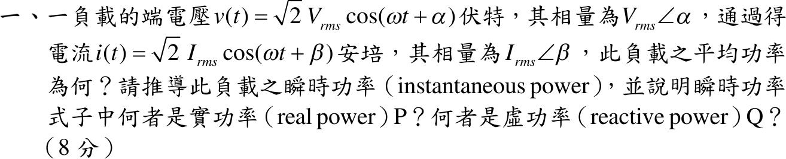
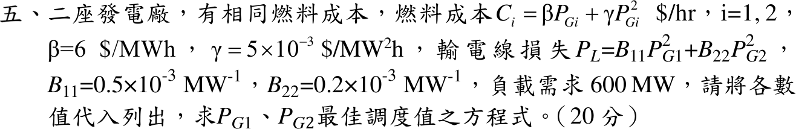

# 109 年電機工程技師｜電力系統逐題詳解

> 本頁由題級 canonical 筆記組合；每題保留官方裁切圖、校驗狀態與可追溯的推導。

## 題目導覽
- [[#一、109 年電力系統第 1 題｜瞬時功率與實功／虛功|第 1 題：瞬時功率與實功／虛功]]
- [[#二、109 年電力系統第 2 題｜345 kV 雙分裂導線中程 π 模型與傳輸功率|第 2 題：345 kV 雙分裂導線中程 π 模型與傳輸功率]]
- [[#三、109 年電力系統第 3 題｜二匯流排牛頓－拉弗森法二次疊代|第 3 題：二匯流排牛頓－拉弗森法二次疊代]]
- [[#四、109 年電力系統第 4 題｜三相與線間故障電流|第 4 題：三相與線間故障電流]]
- [[#五、109 年電力系統第 5 題｜含輸電損失的經濟調度|第 5 題：含輸電損失的經濟調度]]
- [[#六、109 年電力系統第 6 題｜負載頻率控制與穩態頻率偏差|第 6 題：負載頻率控制與穩態頻率偏差]]

---

## 一、109 年電力系統第 1 題｜瞬時功率與實功／虛功

> 題級識別：EE-109-05-1
> canonical 來源：[[canonical/EE-109-05-1.md]]
> 題級校驗狀態：verified

### 已知與所求

端電壓 \(v(t)=\sqrt2V_{rms}\cos(\omega t+\alpha)\)（相量 \(V_{rms}\angle\alpha\)），電流 \(i(t)=\sqrt2I_{rms}\cos(\omega t+\beta)\)（相量 \(I_{rms}\angle\beta\)）。求平均功率，推導瞬時功率 \(p(t)\)，並指出式中何者為實功率 \(P\)、何者為虛功率 \(Q\)。

### 考場標準作答

**解題邏輯**：瞬時功率就是 \(v(t)i(t)\)；用積化和差把乘積拆成「常數項 + 兩倍頻項」，常數項就是平均功率。再把兩倍頻項以電壓相角 \(\omega t+\alpha\) 為基準展開，分成「恆不為負、平均值 \(P\)」的一項與「正負交替、平均為零、振幅 \(Q\)」的一項，即可對應實功率與虛功率。記 \(V=V_{rms}\)、\(I=I_{rms}\)、\(\theta=\alpha-\beta\)（電壓超前電流的角度）。

#### 步驟 1：瞬時功率的積化和差

**邏輯**：\(\cos A\cos B=\tfrac12[\cos(A-B)+\cos(A+B)]\)，取 \(A=\omega t+\alpha\)、\(B=\omega t+\beta\)。

\[
p(t)=v(t)i(t)=\sqrt2V\cos(\omega t+\alpha)\cdot\sqrt2I\cos(\omega t+\beta)=2VI\cos(\omega t+\alpha)\cos(\omega t+\beta)
\]
\[
p(t)=VI[\cos(\alpha-\beta)+\cos(2\omega t+\alpha+\beta)]=VI\cos\theta+VI\cos(2\omega t+\alpha+\beta)
\]

#### （一）平均功率

**邏輯**：平均功率是 \(p(t)\) 在一週期 \(T=2\pi/\omega\) 的平均；兩倍頻餘弦在一週期內恰走兩圈，積分為零。

\[
P=\frac1T\int_0^Tp(t)\,dt=\frac1T\int_0^TVI\cos\theta\,dt+\frac1T\int_0^TVI\cos(2\omega t+\alpha+\beta)\,dt
\]
\[
P=VI\cos\theta+0
\]
\[
\boxed{P=\frac1T\int_0^Tp\,dt=V_{rms}I_{rms}\cos(\alpha-\beta)\ \mathrm W}
\]

#### （二）瞬時功率的分解

**邏輯**：把兩倍頻項的相角改寫成 \(2(\omega t+\alpha)-\theta\)（因 \(\alpha+\beta=2\alpha-\theta\)），再用 \(\cos(x-\theta)=\cos x\cos\theta+\sin x\sin\theta\) 展開。

\[
\cos(2\omega t+\alpha+\beta)=\cos[2(\omega t+\alpha)-\theta]=\cos2(\omega t+\alpha)\cos\theta+\sin2(\omega t+\alpha)\sin\theta
\]
代回步驟 1：
\[
p(t)=VI\cos\theta+VI\cos\theta\cos2(\omega t+\alpha)+VI\sin\theta\sin2(\omega t+\alpha)
\]
合併前兩項：
\[
\boxed{p(t)=\underbrace{VI\cos\theta}_{P}\,[1+\cos2(\omega t+\alpha)]+\underbrace{VI\sin\theta}_{Q}\,\sin2(\omega t+\alpha)}
\]

#### （三）實功率與虛功率

**邏輯**：依各項的平均值與正負性質判定：平均值不為零的是淨能量流（實功率），平均為零只在電源與儲能元件間往返的是虛功率。

- 第一項 \(P[1+\cos2(\omega t+\alpha)]\)：因 \(1+\cos(\cdot)\ge0\)，恆不為負，平均值為 \(P\)——**實功率**，負載淨吸收能量的速率。
- 第二項 \(Q\sin2(\omega t+\alpha)\)：正負交替、平均為零，其振幅 \(\boxed{Q=V_{rms}I_{rms}\sin(\alpha-\beta)\ \mathrm{var}}\)——**虛功率**，電源與 L／C 儲能間往返交換。

### 驗算

複功率 \(S=\mathbf V\mathbf I^*=VI\angle\alpha\cdot\angle(-\beta)=VI\angle(\alpha-\beta)=VI\cos\theta+jVI\sin\theta\)，實部、虛部恰為上式 \(P\)、\(Q\)；\(\theta>0\)（電流落後）時 \(Q>0\)，負載吸收虛功。另取 \(t=0\)、\(\alpha=\beta=0\)：原式 \(p=2VI\)，分解式 \(VI(1+1)+0=2VI\)，一致。

### 失分點

- 有效值相量下 \(p=2VI\cos(\cdot)\cos(\cdot)\)，係數 \(\sqrt2\cdot\sqrt2=2\) 漏掉會使 \(P\) 少一半。
- \(\theta=\alpha-\beta\) 是電壓減電流相角；寫成 \(\beta-\alpha\) 會使 \(Q\) 變號（電感性負載誤判為發出虛功）。
- 只答「\(VI\cos\theta\) 為實功率」而未把 \(p(t)\) 展開成含 \(\sin2(\omega t+\alpha)\) 的兩項，無法指出虛功率對應的項。

---

## 二、109 年電力系統第 2 題｜345 kV 雙分裂導線中程 π 模型與傳輸功率

> 題級識別：EE-109-05-2
> canonical 來源：[[canonical/EE-109-05-2.md]]
> 題級校驗狀態：verified

### 已知與所求

三相 345 kV、60 Hz 換位線，每相兩條 Bluejay（直徑 3.195 cm、GMR 1.268 cm），子導體間隔 40 cm；水平排列相間 10 m；忽略電阻與電導；長 200 km；\(V_S=345\angle30^\circ\) kV、\(V_R=327.75\angle0^\circ\) kV（線電壓）。以 π 模型求傳輸實功率。

### 考場標準作答

**解題邏輯**：π 模型把線路畫成「串聯 \(jX\) ＋ 兩端各一個並聯 \(Y/2\)」。因電阻、電導忽略，並聯 \(Y/2\) 為純電容，只吸收（產生）無功，所以實功率全部經過串聯 \(jX\)，可用 \(P=\dfrac{V_SV_R}{X}\sin\delta\) 計算。依序：由導體幾何求 \(D_m\)、電感用的 \(D_{sL}\)、電容用的 \(D_{sC}\) → 求每相串聯電抗 \(X\) 與並聯導納 \(Y\)（建立 π 模型）→ 代入功率式。前提：換位線、每相兩分裂導線；題給 \(V_S\)、\(V_R\) 為線電壓（每相等效以 \(V/\sqrt3\) 計）；題幹只給 60 Hz，\(\omega=2\pi(60)=376.99\ \mathrm{rad/s}\)；\(\varepsilon_0=8.854\times10^{-12}\ \mathrm{F/m}\)。題給「ACSR 1,113,000 cmil、45/7」只用於查導線表（電阻、尺寸），本題已直接給直徑與 GMR，且電阻忽略，所以不必使用。

#### 步驟 1：幾何量 \(D_m\)、\(D_{sL}\)、\(D_{sC}\)

**邏輯**：水平排列三相的相間距為 10、10、20 m，取幾何平均；兩分裂導線的等效自距離為 \(\sqrt{D_s\,d}\)，電感用導體 GMR，電容用導體實際半徑。

\[
D_m=\sqrt[3]{D_{ab}D_{bc}D_{ca}}=\sqrt[3]{10\times10\times20}=\sqrt[3]{2000}=12.5992\ \mathrm m
\]
\[
D_{sL}=\sqrt{\mathrm{GMR}\times d}=\sqrt{1.268\times40}=\sqrt{50.72}=7.1218\ \mathrm{cm}=0.071218\ \mathrm m
\]
\[
r=\frac{3.195}{2}=1.5975\ \mathrm{cm},\qquad D_{sC}=\sqrt{r\times d}=\sqrt{1.5975\times40}=\sqrt{63.90}=7.9937\ \mathrm{cm}=0.079937\ \mathrm m
\]

#### 步驟 2：每相串聯電抗 \(X\)

**邏輯**：換位線每相電感 \(L=2\times10^{-7}\ln(D_m/D_{sL})\) H/m，乘 \(\omega\) 與線長得總串聯電抗。（\(X\) 會直接決定 \(P\) 的末位，故本鏈保留 5–6 位有效數字。）

\[
\frac{D_m}{D_{sL}}=\frac{12.5992}{0.071218}=176.91,\qquad \ln176.91=5.17564
\]
\[
L=2\times10^{-7}\times5.17564=1.03513\times10^{-6}\ \mathrm{H/m}
\]
\[
\omega=2\pi f=2\pi(60)=376.99\ \mathrm{rad/s}
\]
\[
X=\omega L\ell=376.99\times1.03513\times10^{-6}\times(200\times10^3)=78.047\ \Omega
\]

#### 步驟 3：每相並聯導納 \(Y\) 與 π 模型

**邏輯**：每相對中性點電容 \(C=2\pi\varepsilon_0/\ln(D_m/D_{sC})\) F/m，總並聯導納 \(Y=j\omega C\ell\)，π 模型兩端各接 \(Y/2\)。

\[
\frac{D_m}{D_{sC}}=\frac{12.5992}{0.079937}=157.61,\qquad \ln157.61=5.0601
\]
\[
C=\frac{2\pi\varepsilon_0}{5.0601}=\frac{2\pi(8.854\times10^{-12})}{5.0601}=\frac{5.5631\times10^{-11}}{5.0601}=1.0994\times10^{-11}\ \mathrm{F/m}
\]
\[
Y=j\omega C\ell=j376.99\times1.0994\times10^{-11}\times(200\times10^3)=j8.2893\times10^{-4}\ \mathrm S
\]
\[
\frac{Y}{2}=j4.145\times10^{-4}\ \mathrm S
\]
每相電壓（線電壓 \(/\sqrt3\)）：
\[
V_{S,\phi}=\frac{345}{\sqrt3}\angle30^\circ=199.19\angle30^\circ\ \mathrm{kV},\qquad V_{R,\phi}=\frac{327.75}{\sqrt3}\angle0^\circ=189.23\angle0^\circ\ \mathrm{kV}
\]

#### 輸電線傳輸的實功率（12 分）

**邏輯**：兩端 \(Y/2\) 為純電容，流經它們的電流與端電壓正交，不消耗實功率；串聯 \(jX\) 無電阻也不消耗實功率，所以送電端送出、受電端收到的實功率都等於流過串聯 \(jX\) 的功率。

串聯支路電流（由送電端流向受電端）：
\[
I_{ser}=\frac{V_{S,\phi}\angle\delta-V_{R,\phi}\angle0^\circ}{jX}
\]
受電端由串聯支路收到的每相複數功率（\((jX)^*=-jX\)）：
\[
V_{R,\phi}I_{ser}^*=\frac{V_{R,\phi}\left(V_{S,\phi}\angle-\delta-V_{R,\phi}\right)}{-jX}=\frac{jV_{R,\phi}\left(V_{S,\phi}\cos\delta-jV_{S,\phi}\sin\delta-V_{R,\phi}\right)}{X}
\]
取實部（只有 \(j\cdot(-jV_{S,\phi}\sin\delta)=V_{S,\phi}\sin\delta\) 為實數）：
\[
P_\phi=\mathrm{Re}\{V_{R,\phi}I_{ser}^*\}=\frac{V_{S,\phi}V_{R,\phi}}{X}\sin\delta
\]
三相（\(3\times\dfrac{V_S}{\sqrt3}\times\dfrac{V_R}{\sqrt3}=V_SV_R\)，以線電壓直接代入）：
\[
P=\frac{V_SV_R}{X}\sin\delta
\]
代入 \(V_S=345\) kV、\(V_R=327.75\) kV、\(\delta=30^\circ-0^\circ=30^\circ\)、\(X=78.047\ \Omega\)：
\[
V_SV_R=345\times327.75=113073.75\ \mathrm{kV^2}
\]
\[
V_SV_R\sin\delta=113073.75\times0.5=56536.875\ \mathrm{kV^2}
\]
\[
P=\frac{56536.875}{78.047}=724.40\ \mathrm{MW}
\]
\[
\boxed{P=724.40\ \mathrm{MW}}
\]
（\(\mathrm{kV^2}/\Omega=\mathrm{MW}\)。）

### 驗算

每相複功率（以完整精度計算）：\(I_{ser}=(V_{S,\phi}-V_{R,\phi})/(jX)\)，受電端 \(I_R=I_{ser}-\tfrac Y2V_{R,\phi}\)，\(3\,\mathrm{Re}(V_{R,\phi}I_R^*)=724.40\) MW；送電端 \(I_S=I_{ser}+\tfrac Y2V_{S,\phi}\)，\(3\,\mathrm{Re}(V_{S,\phi}I_S^*)=724.40\) MW，送受兩端相等，符合無損線路且並聯 \(Y/2\) 不影響實功率。

### 失分點

- 電感用導體 GMR（1.268 cm），電容用導體實際半徑 \(3.195/2\) cm；兩者互換會使 \(L\)、\(C\) 皆錯。
- 水平排列的 \(D_{ca}=20\) m，\(D_m=\sqrt[3]{2000}\)，不是 10 m。
- 題給為線電壓，\(V_SV_R\sin\delta/X\) 已是三相功率，不可再乘 3。

### 條件與疑義

框內值依題幹 60 Hz 取 \(\omega=2\pi(60)=376.99\ \mathrm{rad/s}\)（\(X=78.047\ \Omega\)）；若依慣例取 \(377\ \mathrm{rad/s}\)，\(X=78.049\ \Omega\)、\(P=724.38\ \mathrm{MW}\)，僅差末位。

---

## 三、109 年電力系統第 3 題｜二匯流排牛頓－拉弗森法二次疊代

> 題級識別：EE-109-05-3
> canonical 來源：[[canonical/EE-109-05-3.md]]
> 題級校驗狀態：verified

### 已知與所求

匯流排 1 為 slack，\(V_1=1.0\angle0^\circ\)；匯流排 2 負載 200 MW、50 Mvar；\(y_{12}=-j10\) pu，基準 100 MVA。寫出匯流排 2 潮流方程，由 \(V_2=1.0\angle0^\circ\) 起以牛頓－拉弗森法疊代兩次，求 \(|V_2|\)、\(\delta_2\)。

### 考場標準作答

**解題邏輯**：先由 \(Y_{bus}\) 與 \(S_2=V_2I_2^*\) 寫出匯流排 2 的潮流方程 \(P_2(\delta_2,|V_2|)\)、\(Q_2(\delta_2,|V_2|)\) 與 Jacobian；牛頓－拉弗森法每一輪在目前估計值算功率不平衡量 \(\Delta P,\Delta Q\) 與 \(J\)，解 \(J\,\Delta x=\Delta(P,Q)\) 得修正量後更新，第二輪必須用第一輪結果重算 \(P_2,Q_2,J\)。共用前提：搖擺匯流排 \(V_1=1.0\angle0^\circ\) 固定；負載為負注入。

#### 步驟 1：指定功率（標么）

\[
P_2^{sch}=-\frac{200}{100}=-2.00\ \mathrm{pu},\qquad Q_2^{sch}=-\frac{50}{100}=-0.50\ \mathrm{pu}
\]

#### 步驟 2：匯流排 2 潮流方程與 Jacobian

**邏輯**：題目要求寫出潮流方程；兩匯流排系統由 \(Y_{bus}\) 的第 2 列直接展開 \(S_2=V_2I_2^*\)。

\(y_{12}=-j10\)，故 \(Y_{22}=y_{12}=-j10\)、\(Y_{21}=-y_{12}=j10\)。注入電流：
\[
I_2=Y_{21}V_1+Y_{22}V_2=j10(1\angle0^\circ)-j10|V_2|\angle\delta_2
\]
複功率：
\[
S_2=V_2I_2^*=|V_2|\angle\delta_2\left(-j10+j10|V_2|\angle-\delta_2\right)=-j10|V_2|\angle\delta_2+j10|V_2|^2
\]
展開 \(-j10|V_2|(\cos\delta_2+j\sin\delta_2)=10|V_2|\sin\delta_2-j10|V_2|\cos\delta_2\)，取實部、虛部：
\[
P_2=10|V_2|\sin\delta_2,\qquad Q_2=10|V_2|^2-10|V_2|\cos\delta_2
\]
對 \(\delta_2\)、\(|V_2|\) 偏微分：
\[
J=\begin{bmatrix}\partial P_2/\partial\delta_2&\partial P_2/\partial|V_2|\\\partial Q_2/\partial\delta_2&\partial Q_2/\partial|V_2|\end{bmatrix}
=\begin{bmatrix}10|V_2|\cos\delta_2&10\sin\delta_2\\10|V_2|\sin\delta_2&20|V_2|-10\cos\delta_2\end{bmatrix}
\]
修正方程：
\[
J\begin{bmatrix}\Delta\delta_2\\\Delta|V_2|\end{bmatrix}=\begin{bmatrix}\Delta P\\\Delta Q\end{bmatrix},\qquad \Delta P=P_2^{sch}-P_2,\ \ \Delta Q=Q_2^{sch}-Q_2
\]

#### （一）第 1 次疊代

**邏輯**：起始值 \(|V_2|=1\)、\(\delta_2=0\) 代入步驟 2 的方程算不平衡量與 \(J\)，解修正量。

計算功率（\(\sin0=0\)、\(\cos0=1\)）：
\[
P_2=10(1)(0)=0,\qquad Q_2=10(1)^2-10(1)(1)=0
\]
不平衡量：
\[
\Delta P=-2.00-0=-2.00,\qquad \Delta Q=-0.50-0=-0.50
\]
Jacobian：
\[
J=\begin{bmatrix}10(1)(1)&10(0)\\10(1)(0)&20(1)-10(1)\end{bmatrix}=\begin{bmatrix}10&0\\0&10\end{bmatrix}
\]
對角矩陣，直接相除：
\[
\Delta\delta_2=\frac{-2.00}{10}=-0.20\ \mathrm{rad},\qquad \Delta|V_2|=\frac{-0.50}{10}=-0.05
\]
更新：
\[
\delta_2^{(1)}=0+(-0.20)=-0.20\ \mathrm{rad}=-0.20\times\frac{180^\circ}{\pi}=-11.46^\circ,\qquad |V_2|^{(1)}=1-0.05=0.95
\]
\[
\boxed{\delta_2^{(1)}=-0.20\ \mathrm{rad}=-11.46^\circ,\quad |V_2|^{(1)}=0.95\ \mathrm{pu}}
\]

#### （二）第 2 次疊代

**邏輯**：以 \(\delta_2=-0.20\) rad、\(|V_2|=0.95\) 重算功率、不平衡量與 Jacobian（牛頓法每輪更新 \(J\)），以克拉瑪法則解 \(2\times2\) 方程。

三角函數值：
\[
\sin(-0.20)=-0.198669,\qquad \cos(0.20)=0.980067
\]
計算功率：
\[
P_2=10(0.95)(-0.198669)=-1.8874
\]
\[
Q_2=10(0.95)^2-10(0.95)(0.980067)=9.025-9.3106=-0.2856
\]
不平衡量：
\[
\Delta P=-2.00-(-1.8874)=-0.1126,\qquad \Delta Q=-0.50-(-0.2856)=-0.2144
\]
Jacobian 各元：
\[
J_{11}=10(0.95)(0.980067)=9.3106,\qquad J_{12}=10(-0.198669)=-1.9867
\]
\[
J_{21}=10(0.95)(-0.198669)=-1.8874,\qquad J_{22}=20(0.95)-10(0.980067)=19-9.8007=9.1993
\]
行列式：
\[
\det J=J_{11}J_{22}-J_{12}J_{21}=9.3106\times9.1993-(-1.9867)(-1.8874)=85.651-3.7497=81.901
\]
克拉瑪法則：
\[
\Delta\delta_2=\frac{\Delta P\,J_{22}-J_{12}\,\Delta Q}{\det J}=\frac{(-0.1126)(9.1993)-(-1.9867)(-0.2144)}{81.901}=\frac{-1.0358-0.4259}{81.901}=\frac{-1.4617}{81.901}=-0.01785\ \mathrm{rad}
\]
\[
\Delta|V_2|=\frac{J_{11}\,\Delta Q-J_{21}\,\Delta P}{\det J}=\frac{(9.3106)(-0.2144)-(-1.8874)(-0.1126)}{81.901}=\frac{-1.9962-0.2125}{81.901}=\frac{-2.2087}{81.901}=-0.02697
\]
更新：
\[
\delta_2^{(2)}=-0.20+(-0.01785)=-0.21785\ \mathrm{rad}=-0.21785\times\frac{180^\circ}{\pi}=-12.48^\circ
\]
\[
|V_2|^{(2)}=0.95+(-0.02697)=0.92303
\]
\[
\boxed{\delta_2^{(2)}=-0.2179\ \mathrm{rad}=-12.48^\circ,\quad |V_2|^{(2)}=0.92\ \mathrm{pu}}
\]

### 驗算

兩匯流排可求精確解：由 \(10|V_2|\sin\delta_2=-2\) 得 \(|V_2|\sin\delta_2=-0.20\)；由 \(10|V_2|^2-10|V_2|\cos\delta_2=-0.5\) 得 \(|V_2|\cos\delta_2=|V_2|^2+0.05\)。兩式平方相加消去 \(\delta_2\)（\(u=|V_2|^2\)）：
\[
(u+0.05)^2+0.04=u\ \Rightarrow\ u^2-0.9u+0.0425=0\ \Rightarrow\ u=\frac{0.9+\sqrt{0.81-0.17}}{2}=\frac{0.9+0.8}{2}=0.85
\]
\(|V_2|=\sqrt{0.85}=0.9220\)、\(\delta_2=\sin^{-1}(-0.20/0.9220)=-12.53^\circ\)。第二次疊代值與精確解差 \(0.92303-0.9220=0.0011\) pu、\(0.05^\circ\)，收斂方向正確。

### 失分點

- 負載是負注入，\(P_2^{sch}=-2.00\)、\(Q_2^{sch}=-0.50\)；寫成正值會使修正方向全反。
- \(\partial Q_2/\partial|V_2|=20|V_2|-10\cos\delta_2\)，漏掉 \(|V_2|^2\) 項的 2 倍會讓第 2 次電壓修正錯。
- 第 2 次要以 \(\delta_2=-0.2\) rad、\(|V_2|=0.95\) 重算 Jacobian，沿用初始 \(J\) 不算牛頓法。

---

## 四、109 年電力系統第 4 題｜三相與線間故障電流

> 題級識別：EE-109-05-4
> canonical 來源：[[canonical/EE-109-05-4.md]]
> 題級校驗狀態：verified

### 已知與所求

共同基準標么電抗（\(X_1/X_2/X_0\)）：\(G_1\) 0.2/0.2/0.05，\(G_2\) 0.1/0.1/0.05，\(T_1\) 0.25，\(T_2\) 0.3，線路 1-2 0.4/0.4/0.5。圖二：\(G_1\)–3–\(T_1\)–1–線路–2–\(T_2\)–4–\(G_2\)；\(T_1\) 在匯流排 3 側為 \(\Delta\)、匯流排 1 側 Y 接地；\(T_2\) 在匯流排 2 側 Y 接地、匯流排 4 側 \(\Delta\)；兩發電機中性點接地。求匯流排 1 的戴維寧相序阻抗、三相直接故障電流、b-c 直接線間故障電流。題目未給故障前電壓，設 \(V_f=1\angle0^\circ\) pu。

### 考場標準作答

**解題邏輯**：先依表列電抗與變壓器接線畫出正、負、零序網路，從匯流排 1 看入（電源短路）求三個戴維寧相序阻抗 \(Z_1,Z_2,Z_0\)。三相故障只用正序網路：\(I_f=V_f/Z_1\)；b-c 線間故障把正、負序網路在故障點並聯（零序不參與），求出 \(I_{a1}\) 後以對稱成分轉回相電流 \(I_b=(a^2-a)I_{a1}\)。共用前提：故障前電壓 \(V_f=1\angle0^\circ\) pu。

#### 步驟 1：畫正、負、零序網路

- 正序：匯流排 1 往左 \(T_1\to\) 匯流排 3 \(\to G_1\to\) 參考點；往右線路 \(\to\) 匯流排 2 \(\to T_2\to\) 匯流排 4 \(\to G_2\to\) 參考點；兩機內電勢 \(E=1\angle0^\circ\)（故障前無載）。負序同結構、無電源，表列 \(X_2=X_1\)。
- 故障點 F 取在匯流排 1。
- 零序：\(T_1\) 匯流排 1 側 Y 接地、匯流排 3 側 \(\Delta\)，故匯流排 1 經 \(X_{T1,0}=0.25\) 直接入地，\(\Delta\) 側斷開 \(G_1\)；\(T_2\) 匯流排 2 側 Y 接地、匯流排 4 側 \(\Delta\)，匯流排 2 經 \(X_{T2,0}=0.3\) 入地，斷開 \(G_2\)；線路零序電抗 \(0.5\)。

#### （一）匯流排 1 的戴維寧相序阻抗

**邏輯**：電源短路後，從匯流排 1 看入是「左支路 ∥ 右支路」；各序只差在支路內的電抗值與零序被 \(\Delta\) 斷開的部分。

正序左支路（\(T_1+G_1\)）：
\[
X_{左}=0.25+0.2=0.45
\]
正序右支路（線路 \(+T_2+G_2\)）：
\[
X_{右}=0.4+0.3+0.1=0.80
\]
並聯：
\[
Z_1=j\frac{X_{左}X_{右}}{X_{左}+X_{右}}=j\frac{0.45\times0.80}{0.45+0.80}=j\frac{0.36}{1.25}=j0.288
\]
負序各電抗與正序相同：
\[
\boxed{Z_1=Z_2=j0.288\ \mathrm{pu}}
\]
零序左支路只剩 \(T_1\)：\(X_{左,0}=0.25\)；右支路為線路 \(+T_2\)：
\[
X_{右,0}=0.5+0.3=0.80
\]
\[
Z_0=j\frac{0.25\times0.80}{0.25+0.80}=j\frac{0.20}{1.05}=j\frac{4}{21}
\]
\[
\boxed{Z_0=j\tfrac{4}{21}\approx j0.19\ \mathrm{pu}}
\]

#### （二）匯流排 1 直接三相故障電流

**邏輯**：三相平衡故障只有正序分量，故障點經 \(Z_f=0\) 短路，戴維寧電源 \(V_f\) 串 \(Z_1\) 成單一迴路。

\[
I_f^{3\phi}=\frac{V_f}{Z_1}=\frac{1\angle0^\circ}{0.288\angle90^\circ}
\]
大小與相角：
\[
|I_f^{3\phi}|=\frac{1}{0.288}=3.472,\qquad \angle I_f^{3\phi}=0^\circ-90^\circ=-90^\circ
\]
\[
\boxed{I_f^{3\phi}=3.47\angle-90^\circ=-j3.47\ \mathrm{pu}}
\]

#### （三）匯流排 1 直接 b-c 線間故障電流

**邏輯**：b、c 相短接且不接地：\(I_a=0\)、\(I_b=-I_c\)、\(V_b=V_c\)，換成對稱成分得 \(I_{a0}=0\)、\(I_{a2}=-I_{a1}\)、\(V_{a1}=V_{a2}\)，即正、負序網路在故障點並聯，零序網路不接入。

序網路連接畫法：
- 正序網路以戴維寧等效表示：\(V_f\) 串 \(Z_1=j0.288\)，端點為 F。
- 負序網路只有 \(Z_2=j0.288\)（無電源），端點也接 F；兩網路的參考點相接。
- 正序流出 F 的 \(I_{a1}\) 全部流入負序網路，故 \(I_{a2}=-I_{a1}\)；零序網路開路，\(I_{a0}=0\)。

正序電流：
\[
I_{a1}=\frac{V_f}{Z_1+Z_2}=\frac{1\angle0^\circ}{j0.288+j0.288}=\frac{1\angle0^\circ}{0.576\angle90^\circ}
\]
\[
|I_{a1}|=\frac{1}{0.576}=1.736,\qquad \angle I_{a1}=-90^\circ\quad\Rightarrow\quad I_{a1}=-j1.736
\]
b 相電流（\(I_{a0}=0\)、\(I_{a2}=-I_{a1}\)）：
\[
I_b=I_{a0}+a^2I_{a1}+aI_{a2}=(a^2-a)I_{a1}
\]
\[
a^2-a=\left(-\tfrac12-j\tfrac{\sqrt3}{2}\right)-\left(-\tfrac12+j\tfrac{\sqrt3}{2}\right)=-j\sqrt3=1.732\angle-90^\circ
\]
相乘（大小相乘、角度相加）：
\[
I_b=(1.732\angle-90^\circ)(1.736\angle-90^\circ)=1.732\times1.736\angle-180^\circ=3.007\angle180^\circ
\]
\[
\boxed{I_b=-I_c=-3.01\ \mathrm{pu}\ \ (|I_f^{LL}|=3.01\ \mathrm{pu})}
\]

### 驗算

相域回代：\(V_{a1}=1-Z_1I_{a1}=1-(j0.288)(-j1.736)=1-0.5000=0.5000\)、\(V_{a2}=-Z_2I_{a2}=-(j0.288)(j1.736)=0.5000\)，得 \(V_b=V_c=-0.50\) pu、\(I_a=0\)，符合 b-c 金屬短路；且 \(|I_f^{LL}|/|I_f^{3\phi}|=3.007/3.472=0.8661\approx\sqrt3/2=0.8660\)。

### 失分點

- 零序網路須依變壓器接線判斷：\(\Delta\) 側把 \(G_1\)、\(G_2\) 的零序隔開，若直接串入 \(X_{G,0}=0.05\) 會得錯誤的 \(Z_0\)。
- 線路零序電抗是 0.5，不是正序的 0.4。
- 線間故障電流是 \(\sqrt3|I_{a1}|\)，不是 \(|I_{a1}|\)；且不經零序網路，\(Z_0\) 雖要求列出但不參與。

---

## 五、109 年電力系統第 5 題｜含輸電損失的經濟調度

> 題級識別：EE-109-05-5
> canonical 來源：[[canonical/EE-109-05-5.md]]
> 題級校驗狀態：verified

### 已知與所求

\(C_i=\beta P_{Gi}+\gamma P_{Gi}^2\)（\(\$/\mathrm h\)），\(\beta=6\ \$/\mathrm{MWh}\)、\(\gamma=5\times10^{-3}\ \$/\mathrm{MW^2h}\)；\(P_L=B_{11}P_{G1}^2+B_{22}P_{G2}^2\)，\(B_{11}=0.5\times10^{-3}\)、\(B_{22}=0.2\times10^{-3}\ \mathrm{MW^{-1}}\)；\(P_D=600\) MW。代入數值列出求 \(P_{G1}\)、\(P_{G2}\) 最佳調度的方程式（20 分）。

### 考場標準作答

**解題邏輯**：含網路損失的經濟調度用拉格朗日乘數法：目標為總燃料成本最小，限制式為「發電量 = 負載 + 損失」。對各機出力偏微分得到協調方程式（增量成本 × 罰點因數 = \(\lambda\)），再加上功率平衡式，就是本題要列的方程式組。依序：寫拉格朗日函數與最佳條件 → 代入數值求增量成本與增量損失 → 列出方程式（得分主體）→ 把兩機出力寫成 \(\lambda\) 的函數，代入功率平衡疊代求數值。前提：兩機燃料成本相同；出力上下限未給，視為不受限；損失式只含題給兩個 \(B\) 係數（無交叉項）。

#### 步驟 1：拉格朗日函數與最佳條件

**邏輯**：把等式限制乘上 \(\lambda\) 併入目標函數，對每個變數偏微分令其為 0。

\[
\mathcal L=C_1+C_2+\lambda\big(P_D+P_L-P_{G1}-P_{G2}\big)
\]
\[
\frac{\partial\mathcal L}{\partial P_{Gi}}=\frac{dC_i}{dP_{Gi}}-\lambda\Big(1-\frac{\partial P_L}{\partial P_{Gi}}\Big)=0
\quad\Rightarrow\quad
\frac{dC_i/dP_{Gi}}{1-\partial P_L/\partial P_{Gi}}=\lambda
\]
\[
\frac{\partial\mathcal L}{\partial\lambda}=0\quad\Rightarrow\quad P_{G1}+P_{G2}=P_D+P_L
\]

#### 步驟 2：代入數值的增量成本與增量損失

**邏輯**：增量成本是 \(C_i\) 對 \(P_{Gi}\) 的導數；增量損失是 \(P_L\) 對各機出力的偏導數。

\[
\frac{dC_i}{dP_{Gi}}=\beta+2\gamma P_{Gi}=6+2(0.005)P_{Gi}=6+0.01P_{Gi}
\]
\[
\frac{\partial P_L}{\partial P_{G1}}=2B_{11}P_{G1}=2(0.0005)P_{G1}=0.001P_{G1}
\]
\[
\frac{\partial P_L}{\partial P_{G2}}=2B_{22}P_{G2}=2(0.0002)P_{G2}=0.0004P_{G2}
\]

#### 最佳調度方程式（20 分）

**邏輯**：把步驟 2 代入步驟 1 的兩個最佳條件：兩機的「增量成本 ÷（1 − 增量損失）」相等且等於 \(\lambda\)，同時發電量要供應負載與損失。

協調方程式：
\[
\boxed{\frac{6+0.01P_{G1}}{1-0.001P_{G1}}=\frac{6+0.01P_{G2}}{1-0.0004P_{G2}}=\lambda}
\]
功率平衡式：
\[
\boxed{P_{G1}+P_{G2}=600+0.0005P_{G1}^2+0.0002P_{G2}^2\ \ (\mathrm{MW})}
\]

#### 步驟 3：解出 \(P_{G1}\)、\(P_{G2}\)

**邏輯**：由協調方程式把兩機出力各寫成 \(\lambda\) 的函數，代入功率平衡，只剩一個未知數 \(\lambda\)，用試值與割線法逼近。

由 \(6+0.01P_{G1}=\lambda(1-0.001P_{G1})\) 移項：
\[
P_{G1}(0.01+0.001\lambda)=\lambda-6\quad\Rightarrow\quad P_{G1}=\frac{\lambda-6}{0.01+0.001\lambda}
\]
同理：
\[
P_{G2}=\frac{\lambda-6}{0.01+0.0004\lambda}
\]
定義功率不平衡量 \(f(\lambda)=P_{G1}+P_{G2}-600-P_L\)。

試值 \(\lambda=11.8\)：
\[
P_{G1}=\frac{5.8}{0.0218}=266.06,\qquad P_{G2}=\frac{5.8}{0.01472}=394.02
\]
\[
P_L=0.0005(266.06)^2+0.0002(394.02)^2=35.39+31.05=66.44
\]
\[
f=(266.06+394.02)-(600+66.44)=660.08-666.44=-6.36\ \mathrm{MW}
\]
試值 \(\lambda=11.9\)：
\[
P_{G1}=\frac{5.9}{0.0219}=269.41,\qquad P_{G2}=\frac{5.9}{0.01476}=399.73
\]
\[
P_L=0.0005(269.41)^2+0.0002(399.73)^2=36.29+31.96=68.25
\]
\[
f=(269.41+399.73)-(600+68.25)=669.14-668.25=0.89\ \mathrm{MW}
\]
割線法內插 \(f=0\)：
\[
\lambda=11.9-0.89\times\frac{11.9-11.8}{0.89-(-6.36)}=11.9-\frac{0.089}{7.25}=11.9-0.01228=11.8877
\]
代回（保留 3 位小數）：
\[
P_{G1}=\frac{11.8877-6}{0.01+0.001(11.8877)}=\frac{5.8877}{0.0218877}=268.996\ \mathrm{MW}
\]
\[
P_{G2}=\frac{11.8877-6}{0.01+0.0004(11.8877)}=\frac{5.8877}{0.0147551}=399.029\ \mathrm{MW}
\]
檢查不平衡量：\(P_L=0.0005(268.996)^2+0.0002(399.029)^2=36.179+31.845=68.024\)，\(f=668.025-668.024=0.001\approx0\)，已收斂。
\[
\boxed{\lambda=11.89\ \$/\mathrm{MWh},\quad P_{G1}=269.00\ \mathrm{MW},\quad P_{G2}=399.03\ \mathrm{MW}}
\]
網路損失 \(P_L=68.02\) MW。

### 驗算

以未四捨五入值驗證（以 \(P_{G1}=268.996\)、\(P_{G2}=399.029\) 代入）：

- \(1-0.001P_{G1}=0.7310\)、\(1-0.0004P_{G2}=0.8404\)，罰點因數 \(L_1=1/0.7310=1.368\)、\(L_2=1/0.8404=1.190\)。
- 增量成本 \(6+0.01P_{G1}=8.690\)、\(6+0.01P_{G2}=9.990\ \$/\mathrm{MWh}\)。
- \(L_1\times8.690=1.368\times8.690=11.888\)，\(L_2\times9.990=1.190\times9.990=11.888\)，兩機相等，即 \(\lambda\)。
- 功率平衡：\(268.996+399.029=668.025\)，\(600+36.179+31.845=668.024\)，差 0.001 MW 為捨入誤差。

### 失分點

- 協調式是 \(IC_i/(1-\partial P_L/\partial P_{Gi})=\lambda\)；寫成 \(IC_i(1-\partial P_L/\partial P_{Gi})=\lambda\) 會使損失大的機組反而多發電。
- \(\partial P_L/\partial P_{G1}=2B_{11}P_{G1}=0.001P_{G1}\)，漏乘 2 是常見錯誤。
- 功率平衡要含 \(P_L\)；只寫 \(P_{G1}+P_{G2}=600\) 為無損調度。

---

## 六、109 年電力系統第 6 題｜負載頻率控制與穩態頻率偏差

> 題級識別：EE-109-05-6
> canonical 來源：[[canonical/EE-109-05-6.md]]
> 題級校驗狀態：verified

### 已知與所求

單區域兩機組 500 MVA、800 MVA，各以自身額定為基準的速率調整率 \(R=5\%\)；\(D=0\)；60 Hz 時機組 1 供 200 MW、機組 2 供 500 MW（共 700 MW）。負載增加 150 MW，求穩態頻率偏移及兩機組新發電量。

### 考場標準作答

**解題邏輯**：負載突增後，兩機調速器依下垂特性（droop）增加出力，穩態時兩機同在一個頻率。主線：把各機的速率調整率 \(R_i\)（以自身額定為基準）換成以 MW/Hz 表示的頻率響應 \(\beta_i\) → 系統總響應 \(\beta=\beta_1+\beta_2+D\) → 由「發電增量 = 負載增量」求 \(\Delta f\) → 各機增量 \(\Delta P_i=-\beta_i\Delta f\)，加回原出力。前提：只有一次（調速器）控制、無二次控制（AGC）把頻率拉回；\(D=0\)；\(f_0=60\) Hz。

#### 步驟 1：各機頻率響應 \(\beta_i\)

速率調整率以自身額定 \(S_i\) 為基準：\(R_i=-\dfrac{\Delta f/f_0}{\Delta P_i/S_i}\)，移項得
\[
\Delta P_i=-\frac{S_i}{R_if_0}\Delta f=-\beta_i\Delta f,\qquad \beta_i=\frac{S_i}{R_if_0}
\]
代入：
\[
\beta_1=\frac{500}{0.05\times60}=\frac{500}{3}=166.67\ \mathrm{MW/Hz}
\]
\[
\beta_2=\frac{800}{0.05\times60}=\frac{800}{3}=266.67\ \mathrm{MW/Hz}
\]
\[
\beta=\beta_1+\beta_2+D=\frac{500}{3}+\frac{800}{3}+0=\frac{1300}{3}=433.33\ \mathrm{MW/Hz}
\]

#### 穩態頻率偏移量

**邏輯**：穩態時兩機出力增量之和等於負載增量（\(D=0\) 時負載不隨頻率變），\(\Delta P_L=\Delta P_1+\Delta P_2=-\beta\Delta f\)。

\[
\Delta f=-\frac{\Delta P_L}{\beta}
\]
代入（用精確分數 \(\beta=1300/3\)）：
\[
\Delta f=-\frac{150}{1300/3}=-\frac{450}{1300}=-\frac{9}{26}=-0.34615\ \mathrm{Hz}
\]
\[
f=60-0.34615=59.65385\ \mathrm{Hz}
\]
\[
\boxed{\Delta f=-346.15\ \mathrm{mHz}\ \ (f=59.65\ \mathrm{Hz})}
\]

#### 每一機組新的發電量

**邏輯**：兩機在同一頻率偏移 \(\Delta f\) 下各依自己的 \(\beta_i\) 增加出力，新發電量 = 原出力 + 增量。

\[
\Delta P_1=-\beta_1\Delta f=\frac{500}{3}\times\frac{9}{26}=\frac{4500}{78}=57.692\ \mathrm{MW}
\]
\[
\Delta P_2=-\beta_2\Delta f=\frac{800}{3}\times\frac{9}{26}=\frac{7200}{78}=92.308\ \mathrm{MW}
\]
\[
P_1=200+57.692=257.692\ \mathrm{MW},\qquad P_2=500+92.308=592.308\ \mathrm{MW}
\]
\[
\boxed{P_1=257.69\ \mathrm{MW}},\qquad \boxed{P_2=592.31\ \mathrm{MW}}
\]

### 驗算

改用 1000 MVA 共同基準：
\[
R_1=0.05\times\frac{1000}{500}=0.10,\qquad R_2=0.05\times\frac{1000}{800}=0.0625\ \mathrm{pu}
\]
\[
\frac1{R_1}+\frac1{R_2}=10+16=26,\qquad \Delta P_L=\frac{150}{1000}=0.15\ \mathrm{pu}
\]
\[
\Delta f=-\frac{0.15}{26}=-0.0057692\ \mathrm{pu}=-0.0057692\times60=-0.34615\ \mathrm{Hz}
\]
相同。兩機增量比 \(57.692:92.308=500:800\)（同 \(R\) 時依額定容量分攤），且 \(257.692+592.308=850=700+150\) MW。

### 失分點

- \(R=5\%\) 是以各自額定為基準，須先換成 MW/Hz（或同一基準）再相加，不能直接把兩個 0.05 並聯。
- 負載增加使頻率下降，\(\Delta f\) 為負；兩機出力依容量比分攤，不是依原出力 200:500。

---
