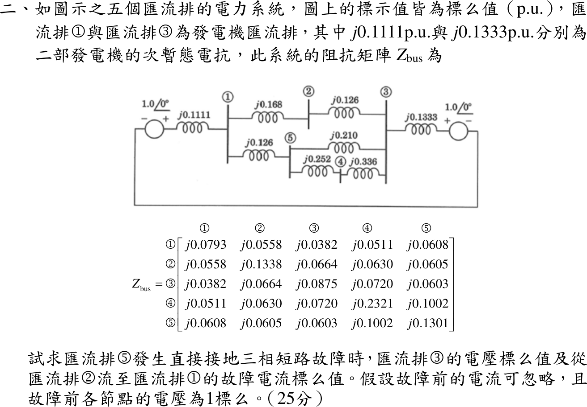
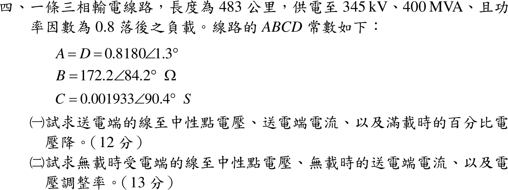

# 111 年電機工程技師｜電力系統逐題詳解

> 本頁由題級 canonical 筆記組合；每題保留官方裁切圖、校驗狀態與可追溯的推導。

## 題目導覽
- [[#一、111 年第 1 題｜輸電線路串聯補償與最大傳送功率|第 1 題：輸電線路串聯補償與最大傳送功率]]
- [[#二、111 年第 2 題｜五匯流排三相短路之故障電壓與線路電流|第 2 題：五匯流排三相短路之故障電壓與線路電流]]
- [[#三、111 年第 3 題｜三相短路之臨界清除角與清除時間|第 3 題：三相短路之臨界清除角與清除時間]]
- [[#四、111 年第 4 題｜長程輸電線 ABCD 參數與送受電端量|第 4 題：長程輸電線 ABCD 參數與送受電端量]]

---

## 一、111 年第 1 題｜輸電線路串聯補償與最大傳送功率

> 題級識別：EE-111-05-1
> canonical 來源：[[canonical/EE-111-05-1.md]]
> 題級校驗狀態：verified

### 已知與所求

概念題，無數值。求（一）串聯補償的定義（15 分）；（二）串聯補償能提高線路最大傳送實功率的原因（10 分）。

### 考場標準作答

**解題邏輯**：（一）先說明「在線路上串接電容器」這個接法，再用 \(-jX_C\) 與 \(+jX_L\) 相消寫出等效串聯電抗 \(X_{eq}=(1-k)X_L\)，最後交代作用與實施要點；（二）由每相等效電路推出傳輸功率 \(P=\dfrac{V_SV_R}{X_{eq}}\sin\delta\)，指出最大值在 \(\delta=90^\circ\) 且與 \(X_{eq}\) 成反比，所以 \(X_{eq}\) 變小，\(P_{\max}\) 變大。前提：以每相短線模型說明，忽略線路電阻與並聯充電電容；兩端電壓大小 \(V_S,V_R\) 固定，送電端領先受電端功率角 \(\delta\)。

#### （一）串聯補償的定義（15 分）

**邏輯**：串聯電容器與線路電感串在同一電流路徑上，兩者阻抗符號相反（\(-jX_C\) 與 \(+jX_L\)），相加後線路的淨串聯電抗變小。

**定義**：在輸電線路的各相導線上**串接電容器組**（通常裝在線路中點或兩端變電所），用電容器的容抗 \(X_C=\dfrac{1}{\omega C}\) 抵銷一部分線路串聯感抗 \(X_L\)，使線路的電氣長度縮短（圖 1）。

補償度定義為電容器容抗與線路感抗的比：
\[
k=\frac{X_C}{X_L}\quad\Rightarrow\quad X_C=kX_L
\]
同一條電流路徑上的串聯阻抗相加：
\[
jX_L+(-jX_C)=j(X_L-X_C)
\]
所以等效串聯電抗：
\[
X_{eq}=X_L-X_C
\]
代入 \(X_C=kX_L\)：
\[
\boxed{X_{eq}=X_L-kX_L=(1-k)X_L}
\]
例：\(X_L=0.50\) pu、\(k=0.50\)，則 \(X_C=0.50\times0.50=0.25\) pu，\(X_{eq}=0.50-0.25=0.25\) pu。

**作用**：提高傳輸容量與穩定度裕度（見（二））；減少線路的無效功率損失 \(I^2X\) 與電壓降，改善電壓調整；調整並聯線路間的潮流分配。

**實施要點**：補償度採部分補償（實務約 \(k=0.25\sim0.70\)）；電容器組並接金屬氧化物變阻器（MOV）、火花間隙與旁路開關，故障時限制電容器過電壓並可旁路；補償度高時須檢討與汽輪發電機軸系的次同步共振（SSR）及距離電驛的量測誤差。

#### （二）能增加最大傳送實功率的原因（10 分）

**邏輯**：受電端實功率 \(P=\mathrm{Re}\{V_RI^*\}\) 由串聯電抗決定，最大值 \(V_SV_R/X_{eq}\) 與 \(X_{eq}\) 成反比；（一）已得 \(X_{eq}=(1-k)X_L<X_L\)，故最大傳送功率提高為 \(\dfrac{1}{1-k}\) 倍。

依圖 1 的參考方向，線路電流由送電端流向受電端：
\[
I=\frac{V_S\angle\delta-V_R\angle0^\circ}{jX_{eq}}
\]
受電端複數功率 \(S_R=V_RI^*\)，取共軛（\((jX_{eq})^*=-jX_{eq}\)）：
\[
S_R=V_R\cdot\frac{V_S\angle-\delta-V_R}{-jX_{eq}}=\frac{jV_R\left(V_S\cos\delta-jV_S\sin\delta-V_R\right)}{X_{eq}}
\]
展開 \(j(\cdots)\)：
\[
S_R=\frac{V_SV_R\sin\delta}{X_{eq}}+j\,\frac{V_SV_R\cos\delta-V_R^2}{X_{eq}}
\]
取實部得傳輸實功率：
\[
P=\frac{V_SV_R}{X_{eq}}\sin\delta
\]
\(\sin\delta\) 最大為 1（\(\delta=90^\circ\)），故
\[
P_{\max}=\frac{V_SV_R}{X_{eq}}
\]
未補償時 \(X_{eq}=X_L\)，補償後 \(X_{eq}=(1-k)X_L\)，分別代入：
\[
P_{\max,u}=\frac{V_SV_R}{X_L},\qquad P_{\max,c}=\frac{V_SV_R}{(1-k)X_L}
\]
兩式相除：
\[
\boxed{P_{\max,c}=\frac{1}{1-k}\,P_{\max,u}}
\]
因 \(0<k<1\)，\(\dfrac{1}{1-k}>1\)，最大傳送實功率（靜態穩定極限）提高；例如 \(k=0.5\) 時為 \(\dfrac{1}{1-0.5}=2\) 倍。

另一方面，傳送同一功率 \(P_0\) 時 \(\sin\delta=\dfrac{P_0X_{eq}}{V_SV_R}\) 隨 \(X_{eq}\) 變小，功率角由 \(\delta_u\) 降為 \(\delta_c\)，距離 \(90^\circ\) 的裕度變大，暫態穩定度也改善（圖 2）。

### 驗算

數值例：\(V_S=V_R=1\) pu、\(X_L=0.50\) pu，傳送 1 pu。未補償：\(\sin\delta_u=\dfrac{1\times0.50}{1\times1}=0.50\)，\(\delta_u=30^\circ\)，\(P_{\max,u}=\dfrac{1}{0.50}=2\) pu。補償 50% 後 \(X_{eq}=0.25\) pu：\(\sin\delta_c=0.25\)，\(\delta_c=14.48^\circ\)，\(P_{\max,c}=\dfrac{1}{0.25}=4\) pu，恰為 \(\dfrac{1}{1-0.50}=2\) 倍。

### 失分點

- 串聯補償是**串接電容**降低 \(X_L\)；並聯電抗器／電容器是並聯補償，主要調節電壓與無效功率，不改變線路串聯電抗。
- （二）須寫出 \(P_{\max}=V_SV_R/X\) 並指出 \(X\) 減小，只寫「改善電壓」不足以說明實功率極限提高。

---

## 二、111 年第 2 題｜五匯流排三相短路之故障電壓與線路電流

> 題級識別：EE-111-05-2
> canonical 來源：[[canonical/EE-111-05-2.md]]
> 題級校驗狀態：verified

### 已知與所求

五匯流排系統，標示值皆為 pu；匯流排 1、3 經次暫態電抗 \(j0.1111\)、\(j0.1333\) 接 \(1.0\angle0^\circ\) 電源。線路：1–2 \(j0.168\)、2–3 \(j0.126\)、1–5 \(j0.126\)、5–3 \(j0.210\)、5–4 \(j0.252\)、4–3 \(j0.336\)。題給 \(Z_{bus}\) 第 5 行：\(Z_{15}=j0.0608\)、\(Z_{25}=j0.0605\)、\(Z_{35}=j0.0603\)、\(Z_{45}=j0.1002\)、\(Z_{55}=j0.1301\)。故障前電流忽略、各節點 1 pu。匯流排 5 直接接地三相短路，求 \(V_3\) 與由 2 流至 1 的故障電流。

### 考場標準作答

**解題邏輯**：題給 \(Z_{bus}\) 已含兩部發電機的次暫態電抗，故 Bus 5 看入的戴維寧阻抗就是 \(Z_{55}\)。主線：由「故障前電壓 ÷ \((Z_{55}+Z_f)\)」求故障電流 \(I_f\) → 依重疊定理（故障後 = 故障前 + 只在 Bus 5 注入 \(-I_f\)）以第 5 行 \(Z_{i5}\) 求各匯流排電壓 → 線路 2–1 兩端電壓差除以線路電抗得線路電流。共用前提：故障前電流忽略，各匯流排 \(V_i^{(0)}=1\angle0^\circ\) pu；直接接地 \(Z_f=0\)。

#### 步驟 1：Bus 5 的戴維寧等效與故障電流

- 戴維寧電壓：故障前 Bus 5 電壓 \(V_5^{(0)}=1\angle0^\circ\)。
- 戴維寧阻抗：\(Z_{bus}\) 對角元 \(Z_{55}=j0.1301\)（已含 \(j0.1111\)、\(j0.1333\)，不可再串）。
- 直接接地：\(Z_f=0\)。

\[
I_f=\frac{V_5^{(0)}}{Z_{55}+Z_f}
\]
代入（分母 \(j0.1301=0.1301\angle90^\circ\)）：
\[
I_f=\frac{1\angle0^\circ}{0.1301\angle90^\circ}
\]
大小與相角：
\[
|I_f|=\frac{1}{0.1301}=7.686,\qquad \angle I_f=0^\circ-90^\circ=-90^\circ
\]
\[
I_f=7.686\angle-90^\circ=-j7.686\ \mathrm{pu}
\]

#### 步驟 2：故障後電壓的通式

重疊定理：故障後狀態 = 故障前狀態（各點 1 pu）+ 只在 Bus 5 注入 \(-I_f\) 的狀態，後者在 Bus \(i\) 造成的電壓變化為 \(-Z_{i5}I_f\)：
\[
V_i=V_i^{(0)}-Z_{i5}I_f
\]
代入 \(I_f=\dfrac{1}{Z_{55}}\)：
\[
V_i=1-Z_{i5}\cdot\frac{1}{Z_{55}}=1-\frac{Z_{i5}}{Z_{55}}
\]
\(Z_{i5}\) 與 \(Z_{55}\) 都是純虛數，\(j\) 相消，比值為純實數，所以各點電壓都是 \(\angle0^\circ\)。

#### （一）匯流排 3 的電壓

**邏輯**：用步驟 2 的通式，取第 5 行中 Bus 3 的轉移阻抗 \(Z_{35}=j0.0603\)。

\[
V_3=1-\frac{Z_{35}}{Z_{55}}
\]
代入：
\[
\frac{Z_{35}}{Z_{55}}=\frac{j0.0603}{j0.1301}=\frac{0.0603}{0.1301}=0.4635
\]
\[
V_3=1-0.4635=0.5365
\]
\[
\boxed{V_3=1-\frac{0.0603}{0.1301}\approx0.54\angle0^\circ\ \mathrm{pu}}
\]
（\(0.54\) 與 \(0.5365\) 相差 \(0.65\%\)，精確值以分式 \(1-0.0603/0.1301\) 表示。）

#### （二）由匯流排 2 流至匯流排 1 的故障電流

**邏輯**：線路電流 = 線路兩端電壓差 ÷ 線路電抗；方向 2→1，所以分子取 \(V_2-V_1\)。兩端電壓只差在第三位小數，先用 \(Z\) 比值相減保留精度。

兩端電壓（步驟 2 通式）：
\[
V_1=1-\frac{0.0608}{0.1301}=1-0.4673=0.5327,\qquad V_2=1-\frac{0.0605}{0.1301}=1-0.4650=0.5350\ \mathrm{pu}
\]
電壓差直接由比值相減：
\[
V_2-V_1=\left(1-\frac{Z_{25}}{Z_{55}}\right)-\left(1-\frac{Z_{15}}{Z_{55}}\right)=\frac{Z_{15}-Z_{25}}{Z_{55}}
\]
\[
V_2-V_1=\frac{0.0608-0.0605}{0.1301}=\frac{0.0003}{0.1301}=0.002306\ \mathrm{pu}
\]
線路 1–2 電抗 \(jX_{12}=j0.168=0.168\angle90^\circ\)：
\[
I_{2\to1}=\frac{V_2-V_1}{jX_{12}}=\frac{0.002306\angle0^\circ}{0.168\angle90^\circ}
\]
大小與相角：
\[
|I_{2\to1}|=\frac{0.002306}{0.168}=0.01373,\qquad \angle I_{2\to1}=0^\circ-90^\circ=-90^\circ
\]
\[
\boxed{I_{2\to1}=0.0137\angle-90^\circ=-j0.0137\ \mathrm{pu}}
\]
（量值小於 0.1，取三位有效數字；兩位小數只剩 0.01，誤差過大。）

### 驗算

由單線圖自行組 \(Y_{bus}\)（兩發電機電抗接地）再求反矩陣，所得 \(Z_{bus}\) 與題給值在第四位小數內一致，\(V_3\) 差 \(<0.0005\)；且匯流排 5 的 KCL：三條線路流入電流之和 \((V_1-V_5)/j0.126+(V_3-V_5)/j0.210+(V_4-V_5)/j0.252=I_f\) 成立（\(V_5=0\)）。代入 \(V_1=0.5327\)、\(V_3=0.5365\)、\(V_4=1-0.1002/0.1301=0.2298\)：
\[
\frac{0.5327}{j0.126}+\frac{0.5365}{j0.210}+\frac{0.2298}{j0.252}=-j(4.228+2.555+0.9119)=-j7.695\approx-j7.686
\]
（差 \(0.1\%\) 來自題給 \(Z_{bus}\) 只有四位小數。）

### 失分點

- \(Z_{bus}\) 已含發電機次暫態電抗，故障電流直接用 \(1/Z_{55}\)，不可再串入 \(j0.1111\)、\(j0.1333\)。
- \(V_i=1-Z_{i5}I_f\) 中 \(j\cdot(-j)=+1\)，扣除量為正，誤寫成 \(1+0.4635\) 會得 1.46 pu。
- 方向指定 2→1，用 \(V_2-V_1\)；寫成 \(V_1-V_2\) 符號相反。

---

## 三、111 年第 3 題｜三相短路之臨界清除角與清除時間

> 題級識別：EE-111-05-3
> canonical 來源：[[canonical/EE-111-05-3.md]]
> 題級校驗狀態：needs_manual_review
> [!WARNING] 本題仍有官方資料缺口或事件定義歧義；請以 canonical 條件式解答為準。

### 已知與所求

\(H=6.0\) MJ/MVA，經純電抗網路送 \(P_m=1.0\) pu 至無限匯流排，\(P_{\max}=2.5\) pu；發電機出口三相短路期間 \(P_e=0\)，清除後恢復原網路。求臨界清除角 \(\delta_{cr}\) 與臨界清除時間 \(t_{cr}\)（合計 25 分，未分配子題配分）。題面未給系統頻率 \(f\)。

### 考場標準作答

**解題邏輯**：用等面積準則。故障期間 \(P_e=0\)，轉子以固定的 \(P_m\) 加速（加速面積 \(A_1\)）；清除後回到原功率曲線 \(P_{\max}\sin\delta\)，轉子減速（減速面積 \(A_2\)），最遠可擺到 \(\delta_{\max}=\pi-\delta_0\)。依序求 \(\delta_0\)、\(\delta_{\max}\) → 令 \(A_1=A_2\) 解 \(\delta_{cr}\) → 故障期間 \(P_e=0\) 使擺動方程可直接積分，得 \(t_{cr}\)。前提：古典模型（暫態電勢與 \(P_m\) 不變、忽略阻尼）；標么值以發電機額定為基準（\(H\) 亦同基準）；故障前轉子以同步速運轉（相對轉速 0）；角度以 rad 代入公式。\(\cos\delta_{cr}\) 由兩個相近量相減，中間值保留 6–7 位有效數字。

#### 步驟 1：初始角與最大擺角

**邏輯**：故障前穩態 \(P_m=P_{\max}\sin\delta_0\)；清除後網路與故障前相同，減速區的終點是同一條曲線上另一個 \(P_e=P_m\) 的角度 \(\pi-\delta_0\)。

\[
\delta_0=\sin^{-1}\frac{P_m}{P_{\max}}=\sin^{-1}\frac{1.0}{2.5}=\sin^{-1}0.4=23.5782^\circ=0.4115168\ \mathrm{rad}
\]
\[
\delta_{\max}=\pi-\delta_0=3.1415927-0.4115168=2.7300759\ \mathrm{rad}=156.4218^\circ
\]
\[
\cos\delta_0=\sqrt{1-0.4^2}=\sqrt{0.84}=0.9165151
\]

#### （一）臨界清除角

**邏輯**：故障期間 \(P_e=0\)，加速面積是 \(P_m\) 下方的矩形；清除後減速面積是 \(P_{\max}\sin\delta\) 高出 \(P_m\) 的部分；臨界時兩者相等，擺幅恰到 \(\delta_{\max}\)。

加速面積：
\[
A_1=\int_{\delta_0}^{\delta_{cr}}(P_m-0)\,d\delta=P_m(\delta_{cr}-\delta_0)
\]
減速面積：
\[
A_2=\int_{\delta_{cr}}^{\delta_{\max}}(P_{\max}\sin\delta-P_m)\,d\delta=P_{\max}(\cos\delta_{cr}-\cos\delta_{\max})-P_m(\delta_{\max}-\delta_{cr})
\]
令 \(A_1=A_2\)，\(P_m\delta_{cr}\) 兩邊相消：
\[
P_m(\delta_{\max}-\delta_0)=P_{\max}(\cos\delta_{cr}-\cos\delta_{\max})
\]
代入 \(\delta_{\max}=\pi-\delta_0\)、\(\cos\delta_{\max}=-\cos\delta_0\)，解出：
\[
\cos\delta_{cr}=\frac{P_m}{P_{\max}}(\pi-2\delta_0)-\cos\delta_0
\]
代入（弧度）：
\[
\pi-2\delta_0=3.1415927-2(0.4115168)=3.1415927-0.8230336=2.3185591
\]
\[
\frac{P_m}{P_{\max}}(\pi-2\delta_0)=0.4\times2.3185591=0.9274236
\]
\[
\cos\delta_{cr}=0.9274236-0.9165151=0.0109085
\]
\[
\delta_{cr}=\cos^{-1}0.0109085=89.37498^\circ=1.559888\ \mathrm{rad}
\]
\[
\boxed{\delta_{cr}=89.37^\circ\ (1.56\ \mathrm{rad})}
\]
（\(89.37498^\circ\) 取兩位小數為 \(89.37^\circ\)，不可先寫成 \(89.375^\circ\) 再進位。）

#### （二）臨界清除時間

**邏輯**：故障期間 \(P_e=0\)，擺動方程右邊是常數 \(P_m\)，角加速度固定，積分兩次即得 \(\delta(t)\)；令 \(\delta(t_{cr})=\delta_{cr}\) 反解時間。

擺動方程（\(\delta\) 為電機角 rad，\(\omega_s=2\pi f\)）：
\[
\frac{2H}{\omega_s}\frac{d^2\delta}{dt^2}=P_m-P_e=P_m
\]
初值 \(\delta(0)=\delta_0\)、\(\dfrac{d\delta}{dt}(0)=0\)，積分一次：
\[
\frac{d\delta}{dt}=\frac{\omega_sP_m}{2H}t
\]
再積分一次：
\[
\delta(t)=\delta_0+\frac{\omega_sP_m}{4H}t^2
\]
令 \(\delta(t_{cr})=\delta_{cr}\)：
\[
t_{cr}=\sqrt{\frac{4H(\delta_{cr}-\delta_0)}{2\pi fP_m}}
\]
代入：
\[
\delta_{cr}-\delta_0=1.559888-0.4115168=1.148371\ \mathrm{rad}
\]
\[
4H(\delta_{cr}-\delta_0)=4(6.0)(1.148371)=27.56090
\]
\[
t_{cr}=\sqrt{\frac{27.56090}{2\pi f(1.0)}}=\sqrt{\frac{4.386453}{f}}\ \mathrm{s}
\]
題面未給 \(f\)，寫成以 60 Hz 為參考的通式：
\[
\sqrt{\frac{4.386453}{60}}=\sqrt{0.07310755}=0.2704\ \mathrm{s}
\]
\[
\boxed{t_{cr}=0.27\sqrt{60/f}\ \mathrm{s}\ \ (f=60\ \mathrm{Hz}\text{ 時 }0.27\ \mathrm{s})}
\]

### 驗算

回代面積：\(A_1=1.0(1.148371)=1.148371\)；\(A_2=2.5(0.0109085+0.9165151)-1.0(2.7300759-1.559888)=2.5(0.9274236)-1.170188=2.318559-1.170188=1.148371\)，兩面積相等。另以 \(\ddot\delta=(\pi f/H)P_m\)、\(f=60\) 數值積分擺動方程，\(\delta\) 由 \(23.58^\circ\) 到 \(89.37^\circ\) 歷時 0.27 s，與封閉解相同。

### 失分點

- \(\cos\delta_{cr}\) 式中的 \(\pi-2\delta_0\) 必須用弧度；以度數代入會得到無意義的餘弦值；且兩項相近相減，不可先四捨五入成兩位小數。
- 故障在發電機出口，故障期間 \(P_e=0\)，\(t_{cr}\) 才有封閉解；若誤用部分功率曲線則需數值解。
- \(t_{cr}\) 公式中是 \(\omega_s=2\pi f\)（電氣角速度），不是 \(f\) 本身。

### 條件與疑義

官方裁切圖未提供頻率，\(\delta_{cr}\) 由題目唯一決定，但 \(t_{cr}\propto1/\sqrt f\)。依經濟部「電業供電電壓及頻率標準」第三條，交流電頻率定為 $f=60\,\mathrm{Hz}$（<https://www.moeaea.gov.tw/ECW/populace/news/wHandNews_File.ashx?file_id=7592>），台灣考試情境下作答寫 \(t_{cr}=0.27\) s；保守寫法同時列出通式 $t_{cr}=0.27\sqrt{60/f}\,\mathrm{s}$（\(f=50\) Hz 時為 296.19 ms）。

---

## 四、111 年第 4 題｜長程輸電線 ABCD 參數與送受電端量

> 題級識別：EE-111-05-4
> canonical 來源：[[canonical/EE-111-05-4.md]]
> 題級校驗狀態：verified

### 已知與所求

483 km 三相線路，受電端 345 kV、400 MVA、pf 0.8 落後。\(A=D=0.8180\angle1.3^\circ\)，\(B=172.2\angle84.2^\circ\ \Omega\)，\(C=0.001933\angle90.4^\circ\ \mathrm S\)。求（一）滿載送電端相電壓、送電端電流、百分比電壓降（12 分）；（二）無載受電端相電壓、無載送電端電流、電壓調整率（13 分）。

### 考場標準作答

**解題邏輯**：長線路以每相 ABCD 兩埠網路描述（圖 1）：\(V_S=AV_R+BI_R\)、\(I_S=CV_R+DI_R\)。先求受電端每相電壓與電流相量，（一）代入兩式得 \(V_S,I_S\)，再由 \(|V_S|\) 與 \(|V_R|\) 求電壓降；（二）無載時 \(I_R=0\)，送電端電壓維持（一）的 \(V_S\)，反解 \(V_{R,NL}=V_S/A\)，送電端電流只剩 \(CV_{R,NL}\)，再求電壓調整率。前提：Y 接每相計算，以受電端相電壓為參考相量（\(0^\circ\)）；題給 ABCD 常數直接使用；電壓降與調整率都以滿載受電端相電壓為分母。中間值以 kV、A 保留到小數點後三位，使各行照字面相加後的極座標值與框內答案一致。

#### 步驟 1：受電端每相電壓與電流

**邏輯**：題給 345 kV 是線電壓、400 MVA 是三相視在功率，ABCD 方程式要用每相量。

\[
V_R=\frac{345}{\sqrt3}=199.186\ \mathrm{kV}\quad\Rightarrow\quad V_R=199.186\angle0^\circ\ \mathrm{kV}
\]
\[
|I_R|=\frac{S_{3\phi}}{\sqrt3V_{LL}}=\frac{400\times10^6}{\sqrt3(345\times10^3)}=669.39\ \mathrm A
\]
功因 0.8 落後，電流落後電壓：
\[
\theta=\cos^{-1}0.8=36.87^\circ\quad\Rightarrow\quad I_R=669.39\angle-36.87^\circ\ \mathrm A
\]

#### （一）滿載送電端電壓、電流與電壓降（12 分）

**邏輯**：兩埠方程式的每一項都是相量乘法（大小相乘、角度相加），先化成直角座標再相加，最後換回極座標。

**送電端相電壓**：
\[
V_S=AV_R+BI_R
\]
第一項：
\[
|AV_R|=0.8180\times199.186=162.934\ \mathrm{kV},\qquad \angle AV_R=1.3^\circ+0^\circ=1.3^\circ
\]
\[
AV_R=162.934\cos1.3^\circ+j162.934\sin1.3^\circ=162.892+j3.697\ \mathrm{kV}
\]
第二項：
\[
|BI_R|=172.2\times669.39=115269\ \mathrm V=115.269\ \mathrm{kV},\qquad \angle BI_R=84.2^\circ-36.87^\circ=47.33^\circ
\]
\[
BI_R=115.269\cos47.33^\circ+j115.269\sin47.33^\circ=78.126+j84.754\ \mathrm{kV}
\]
相加：
\[
V_S=(162.892+78.126)+j(3.697+84.754)=241.018+j88.451\ \mathrm{kV}
\]
換成極座標：
\[
|V_S|=\sqrt{241.018^2+88.451^2}=256.736\ \mathrm{kV}
\]
\[
\angle V_S=\tan^{-1}\frac{88.451}{241.018}=20.15^\circ
\]
\[
\boxed{V_S=256.74\angle20.15^\circ\ \mathrm{kV}}
\]
（線電壓 \(\sqrt3\times256.736=444.68\ \mathrm{kV}\)。）

**送電端電流**：
\[
I_S=CV_R+DI_R
\]
第一項（\(V_R\) 換成 V）：
\[
|CV_R|=0.001933\times199186=385.027\ \mathrm A,\qquad \angle CV_R=90.4^\circ+0^\circ=90.4^\circ
\]
\[
CV_R=385.027\cos90.4^\circ+j385.027\sin90.4^\circ=-2.688+j385.017\ \mathrm A
\]
第二項：
\[
|DI_R|=0.8180\times669.39=547.561\ \mathrm A,\qquad \angle DI_R=1.3^\circ-36.87^\circ=-35.57^\circ
\]
\[
DI_R=547.561\cos(-35.57^\circ)+j547.561\sin(-35.57^\circ)=445.389-j318.515\ \mathrm A
\]
相加：
\[
I_S=(-2.688+445.389)+j(385.017-318.515)=442.701+j66.502\ \mathrm A
\]
換成極座標：
\[
|I_S|=\sqrt{442.701^2+66.502^2}=447.67\ \mathrm A
\]
\[
\angle I_S=\tan^{-1}\frac{66.502}{442.701}=8.54^\circ
\]
\[
\boxed{I_S=447.67\angle8.54^\circ\ \mathrm A}
\]

**滿載百分比電壓降**（以受電端相電壓為基準）：
\[
\%VD=\frac{|V_S|-|V_R|}{|V_R|}\times100\%
\]
\[
\%VD=\frac{256.74-199.19}{199.19}\times100\%
\]
\[
256.74-199.19=57.55\ \mathrm{kV},\qquad \frac{57.55}{199.19}=0.28892
\]
\[
\boxed{\%VD=0.28892\times100\%=28.89\%}
\]

#### （二）無載受電端電壓、送電端電流與電壓調整率（13 分）

**邏輯**：無載 \(I_R=0\)，兩埠方程式只剩 \(V_S=AV_{R,NL}\)、\(I_{S,NL}=CV_{R,NL}\)；送電端電壓維持（一）的 \(V_S\) 不變，所以先反解 \(V_{R,NL}\)，再求充電電流。

**無載受電端相電壓**：
\[
V_{R,NL}=\frac{V_S}{A}=\frac{256.74\angle20.15^\circ}{0.8180\angle1.3^\circ}
\]
相量除法：大小相除、角度相減：
\[
|V_{R,NL}|=\frac{256.74}{0.8180}=313.86\ \mathrm{kV},\qquad \angle V_{R,NL}=20.15^\circ-1.3^\circ=18.85^\circ
\]
\[
\boxed{V_{R,NL}=313.86\angle18.85^\circ\ \mathrm{kV}}
\]
（線電壓 \(\sqrt3\times313.86=543.62\ \mathrm{kV}\)。）

**無載送電端電流**（此時 \(I_R=0\)，只剩充電電流）：
\[
I_{S,NL}=CV_{R,NL}=0.001933\angle90.4^\circ\times313.86\times10^3\angle18.85^\circ
\]
\[
|I_{S,NL}|=0.001933\times313860=606.69\ \mathrm A,\qquad \angle I_{S,NL}=90.4^\circ+18.85^\circ=109.25^\circ
\]
\[
\boxed{I_{S,NL}=606.69\angle109.25^\circ\ \mathrm A}
\]

**電壓調整率**（分母為滿載受電端電壓 \(|V_{R,FL}|=199.19\ \mathrm{kV}\)）：
\[
VR=\frac{|V_{R,NL}|-|V_{R,FL}|}{|V_{R,FL}|}\times100\%
\]
\[
VR=\frac{313.86-199.19}{199.19}\times100\%
\]
\[
313.86-199.19=114.67\ \mathrm{kV},\qquad \frac{114.67}{199.19}=0.57568
\]
\[
\boxed{VR=0.57568\times100\%=57.57\%}
\]

### 驗算

互易線路 \(AD-BC=1.00-j0.000972\approx1.00\)。以反矩陣 \(V_R=DV_S-BI_S\)、\(I_R=-CV_S+AI_S\) 回代滿載結果，得 \(199.15\angle-0.0557^\circ\) kV 與 \(669.27\angle-36.93^\circ\) A，與給定的 \(199.19\angle0^\circ\) kV、\(669.39\angle-36.87^\circ\) A 相符（差異來自 ABCD 常數本身的有效位數）。送電端三相實功率 \(3\,\mathrm{Re}(V_SI_S^*)=337.75\) MW 大於受電端 \(400\times0.8=320\) MW，差值 \(17.75\) MW 為線路損失，方向合理。

### 失分點

- \(V_R\) 必須用相電壓 \(345/\sqrt3\)；直接代 345 kV 會把 \(V_S\) 放大 \(\sqrt3\) 倍。
- 無載時送電端電壓不變，\(V_{R,NL}=V_S/A\)，不是 \(V_S\) 本身；長線路的 \(|A|<1\) 使無載受電端電壓升高（Ferranti 效應）。
- 落後功因的 \(I_R\) 角度為 \(-36.87^\circ\)，取正號會使 \(|V_S|\) 明顯偏小。

---
