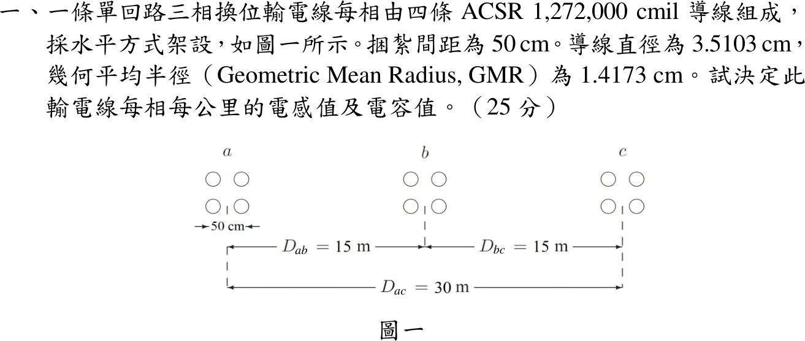
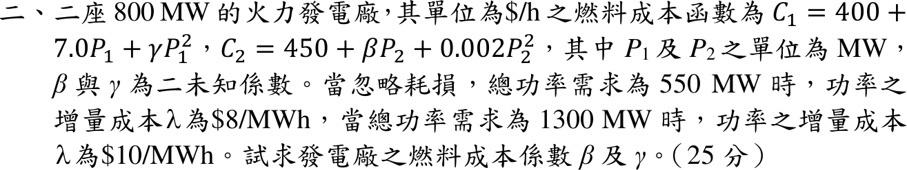
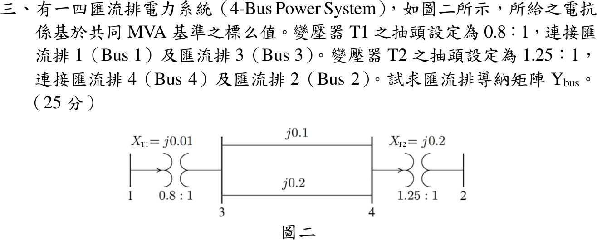
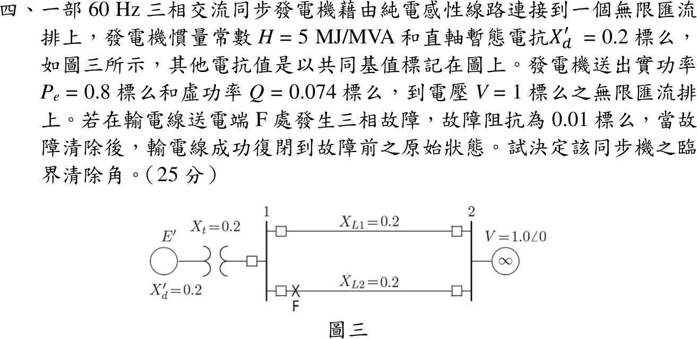

# 112 年電機工程技師｜電力系統逐題詳解

> 本頁由題級 canonical 筆記組合；每題保留官方裁切圖、校驗狀態與可追溯的推導。

## 題目導覽
- [[#一、112 年第 1 題｜四分裂換位輸電線的每公里電感與電容|第 1 題：四分裂換位輸電線的每公里電感與電容]]
- [[#二、112 年電力系統第 2 題｜經濟調度係數與容量約束 KKT 校驗|第 2 題：經濟調度係數與容量約束 KKT 校驗]]
- [[#三、112 年電力系統第 3 題｜含分接頭變壓器之四匯流排 Ybus|第 3 題：含分接頭變壓器之四匯流排 Ybus]]
- [[#四、112 年電力系統第 4 題｜三相故障之臨界清除角|第 4 題：三相故障之臨界清除角]]

---

## 一、112 年第 1 題｜四分裂換位輸電線的每公里電感與電容

> 題級識別：EE-112-05-1
> canonical 來源：[[canonical/EE-112-05-1.md]]
> 題級校驗狀態：verified

### 已知與所求

單回路三相換位線，每相四分裂正方形束線，間距 \(d=50\) cm；導線直徑 3.5103 cm（\(r=1.75515\) cm）、GMR \(=1.4173\) cm；水平排列 \(D_{ab}=D_{bc}=15\) m、\(D_{ac}=30\) m。求每相每公里電感與電容（25 分）。

### 考場標準作答

**解題邏輯**：換位三相線的每相電感 \(L=2\times10^{-7}\ln(\mathrm{GMD}/D_{sL})\)、每相對中性點電容 \(C=2\pi\varepsilon_0/\ln(\mathrm{GMD}/D_{sC})\)；前提為線路完全換位；相間距離取各相束線中心距（束線內 50 cm 的偏移相對 15 m 可忽略）；\(\varepsilon_0=8.854\times10^{-12}\ \mathrm{F/m}\)；忽略大地與架空地線的影響。
1. 先求相間等效距離 GMD。
2. 求束線等效半徑 \(D_{sL}\)（用 GMR）與 \(D_{sC}\)（用實際半徑 \(r\)）。
3. 代入兩式並換成每公里。
4. 題給「ACSR 1,272,000 cmil」只用於查導線表，本題已直接給直徑與 GMR，所以不必使用。

#### 步驟 1：相間等效距離 GMD

**邏輯**：換位線三相輪流佔據三個位置，等效距離為三個相間距離的幾何平均。

\[
\mathrm{GMD}=\sqrt[3]{D_{ab}D_{bc}D_{ac}}
\]
\[
\mathrm{GMD}=\sqrt[3]{15\times15\times30}=\sqrt[3]{6750}=18.8988\ \mathrm m=1889.88\ \mathrm{cm}
\]

#### 步驟 2：束線等效半徑 \(D_{sL}\)、\(D_{sC}\)

**邏輯**：束線等效半徑是「每根子導線自身半徑（GMR 或 \(r\)）與到其他三根距離」的幾何平均；正方形四分裂中，每根到其他三根的距離為 \(d,d,\sqrt2d\)（圖 1），四根情況相同，16 個距離相乘開 16 次方即化成一根的 4 個量開 4 次方。

\[
D_s=\left(\rho\cdot d\cdot d\cdot\sqrt2d\right)^{1/4}=\left(\rho\cdot\sqrt2\,d^3\right)^{1/4}\qquad(\rho=\mathrm{GMR}\ \text{或}\ r)
\]
以 cm 計，先算共用項：
\[
\sqrt2\,d^3=\sqrt2\times50^3=\sqrt2\times125000=176776.7\ \mathrm{cm^3}
\]
電感用 GMR \(=1.4173\) cm：
\[
D_{sL}=(1.4173\times176776.7)^{1/4}=(250545.6)^{1/4}=22.373\ \mathrm{cm}
\]
電容用實際半徑 \(r=\dfrac{3.5103}{2}=1.75515\) cm：
\[
D_{sC}=(1.75515\times176776.7)^{1/4}=(310269.6)^{1/4}=23.601\ \mathrm{cm}
\]

#### 步驟 3：每相每公里電感

**邏輯**：分子分母同以 cm 計，比值無單位；\(2\times10^{-7}\ \mathrm{H/m}=0.2\ \mu\mathrm{H/m}\)，再乘 1000 m/km。

\[
L=2\times10^{-7}\ln\frac{\mathrm{GMD}}{D_{sL}}\ \mathrm{H/m}
\]
\[
\frac{\mathrm{GMD}}{D_{sL}}=\frac{1889.88}{22.373}=84.471
\]
\[
\ln84.471=4.4364
\]
\[
L=0.2\times4.4364=0.88728\ \mu\mathrm{H/m}
\]
\[
L=0.88728\times1000\ \mathrm{m/km}=887.28\ \mu\mathrm{H/km}
\]
\[
\boxed{L=887.28\ \mu\mathrm{H/km}}
\]

#### 步驟 4：每相每公里電容

**邏輯**：電容對中性點，用實際半徑求得的 \(D_{sC}\)；\(1\ \mathrm{pF/m}\times1000\ \mathrm{m/km}=1\ \mathrm{nF/km}\)。

\[
C=\frac{2\pi\varepsilon_0}{\ln(\mathrm{GMD}/D_{sC})}\ \mathrm{F/m}
\]
\[
2\pi\varepsilon_0=2\pi\times8.854\times10^{-12}=55.631\ \mathrm{pF/m}
\]
\[
\frac{\mathrm{GMD}}{D_{sC}}=\frac{1889.88}{23.601}=80.076
\]
\[
\ln80.076=4.3830
\]
\[
C=\frac{55.631}{4.3830}=12.692\ \mathrm{pF/m}
\]
\[
C=12.692\times1000\ \mathrm{pF/km}=12692\ \mathrm{pF/km}
\]
\[
\boxed{C=12.69\ \mathrm{nF/km}}
\]

### 驗算

- 以 12 條子導線逐對距離直接求幾何平均（含束線內偏移），所得 \(L,C\) 與上式差異小於 0.5%。
- 量級：\(\omega L=2\pi(60)(887.28\ \mu\mathrm H)=334.50\ \mathrm{m\Omega/km}\)；\(1/\sqrt{LC}=1/\sqrt{887.28\times10^{-6}\times12.69\times10^{-9}}=2.98\times10^{5}\) km/s，接近光速，符合架空線。

### 失分點

- 電容須用實際半徑 \(r\)，不可用 GMR；混用會使電容偏小。
- 水平排列 \(D_{ac}=30\) m，GMD 為 18.90 m，不是 15 m。
- 正方形四分裂的對角距離是 \(\sqrt2d\)，漏乘 \(\sqrt2\) 會使 \(D_s\) 偏小。

---

## 二、112 年電力系統第 2 題｜經濟調度係數與容量約束 KKT 校驗

> 題級識別：EE-112-05-2
> canonical 來源：[[canonical/EE-112-05-2.md]]
> 題級校驗狀態：needs_manual_review
> [!WARNING] 本題仍有官方資料缺口或事件定義歧義；請以 canonical 條件式解答為準。

### 已知與所求

兩座 800 MW 火力廠，\(C_1=400+7.0P_1+\gamma P_1^2\)、\(C_2=450+\beta P_2+0.002P_2^2\)（\$/h，\(P\) 以 MW 計），忽略耗損。需求 550 MW 時 \(\lambda=8\)，1300 MW 時 \(\lambda=10\) \$/MWh。求 \(\beta,\gamma\)（25 分）。

### 考場標準作答

**解題邏輯**：無損失經濟調度的條件是「未受限機組的增量成本都等於 \(\lambda\)」加上「總出力 = 需求」；前提為 800 MW 為硬上限、下限 0 MW；到上限的機組不參與 \(\mathrm{IC}=\lambda\)，\(\lambda\) 由自由機組決定。
1. 先由成本函數微分得兩機增量成本，以兩個 \((P_D,\lambda)\) 運轉點列方程解 \(\beta,\gamma\)。
2. 解出後必須回代檢查 800 MW 容量。
3. 無約束解在 1300 MW 時使 \(P_2\) 超過 800 MW，所以再分別假設「機組 2 到上限」與「機組 1 到上限」兩個分支求解。
4. 以 KKT 條件（到上限的機組 \(\mathrm{IC}_i\le\lambda\)、停在下限 0 MW 的機組 \(\mathrm{IC}_i\ge\lambda\)）檢查。

#### 步驟 1：增量成本與內點出力

**邏輯**：二次成本函數微分後，增量成本是出力的一次式；未受限時 \(\mathrm{IC}_i=\lambda\)，即可反解出力。

\[
\mathrm{IC}_1=\frac{dC_1}{dP_1}=7+2\gamma P_1,\qquad \mathrm{IC}_2=\frac{dC_2}{dP_2}=\beta+2(0.002)P_2=\beta+0.004P_2
\]
令 \(\mathrm{IC}_i=\lambda\) 反解：
\[
P_1=\frac{\lambda-7}{2\gamma},\qquad P_2=\frac{\lambda-\beta}{0.004}=250(\lambda-\beta)
\]
以下 a 表 550 MW、\(\lambda=8\) 的運轉點，b 表 1300 MW、\(\lambda=10\) 的運轉點。

#### 步驟 2：兩機皆為內點（先不計容量）

**邏輯**：兩個運轉點都令兩機 \(\mathrm{IC}=\lambda\)，兩個功率平衡式相減可消去 \(\beta\)，先得 \(\gamma\)。

\[
P_{1a}=\frac{8-7}{2\gamma}=\frac{1}{2\gamma},\qquad P_{1b}=\frac{10-7}{2\gamma}=\frac{3}{2\gamma}
\]
\[
P_{2a}=250(8-\beta),\qquad P_{2b}=250(10-\beta)
\]
功率平衡 \(P_{1a}+P_{2a}=550\)、\(P_{1b}+P_{2b}=1300\)，兩式相減：
\[
\frac{3}{2\gamma}-\frac{1}{2\gamma}+250(10-\beta)-250(8-\beta)=1300-550
\]
\[
\frac{1}{\gamma}+250\times2=750\ \Rightarrow\ \frac{1}{\gamma}=250\ \Rightarrow\ \gamma=0.004
\]
回到運轉點 a：
\[
P_{1a}=\frac{1}{2(0.004)}=125\ \mathrm{MW},\qquad P_{2a}=550-125=425\ \mathrm{MW}
\]
由 \(\mathrm{IC}_2(P_{2a})=8\)：
\[
\beta=8-0.004(425)=8-1.7=6.30
\]
\[
(\beta,\gamma)_{\text{無約束}}=(6.30,\ 0.004)\qquad\text{（僅供對照，下面回代會違反容量，不作答案）}
\]
回代容量：運轉點 b 的 \(P_{1b}=\dfrac{3}{2(0.004)}=375\) MW，\(P_{2b}=1300-375=925\ \mathrm{MW}>800\ \mathrm{MW}\)，違反題目所給容量，所以要改看容量邊界的分支。

#### 步驟 3：機組 2 在 1300 MW 時達上限（\(P_2=800\)）

**邏輯**：運轉點 b 機組 2 固定在 800 MW，\(\lambda=10\) 只由自由機組 1 決定，先得 \(\gamma\)；運轉點 a 兩機皆為內點，再得 \(\beta\)；最後檢查受限機組 \(\mathrm{IC}_2(800)\le\lambda\)。

運轉點 b：
\[
P_{1b}=1300-800=500\ \mathrm{MW}
\]
\[
7+2\gamma(500)=10\ \Rightarrow\ 1000\gamma=3\ \Rightarrow\ \gamma=0.003
\]
運轉點 a：
\[
P_{1a}=\frac{8-7}{2(0.003)}=\frac{1}{0.006}=166.67\ \mathrm{MW}
\]
\[
P_{2a}=550-166.67=383.33\ \mathrm{MW}
\]
\[
\beta=8-0.004(383.33)=8-1.5333=6.4667
\]
KKT 檢查（機組 2 在上限時的增量成本不得高於 \(\lambda\)）：
\[
\mathrm{IC}_2(800)=6.4667+0.004(800)=6.4667+3.2=9.6667\le\lambda=10\quad\text{成立}
\]
\[
\boxed{(\beta,\gamma)_{P_2=800}=(6.47,\ 0.003)}
\]

#### 步驟 4：機組 1 在 1300 MW 時達上限（\(P_{1b}=800\)）

**邏輯**：運轉點 b 機組 1 固定在 800 MW，\(\lambda=10\) 由自由機組 2 決定，先得 \(\beta\)；運轉點 a 再由 \(\mathrm{IC}_2=8\) 得 \(P_{2a}\)，進而得 \(P_{1a}\) 與 \(\gamma\)；最後檢查 \(\mathrm{IC}_1(800)\le\lambda\)。

運轉點 b：
\[
P_{2b}=1300-800=500\ \mathrm{MW}
\]
\[
\beta+0.004(500)=10\ \Rightarrow\ \beta+2=10\ \Rightarrow\ \beta=8
\]
運轉點 a：
\[
\mathrm{IC}_2=8+0.004P_{2a}=8\ \Rightarrow\ P_{2a}=0\ \mathrm{MW},\qquad P_{1a}=550-0=550\ \mathrm{MW}
\]
\(P_{2a}=0\) 恰在下限。停在下限的機組須滿足 \(\mathrm{IC}_2(0)\ge\lambda\)；此處 \(\mathrm{IC}_2(0)=8+0.004(0)=8=\lambda\)，下限條件與內點條件 \(\mathrm{IC}_2=\lambda\) 同時成立，把機組 2 視為內點或停在下限，結果相同。
\[
7+2\gamma(550)=8\ \Rightarrow\ 1100\gamma=1\ \Rightarrow\ \gamma=\frac{1}{1100}=9.09\times10^{-4}
\]
KKT 檢查：
\[
\mathrm{IC}_1(800)=7+2\left(\frac{1}{1100}\right)(800)=7+\frac{1600}{1100}=7+1.4545=8.4545\le\lambda=10\quad\text{成立}
\]
\[
\boxed{(\beta,\gamma)_{P_1=800}=\left(8.00,\ \dfrac{1}{1100}\approx9.09\times10^{-4}\right)}
\]

**結論**：若不計容量，唯一的代數解為 \((6.30,\ 0.004)\)，但它使 \(P_2=925\) MW 超限；在 800 MW 硬上限下，步驟 3、步驟 4 兩組係數都能重現題給的兩個 \(\lambda\)，題目未指定哪一台到上限。

### 驗算

以各組係數在 \(0\le P_i\le800\) 內直接網格搜尋總成本最小的調度：

- \((6.47,\ 0.003)\)：550 MW → \(P_1=166.67\)、\(P_2=383.33\)，\(\lambda=8\)；1300 MW → \(P_1=500\)、\(P_2=800\)，\(\lambda=\mathrm{IC}_1=10\)。
- \((8.00,\ 1/1100)\)：550 MW → \(P_1=550\)、\(P_2=0\)，\(\lambda=8\)；1300 MW → \(P_1=800\)、\(P_2=500\)，\(\lambda=\mathrm{IC}_2=10\)。
- \((6.30,\ 0.004)\)：1300 MW 時 \(P_2\) 被截在 800、\(P_1=500\)，\(\lambda=\mathrm{IC}_1=7+2(0.004)(500)=11\neq10\)，硬上限下不成立。

### 失分點

- 未回代容量，直接以 \(\beta=6.30,\ \gamma=0.004\) 作唯一答案，忽略 \(P_2=925\) MW 超限。
- 機組達上限時其增量成本不等於 \(\lambda\)，只須 \(\mathrm{IC}_i\le\lambda\)；把受限機組的 \(\mathrm{IC}\) 設為 \(\lambda\) 會得錯誤係數。

### 條件與疑義

題面未說明 800 MW 是否為硬上限、也未指定哪台機組受限；三組結果分別對應無約束、\(P_2=800\)、\(P_1=800\)，不得把其中一組當成唯一答案。

---

## 三、112 年電力系統第 3 題｜含分接頭變壓器之四匯流排 Ybus

> 題級識別：EE-112-05-3
> canonical 來源：[[canonical/EE-112-05-3.md]]
> 題級校驗狀態：verified

### 已知與所求

T1：Bus 1–Bus 3，\(X_{T1}=j0.01\)，抽頭 \(0.8:1\)（箭頭在 Bus 1 側）；Bus 3–Bus 4 兩條並聯線 \(j0.1\)、\(j0.2\)；T2：Bus 4–Bus 2，\(X_{T2}=j0.2\)，抽頭 \(1.25:1\)（箭頭在 Bus 4 側）。電抗為共同基準標么值。求 \(Y_{bus}\)。

### 考場標準作答

**解題邏輯**：\(Y_{bus}\) 由各支路逐一「蓋印」相加；前提為電抗皆為題給共同 MVA 基準的標么值；電阻、並聯電納忽略；抽頭比為實數（無相移）；依題圖，抽頭（箭頭）在 Bus 1 側與 Bus 4 側，串聯電抗歸在另一側。
1. 普通線路的蓋印是 \(Y_{ii}\mathrel{+}=y\)、\(Y_{kk}\mathrel{+}=y\)、\(Y_{ik}\mathrel{+}=-y\)；含非標稱抽頭的變壓器要先用「理想變壓器 \(a:1\) 串聯導納 \(y\)」的模型推出它自己的蓋印式。
2. 求各支路串聯導納。
3. 推抽頭支路蓋印式。
4. T1、3–4 線路、T2 逐一蓋印。
5. 彙整成 \(4\times4\) 矩陣。

#### 步驟 1：各支路串聯導納

**邏輯**：導納 = 阻抗倒數；兩條並聯線的導納直接相加。

\[
y_{T1}=\frac{1}{j0.01}=-j100
\]
\[
y_{T2}=\frac{1}{j0.2}=-j5
\]
\[
y_{34}=\frac{1}{j0.1}+\frac{1}{j0.2}=-j10+(-j5)=-j15
\]

#### 步驟 2：抽頭支路的蓋印式

**邏輯**：理想變壓器兩側電壓比為 \(a:1\)、複功率相等（電流比為 \(1:a\)），由此寫出 \(I_i\)、\(I_k\) 對 \(V_i\)、\(V_k\) 的關係，係數即為蓋印值。

- 理想變壓器另一側（內部節點）電壓：\(V_i/a\)。
- 串聯電流（由內部節點流向 Bus \(k\)）：\(I=y\left(\dfrac{V_i}{a}-V_k\right)\)。
- 無損：\(V_iI_i^*=\dfrac{V_i}{a}I^*\)，且 \(a\) 為實數，故 \(I_i=\dfrac{I}{a}\)；Bus \(k\) 側 \(I_k=-I\)。

展開：
\[
I_i=\frac{1}{a}\,y\left(\frac{V_i}{a}-V_k\right)=\frac{y}{a^2}V_i-\frac{y}{a}V_k
\]
\[
I_k=-y\left(\frac{V_i}{a}-V_k\right)=-\frac{y}{a}V_i+yV_k
\]
所以
\[
Y_{ii}\mathrel{+}=\frac{y}{a^2},\qquad Y_{ik}=Y_{ki}\mathrel{+}=-\frac{y}{a},\qquad Y_{kk}\mathrel{+}=y
\]
（\(a=1\) 時即回到普通線路的蓋印。）

#### 步驟 3：逐支路蓋印

**邏輯**：T1 取 \(a=0.8\)、\(i=1\)、\(k=3\)；T2 取 \(a=1.25\)、\(i=4\)、\(k=2\)；3–4 線路視為 \(a=1\)。

T1：
\[
\frac{y_{T1}}{a^2}=\frac{-j100}{0.8^2}=\frac{-j100}{0.64}=-j156.25\quad(\text{加到 }Y_{11})
\]
\[
-\frac{y_{T1}}{a}=-\frac{-j100}{0.8}=+j125\quad(\text{加到 }Y_{13}=Y_{31})
\]
\[
y_{T1}=-j100\quad(\text{加到 }Y_{33})
\]
3–4 線路：
\[
y_{34}=-j15\ (\text{加到 }Y_{33}\text{、}Y_{44}),\qquad -y_{34}=+j15\ (\text{加到 }Y_{34}=Y_{43})
\]
T2：
\[
\frac{y_{T2}}{a^2}=\frac{-j5}{1.25^2}=\frac{-j5}{1.5625}=-j3.2\quad(\text{加到 }Y_{44})
\]
\[
-\frac{y_{T2}}{a}=-\frac{-j5}{1.25}=+j4\quad(\text{加到 }Y_{42}=Y_{24})
\]
\[
y_{T2}=-j5\quad(\text{加到 }Y_{22})
\]

#### \(Y_{bus}\)（25 分）

**邏輯**：把步驟 3 的蓋印值逐元素相加；沒有支路直接相連的匯流排（1–2、1–4、2–3）互導納為 0。

自導納：
\[
Y_{11}=-j156.25,\qquad Y_{22}=-j5
\]
\[
Y_{33}=-j100+(-j15)=-j115
\]
\[
Y_{44}=-j15+(-j3.2)=-j18.20
\]
互導納：
\[
Y_{13}=Y_{31}=+j125,\qquad Y_{24}=Y_{42}=+j4,\qquad Y_{34}=Y_{43}=+j15
\]
\[
\boxed{Y_{bus}=\begin{bmatrix}
-j156.25&0&+j125&0\\
0&-j5&0&+j4\\
+j125&0&-j115&+j15\\
0&+j4&+j15&-j18.20
\end{bmatrix}\ \mathrm{pu}}
\]

### 驗算

π 等效分路檢查（抽頭支路的列和 = 該側對地分路）：Bus 1 列和 \(-j156.25+j125=-j31.25\)，而 \(y_{T1}\left(\dfrac{1}{0.8^2}-\dfrac{1}{0.8}\right)=-j100(1.5625-1.25)=-j31.25\)，一致；Bus 2 列和 \(-j5+j4=-j1\)，而 \(y_{T2}\left(1-\dfrac{1}{1.25}\right)=-j5(0.2)=-j1\)，一致。矩陣對稱（\(Y_{13}=Y_{31}\)、\(Y_{24}=Y_{42}\)），符合實數抽頭理想變壓器的互易性。

### 失分點

- 把 T2 的 \(1.25\) 放到 Bus 2 側，會得 \(Y_{22}=-j3.20\)、\(Y_{44}=-j20\)。
- 兩條 3–4 線路應先並聯成 \(-j15\)（導納相加），不是串聯。
- 有分接頭時列和不為零，不能用「每列和為零」檢查。

---

## 四、112 年電力系統第 4 題｜三相故障之臨界清除角

> 題級識別：EE-112-05-4
> canonical 來源：[[canonical/EE-112-05-4.md]]
> 題級校驗狀態：verified

### 已知與所求

60 Hz，\(H=5\) MJ/MVA，\(X_d'=0.2\)、\(X_t=0.2\)，兩條並聯線 \(X_{L1}=X_{L2}=0.2\) pu；送至無限匯流排 \(V=1\angle0^\circ\) 的 \(P_e=0.8\)、\(Q=0.074\) pu。線路 2 送電端 F 經 0.01 pu 三相故障，清除後線路復閉回原狀態。求臨界清除角 \(\delta_{cr}\)。

### 考場標準作答

**解題邏輯**：暫態穩定度用等面積準則；前提為古典模型（\(X_d'\) 後的 \(|E'|\) 與 \(P_m=0.8\) 不變、忽略阻尼）；標么值以題圖的共同基準；無限匯流排 \(V=1\angle0^\circ\) 為參考相量；F 在線路 2 送電端，視為 Bus 1 經 \(Z_f\) 接地（主解取 \(Z_f=j0.01\)，見「條件與疑義」）；復閉後網路與故障前相同。
1. 由故障前潮流求暫態電勢 \(E'\) 與初始角 \(\delta_0\)。
2. 求「故障前／復閉後」的轉移電抗 \(X_1\) 與 \(P_{\max}\)。
3. 求「故障期間」的轉移電抗 \(X_2\) 與 \(P_{2\max}\)。
4. 令加速面積 \(A_1\) 等於減速面積 \(A_2\)，解 \(\cos\delta_{cr}\)。
5. \(\delta_{cr}\) 距兩位小數的進位界很近，本題中間值保留 6–7 位有效數字。

#### 步驟 1：故障前／復閉後的轉移電抗 \(X_1\)

**邏輯**：\(E'\) 到無限匯流排是 \(X_d'\)、\(X_t\) 與兩條並聯線串聯。

\[
X_{L1}\parallel X_{L2}=\frac{0.2\times0.2}{0.2+0.2}=\frac{0.04}{0.4}=0.10
\]
\[
X_1=X_d'+X_t+X_{L1}\parallel X_{L2}=0.20+0.20+0.10=0.50\ \mathrm{pu}
\]

#### 步驟 2：暫態電勢 \(E'\)、初始角 \(\delta_0\) 與 \(P_{\max}\)

**邏輯**：送到無限匯流排的複功率 \(S=VI^*\)，故 \(I=(P-jQ)/V^*\)；再由 \(E'=V+jX_1I\) 得 \(E'\)，其相角即 \(\delta_0\)。

\[
I=\frac{P-jQ}{V^*}=\frac{0.8-j0.074}{1}=0.8-j0.074\ \mathrm{pu}
\]
\[
jX_1I=j0.50(0.8-j0.074)=0.037+j0.40\ \mathrm{pu}
\]
\[
E'=V+jX_1I=1+0.037+j0.40=1.037+j0.40\ \mathrm{pu}
\]
大小與相角：
\[
|E'|=\sqrt{1.037^2+0.40^2}=\sqrt{1.075369+0.16}=\sqrt{1.235369}=1.111471\ \mathrm{pu}
\]
\[
\delta_0=\tan^{-1}\frac{0.40}{1.037}=\tan^{-1}0.385728=21.0930^\circ=0.368143\ \mathrm{rad}
\]
故障前／復閉後功率曲線峰值：
\[
P_{\max}=\frac{|E'|V}{X_1}=\frac{1.111471\times1}{0.50}=2.222942\ \mathrm{pu}
\]

#### 步驟 3：故障期間的轉移電抗 \(X_2\) 與 \(P_{2\max}\)

**邏輯**：故障期間 Bus 1 多一條對地支路 \(Z_f\)；以 Bus 1 為中心的 Y 形（\(j0.40\)、\(j0.10\)、\(j0.01\)）做 Y→Δ，\(E'\) 與 \(V\) 之間的 Δ 支路即轉移電抗（另兩條 Δ 支路接地，不傳送功率）。

\[
X_2=\frac{X_aX_b+X_bX_f+X_fX_a}{X_f},\qquad X_a=0.40,\ X_b=0.10,\ X_f=0.01
\]
\[
X_aX_b+X_bX_f+X_fX_a=0.40(0.10)+0.10(0.01)+0.01(0.40)=0.04+0.001+0.004=0.045
\]
\[
X_2=\frac{0.045}{0.01}=4.5\ \mathrm{pu}
\]
\[
P_{2\max}=\frac{|E'|V}{X_2}=\frac{1.111471}{4.5}=0.246994\ \mathrm{pu}
\]

#### （一）臨界清除角（25 分）

**邏輯**：故障期間 \(P_m>P_{2\max}\sin\delta\)，轉子由 \(\delta_0\) 加速到 \(\delta_{cr}\)（\(A_1\)）；復閉後回到 \(P_{\max}\sin\delta\)，減速到最遠 \(\delta_{\max}=\pi-\delta_0\)（\(A_2\)）；臨界時 \(A_1=A_2\)。

加速面積：
\[
A_1=\int_{\delta_0}^{\delta_{cr}}(P_m-P_{2\max}\sin\delta)\,d\delta=P_m(\delta_{cr}-\delta_0)+P_{2\max}(\cos\delta_{cr}-\cos\delta_0)
\]
減速面積：
\[
A_2=\int_{\delta_{cr}}^{\delta_{\max}}(P_{\max}\sin\delta-P_m)\,d\delta=P_{\max}(\cos\delta_{cr}-\cos\delta_{\max})-P_m(\delta_{\max}-\delta_{cr})
\]
令 \(A_1=A_2\)，\(P_m\delta_{cr}\) 兩邊相消，移項解 \(\cos\delta_{cr}\)：
\[
\cos\delta_{cr}=\frac{P_m(\delta_{\max}-\delta_0)+P_{\max}\cos\delta_{\max}-P_{2\max}\cos\delta_0}{P_{\max}-P_{2\max}}
\]
所需角度量（弧度）：
\[
\delta_{\max}=\pi-\delta_0=3.141593-0.368143=2.773450\ \mathrm{rad}\ (158.9070^\circ)
\]
\[
\delta_{\max}-\delta_0=2.773450-0.368143=2.405307\ \mathrm{rad}
\]
\[
\cos\delta_0=\cos(0.368143)=0.932997,\qquad \cos\delta_{\max}=-\cos\delta_0=-0.932997
\]
分子三項：
\[
P_m(\delta_{\max}-\delta_0)=0.8\times2.405307=1.924246
\]
\[
P_{\max}\cos\delta_{\max}=2.222942\times(-0.932997)=-2.073998
\]
\[
P_{2\max}\cos\delta_0=0.246994\times0.932997=0.230445
\]
\[
\text{分子}=1.924246-2.073998-0.230445=-0.380197
\]
分母：
\[
P_{\max}-P_{2\max}=2.222942-0.246994=1.975948
\]
\[
\cos\delta_{cr}=\frac{-0.380197}{1.975948}=-0.192412
\]
\[
\delta_{cr}=\cos^{-1}(-0.192412)=101.0936^\circ=1.764416\ \mathrm{rad}
\]
\[
\boxed{\delta_{cr}=1.76\ \mathrm{rad}=101.09^\circ}
\]

### 驗算

以 Bus 1 節點 KCL 直接求故障期間輸出 \(P_e(\delta)=\mathrm{Re}\{E'I_g^*\}\)（不經 Y–Δ），再以數值積分令加速面積 \(\int_{\delta_0}^{\delta_{cr}}(P_m-P_e)\,d\delta\) 等於減速面積 \(\int_{\delta_{cr}}^{\delta_{\max}}(P_{\max}\sin\delta-P_m)\,d\delta\)，二分法求根得 \(101.09^\circ\)；另 \(P_{\max}\sin\delta_0=2.222942\times\sin(0.368143)=2.222942\times0.359883=0.8000\)，與 \(P_m\) 相符；且 \(\delta_0<\delta_{cr}<\delta_{\max}\)（\(21.09^\circ<101.09^\circ<158.91^\circ\)）。

### 失分點

- 故障期間把 \(P_e\) 設為 0；有限故障阻抗與健全線路使 \(P_{2\max}=0.246994\) pu。
- 兩條 0.2 pu 線路在故障前後是並聯（0.1 pu），不是只算一條。
- 等面積式中的 \(\delta_{\max}-\delta_0\) 必須用弧度；\(\cos\delta_{cr}\) 由相近量相減，中間值不可先四捨五入成兩位小數。

### 條件與疑義

題面只寫「故障阻抗為 0.01 標么」未標 \(j\)。主解：等效接地電抗 \(Z_f=j0.01\) pu（與公開更正解答一致），得 \(\delta_{cr}=101.09^\circ\)。若依字面視為純電阻 0.01 pu，故障期間曲線含電阻損耗項，數值等面積求得 \(\delta_{cr}=102.08^\circ\)，僅作敏感度對照。

---
