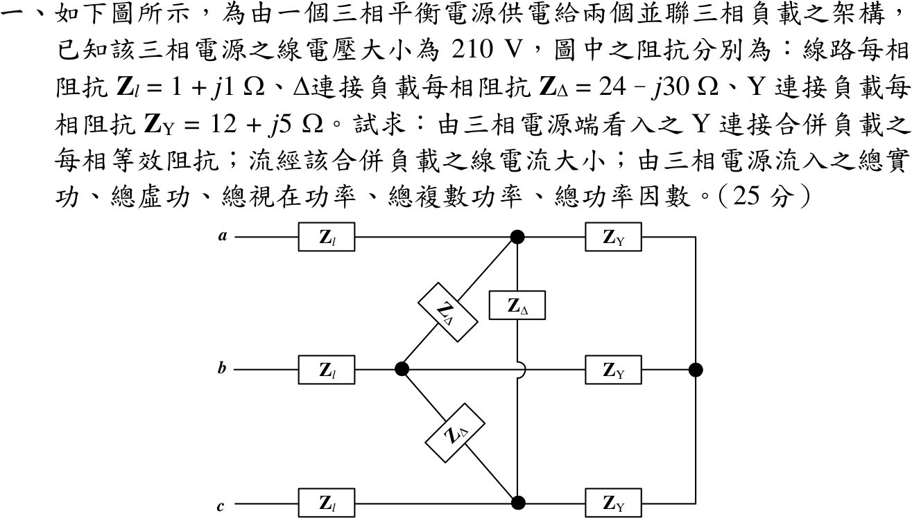
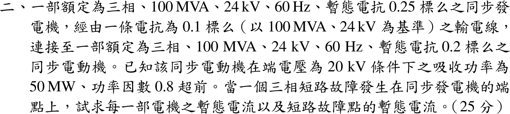
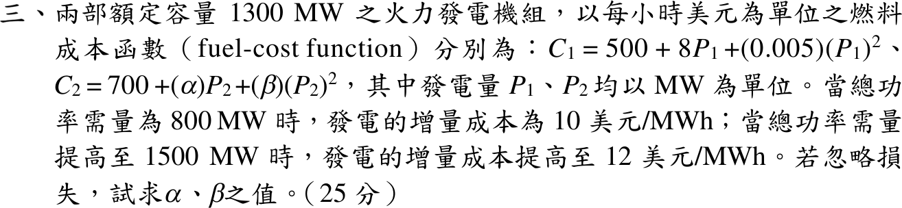
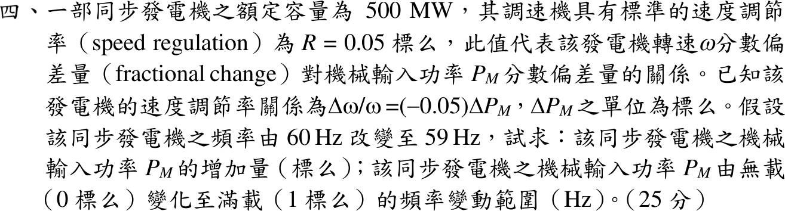

# 113 年電機工程技師｜電力系統逐題詳解

> 本頁由題級 canonical 筆記組合；每題保留官方裁切圖、校驗狀態與可追溯的推導。

## 題目導覽
- [[#一、113 年第 1 題｜三相並聯負載與複數功率|第 1 題：三相並聯負載與複數功率]]
- [[#二、113 年第 2 題｜同步機與輸電線三相短路暫態電流|第 2 題：同步機與輸電線三相短路暫態電流]]
- [[#三、113 年電力系統第 3 題｜經濟調度增量成本係數|第 3 題：經濟調度增量成本係數]]
- [[#四、113 年第 4 題｜獨立驗證|第 4 題：獨立驗證]]

---

## 一、113 年第 1 題｜三相並聯負載與複數功率

> 題級識別：EE-113-05-1
> canonical 來源：[[canonical/EE-113-05-1.md]]
> 題級校驗狀態：verified

### 已知與所求

平衡三相電源線電壓 210 V；線路每相 \(Z_l=1+j1\ \Omega\)；\(\Delta\) 負載每相 \(Z_\Delta=24-j30\ \Omega\)；Y 負載每相 \(Z_Y=12+j5\ \Omega\)。求由電源端看入的 Y 等效每相阻抗、線電流大小，以及電源送出的總 \(P\)、\(Q\)、\(|S|\)、\(S\)、功率因數。

### 考場標準作答

**解題邏輯**：平衡三相電路取一相（單相等效）計算：把 \(\Delta\) 負載轉成等效 Y（每相阻抗除以 3）→ 與 Y 負載並聯得合併負載 \(Z_L\) → 串線路阻抗得電源端看入的 \(Z_{in}\) → 相電壓 ÷ \(|Z_{in}|\) 得線電流 → 三相總複功率 \(S=3|I_L|^2Z_{in}\)，由其實部、虛部求 \(P\)、\(Q\)、\(|S|\)、功因。共用前提：電源線電壓 210 V，Y 等效每相電壓 \(V_\phi=210/\sqrt3\)。

#### 步驟 1：單相等效電路

- 以電源中性點 n 為參考，每相為「\(Z_l\) 串（\(Z_\Delta/3\) 並聯 \(Z_Y\)）」。
- 平衡負載的 Y 中性點與電源中性點同電位，可直接連到 n。

#### 由電源端看入之 Y 連接合併負載每相等效阻抗

**邏輯**：平衡 \(\Delta\) 負載的等效 Y 每相阻抗為 \(Z_\Delta/3\)；兩組 Y 負載每相並聯，再與線路阻抗串聯。

\(\Delta\to\mathrm Y\)：
\[
\frac{Z_\Delta}{3}=\frac{24-j30}{3}=8-j10\ \Omega
\]
與 \(Z_Y\) 並聯，分子、分母分別計算：
\[
(8-j10)(12+j5)=96+j40-j120-j^2 50=146-j80
\]
\[
(8-j10)+(12+j5)=20-j5
\]
分母有理化（乘 \(20+j5\)，\(|20-j5|^2=400+25=425\)）：
\[
Z_L=\frac{146-j80}{20-j5}=\frac{(146-j80)(20+j5)}{425}=\frac{2920+j730-j1600+400}{425}=\frac{3320-j870}{425}
\]
\[
\boxed{Z_L=7.81-j2.05\ \Omega}
\]
由電源端看入再串線路阻抗：
\[
\boxed{Z_{in}=Z_l+Z_L=(1+j1)+(7.81-j2.05)=8.81-j1.05\ \Omega}
\]
極式（供下一小題用）：
\[
|Z_{in}|=\sqrt{8.81^2+1.05^2}=8.87\ \Omega,\qquad \angle Z_{in}=\tan^{-1}\frac{-1.05}{8.81}=-6.78^\circ
\]

#### 流經合併負載的線電流大小

**邏輯**：Y 接時線電流 = 相電流 = 相電壓 ÷ 每相看入阻抗。

\[
V_\phi=\frac{210}{\sqrt3}=121.24\ \mathrm V
\]
\[
\boxed{|I_L|=\frac{V_\phi}{|Z_{in}|}=\frac{121.24}{8.87}=13.66\ \mathrm A}
\]

#### 電源流入之總實功、總虛功、總視在功率、總複數功率、總功率因數

**邏輯**：每相複功率 \(V_\phi I_L^*=|I_L|^2Z_{in}\)，三相合計乘 3；電源端看入的 \(Z_{in}\) 已含線路，所以這就是電源送出的總功率。

\[
|I_L|^2=13.66^2=186.68\ \mathrm{A^2},\qquad 3|I_L|^2=3\times186.68=560.05\ \mathrm{A^2}
\]
\[
S=3|I_L|^2Z_{in}=560.05\,(8.81-j1.05)
\]
實部、虛部分別相乘（以完整精度）：
\[
P=560.05\times8.81=4934.99\ \mathrm W,\qquad Q=560.05\times(-1.05)=-586.40\ \mathrm{var}
\]
\[
\boxed{P=4934.99\ \mathrm W},\quad \boxed{Q=-586.40\ \mathrm{var}}
\]
視在功率與複數功率：
\[
\boxed{|S|=\sqrt{P^2+Q^2}=4969.71\ \mathrm{VA}},\qquad \boxed{S=4934.99-j586.40\ \mathrm{VA}}
\]
功率因數（\(Q<0\)：電源端看入為容性，電流超前電壓）：
\[
\boxed{\mathrm{pf}=\frac{P}{|S|}=\frac{4934.99}{4969.71}=0.99\ \text{超前}}
\]
（以完整精度計算後顯示兩位小數；\(\cos(-6.78^\circ)=0.99\) 亦同。）

### 驗算

- 分項功率守恆：負載 \(3|I_L|^2Z_L=4374.95-j1146.45\) VA，線路 \(3|I_L|^2Z_l=560.05+j560.05\) VA，相加 \(4934.99-j586.40\) VA（顯示值相加有 0.01 的捨入差）。
- 完整三相節點分析（A、B、C 三節點加 Y 中性點，\(\Delta\) 負載不轉換）解得線電流 13.66 A、\(S\) 相同。

### 失分點

- \(\Delta\) 負載忘記除以 3，直接以 \(24-j30\) 與 \(12+j5\) 並聯。
- 求電源送出功率時漏掉線路阻抗，只算負載 \(4374.95\) W。
- \(Q<0\) 為容性，功率因數應標「超前」。

### 條件與疑義

「由電源端看入之 Y 連接合併負載每相等效阻抗」可讀為只含負載（\(Z_L\)）或含線路（\(Z_{in}\)）；兩者都列出。線電流與電源功率均以含線路的 \(Z_{in}\) 計算，不受此讀法影響。

---

## 二、113 年第 2 題｜同步機與輸電線三相短路暫態電流

> 題級識別：EE-113-05-2
> canonical 來源：[[canonical/EE-113-05-2.md]]
> 題級校驗狀態：verified

### 已知與所求

基準 100 MVA、24 kV。發電機 \(X_g'=0.25\)，線路 \(X_l=0.1\)，電動機 \(X_m'=0.2\) pu。電動機端電壓 20 kV、吸收 50 MW、pf 0.8 超前。發電機端點三相短路，求兩機暫態電流與故障點暫態電流。

### 考場標準作答

**解題邏輯**：暫態電流要用「暫態電抗後的內電勢」\(E'\)，而 \(E'\) 在故障瞬間保持故障前的值。所以先由電動機端電壓與吸收功率求故障前負載電流 \(I\) → 以 \(E'=V+jX'I\) 求兩機內電勢 → 故障時發電機端電壓為 0，兩機各自經自身支路（電動機側含線路）把電流送入故障點 → 故障電流為兩者相量和，最後換算安培。共用前提：兩機額定與基準相同（100 MVA、24 kV），電抗不需換算基準；以電動機端電壓為相角參考。

#### 步驟 1：故障前電路與負載電流

- 等效電路：\(E_g'\) 串 \(j0.25\) 到發電機端 G，經線路 \(j0.1\) 到電動機端 M，再串 \(j0.2\) 到 \(E_m'\)；電流 \(I\) 由發電機流向電動機。

電動機端電壓（標么）：
\[
V_m=\frac{20}{24}=\frac{5}{6}\approx0.8333\angle0^\circ\ \mathrm{pu}
\]
吸收功率：\(P=50/100=0.50\) pu；pf 0.8 超前表示電動機吸收的 \(Q<0\)，\(\tan\theta=0.6/0.8=0.75\)：
\[
Q=-P\tan\theta=-0.50\times0.75=-0.375\ \mathrm{pu},\qquad S_m=0.50-j0.375\ \mathrm{pu}
\]
負載電流（由 \(S_m=V_mI^*\) 解出）：
\[
I=\frac{S_m^*}{V_m^*}=\frac{0.50+j0.375}{5/6}=(0.50+j0.375)\times1.2=0.60+j0.45\ \mathrm{pu}
\]
大小與相角：
\[
|I|=\sqrt{0.60^2+0.45^2}=0.75,\qquad \angle I=\tan^{-1}\frac{0.45}{0.60}=36.87^\circ\ \Rightarrow\ I=0.75\angle36.87^\circ\ \mathrm{pu}
\]

#### 步驟 2：兩機暫態內電勢

**發電機**（由 \(E_g'\) 出發，經 \(j0.25\) 與 \(j0.1\) 到 M 點，電流 \(I\) 同向，所以 \(E_g'=V_m+j(0.25+0.1)I\)）：
\[
j0.35I=j0.35(0.60+j0.45)=j0.21+j^2(0.1575)=-0.1575+j0.21
\]
\[
E_g'=V_m+j0.35I=0.8333+(-0.1575+j0.21)=0.6758+j0.21\ \mathrm{pu}
\]
**電動機**（電流 \(I\) 流入電動機，內電勢比端電壓少一個電抗壓降，\(E_m'=V_m-j0.2I\)）：
\[
j0.20I=j0.20(0.60+j0.45)=-0.09+j0.12
\]
\[
E_m'=V_m-j0.20I=0.8333-(-0.09+j0.12)=0.9233-j0.12\ \mathrm{pu}
\]

#### 步驟 3：故障瞬間的電路

- 發電機端 G 三相短路接地，\(V_G=0\)；\(E_g'\)、\(E_m'\) 維持步驟 2 的值。
- 發電機支路只剩 \(j0.25\)；電動機支路為 \(j0.2+j0.1=j0.30\)（含線路）。兩支路電流都定為流向故障點。

#### 每部電機的暫態電流

**邏輯**：故障點電壓為 0，每條支路電流 = 該支路內電勢 ÷ 支路電抗，兩支路互不影響。

發電機暫態電流（除以 \(j0.25\) 等於乘 \(-j4\)）：
\[
I_g'=\frac{E_g'}{j0.25}=(0.6758+j0.21)(-j4)=-j(0.6758\times4)+(-j)(j)(0.21\times4)=0.84-j2.7032
\]
大小與相角（第四象限）：
\[
|I_g'|=\sqrt{0.84^2+2.7032^2}=2.8307,\qquad \angle I_g'=-\tan^{-1}\frac{2.7032}{0.84}=-72.74^\circ
\]
\[
\boxed{I_g'=\frac{E_g'}{j0.25}=0.84-j2.70=2.83\angle-72.74^\circ\ \mathrm{pu}}
\]
電動機暫態電流（除以 \(j0.30\) 等於乘 \(-j\tfrac{10}{3}\)）：
\[
I_m'=\frac{E_m'}{j0.30}=(0.9233-j0.12)\left(-j\tfrac{10}{3}\right)=-j(0.9233)\left(\tfrac{10}{3}\right)+j^2(0.12)\left(\tfrac{10}{3}\right)
\]
\[
(0.9233)\left(\tfrac{10}{3}\right)=3.0777,\qquad (0.12)\left(\tfrac{10}{3}\right)=0.40\ \Rightarrow\ I_m'=-0.40-j3.0777
\]
大小與相角（第三象限，角度 \(=-180^\circ+\tan^{-1}\frac{3.0777}{0.40}\)）：
\[
|I_m'|=\sqrt{0.40^2+3.0777^2}=3.1036,\qquad \angle I_m'=-180^\circ+82.59^\circ=-97.40^\circ
\]
\[
\boxed{I_m'=\frac{E_m'}{j(0.2+0.1)}=-0.40-j3.08=3.10\angle-97.40^\circ\ \mathrm{pu}}
\]

#### 短路故障點的暫態電流

**邏輯**：故障點 KCL——流入故障點的總電流是兩支路電流的相量和（不是幅值和）。

\[
I_f'=I_g'+I_m'=(0.84-0.40)+j(-2.7032-3.0777)=0.44-j5.7809
\]
大小與相角：
\[
|I_f'|=\sqrt{0.44^2+5.7809^2}=5.7976,\qquad \angle I_f'=-\tan^{-1}\frac{5.7809}{0.44}=-85.65^\circ
\]
\[
\boxed{I_f'=I_g'+I_m'=0.44-j5.78=5.80\angle-85.65^\circ\ \mathrm{pu}}
\]

#### 換算成安培

**邏輯**：實際電流 = 標么值 × 基準電流，基準電流取故障所在 24 kV 側。

\[
I_B=\frac{S_B}{\sqrt3V_B}=\frac{100\times10^6}{\sqrt3(24\times10^3)}=2405.63\ \mathrm A
\]
各標么值乘基準電流：
\[
|I_g'|=2.8307\times2405.63=6810\ \mathrm A
\]
\[
|I_m'|=3.1036\times2405.63=7466\ \mathrm A
\]
\[
|I_f'|=5.7976\times2405.63=13947\ \mathrm A
\]
\[
\boxed{|I_g'|=6.81\ \mathrm{kA}},\qquad \boxed{|I_m'|=7.47\ \mathrm{kA}},\qquad \boxed{|I_f'|=13.95\ \mathrm{kA}}
\]

### 驗算

戴維寧疊加：故障前發電機端電壓 \(V_f=V_m+j0.1I=0.8333+(-0.045+j0.06)=0.7883+j0.06\)，\(Z_{th}=j0.25\parallel j0.30=j\tfrac{3}{22}\approx j0.136\)，\(I_f'=V_f/Z_{th}=(0.7883+j0.06)\left(-j\tfrac{22}{3}\right)=0.44-j5.7809\)；依電抗分流再疊加負載電流：\(I_g'=I+I_f'\frac{0.30}{0.55}=(0.60+0.24)+j(0.45-3.1532)=0.84-j2.7032\)、\(I_m'=-I+I_f'\frac{0.25}{0.55}=(-0.60+0.20)+j(-0.45-2.6277)=-0.40-j3.0777\)，與上相同。

### 失分點

- 超前功率因數表示電動機吸收 \(Q<0\)，\(S_m=0.50-j0.375\)；符號弄反則兩個電勢都錯。
- 電動機端電壓是 20 kV（0.8333 pu），不可當 1.0 pu。
- 故障電流為相量和 \(5.80\) pu，不是幅值和 \(2.83+3.10\)。

---

## 三、113 年電力系統第 3 題｜經濟調度增量成本係數

> 題級識別：EE-113-05-3
> canonical 來源：[[canonical/EE-113-05-3.md]]
> 題級校驗狀態：verified

### 已知與所求

兩機各 1300 MW，\(C_1=500+8P_1+0.005P_1^2\)、\(C_2=700+\alpha P_2+\beta P_2^2\)（\$/h）。需求 800 MW 時 \(\lambda=10\)，1500 MW 時 \(\lambda=12\) \$/MWh，忽略損失。求 \(\alpha,\beta\)。

### 考場標準作答

無損失經濟調度：兩機未達容量限制時增量成本相等且等於 \(\lambda\)；由機組 1（係數已知）的增量成本反求各運轉點出力，再用機組 2 的增量成本方程式求 \(\alpha,\beta\)。\(\mathrm{IC}_1=8+0.01P_1\)、\(\mathrm{IC}_2=\alpha+2\beta P_2\)，\(\mathrm{IC}_1=\mathrm{IC}_2=\lambda\)。

由機組 1 求各點出力（\(P_1=(\lambda-8)/0.01\)，\(P_2=P_D-P_1\)）：
\[
\lambda=10:\ P_1=\frac{10-8}{0.01}=200,\ P_2=800-200=600\ \mathrm{MW};\qquad
\lambda=12:\ P_1=\frac{12-8}{0.01}=400,\ P_2=1500-400=1100\ \mathrm{MW}
\]
皆在 0–1300 MW 內，兩機均為內點。代入機組 2 的 \(\mathrm{IC}_2=\lambda\)：
\[
\alpha+2\beta(600)=10,\qquad \alpha+2\beta(1100)=12\ \Rightarrow\ \alpha+1200\beta=10,\quad \alpha+2200\beta=12
\]
兩式相減：\(1000\beta=2\)，再回代 \(\alpha=10-1200\beta\)：
\[
\boxed{\beta=2.00\times10^{-3}\ \$/\mathrm{MW^2h}},\qquad \boxed{\alpha=10-1200(2.00\times10^{-3})=7.60\ \$/\mathrm{MWh}}
\]

### 驗算

以求得係數重新調度：800 MW 時 \(8+0.01P_1=7.60+4.00\times10^{-3}(800-P_1)\Rightarrow P_1=200\)，\(\lambda=10\)；1500 MW 時 \(P_1=400\)，\(\lambda=12\)，兩點均重現題給增量成本。

### 失分點

- \(0.005P_1^2\) 微分為 \(0.01P_1\)；誤寫 \(0.005P_1\) 會得 \(P_1=400,800\) MW，係數全錯。
- 未檢查第二點 \(P_2=1100\) MW 是否超過 1300 MW 容量就直接作答。

---

## 四、113 年第 4 題｜獨立驗證

> 題級識別：EE-113-05-4
> canonical 來源：[[canonical/EE-113-05-4.md]]
> 題級校驗狀態：verified

### 已知與所求

500 MW 同步發電機，速度調節率 \(R=0.05\) pu，關係式 \(\Delta\omega/\omega=-0.05\,\Delta P_M\)（\(\Delta P_M\) 為標么值）。頻率由 60 Hz 降至 59 Hz，求 \(P_M\) 的增加量（pu）；並求 \(P_M\) 由 0 變至 1 pu 時的頻率變動範圍（Hz）。

### 考場標準作答

觀念：速度調節率 \(R\) 描述調速機的下垂特性——轉速（頻率）每降低一個標么量，機械輸入功率須按 \(R\) 的倒數增加；題目已給 \(\Delta\omega/\omega=-R\,\Delta P_M\)，頻率與轉速成正比，故 \(\Delta\omega/\omega=\Delta f/f_0\) 可直接代入。

#### 1. 功率增加量

頻率由 60 Hz 降到 59 Hz，轉速分數偏差：
\[
\frac{\Delta\omega}{\omega}=\frac{\Delta f}{f_0}=\frac{59-60}{60}=-\frac{1}{60}=-1.67\times10^{-2}
\]
代入 \(\Delta\omega/\omega=-0.05\,\Delta P_M\)：
\[
-\frac{1}{60}=-0.05\,\Delta P_M
\]
\[
\Delta P_M=\frac{1/60}{0.05}=\frac{1}{3}
\]
\[
\boxed{\Delta P_M=\tfrac13\approx0.33\ \mathrm{pu}}\ \left(=\tfrac13\times500=166.67\ \mathrm{MW}\right)
\]

#### 2. 無載至滿載的頻率範圍

觀念：由同一條下垂線，\(P_M\) 由 0 增至 1 pu 時 \(\Delta P_M=1\)，反解 \(\Delta f\)。
\[
\Delta f=-R\,\Delta P_M\,f_0=-0.05\times1\times60
\]
\[
\boxed{|\Delta f|=3\ \mathrm{Hz}}
\]
若無載運轉於 60 Hz，滿載降至 \(60-3=57\) Hz，故頻率變動範圍為 57–60 Hz。

### 驗算

下垂斜率 \(Rf_0=3\) Hz/pu，降 1 Hz 對應 \(1/3\approx0.33\) pu。

### 失分點

- 偏差量是 \((59-60)/60=-1/60\)，不是 \(-1\)；漏除 \(f_0\) 會得 \(\Delta P_M=20\) pu。
- 無載到滿載是 \(\Delta P_M=1\) pu，頻率範圍用 \(0.05\times60=3\) Hz，不是 \(0.05\times59\)。

---
