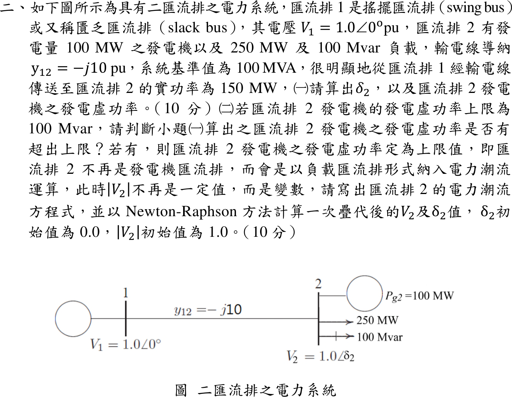
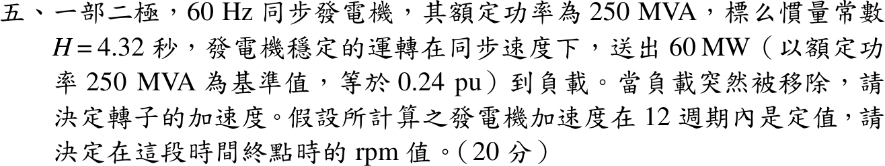

# 114 年電機工程技師｜電力系統逐題詳解

> 本頁由題級 canonical 筆記組合；每題保留 QID、官方裁切、校驗狀態與完整得分型解答。

## 題目導覽
- [[#一、114 年電力系統第 1 題｜負載相量與複功率|第 1 題：負載相量與複功率]]
- [[#二、114 年電力系統第 2 題｜二匯流排潮流|第 2 題：二匯流排潮流]]
- [[#三、114 年電力系統第 3 題｜經濟調度|第 3 題：經濟調度]]
- [[#四、114 年電力系統第 4 題｜經故障阻抗之三相短路|第 4 題：經故障阻抗之三相短路]]
- [[#五、114 年電力系統第 5 題｜甩負載後的轉子加速|第 5 題：甩負載後的轉子加速]]

---

## 一、114 年電力系統第 1 題｜負載相量與複功率

> 題級識別：`EE-114-05-1`
> canonical 來源：`canonical/EE-114-05-1.md`
> 題級校驗狀態：`verified`

![[01_原始試題/依考科/05_電力系統/images/questions/PE_114年_電力系統_Q01.png]]

> 官方裁切來源：`01_原始試題/依考科/05_電力系統/images/questions/PE_114年_電力系統_Q01.png`

### 已知與所求

\(v(t)=\sqrt2\times100\cos(\omega t+\alpha)\) V，相量 \(100\angle\alpha\)；\(i(t)=\sqrt2I_{rms}\cos(\omega t+60^\circ)\) A，相量 \(I_{rms}\angle60^\circ\)；\(P=500\sqrt3\) W、\(Q=500\) var。求 \(I_{rms}\) 與 \(\alpha\)。

### 考場標準作答

觀念：單相負載吸收的複功率為 \(S=VI^*=P+jQ\)（相量取有效值，電流要取共軛）；其大小給出 \(|V||I|\)，其角度為 \(\angle V-\angle I\)。先由 \(P,Q\) 求 \(S\)，再分別解 \(I_{rms}\) 與 \(\alpha\)。

#### 1. 電流有效值

視在功率大小：
\[
|S|=\sqrt{P^2+Q^2}=\sqrt{(500\sqrt3)^2+500^2}=\sqrt{750000+250000}=\sqrt{1000000}=1000\ \mathrm{VA}
\]
電壓有效值 \(|V|=100\) V（題給 \(\sqrt2\times100\) 為峰值），故
\[
\boxed{I_{rms}=|S|/|V|=1000/100=10\ \mathrm A}
\]

#### 2. 電壓相角

\(S\) 的角度為功因角：
\[
\angle S=\tan^{-1}\frac{Q}{P}=\tan^{-1}\frac{500}{500\sqrt3}=\tan^{-1}\frac{1}{\sqrt3}=30^\circ
\]
\(S=VI^*\) 的角度等於電壓角減電流角：
\[
\angle S=\angle V-\angle I=\alpha-60^\circ\Rightarrow 30^\circ=\alpha-60^\circ
\]
\[
\alpha=30^\circ+60^\circ\Rightarrow\boxed{\alpha=90^\circ}
\]

### 驗算

回代相量：\((100\angle90^\circ)(10\angle-60^\circ)=1000\angle30^\circ=866.03+j500.00\ \mathrm{VA}\)，\(500\sqrt3=866.03\)，與題給 \(P,Q\) 相符；\(Q>0\) 對應電流落後電壓 \(30^\circ\)。

### 失分點

- 漏取電流共軛，寫成 \(\angle S=\alpha+60^\circ\) 會得 \(\alpha=-30^\circ\)。
- 題目已寫 \(\sqrt2\times100\)，100 V 即有效值；再除以 \(\sqrt2\) 會得 \(I_{rms}=14.14\ \mathrm A\)。

---

## 二、114 年電力系統第 2 題｜二匯流排潮流

> 題級識別：`EE-114-05-2`
> canonical 來源：`canonical/EE-114-05-2.md`
> 題級校驗狀態：`verified`

![[01_原始試題/依考科/05_電力系統/images/questions/PE_114年_電力系統_Q02.png]]

> 官方裁切來源：`01_原始試題/依考科/05_電力系統/images/questions/PE_114年_電力系統_Q02.png`

### 已知與所求

\(V_1=1.0\angle0^\circ\) pu（搖擺匯流排），\(y_{12}=-j10\) pu，基準 100 MVA；匯流排 2：發電 100 MW，負載 250 MW＋100 Mvar，\(|V_2|=1.0\)。求（一）\(\delta_2\) 與發電機虛功率；（二）\(Q_{g2,\max}=100\) Mvar 時是否超限，若超限改為 PQ 匯流排，寫出潮流方程並由 \(\delta_2=0,\ |V_2|=1\) 作一次 Newton–Raphson 疊代。

### 考場標準作答

二匯流排潮流：搖擺匯流排固定 \(V_1\)，匯流排 2 為 PV（給定 \(P\)、\(|V_2|\)）時由有功方程解功角，再求所需無功；若發電機虛功率超限，改為 PQ 匯流排，以兩條潮流方程做 Newton–Raphson。由 \(Y_{22}=-j10\)、\(Y_{21}=j10\)，匯流排 2 淨注入：
\[
P_2=10|V_2|\sin\delta_2,\qquad Q_2=10|V_2|^2-10|V_2|\cos\delta_2
\]

#### （一）功角與發電虛功率

\(P_2=(100-250)/100=-1.50\) pu。\(\sin\delta_2=-0.15\) 另有大角度根，僅由正弦方程不能宣稱這是數學上的唯一根；取正常運轉的低功角分支 \(|\delta_2|<90^\circ\)：
\[
10\sin\delta_2=-1.50\Rightarrow\sin\delta_2=-0.15\Rightarrow\boxed{\delta_2=-8.63^\circ}
\]
淨注入無功 \(Q_2=10(1-\cos\delta_2)\)，\(1-\cos\delta_2=1.13\times10^{-2}\)：
\[
Q_2=10(1.13\times10^{-2})=1.13\times10^{-1}\ \mathrm{pu}
\]
發電機虛功率 = 淨注入 + 負載 \(Q_{L2}=1.00\) pu（100 Mvar）：
\[
Q_{g2}=1.13\times10^{-1}+1.00=1.11\ \mathrm{pu}\ \Rightarrow\ \boxed{Q_{g2}=111.31\ \mathrm{Mvar}}
\]

#### （二）超限判斷與一次疊代

\(111.31>100\) Mvar，超限；令 \(Q_{g2}=100\) Mvar，匯流排 2 改為 PQ，指定 \(P_2=-1.50\)、\(Q_2=1.00-1.00=0\) pu：
\[
10|V_2|\sin\delta_2=-1.50,\qquad 10|V_2|^2-10|V_2|\cos\delta_2=0
\]
平坦起始 \(\delta_2^{(0)}=0,\ |V_2|^{(0)}=1\)：計算值 \(P_2=Q_2=0\)，不平衡量 \([\Delta P_2,\Delta Q_2]=[-1.50,\ 0]\)。Jacobian
\[
J=\begin{bmatrix}10|V_2|\cos\delta_2 & 10\sin\delta_2\\ 10|V_2|\sin\delta_2 & 20|V_2|-10\cos\delta_2\end{bmatrix}
=\begin{bmatrix}10&0\\0&10\end{bmatrix}
\]
\[
\begin{bmatrix}\Delta\delta_2\\ \Delta|V_2|\end{bmatrix}=J^{-1}\begin{bmatrix}-1.50\\0\end{bmatrix}=\begin{bmatrix}-0.15\\0\end{bmatrix}
\Rightarrow
\boxed{\delta_2^{(1)}=-0.15\ \mathrm{rad}=-8.59^\circ},\quad \boxed{|V_2|^{(1)}=1.00\ \mathrm{pu}}
\]

### 驗算

- 線路潮流法：\(S_{12}=V_1\,[y_{12}(V_1-V_2)]^*\) 以 \(V_2=1\angle-8.63^\circ\) 代入得 \(P_{12}=150\) MW，與題述「由匯流排 1 送 150 MW」一致。
- 無功守恆：線路吸收 \(|I|^2X=|V_1-V_2|^2/X=10(2-2\cos\delta_2)=2.26\times10^{-1}\) pu，兩端各供一半（對稱），匯流排 2 供 11.31 Mvar，加負載 100 Mvar 即 111.31 Mvar。

### 失分點

- 由潮流式得到的是淨注入 \(Q_2=11.31\) Mvar，漏加 100 Mvar 負載會誤判「未超限」。
- 超限後仍固定 \(|V_2|=1\)（仍當 PV 匯流排）就不需要 \(Q_2\) 方程，與題意不符。
- \(\Delta\delta_2=-0.15\) 是弧度；誤當度數會寫成 \(-0.15^\circ\)。

---

## 三、114 年電力系統第 3 題｜經濟調度

> 題級識別：`EE-114-05-3`
> canonical 來源：`canonical/EE-114-05-3.md`
> 題級校驗狀態：`verified`

![[01_原始試題/依考科/05_電力系統/images/questions/PE_114年_電力系統_Q03.png]]

> 官方裁切來源：`01_原始試題/依考科/05_電力系統/images/questions/PE_114年_電力系統_Q03.png`

### 已知與所求

\(C_1=400+6.0P_1+0.004P_1^2\)、\(C_2=400+6.8P_2+0.002P_2^2\)（\(\$/\mathrm h\)，\(P\) 以 MW 計），兩廠各 800 MW，總需求 550 MW，忽略耗損。求兩廠最佳發電量。

### 考場標準作答

觀念：忽略耗損、兩機都在容量內運轉時，總成本最低的條件是「等增量成本」——各機增量成本 \(dC_i/dP_i\) 相等並等於系統 \(\lambda\)，再加上功率平衡 \(P_1+P_2=550\)。成本函數為凸（二次項係數為正），所以這個駐點就是全域最小。

#### 1. 增量成本與功率平衡

各機增量成本（對 \(P\) 微分，二次項係數乘 2）：
\[
\frac{dC_1}{dP_1}=6+2(0.004)P_1=6+8.00\times10^{-3}P_1,\qquad
\frac{dC_2}{dP_2}=6.8+2(0.002)P_2=6.8+4.00\times10^{-3}P_2
\]
等增量成本與功率平衡：
\[
6+8.00\times10^{-3}P_1=6.8+4.00\times10^{-3}P_2,\qquad P_1+P_2=550
\]

#### 2. 解兩機出力

代入 \(P_2=550-P_1\)：
\[
6+8.00\times10^{-3}P_1=6.8+4.00\times10^{-3}(550-P_1)
\]
展開右側 \(4.00\times10^{-3}\times550=2.20\)，得 \(6+8.00\times10^{-3}P_1=9-4.00\times10^{-3}P_1\)。

移項合併：
\[
12.00\times10^{-3}P_1=3\Rightarrow P_1=\frac{3}{12.00\times10^{-3}}
\]
\[
\boxed{P_1=250\ \mathrm{MW}},\qquad P_2=550-250\Rightarrow\boxed{P_2=300\ \mathrm{MW}}
\]

#### 3. 檢查限制

共同增量成本：
\[
\lambda=6+8.00\times10^{-3}(250)=8\ \$/\mathrm{MWh}
\]
\(0\le250,300\le800\ \mathrm{MW}\)，兩解均在容量限制內，故上述等增量解即為最佳調度。

### 驗算

\(6.8+4.00\times10^{-3}(300)=8=\lambda\)，\(250+300=550\)。

### 失分點

- 兩個二次項都漏乘 2（寫成 \(6+0.004P_1=6.8+0.002P_2\)）會得 \(P_1=316.67,\ P_2=233.33\ \mathrm{MW}\)。
- 平均分配 275／275 MW 時 \(\lambda_1=8.20\neq\lambda_2=7.90\)，不是最佳解。

---

## 四、114 年電力系統第 4 題｜經故障阻抗之三相短路

> 題級識別：`EE-114-05-4`
> canonical 來源：`canonical/EE-114-05-4.md`
> 題級校驗狀態：`verified`

![[01_原始試題/依考科/05_電力系統/images/questions/PE_114年_電力系統_Q04.png]]

> 官方裁切來源：`01_原始試題/依考科/05_電力系統/images/questions/PE_114年_電力系統_Q04.png`

### 已知與所求

匯流排 3 發電機 \(X_d''=j0.1\)，經變壓器 \(jX_t=j0.4\) 至匯流排 1；匯流排 1–2 線路 \(jX_L=j0.2\)；匯流排 2 發電機 \(X_d''=j0.1\)。無載、電勢均為 \(1\angle0^\circ\) pu。匯流排 1 經 \(Z_f=j0.0125\) pu 三相短路。求（一）戴維寧阻抗與故障電流；（二）故障期間匯流排電壓與線路電流。

### 考場標準作答

#### （一）戴維寧阻抗與故障電流

觀念：戴維寧定理——從故障點 Bus 1 看入，所有電源（EMF）短路後得等效阻抗 \(Z_{th}\)，開路電壓為故障前電壓 \(1\angle0^\circ\)；故障電流由戴維寧電源串 \(Z_{th}\)、\(Z_f\) 的單一迴路決定。畫法：把兩個發電機 EMF 短路接地，從 Bus 1 向左是 Bus 3 發電機串變壓器，向右是線路串 Bus 2 發電機，兩支路並聯。

\[
Z_{左}=j(0.1+0.4)=j0.50,\qquad Z_{右}=j(0.2+0.1)=j0.30
\]
\[
Z_{th}=Z_{左}\parallel Z_{右}=j\frac{0.50\times0.30}{0.50+0.30}=j\frac{0.15}{0.80}
\]
\[
\boxed{Z_{th}=j\tfrac{3}{16}\approx j0.19\ \mathrm{pu}}
\]
\[
I_f=\frac{1\angle0^\circ}{Z_{th}+Z_f}=\frac{1}{j\left(\frac{3}{16}+0.0125\right)}=\frac{1}{j0.20}
\]
（分母以完整精度相加為 \(j0.20\)。）
\[
\boxed{I_f=-j5.00\ \mathrm{pu}}
\]

#### （二）匯流排電壓與線路電流

觀念：故障期間 Bus 1 電壓就是故障電流流過 \(Z_f\) 的壓降；兩支路電流由「發電機 EMF 減 Bus 1 電壓」除以該支路阻抗，其餘匯流排電壓再由 EMF 減發電機電抗壓降求得。

\[
V_1=I_fZ_f=(-j5.00)(j0.0125)=5.00\times0.0125
\]
\[
\boxed{V_1=6.25\times10^{-2}\ \mathrm{pu}}
\]
題圖未指定線路電流正方向；以下定義 \(I_{31}\) 為匯流排 3 經變壓器流向故障匯流排 1，\(I_{21}\) 為匯流排 2 經線路流向匯流排 1。支路電壓：\(1-V_1=\dfrac{15}{16}=0.94\)，故
\[
I_{31}=\frac{1-V_1}{j0.50}=\frac{15/16}{j0.50}=-j\frac{15}{8},\qquad
I_{21}=\frac{1-V_1}{j0.30}=\frac{15/16}{j0.30}=-j\frac{25}{8}
\]
\[
\boxed{I_{31}=-j1.88\ \mathrm{pu}},\qquad \boxed{I_{21}=-j3.13\ \mathrm{pu}}
\]
若採由故障點向外為正方向，則 \(I_{13}=+j1.88\) pu、\(I_{12}=+j3.13\) pu，只是參考方向反轉。

發電機端匯流排電壓，先算發電機電抗上的壓降：\((j0.1)I_{31}=(j0.1)\left(-j\frac{15}{8}\right)=\frac{3}{16}\approx0.19\)、\((j0.1)I_{21}=(j0.1)\left(-j\frac{25}{8}\right)=\frac{5}{16}\approx0.31\)。
\[
V_3=1-\frac{3}{16}=\frac{13}{16}=\boxed{0.81\ \mathrm{pu}},\qquad V_2=1-\frac{5}{16}=\frac{11}{16}=\boxed{0.69\ \mathrm{pu}}
\]

### 驗算

- KCL：\(I_{31}+I_{21}=-j\dfrac{15}{8}-j\dfrac{25}{8}=-j5.00=I_f\)。
- 沿支路 KVL：\(V_3-V_1=(j0.4)\left(-j\frac{15}{8}\right)=\frac{3}{4}=0.75=\frac{13}{16}-\frac{1}{16}\)；\(V_2-V_1=(j0.2)\left(-j\frac{25}{8}\right)=\frac{5}{8}=6.25\times10^{-1}=\frac{11}{16}-\frac{1}{16}\)。
- 疊加法：\(\Delta V_i=-Z_{i1}I_f\)，\(Z_{11}=j\dfrac{3}{16}\) 給出 \(V_1=1-\dfrac{3}{16}\times5=1-\dfrac{15}{16}=6.25\times10^{-2}\)，與上同。

### 失分點

- 漏掉左側變壓器 \(j0.4\)，左支路誤用 \(j0.1\)，\(Z_{th}\) 與 \(I_f\) 全部錯誤。
- 有 \(Z_f\) 時 \(V_1\neq0\)；直接令 \(V_1=0\) 會使兩支路電流都偏大。
- 未先宣告方向就混用 \(I_{31}\) 與 \(I_{13}\)，答案會差一個負號。

---

## 五、114 年電力系統第 5 題｜甩負載後的轉子加速

> 題級識別：`EE-114-05-5`
> canonical 來源：`canonical/EE-114-05-5.md`
> 題級校驗狀態：`verified`

![[01_原始試題/依考科/05_電力系統/images/questions/PE_114年_電力系統_Q05.png]]

> 官方裁切來源：`01_原始試題/依考科/05_電力系統/images/questions/PE_114年_電力系統_Q05.png`

### 已知與所求

二極、60 Hz、250 MVA，\(H=4.32\) s，穩態送出 60 MW（0.24 pu）後負載突然移除；加速度在 12 週期內視為定值。求轉子加速度與 12 週期終點的 rpm。

### 考場標準作答

用搖擺方程：甩負載瞬間電功率 \(P_e=0\)，機械輸入尚未來得及改變，加速功率 \(P_a=P_m-P_e\) 使轉子以定加速度上升；再把角加速度換成轉速（rpm）。負載移除瞬間 \(P_e=0\)，機械輸入仍為 \(P_m=0.24\) pu，故 \(P_a=0.24\) pu。搖擺方程 \(\dfrac{2H}{\omega_s}\dfrac{d^2\delta}{dt^2}=P_a\)，\(\omega_s=120\pi\) rad/s，\(2H=8.64\)：
\[
\boxed{\alpha=\frac{\omega_sP_a}{2H}=\frac{120\pi(0.24)}{8.64}=\frac{10\pi}{3}=10.47\ \mathrm{rad/s^2}}
\]
（等同 \(600\) 電機度/s²；二極機電機角即機械角。）換成轉速變化率：\(\alpha\cdot\dfrac{60}{2\pi}=100\ \mathrm{rpm/s}\)。同步轉速 \(N_s=120f/P=3600\) rpm，12 週期 \(t=12/60=0.20\) s，轉速增量 \(100(0.20)=20\) rpm：
\[
\boxed{N=3600+100(0.20)=3620\ \mathrm{rpm}}
\]

### 驗算

動能法：同步轉速時儲能 \(W_0=HS=4.32(250)=1080\) MJ，0.20 s 內多吸收 \(60(0.20)=12\) MJ，\(W_1=1092\) MJ；轉速平方比等於儲能比，\(N=3600\sqrt{1092/1080}=3619.94\) rpm，與 3620 rpm 一致。

### 失分點

- 甩負載後誤令 \(P_m=0\)，得到零加速度；調速機在 0.20 s 內來不及動作。
- 12 週期是 0.20 s，不是 12 s；誤用會得 4800 rpm。
