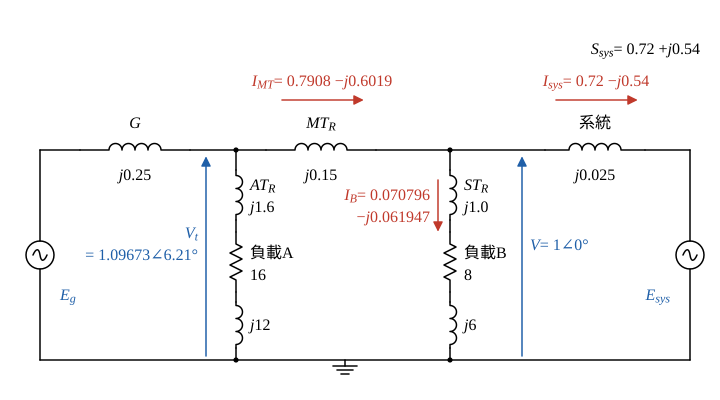
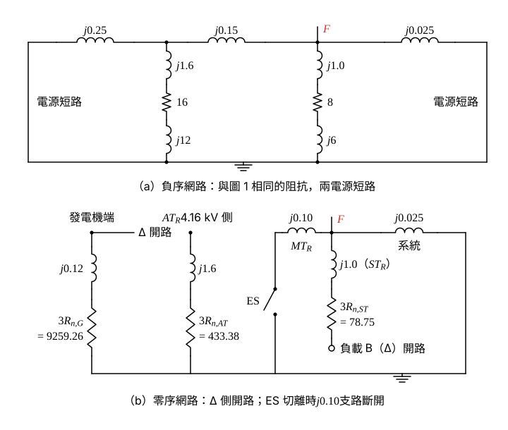
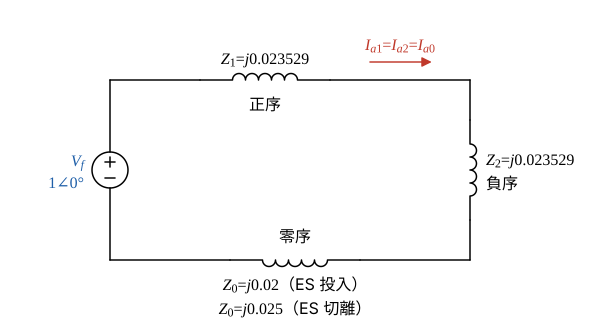

# 104 年電力系統第 1 題｜序網路與接地開關單線接地故障

## 已知與所求

各設備序電抗以自身額定為基準；標么基準取主變 \(MT_R\) 額定：500 MVA、345 kV（發電機側 18 kV）。系統匯流排電壓 345 kV，送往系統等效電源 \(P=360\ \mathrm{MW}\)、\(Q=270\ \mathrm{Mvar}\)。

| 設備 | 額定 | 序電抗 | 接線／接地 |
| --- | --- | --- | --- |
| 發電機 | 500 MVA、18 kV | \(X_d=100\%\)；\(X_1=X_2=X_d''=25\%\)、\(X_0=12\%\) | Y 經 \(2\ \mathrm{k}\Omega\) 接地 |
| \(MT_R\) | 500 MVA、18/345 kV | \(X_1=X_2=15\%\)、\(X_0=10\%\) | 18 kV 側 \(\Delta\)；345 kV 側 Y 經接地開關 ES 接地 |
| 系統等效電源 | 500 MVA、345 kV 基準 | \(X_1=X_2=X_0=2.5\%\) | Y 直接接地 |
| \(AT_R\)（接發電機端） | 25 MVA、18/4.16 kV | \(X_1=X_2=X_0=8\%\) | 18 kV 側 \(\Delta\)；4.16 kV 側 Y 經 \(5\ \Omega\) 接地 |
| \(ST_R\)（接系統匯流排） | 50 MVA、345/13.8 kV | \(X_1=X_2=X_0=10\%\) | 345 kV 側 Y 直接接地；13.8 kV 側 Y 經 \(10\ \Omega\) 接地 |
| 負載 A／負載 B | 25 MVA、4.16 kV／50 MVA、13.8 kV | PF 0.8 滯後、定阻抗 | 皆 \(\Delta\) 接 |

求：發電機端電壓（kV）；正、負、零序電路模型（pu）；系統匯流排 a 相單線接地時，ES 投入與切離兩種情況的 \(MT_R\) 345 kV 側故障相電流（kA）與匯流排零序電壓（kV）。原題 25 分未分子題，以下依所求順序編為（一）至（三）。

## 考場標準作答

### 步驟 1：換算到共同基準

- 電抗換基準（電壓基準與設備額定電壓相同，只換容量）：\(X_{\mathrm{new}}=X_{\mathrm{old}}\dfrac{S_b}{S_{\mathrm{rated}}}\)。發電機、\(MT_R\)、系統等效電源已是 500 MVA 基準，數值不變。
\[
X_{AT}=0.08\times\frac{500}{25}=1.6,\qquad X_{ST}=0.10\times\frac{500}{50}=1.0
\]
- 定阻抗負載：在額定電壓下 \(Z=\dfrac{|V|^2}{S^*}=\dfrac{1}{0.8-j0.6}=0.8+j0.6\)（自身額定為基準），再換到 500 MVA：
\[
Z_A=(0.8+j0.6)\times\frac{500}{25}=16+j12,\qquad Z_B=(0.8+j0.6)\times\frac{500}{50}=8+j6
\]
- 中性點電阻：\(Z_b=\dfrac{V_b^2}{S_b}\)，各取所在側的電壓基準（18 kV、4.16 kV、13.8 kV）。
\[
R_{n,G}=\frac{2000}{18^2/500}=\frac{2000}{0.648}=3086.42,\qquad R_{n,AT}=\frac{5}{4.16^2/500}=\frac{5}{0.034611}=144.46,\qquad R_{n,ST}=\frac{10}{13.8^2/500}=\frac{10}{0.38088}=26.25
\]
（以上皆為 pu。）

### （一）發電機端電壓（kV）

\(MT_R\) 電流為送往系統的電流加負載 B（經 \(ST_R\)）的電流；負載 A 接在發電機端，不流過 \(MT_R\)。送往系統的電流（\(S=VI^*\)，\(V=1\angle0^\circ\)）：
\[
I_{sys}=\left(\frac{S_{sys}}{V}\right)^*=\left(\frac{360+j270}{500}\right)^*=(0.72+j0.54)^*=0.72-j0.54
\]
負載 B 支路阻抗與電流：
\[
Z_{B,\mathrm{tot}}=jX_{ST}+Z_B=j1.0+8+j6=8+j7
\]
\[
I_B=\frac{V}{Z_{B,\mathrm{tot}}}=\frac{1}{8+j7}=\frac{8-j7}{8^2+7^2}=\frac{8-j7}{113}=0.070796-j0.061947
\]
\(MT_R\) 電流：
\[
I_{MT}=I_{sys}+I_B=(0.72+0.070796)-j(0.54+0.061947)=0.7908-j0.6019
\]
發電機端電壓：
\[
V_t=V+jX_{MT}I_{MT}=1+j0.15(0.7908-j0.6019)
\]
\[
j0.15\times0.7908=j0.11862,\qquad j0.15\times(-j0.6019)=0.090285
\]
\[
V_t=(1+0.090285)+j0.11862=1.0903+j0.1186
\]
大小與角度：
\[
|V_t|=\sqrt{1.0903^2+0.1186^2}=\sqrt{1.18875+0.01407}=\sqrt{1.20282}=1.09673\ \mathrm{pu}
\]
\[
\angle V_t=\tan^{-1}\frac{0.1186}{1.0903}=6.21^\circ
\]
換成 kV（發電機側基準 18 kV）：
\[
|V_t|=1.09673\times18=19.741\ \mathrm{kV}
\]
\[
\boxed{|V_t|=19.74\ \mathrm{kV}}
\]

### （二）正、負、零序電路模型（pu）

正序網路（數值取自步驟 1 與（一））：

負序與零序網路的畫法：

- 負序：與圖 1 相同的電抗與負載阻抗，兩個電源短路接參考點。
- 零序，發電機：\(j0.12+3R_{n,G}=j0.12+3\times3086.42=j0.12+9259.26\) 接在發電機端節點與參考點之間；但 \(MT_R\) 與 \(AT_R\) 的發電機側都是 \(\Delta\)，此節點與其他零序網路不相通。
- 零序，\(MT_R\)（\(\Delta\)–Y 經 ES）：匯流排經 \(j0.10\) 與 ES 接參考點；ES 切離時此支路開路。
- 零序，系統等效電源（Y 直接接地）：匯流排經 \(j0.025\) 接參考點。
- 零序，\(ST_R\)（Y 接地–Y 經 \(10\ \Omega\)）：匯流排經 \(j1.0+3R_{n,ST}=j1.0+3\times26.25=j1.0+78.75\) 串到 13.8 kV 節點；負載 B 為 \(\Delta\)，沒有零序通路，此支路末端開路。
- 零序，\(AT_R\)（\(\Delta\)–Y 經 \(5\ \Omega\)）：4.16 kV 節點經 \(j1.6+3R_{n,AT}=j1.6+3\times144.46=j1.6+433.38\) 接參考點；\(\Delta\) 側開路、負載 A 為 \(\Delta\)，與其他網路隔離。

### 步驟 2：匯流排看入的三序戴維寧阻抗（忽略 \(AT_R\)、\(ST_R\)）

依題意忽略 \(AT_R\)、\(ST_R\) 的負載；兩支路正、負序末端開路，\(ST_R\) 零序末端接 \(\Delta\) 負載亦開路，\(AT_R\) 零序被 \(\Delta\) 隔離，故連同兩變壓器略去，故障結果相同；各序阻抗忽略電阻，發電機 \(X_d\) 屬穩態模型，故障計算只用 \(X_d''\)。

正序：電源短路後，匯流排經系統 \(j0.025\) 到參考點，並聯經 \(MT_R\) 與發電機的 \(j(0.15+0.25)=j0.40\)：
\[
Z_1=j\frac{0.025\times0.40}{0.025+0.40}=j\frac{0.01}{0.425}=j0.023529
\]
負序：各設備 \(X_2=X_1\)，故
\[
Z_2=Z_1=j0.023529
\]
零序，ES 投入：系統 \(j0.025\) 並聯 \(MT_R\) 的 \(j0.10\)（發電機被 \(\Delta\) 隔開，不入）：
\[
Z_0^{\mathrm{on}}=j\frac{0.025\times0.10}{0.025+0.10}=j\frac{0.0025}{0.125}=j0.02
\]
零序，ES 切離：\(MT_R\) 支路開路，只剩系統：
\[
Z_0^{\mathrm{off}}=j0.025
\]

### 步驟 3：345 kV 側基準電流與相電壓基準

（基準電流記作 \(I_{\mathrm{base}}\)，以免與 b 相電流 \(I_b\) 混淆。）

\[
I_{\mathrm{base}}=\frac{S_b}{\sqrt3\,V_b}=\frac{500}{\sqrt3\times345}=0.83674\ \mathrm{kA},\qquad V_{\mathrm{base},\phi}=\frac{345}{\sqrt3}=199.19\ \mathrm{kV}
\]

### （三）單線接地故障：故障相電流與零序電壓

設故障前匯流排電壓 \(V_f=1.0\angle0^\circ\) pu（故障前負載電流不計入故障分量）。a 相接地時 \(I_b=I_c=0\)、\(V_a=0\)，三序網路串聯，\(I_{a1}=I_{a2}=I_{a0}\)，\(I_a=3I_{a1}\)，\(|V_{a0}|=|Z_0I_{a0}|\)；兩種情況只差 \(Z_0\)。

**ES 投入**

\[
Z_1+Z_2+Z_0^{\mathrm{on}}=j(0.023529+0.023529+0.02)=j0.067058
\]
\[
I_{a1}=\frac{V_f}{Z_1+Z_2+Z_0^{\mathrm{on}}}=\frac{1}{j0.067058}=-j14.912\ \mathrm{pu}
\]
\[
|I_a|=3|I_{a1}|=3\times14.912=44.736\ \mathrm{pu}
\]
\[
|I_a|=44.736\times0.83674=37.432\ \mathrm{kA}
\]
\[
\boxed{|I_a|=37.43\ \mathrm{kA}}
\]
\[
|V_{a0}|=|Z_0^{\mathrm{on}}|\,|I_{a0}|=0.02\times14.912=0.29824\ \mathrm{pu}
\]
\[
|V_{a0}|=0.29824\times199.19=59.406\ \mathrm{kV}
\]
\[
\boxed{|V_{a0}|=59.41\ \mathrm{kV}}
\]

**ES 切離**

\[
Z_1+Z_2+Z_0^{\mathrm{off}}=j(0.023529+0.023529+0.025)=j0.072058
\]
\[
I_{a1}=\frac{1}{j0.072058}=-j13.878\ \mathrm{pu}
\]
\[
|I_a|=3\times13.878=41.634\ \mathrm{pu}
\]
\[
|I_a|=41.634\times0.83674=34.837\ \mathrm{kA}
\]
\[
\boxed{|I_a|=34.84\ \mathrm{kA}}
\]
\[
|V_{a0}|=0.025\times13.878=0.34695\ \mathrm{pu}
\]
\[
|V_{a0}|=0.34695\times199.19=69.109\ \mathrm{kV}
\]
\[
\boxed{|V_{a0}|=69.11\ \mathrm{kV}}
\]

## 驗算

- 相域：\(I_b=I_{a0}+a^2I_{a1}+aI_{a2}=I_{a1}(1+a^2+a)=0\)，\(I_c\) 同理，符合只有 a 相接地。
- 零序電壓改用分流算（ES 投入）：\(I_{a0}\) 分到系統支路 \(I_{a0}\times\dfrac{0.10}{0.125}=0.8\times14.912=11.930\)，\(|V_{a0}|=0.025\times11.930=0.29825\ \mathrm{pu}\)，與上面 \(0.29824\) 相同（末位為進位差）。
- 趨勢：ES 切離使 \(Z_0\) 由 0.02 增為 0.025，故障電流變小（37.43 → 34.84 kA）、零序電壓變大（59.41 → 69.11 kV），方向合理。

## 失分點

- 求 \(V_t\) 時漏掉啟動變壓器負載 B（題目明示為定阻抗負載）會得 19.55 kV；負載 B 吸取 \(S_B=VI_B^*\times500=35.40+j30.97\ \mathrm{MVA}\)，要併入 \(MT_R\) 電流。
- 發電機側為 \(\Delta\)，發電機 \(X_0=12\%\) 與 \(2\ \mathrm{k}\Omega\) 接地電阻不入匯流排的零序戴維寧阻抗；誤把它串入會讓零序阻抗錯誤。
- ES 投入才有 \(MT_R\) 的 \(j0.10\) 零序接地支路；切離時零序只剩系統 \(j0.025\)。

## 條件與疑義

1. 題幹未明說 \(P,Q\) 是否含負載 B；本解依圖示讀為匯流排送往系統等效電源的功率，負載 B 另由主變供電。若不計負載 B，\(|V_t|=19.55\ \mathrm{kV}\)，故障部分不受影響。
2. 「345 kV 側之故障相電流」取故障點總電流。若指流過 \(MT_R\) 345 kV 繞組的 a 相電流，則依分流：正、負序流經 \(MT_R\) 支路的比例為 \(\dfrac{0.025}{0.425}=0.058824\)，零序（ES 投入）為 \(\dfrac{0.025}{0.125}=0.2\)。ES 投入 \(|I_{MT,a}|=(2\times14.912\times0.058824+0.2\times14.912)\times0.83674=3.963\approx3.96\) kA；ES 切離時零序不經 \(MT_R\)，\(|I_{MT,a}|=2\times13.878\times0.058824\times0.83674=1.366\approx1.37\) kA。
