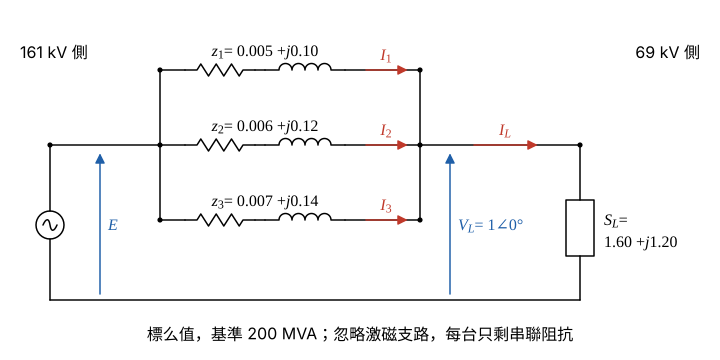

# 104 年電力系統第 2 題｜並聯變壓器功率分擔與損失最佳化

## 已知與所求

三台變壓器 \(T_{R1},T_{R2},T_{R3}\)，各 200 MVA、161/69 kV，阻抗 \((0.5+j10)\%\)、\((0.6+j12)\%\)、\((0.7+j14)\%\)（各自額定基準，即 200 MVA）。負載 \(320+j240\ \mathrm{MVA}\)（\(|S_L|=400\) MVA），69 kV 側電壓維持 69 kV，忽略激磁電流。求三台並聯時 161 kV 側電壓、各台輸出功率（MVA）與電力損失（kW）；若只用兩台且每台不得過載超過額定的 10%（即 \(|S_i|\le1.1\times200=220\) MVA），不允許哪兩台並聯，哪兩台損失最低及其各台輸出與損失。每台鐵損 \(=25\%\) 其滿載銅損。

假設：負載電壓取 \(V_L=1\angle0^\circ\) pu 為參考相量；銅損以各台實際電流計，鐵損為定值（與負載無關）。原題 25 分未分子題，以下依所求順序編為（一）三台並聯、（二）兩台並聯。

## 考場標準作答

### 步驟 1：標么化與等效電路

忽略激磁電流，每台變壓器只剩串聯阻抗 \(z_i\)；三台一次側同接 161 kV 匯流排、二次側同接 69 kV 匯流排，即三阻抗並聯於同一壓降 \(E-V_L\)。基準 \(S_b=200\) MVA，高壓側 \(V_b=161\) kV、低壓側 69 kV（等於變壓器額定，故百分阻抗不必換算）：
\[
z_1=0.005+j0.10,\qquad z_2=0.006+j0.12,\qquad z_3=0.007+j0.14\ \mathrm{pu}
\]
\[
S_L=\frac{320+j240}{200}=1.60+j1.20\ \mathrm{pu},\qquad |S_L|=\sqrt{320^2+240^2}=400\ \mathrm{MVA}
\]
負載電流（\(V_L=1\angle0^\circ\)）：
\[
I_L=\left(\frac{S_L}{V_L}\right)^*=(1.60+j1.20)^*=1.60-j1.20\ \mathrm{pu}
\]
\[
|I_L|=\sqrt{1.60^2+1.20^2}=\sqrt{4.00}=2.00\ \mathrm{pu},\qquad \angle I_L=-\tan^{-1}\frac{1.20}{1.60}=-36.87^\circ
\]

- 每台畫成 \(R_i\) 串 \(jX_i\)，左端共同接 161 kV 側（電壓 \(E\)），右端共同接 69 kV 側（電壓 \(V_L\)）再接負載。
- 電流參考方向：各台 \(I_i\) 由 161 kV 側流向 69 kV 側，\(I_L=\sum I_i\)。

### 步驟 2：分流比與滿載銅損、鐵損

並聯各支路壓降相同，\(I_i=w_iI_L\)，\(w_i=\dfrac{1/z_i}{\sum_k 1/z_k}\)；三台 \(X/R\) 皆為 20（\(z_2=1.2z_1\)、\(z_3=1.4z_1\)），故 \(w_i\) 為實數，各台電流與 \(I_L\) 同相：

\[
\frac1{z_1}:\frac1{z_2}:\frac1{z_3}=\frac11:\frac1{1.2}:\frac1{1.4}
\]
同乘 42：
\[
=42:35:30,\qquad 42+35+30=107
\]

兩台組合同理：
\[
T_{R1}+T_{R2}:\ \frac11:\frac1{1.2}=6:5\ \Rightarrow\ w=\frac6{11},\ \frac5{11}
\]
\[
T_{R1}+T_{R3}:\ \frac11:\frac1{1.4}=7:5\ \Rightarrow\ w=\frac7{12},\ \frac5{12}
\]
\[
T_{R2}+T_{R3}:\ \frac1{1.2}:\frac1{1.4}=7:6\ \Rightarrow\ w=\frac7{13},\ \frac6{13}
\]

滿載（額定電流 1 pu）銅損 \(P_{cu,FL,i}=R_iS_b\)，鐵損 \(P_{fe,i}=0.25P_{cu,FL,i}\)：
\[
P_{cu,FL,1}=0.005\times200=1.00\ \mathrm{MW},\qquad P_{fe,1}=0.25\times1.00=0.25\ \mathrm{MW}
\]
\[
P_{cu,FL,2}=0.006\times200=1.20\ \mathrm{MW},\qquad P_{fe,2}=0.25\times1.20=0.30\ \mathrm{MW}
\]
\[
P_{cu,FL,3}=0.007\times200=1.40\ \mathrm{MW},\qquad P_{fe,3}=0.25\times1.40=0.35\ \mathrm{MW}
\]
實際銅損隨負載率平方：
\[
P_{cu,i}=\left(\frac{|S_i|}{S_b}\right)^2P_{cu,FL,i}
\]

### （一）三台並聯：161 kV 側電壓、各台輸出功率與損失

**1. 各台輸出功率**
\[
|S_i|=w_i|S_L|=w_i\times400\ \mathrm{MVA}
\]
\[
|S_1|=\frac{42}{107}\times400=\frac{16800}{107}=157.0093\ \mathrm{MVA}
\]
\[
|S_2|=\frac{35}{107}\times400=\frac{14000}{107}=130.8411\ \mathrm{MVA}
\]
\[
|S_3|=\frac{30}{107}\times400=\frac{12000}{107}=112.1495\ \mathrm{MVA}
\]
\[
\boxed{|S_1|=157.01\ \mathrm{MVA},\quad |S_2|=130.84\ \mathrm{MVA},\quad |S_3|=112.15\ \mathrm{MVA}}
\]
（複功率 \(S_i=w_i(320+j240)\)，例如 \(S_1=\tfrac{42}{107}(320+j240)=125.61+j94.21\)；同法 \(S_2=104.67+j78.50\)、\(S_3=89.72+j67.29\) MVA，功率因數都是 0.8 落後；三台皆 < 220 MVA。）

**2. 161 kV 側電壓**
\[
z_{eq}=\frac{1}{\sum_k1/z_k}=w_1z_1=\frac{42}{107}(0.005+j0.10)
\]
\[
z_{eq}=\frac{0.21}{107}+j\frac{4.2}{107}=0.0019626+j0.039252\ \mathrm{pu}
\]
\[
E=V_L+z_{eq}I_L
\]
\[
z_{eq}I_L=\frac{42}{107}(0.005+j0.10)(1.60-j1.20)
\]
\[
(0.005+j0.10)(1.60-j1.20)=0.008-j0.006+j0.16+0.12=0.128+j0.154
\]
\[
z_{eq}I_L=\frac{42}{107}(0.128+j0.154)=\frac{5.376}{107}+j\frac{6.468}{107}=0.050243+j0.060449
\]
\[
E=1+0.050243+j0.060449=1.050243+j0.060449\ \mathrm{pu}
\]
（這條鏈最後要乘 161，保留 6 位有效數字才不影響末位。）
\[
|E|=\sqrt{1.050243^2+0.060449^2}=\sqrt{1.103010+0.003654}=\sqrt{1.106664}=1.051981\ \mathrm{pu}
\]
\[
\angle E=\tan^{-1}\frac{0.060449}{1.050243}=\tan^{-1}0.057557=3.29^\circ
\]
\[
|E_{161}|=|E|\times161=1.051981\times161=169.369\ \mathrm{kV}
\]
\[
\boxed{|E_{161}|=169.37\ \mathrm{kV}}
\]

**3. 各台損失**

負載率 \(\dfrac{|S_i|}{S_b}=\dfrac{w_i|S_L|}{S_b}=\dfrac{w_i\times400}{200}=2w_i\)：
\[
\frac{|S_1|}{S_b}=\frac{84}{107}=0.785047,\qquad \frac{|S_2|}{S_b}=\frac{70}{107}=0.654206,\qquad \frac{|S_3|}{S_b}=\frac{60}{107}=0.560748
\]
\[
P_{cu,1}=0.785047^2\times1.00=0.616299\times1.00=0.616299\ \mathrm{MW}=616.30\ \mathrm{kW}
\]
\[
P_{cu,2}=0.654206^2\times1.20=0.427985\times1.20=0.513582\ \mathrm{MW}=513.58\ \mathrm{kW}
\]
\[
P_{cu,3}=0.560748^2\times1.40=0.314438\times1.40=0.440213\ \mathrm{MW}=440.21\ \mathrm{kW}
\]
各台總損失 \(P_{loss,i}=P_{cu,i}+P_{fe,i}\)：
\[
P_{loss,1}=616.30+250=866.30\ \mathrm{kW}
\]
\[
P_{loss,2}=513.58+300=813.58\ \mathrm{kW}
\]
\[
P_{loss,3}=440.21+350=790.21\ \mathrm{kW}
\]
\[
\boxed{P_{loss,1}=866.30\ \mathrm{kW},\quad P_{loss,2}=813.58\ \mathrm{kW},\quad P_{loss,3}=790.21\ \mathrm{kW}}
\]
\[
\sum P_{loss}=866.30+813.58+790.21=2470.09\ \mathrm{kW}
\]
三台總損失 \(\boxed{2470.09\ \mathrm{kW}}\)。

| 變壓器 | 輸出 (MVA) | 銅損 (kW) | 鐵損 (kW) | 合計 (kW) |
| --- | --- | --- | --- | --- |
| \(T_{R1}\) | 157.01 | 616.30 | 250 | 866.30 |
| \(T_{R2}\) | 130.84 | 513.58 | 300 | 813.58 |
| \(T_{R3}\) | 112.15 | 440.21 | 350 | 790.21 |

### （二）兩台並聯：不允許的組合與最低損失組合

**1. 各組合分擔與過載判斷**（\(|S_i|=w_i\times400\)）
\[
T_{R1}+T_{R2}:\ |S_1|=\frac6{11}\times400=218.18,\quad |S_2|=\frac5{11}\times400=181.82\ \mathrm{MVA}\quad(218.18\le220,\ \text{可})
\]
\[
T_{R1}+T_{R3}:\ |S_1|=\frac7{12}\times400=233.33,\quad |S_3|=\frac5{12}\times400=166.67\ \mathrm{MVA}\quad(233.33>220,\ \text{過載})
\]
\[
T_{R2}+T_{R3}:\ |S_2|=\frac7{13}\times400=215.38,\quad |S_3|=\frac6{13}\times400=184.62\ \mathrm{MVA}\quad(215.38\le220,\ \text{可})
\]
\[
\boxed{\text{不允許 }T_{R1}+T_{R3}\text{ 並聯（}T_{R1}\text{ 分得 }233.33\ \mathrm{MVA}>220\ \mathrm{MVA}\text{）}}
\]

**2. 容許組合的損失**（負載率 \(=w_i\times2\)，用精確分數平方）

\(T_{R1}+T_{R2}\)：負載率 \(\tfrac{12}{11}\)、\(\tfrac{10}{11}\)
\[
P_{loss,1}=\left(\frac{12}{11}\right)^2\times1.00+0.25=1.190083+0.25=1.440083\ \mathrm{MW}=1440.08\ \mathrm{kW}
\]
\[
P_{loss,2}=\left(\frac{10}{11}\right)^2\times1.20+0.30=\frac{120}{121}+0.30=0.991736+0.30=1.291736\ \mathrm{MW}=1291.74\ \mathrm{kW}
\]
\[
P_{loss}=1440.08+1291.74=2731.82\ \mathrm{kW}
\]

\(T_{R2}+T_{R3}\)：負載率 \(\tfrac{14}{13}\)、\(\tfrac{12}{13}\)
\[
P_{loss,2}=\left(\frac{14}{13}\right)^2\times1.20+0.30=1.159763\times1.20+0.30=1.391716+0.30=1.691716\ \mathrm{MW}
\]
\[
P_{loss,3}=\left(\frac{12}{13}\right)^2\times1.40+0.35=0.852071\times1.40+0.35=1.192899+0.35=1.542899\ \mathrm{MW}
\]
\[
P_{loss}=1.691716+1.542899=3.234615\ \mathrm{MW}=3234.62\ \mathrm{kW}
\]

比較：\(2731.82\ \mathrm{kW}<3234.62\ \mathrm{kW}\)，故應使用 \(\boxed{T_{R1}+T_{R2}}\)（TR1+TR2）並聯。

**3. 最佳組合各台輸出與損失**
\[
S_1=\frac6{11}(320+j240)=174.55+j130.91\ \mathrm{MVA},\qquad |S_1|=218.18\ \mathrm{MVA}
\]
\[
S_2=\frac5{11}(320+j240)=145.45+j109.09\ \mathrm{MVA},\qquad |S_2|=181.82\ \mathrm{MVA}
\]
\[
\boxed{|S_1|=218.18\ \mathrm{MVA},\ P_{loss,1}=1440.08\ \mathrm{kW};\quad |S_2|=181.82\ \mathrm{MVA},\ P_{loss,2}=1291.74\ \mathrm{kW}}
\]
\[
\boxed{P_{loss}=2.73\ \mathrm{MW}=2731.82\ \mathrm{kW}}
\]

## 驗算

壓降相等：\(|z_1||I_1|=0.100125\times0.785047=0.07860\)，\(|z_2||I_2|=0.120150\times0.654206=0.07860\)，\(|z_3||I_3|=0.140175\times0.560748=0.07860\) pu，三支路相同，分流正確。功率平衡：三台輸出 \(157.01+130.84+112.15=400.00\) MVA \(=|S_L|\)。銅損另以 \(\sum R_i|I_i|^2S_b\) 計：\(0.616+0.514+0.440=1.570\) MW，加鐵損 \(0.90\) MW 得 \(2.47\) MW，與（一）相符；\(T_{R1}+T_{R2}\) 銅損 \(1.190+0.992=2.182\) MW 加鐵損 \(0.55\) MW 得 \(2.73\) MW。

## 失分點

- \(T_{R1}\) 與 \(T_{R3}\) 並聯時 \(T_{R1}\) 分得 \(400\times\tfrac{7}{12}=233.33\) MVA，超過 220 MVA；其總損失 \((7/6)^2\times1.00+0.25+(5/6)^2\times1.40+0.35=2.933333\) MW 雖低於 \(T_{R2}+T_{R3}\)，仍必須剔除。
- 鐵損不隨負載變，每台只要投入就有 \(0.25R_iS_b\)；漏加鐵損時 \(T_{R1}+T_{R2}\) 只剩銅損 \(1.190083+0.991736=2.181818\) MW（少 0.55 MW），損失數值就錯。本題排序剛好不變（\(T_{R2}+T_{R3}\) 銅損 \(1.391716+1.192899=2.584615\) MW 仍較大），但數值仍會被扣分。
- 161 kV 側電壓要由 \(E=1+z_{eq}I_L\) 求（\(I_L=S_L^*/V_L^*\)），不能直接寫 161 kV，也不能把 \(z_{eq}\) 乘上 \(S_L\) 而不取共軛。
