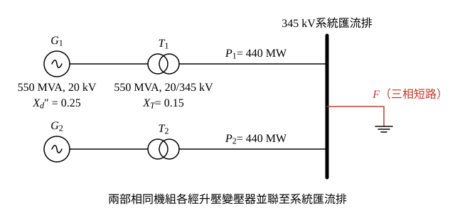
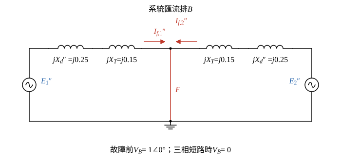

# 104 年電力系統第 3 題｜兩發電機並聯三相故障

## 已知與所求

兩部相同發電機各 550 MVA、20 kV，\(X_d''=25\%\)、\(X_d=95\%\)；各經 550 MVA、20/345 kV、\(X_T=15\%\) 升壓變壓器接至 345 kV 系統匯流排，忽略電阻。正常時匯流排電壓 345 kV；題面「兩部機組各自供電至系統匯流排之有效功率均為 440 MW」，匯流排三相短路時兩機的次暫態故障電流分別為 \(2.5\ \mathrm{kA}\)、\(3\ \mathrm{kA}\)。求單線圖與次暫態電路、正常時各機端電壓與送至匯流排的無效功率，以及匯流排故障時的次暫態故障電流。基準取升壓變壓器額定：\(S_b=550\) MVA，\(V_b=345\) kV（高壓側）、20 kV（低壓側）。

假設：「均為 440 MW」讀為每部機各 440 MW（\(P_i=0.8\) pu）；系統側阻抗未給，故「系統提供至匯流排的故障電流」取兩部機組貢獻之相量和。原題 25 分未分子題，以下依所求順序編為（一）至（四）。

## 考場標準作答

**解題邏輯**：以升壓變壓器額定（550 MVA；345 kV／20 kV）為基準，每部機的次暫態模型是次暫態電勢 \(E_i''\) 串 \(jX_d''\) 再串 \(jX_T\) 接到系統匯流排；匯流排電壓正常時為 \(1\angle0^\circ\)（取為參考相量），三相短路時為 0。主線：題給兩機故障電流 → 反算各機 \(|E_i''|\)（步驟 2）→ 由每機 \(P_i=0.8\) 的功率平衡解出預故障電流與無效功率（步驟 3）→ 端電壓 \(V_{t,i}=V_B+jX_TI_i\) → 故障電流取兩機相量和。同步電抗 \(X_d=95\%\) 屬穩態模型，次暫態與預故障計算都用不到。

### 步驟 1：基準量

\[
I_b=\frac{S_b}{\sqrt3V_b}=\frac{550}{\sqrt3\times345}=0.920413\ \mathrm{kA}
\]
\[
P_i=\frac{440}{550}=0.8\ \mathrm{pu},\qquad X_\Sigma''=X_d''+X_T=0.25+0.15=0.40\ \mathrm{pu}
\]

### （一）單線圖與次暫態電路模型

**邏輯**：兩機各經自己的升壓變壓器並接到同一條 345 kV 匯流排；次暫態模型把每台發電機換成 \(E_i''\) 串 \(jX_d''\)，變壓器換成 \(jX_T\)，故障即把匯流排直接接到參考點。

### 步驟 2：故障電流反算 \(E_i''\)

**邏輯**：匯流排短路時 \(V_B=0\)，每台機的故障電流只由自己的 \(E_i''\) 推動 \(X_\Sigma''\)：\(|I_{f,i}''|=|E_i''|/X_\Sigma''\)，題給 kA 值除以 \(I_b\) 即得標么值。

\[
|E_i''|=X_\Sigma''\frac{I_{f,i}}{I_b}
\]
\[
|E_1''|=0.40\times\frac{2.5}{0.920413}=\frac{1.0}{0.920413}=1.086469
\]
\[
\boxed{|E_1''|=1.09\ \mathrm{pu}}
\]
\[
|E_2''|=0.40\times\frac{3.0}{0.920413}=\frac{1.2}{0.920413}=1.303763
\]
\[
\boxed{|E_2''|=1.30\ \mathrm{pu}}
\]

### 步驟 3：預故障電流與功率平衡

**邏輯**：設機組送入匯流排的電流 \(I_i=0.8-jq_i\)（以 \(V_B=1\angle0^\circ\) 為參考），則 \(S_B=V_BI_i^*=0.8+jq_i\)，\(q_i\) 就是送到匯流排的無效功率（功率平衡）；再用 \(E_i''=V_B+jX_\Sigma''I_i\) 的大小等於步驟 2 的 \(|E_i''|\) 解 \(q_i\)。

\[
E_i''=1+j0.40(0.8-jq_i)=(1+0.40q_i)+j0.32
\]
取大小平方：
\[
|E_i''|^2=(1+0.40q_i)^2+0.32^2\quad\Rightarrow\quad 1+0.40q_i=\sqrt{|E_i''|^2-0.1024}
\]
（取正根，即正常小訊號穩定運轉的低功角分支；另一根 \(\delta>90^\circ\) 需吸收超過 2000 Mvar 且 \(dP/d\delta<0\)，捨去。這條鏈有相減，保留 6 位有效數字。）

機組 1：
\[
1+0.40q_1=\sqrt{1.086469^2-0.1024}=\sqrt{1.180415-0.1024}=\sqrt{1.078015}=1.038275
\]
\[
q_1=\frac{1.038275-1}{0.40}=\frac{0.038275}{0.40}=0.095688
\]
機組 2：
\[
1+0.40q_2=\sqrt{1.303763^2-0.1024}=\sqrt{1.699798-0.1024}=\sqrt{1.597398}=1.263882
\]
\[
q_2=\frac{1.263882-1}{0.40}=\frac{0.263882}{0.40}=0.659705
\]
各機 \(E_i''\) 超前匯流排的角度：
\[
\delta_1=\sin^{-1}\frac{0.32}{1.086469}=\sin^{-1}0.294532=\boxed{17.13^\circ},\qquad \delta_2=\sin^{-1}\frac{0.32}{1.303763}=\sin^{-1}0.245443=\boxed{14.21^\circ}
\]

### （二）正常供電時各機端電壓（kV）

**邏輯**：發電機端（變壓器低壓側）電壓 = 匯流排電壓 + 升壓變壓器電抗壓降，\(V_{t,i}=V_B+jX_TI_i\)；標么值乘低壓側基準 20 kV。

\[
V_{t,i}=1+j0.15(0.8-jq_i)=(1+0.15q_i)+j0.12
\]
機組 1：
\[
V_{t,1}=(1+0.15\times0.095688)+j0.12=1.014353+j0.12
\]
\[
|V_{t,1}|=\sqrt{1.014353^2+0.12^2}=\sqrt{1.028912+0.0144}=\sqrt{1.043312}=1.021426\ \mathrm{pu}
\]
\[
\boxed{|V_{t,1}|=1.021426\times20=20.43\ \mathrm{kV}}
\]
機組 2：
\[
V_{t,2}=(1+0.15\times0.659705)+j0.12=1.098956+j0.12
\]
\[
|V_{t,2}|=\sqrt{1.098956^2+0.12^2}=\sqrt{1.207704+0.0144}=\sqrt{1.222104}=1.105488\ \mathrm{pu}
\]
\[
\boxed{|V_{t,2}|=1.105488\times20=22.11\ \mathrm{kV}}
\]

### （三）各機供給系統匯流排之無效功率（MVAR）

**邏輯**：由步驟 3，送入匯流排的複功率 \(S_B=0.8+jq_i\)，無效功率標么值即 \(q_i\)，乘基準 550 MVA。

\[
\boxed{Q_{B,1}=q_1\times550=0.095688\times550=52.63\ \mathrm{Mvar}}
\]
\[
\boxed{Q_{B,2}=q_2\times550=0.659705\times550=362.84\ \mathrm{Mvar}}
\]

### （四）系統匯流排三相短路之次暫態故障電流（kA）

**邏輯**：短路時兩機的故障電流都流入匯流排，相角不同，須相量相加：\(I_{f,i}''=E_i''/(jX_\Sigma'')\)，\(E_i''\) 用步驟 3 的直角式。

\[
I_{f,1}''=\frac{1.038275+j0.32}{j0.40}=\frac{0.32}{0.40}-j\frac{1.038275}{0.40}=0.8-j2.595688
\]
\[
I_{f,2}''=\frac{1.263882+j0.32}{j0.40}=\frac{0.32}{0.40}-j\frac{1.263882}{0.40}=0.8-j3.159705
\]
相量和：
\[
I_f''=I_{f,1}''+I_{f,2}''=(0.8+0.8)-j(2.595688+3.159705)=1.6-j5.755393
\]
大小：
\[
|I_f''|=\sqrt{1.6^2+5.755393^2}=\sqrt{2.56+33.124548}=\sqrt{35.684548}=5.973655\ \mathrm{pu}
\]
換成 kA：
\[
|I_f''|=5.973655\times0.920413=5.4982\ \mathrm{kA}
\]
\[
\boxed{|I_f''|=5.50\text{ kA}}
\]

## 驗算

故障電流反算：\(|I_{f,1}''|=\sqrt{0.8^2+2.595688^2}\times0.920413=2.71617\times0.920413=2.50\) kA、\(|I_{f,2}''|=\sqrt{0.8^2+3.159705^2}\times0.920413=3.25941\times0.920413=3.00\) kA，與題給相同。另以功角公式檢查有功：\(P=\dfrac{|E_i''|V_B\sin\delta_i}{X_\Sigma''}\)，\(\dfrac{1.086469\times0.294532}{0.40}=0.80\)、\(\dfrac{1.303763\times0.245443}{0.40}=0.80\)，與 \(P_i=0.8\) pu 相符。

## 失分點

- 不可先假設 \(E''=1\) pu；題面給的 \(2.5/3.0\ \mathrm{kA}\) 正是反推各機 \(E''\) 的資料，也因此兩機的 \(Q\) 不同。
- \(P_i=0.8\) 是每部機各 440 MW 對 550 MVA 基準，不是兩部合計除以兩台。
- 最後是兩個故障電流相量相加 \(|I_{f,1}''+I_{f,2}''|\)（5.50 kA）；本題兩電流相角只差約 \(2.92^\circ\)（\(-72.87^\circ\) 與 \(-75.79^\circ\)），代數和 5.5 kA 只是巧合接近，作答仍須列相量式。

## 條件與疑義

題幹未給系統等效阻抗，故「系統提供至匯流排之故障電流」只能取兩部機組貢獻之相量和；若題意另含系統側貢獻，須補系統阻抗後再加。
