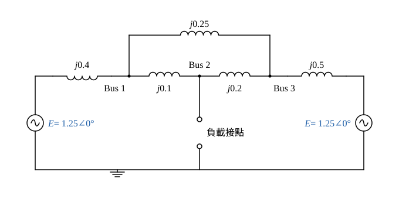
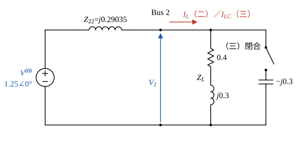

# 104 年電力系統第 4 題｜三匯流排 \(Y_{bus}\)、\(Z_{bus}\) 與電容補償

## 已知與所求

三匯流排：Bus 1–2 線路 \(j0.1\)、Bus 2–3 線路 \(j0.2\)、Bus 1–3 線路 \(j0.25\)（pu）。Bus 1、Bus 3 各接發電機組，電源等效阻抗 \(j0.4\)、\(j0.5\)；Bus 2 為負載匯流排。Bus 2 無載時各匯流排電壓同為 \(1.25\) pu。求電路模型、\(Y_{bus}\)、\(Z_{bus}\)；Bus 2 接 \(0.4+j0.3\) pu 負載時依 \(Z_{bus}\) 求各匯流排電壓；再並接 \(-j0.3\) pu 電容抗後各匯流排電壓。假設：電源模型為等電壓 \(1.25\ \mathrm{pu}\) 串聯其等效電抗，電源阻抗視為接地支路；忽略線路電阻與並聯電納。原題 25 分未分子題，以下依所求順序編為（一）至（三）。

## 考場標準作答

**解題邏輯**：每部發電機以「電壓源串電源電抗」表示，兩電源電勢相等且同相（無載時各匯流排電壓皆 \(1.25\angle0^\circ\)），以此為參考相量。
1. 求 \(Y_{bus}\) 時電源短路、電源電抗成為接地支路；\(Y_{bus}\) 由支路導納組成，反矩陣即 \(Z_{bus}\)。
2. Bus 2 接負載時用 \(Z_{bus}\) 的戴維寧觀點：Bus 2 的開路電壓就是無載電壓 \(V^{(0)}=1.25\) pu、戴維寧阻抗為 \(Z_{22}\)，先求負載電流 \(I_L\)。
3. 再用疊加 \(V_k=V^{(0)}-Z_{k2}I_L\) 更新三個匯流排電壓。
4. 並接電容時只把負載換成「負載 ∥ 電容」，其餘步驟相同。

### （一）電路模型、\(Y_{bus}\) 與 \(Z_{bus}\)

**邏輯**：\(Y_{bus}\) 的對角元 = 接在該匯流排上所有支路導納之和（含電源電抗接地支路），非對角元 = 兩匯流排間支路導納的負值；\(Z_{bus}=Y_{bus}^{-1}\)，用伴隨矩陣（餘因子）求反矩陣。

畫法：三匯流排以三條線路兩兩相連；Bus 1、Bus 3 各經電源電抗接電壓源 \(E=1.25\) 再接參考點；Bus 2 只留負載接點。

支路導納 \(y=\dfrac{1}{jx}=-j\dfrac1x\)：
\[
y_{12}=\frac{1}{j0.1}=-j10,\quad y_{23}=\frac{1}{j0.2}=-j5,\quad y_{13}=\frac{1}{j0.25}=-j4,\quad y_{g1}=\frac{1}{j0.4}=-j2.5,\quad y_{g3}=\frac{1}{j0.5}=-j2
\]
對角元：
\[
Y_{11}=y_{12}+y_{13}+y_{g1}=-j(10+4+2.5)=-j16.5
\]
\[
Y_{22}=y_{12}+y_{23}=-j(10+5)=-j15
\]
\[
Y_{33}=y_{13}+y_{23}+y_{g3}=-j(4+5+2)=-j11
\]
非對角元：\(Y_{12}=-y_{12}=j10\)、\(Y_{13}=-y_{13}=j4\)、\(Y_{23}=-y_{23}=j5\)。
\[
\boxed{Y_{bus}=\begin{bmatrix}-j16.5&j10&j4\\ j10&-j15&j5\\ j4&j5&-j11\end{bmatrix}\ \mathrm{pu}}
\]

求反矩陣：令 \(Y_{bus}=-jB\)，\(B=\begin{bmatrix}16.5&-10&-4\\-10&15&-5\\-4&-5&11\end{bmatrix}\)，則 \(Z_{bus}=(-jB)^{-1}=jB^{-1}=j\dfrac{\operatorname{adj}B}{\det B}\)。

行列式（沿第一列展開）：
\[
\det B=16.5(15\times11-25)+10\big[(-10)(11)-(-5)(-4)\big]-4\big[(-10)(-5)-15(-4)\big]
\]
\[
=16.5\times140+10\times(-130)-4\times110=2310-1300-440=570
\]
餘因子（\(B\) 對稱，伴隨矩陣也對稱）：
\[
C_{11}=15\times11-(-5)^2=140,\qquad C_{22}=16.5\times11-(-4)^2=165.5,\qquad C_{33}=16.5\times15-(-10)^2=147.5
\]
\[
C_{12}=-\big[(-10)(11)-(-5)(-4)\big]=130,\qquad C_{13}=(-10)(-5)-15(-4)=110,\qquad C_{23}=-\big[16.5(-5)-(-10)(-4)\big]=122.5
\]
\[
Z_{bus}=\frac{j}{570}\begin{bmatrix}140&130&110\\130&165.5&122.5\\110&122.5&147.5\end{bmatrix}\approx j\begin{bmatrix}0.24561&0.22807&0.19298\\0.22807&0.29035&0.21491\\0.19298&0.21491&0.25877\end{bmatrix}\ \mathrm{pu}
\]
分子分母同乘 2 化為整數：
\[
\boxed{Z_{bus}=\frac{j}{1140}\begin{bmatrix}280&260&220\\260&331&245\\220&245&295\end{bmatrix}\ \mathrm{pu}}
\]

### （二）Bus 2 接 \(Z_L=0.4+j0.3\) 時各匯流排電壓

**邏輯**：從 Bus 2 看入，網路等效為開路電壓 \(V^{(0)}=1.25\) 串 \(Z_{22}=j0.29035\)；接上 \(Z_L\) 後形成單一迴路求 \(I_L\)。負載電流等於從 Bus 2「抽出」\(I_L\)，由疊加原理各匯流排電壓變化為 \(-Z_{k2}I_L\)（用 \(Z_{bus}\) 第 2 行）。

負載電流：
\[
I_L=\frac{V^{(0)}}{Z_L+Z_{22}}=\frac{1.25}{0.4+j0.3+j0.29035}=\frac{1.25}{0.4+j0.59035}
\]
分母有理化：
\[
I_L=\frac{1.25(0.4-j0.59035)}{0.4^2+0.59035^2}=\frac{0.5-j0.73794}{0.16+0.34851}=\frac{0.5-j0.73794}{0.50851}=0.9833-j1.4512\ \mathrm{pu}
\]
電壓更新式（\(Z_{k2}=jz_{k2}\)）：
\[
V_k=V^{(0)}-Z_{k2}I_L=1.25-jz_{k2}(0.9833-j1.4512)=(1.25-1.4512\,z_{k2})-j0.9833\,z_{k2}
\]
Bus 1（\(z_{12}=0.22807\)）：
\[
1.4512\times0.22807=0.33098,\qquad 0.9833\times0.22807=0.22426
\]
\[
V_1=(1.25-0.33098)-j0.22426=0.91902-j0.22426
\]
\[
|V_1|=\sqrt{0.91902^2+0.22426^2}=\sqrt{0.84460+0.050293}=\sqrt{0.89489}=0.94599,\qquad \angle V_1=-\tan^{-1}\frac{0.22426}{0.91902}=-13.71^\circ
\]
Bus 2（\(z_{22}=0.29035\)）：
\[
1.4512\times0.29035=0.42136,\qquad 0.9833\times0.29035=0.28550
\]
\[
V_2=(1.25-0.42136)-j0.28550=0.82864-j0.28550
\]
\[
|V_2|=\sqrt{0.82864^2+0.28550^2}=\sqrt{0.68664+0.081510}=\sqrt{0.76815}=0.87644,\qquad \angle V_2=-\tan^{-1}\frac{0.28550}{0.82864}=-19.01^\circ
\]
Bus 3（\(z_{32}=0.21491\)）：
\[
1.4512\times0.21491=0.31188,\qquad 0.9833\times0.21491=0.21132
\]
\[
V_3=(1.25-0.31188)-j0.21132=0.93812-j0.21132
\]
\[
|V_3|=\sqrt{0.93812^2+0.21132^2}=\sqrt{0.88007+0.044656}=\sqrt{0.92473}=0.96163,\qquad \angle V_3=-\tan^{-1}\frac{0.21132}{0.93812}=-12.69^\circ
\]
\[
\boxed{|V_1|=0.95,\ |V_2|=0.88,\ |V_3|=0.96\ \mathrm{pu}}
\]

### （三）再並接 \(-j0.3\) 電容抗後各匯流排電壓

**邏輯**：電容與負載並聯，先合成 \(Z_{L\parallel C}\) 再與 \(Z_{22}\) 串聯，其餘同（二）；因電容抗 0.3 與 \(Z_{22}\) 的 0.29035 幾乎相消，兩者之差要用精確分數，不可用四捨五入後的值相減。

並聯合成：
\[
\frac{1}{0.4+j0.3}=\frac{0.4-j0.3}{0.4^2+0.3^2}=\frac{0.4-j0.3}{0.25}=1.6-j1.2,\qquad \frac{1}{-j0.3}=j3.3333
\]
\[
\frac{1}{Z_{L\parallel C}}=1.6-j1.2+j3.3333=1.6+j2.1333
\]
\[
Z_{L\parallel C}=\frac{1.6-j2.1333}{1.6^2+2.1333^2}=\frac{1.6-j2.1333}{2.56+4.5511}=\frac{1.6-j2.1333}{7.1111}=0.225-j0.3
\]
（精確值：\(2.1333=\tfrac{32}{15}\)，分母 \(=\tfrac{64}{9}\)，結果恰為 \(0.225-j0.3\)。）

與 \(Z_{22}=j\tfrac{165.5}{570}\) 串聯，\(0.3=\tfrac{171}{570}\)：
\[
Z_{L\parallel C}+Z_{22}=0.225-j\Big(\frac{171}{570}-\frac{165.5}{570}\Big)=0.225-j\frac{5.5}{570}=0.225-j0.0096491
\]
電流：
\[
I_{LC}=\frac{1.25}{0.225-j0.0096491}=\frac{1.25(0.225+j0.0096491)}{0.225^2+0.0096491^2}=\frac{0.28125+j0.012061}{0.050625+0.000093105}=\frac{0.28125+j0.012061}{0.050718}
\]
\[
I_{LC}=5.5454+j0.23781\ \mathrm{pu}
\]
電壓更新式：
\[
V_k=1.25-jz_{k2}(5.5454+j0.23781)=(1.25+0.23781\,z_{k2})-j5.5454\,z_{k2}
\]
Bus 1：
\[
0.23781\times0.22807=0.054237,\qquad 5.5454\times0.22807=1.2647
\]
\[
V_1=1.3042-j1.2647,\qquad |V_1|=\sqrt{1.3042^2+1.2647^2}=\sqrt{1.7009+1.5995}=\sqrt{3.3004}=1.8167,\qquad \angle V_1=-\tan^{-1}\frac{1.2647}{1.3042}=-44.12^\circ
\]
Bus 2：
\[
0.23781\times0.29035=0.069048,\qquad 5.5454\times0.29035=1.6101
\]
\[
V_2=1.3190-j1.6101,\qquad |V_2|=\sqrt{1.3190^2+1.6101^2}=\sqrt{1.7398+2.5924}=\sqrt{4.3322}=2.0814,\qquad \angle V_2=-\tan^{-1}\frac{1.6101}{1.3190}=-50.68^\circ
\]
Bus 3：
\[
0.23781\times0.21491=0.051108,\qquad 5.5454\times0.21491=1.1918
\]
\[
V_3=1.3011-j1.1918,\qquad |V_3|=\sqrt{1.3011^2+1.1918^2}=\sqrt{1.6929+1.4204}=\sqrt{3.1133}=1.7645,\qquad \angle V_3=-\tan^{-1}\frac{1.1918}{1.3011}=-42.49^\circ
\]
\[
\boxed{|V_1|=1.82,\ |V_2|=2.08,\ |V_3|=1.76\ \mathrm{pu}}
\]

## 驗算

節點電壓法（不用 \(Z_{bus}\)）：電源以諾頓電流 \(1.25y_{g1}\)、\(1.25y_{g3}\) 注入，負載導納加到 \(Y_{22}\)，直接解 \(Y_{bus}'V=I\)，兩種負載情況與上列電壓全相符（誤差 \(<10^{-9}\) pu）。另檢查 Bus 2 自身：\(V_2=I_L Z_L\)，\((0.9833-j1.4512)(0.4+j0.3)=0.39332+0.43536+j(0.29499-0.58048)=0.82868-j0.28549\)，與（二）的 \(V_2\) 相同（末位為進位差）。電容抗 0.30 與 Bus 2 戴維寧電抗 0.29035 幾乎相消，總阻抗只剩 \(0.225-j0.0096491\)，電流約 5.55 pu，電壓大幅上升屬並聯共振現象，非計算錯誤。

## 失分點

- \(Y_{bus}\) 對角項要含電源等效阻抗的接地支路：\(Y_{11}=-j(10+4+2.5)\)、\(Y_{33}=-j(4+5+2)\)；漏掉會得到奇異矩陣，無法求 \(Z_{bus}\)。
- 負載情況的開路電壓用 \(1.25\) pu（不是 1.0）；電壓下降量 \(Z_{k2}I_L\) 要用 \(Z_{bus}\) 第 2 行，三個匯流排都要更新。
- 並聯電容後要先把電容與負載合成 \(0.225-j0.3\) 再與 \(Z_{22}\) 串聯，不可把電容電流另外加上；\(0.3-0.29035\) 這種相近數相減要用精確值。
