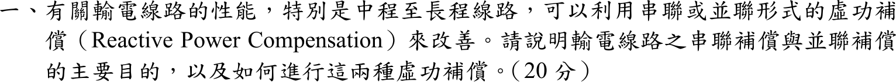
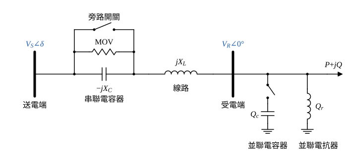

# 105 年電力系統第 1 題｜輸電線路串聯與並聯虛功補償

## 已知與所求

論述題，無數據（20 分）。說明中、長程輸電線路串聯補償與並聯補償的主要目的，以及兩者如何實施。

## 考場標準作答

**解題邏輯**：兩種補償都從線路的兩條基本關係切入：傳輸功率 \(P=\dfrac{V_SV_R}{X}\sin\delta\)（由串聯電抗 \(X\) 決定上限）與壓降 \(\Delta V\approx\dfrac{RP+XQ}{V_R}\)（由線路輸送的無功 \(Q\) 決定電壓）。串聯補償改變的是 \(X\)，目的在提高傳輸容量與穩定度；並聯補償改變的是線路輸送的 \(Q\)，目的在控制電壓。每一種都依「目的（以公式說明）→ 實施方式（裝設位置、設備、保護與限制）」作答。前提：以「送電端匯流排—線路—受電端匯流排」單線路說明，傳輸功率式略去線路電阻，壓降式保留 \(R\)；中、長程線路的並聯充電電容不可忽略。

### 步驟 1：線路的兩條基本關係與補償設備位置

**邏輯**：先寫出兩條公式，後面兩小題分別說明串聯、並聯元件改變的是哪一項。

- 送電端電壓 \(V_S\angle\delta\)、受電端電壓 \(V_R\angle0^\circ\)、線路串聯電抗 \(X_L\)（無補償時 \(X=X_L\)）：
\[
P=\frac{V_SV_R}{X}\sin\delta,\qquad P_{max}=\frac{V_SV_R}{X}\quad(\delta=90^\circ)
\]
- 受電端負載 \(P+jQ\)，線路電阻 \(R\)，小壓降近似：
\[
\Delta V=|V_S|-|V_R|\approx\frac{RP+XQ}{V_R}
\]
- 補償設備的接法：串聯電容器串在相導線上；並聯電容器、並聯電抗器接在匯流排與地之間（圖 1）。

### （一）串聯補償：目的與實施方式

**邏輯**：串聯電容的容抗 \(X_C\) 與線路感抗 \(X_L\) 相減，直接縮小傳輸功率式的分母 \(X\)，所以主要目的是提高傳輸容量與穩定度。

**目的**：令補償度 \(k=X_C/X_L\)，補償後的有效串聯電抗：
\[
X_{eff}=X_L-X_C=X_L-kX_L=(1-k)X_L
\]
代回步驟 1 的 \(P_{max}\)：
\[
\boxed{P_{max}=\frac{V_SV_R}{X_{eff}}=\frac{V_SV_R}{(1-k)X_L}}
\]
與無補償 \(P_{max,0}=V_SV_R/X_L\) 相比：
\[
\frac{P_{max}}{P_{max,0}}=\frac{X_L}{(1-k)X_L}=\frac{1}{1-k}
\]
例如 \(k=0.5\)：\(\dfrac{1}{1-0.5}=\dfrac{1}{0.5}=2\)，傳輸極限加倍。由此得到串聯補償的目的：

1. 提高線路傳輸容量（靜態穩定極限 \(P_{max}\) 提高為 \(1/(1-k)\) 倍）。
2. 同一傳輸功率下功率角 \(\delta\) 變小，穩定裕度增加，暫態穩定度改善。
3. 壓降式中的 \(XQ\) 項變小，且容抗壓降隨負載電流自動增加，重載時電壓調整率改善。
4. 調整並聯線路的有效阻抗，改善各線路間的潮流分配。

**實施方式**：

- 將電容器組串聯於各相導線，裝在線路中點或兩端變電所（置於絕緣平台上）。
- 電容器組並聯保護：金屬氧化物變阻器（MOV）限制故障時電容器過電壓，觸發間隙與旁路開關（斷路器）在嚴重故障或維修時將電容器旁路（圖 1）。
- 補償度採部分補償，一般 \(k\approx0.25\sim0.70\)：補償度過高易與汽輪發電機軸系發生次同步共振（SSR），並使距離電驛量到的阻抗失真；需快速調整時可用閘流體控制串聯電容（TCSC）。

### （二）並聯補償：目的與實施方式

**邏輯**：並聯元件不改變 \(X\)，而是就地供應或吸收無功，改變線路實際輸送的 \(Q\)，從壓降式的 \(XQ\) 項控制受電端電壓。

**目的**：受電端並聯元件供應 \(Q_c\) 後，線路只需輸送 \(Q-Q_c\)：
\[
\Delta V\approx\frac{RP+X(Q-Q_c)}{V_R}
\]

1. **重載（感性負載多）**：並聯電容器供應無功
\[
\boxed{Q_c=\frac{V^2}{X_c}}
\]
使 \(Q-Q_c\) 變小，\(\Delta V\) 減小而抬升受電端電壓；線路電流變小，\(I^2R\) 損失降低，功因改善。

2. **輕載或空載（線路充電無功過剩）**：中、長程線路的並聯電容產生充電無功，受電端電壓反而高於送電端（費蘭梯效應）。無損線路空載時：
\[
V_R=\frac{V_S}{\cos\beta\ell}>V_S\qquad(0<\beta\ell<90^\circ)
\]
此時接入並聯電抗器吸收無功 \(Q_r=V^2/X_r\)，抑制過電壓。

**實施方式**：

- 在變電所匯流排（受電端、中間開閉所）並接電容器組，依負載分段以開關投入或切離。
- 長程超高壓線路兩端裝設並聯電抗器（常直接接在線路側，隨線路一起投切），輕載時吸收充電無功。
- 需連續、快速調整時，採用靜態虛功補償器（SVC）、靜態同步補償器（STATCOM）或同步調相機。

## 驗算

- 串聯補償倍數：\(P_{max}/P_{max,0}=1/(1-k)\)，\(k=0.5\) 時為 2；\(k\to0\) 時回到 1（無補償），符號化簡與數值一致。
- 並聯電容升壓方向（一般示例，非題目數據）：送電端 \(1\) pu、線路 \(X=0.3\) pu、受電端負載 \(0.8+j0.4\) pu，解受電端電壓得 \(V_R=0.81\) pu；並聯電容 \(Q_c=0.4\) pu 投入後 \(V_R=0.97\) pu，與「重載並聯電容升壓」一致。
- 費蘭梯：\(0<\cos\beta\ell<1\) 時 \(1/\cos\beta\ell>1\)，空載受電端電壓高於送電端，需並聯電抗器的結論成立。

## 失分點

- 並聯電容器是「供應」無功（抵消感性負載的無功需求），不是「吸收」；空載過電壓要用並聯「電抗器」吸收，兩者方向寫反會被扣分。
- 串聯補償靠降低 \(X_{eff}\) 提高 \(P_{max}\) 與穩定度，並聯補償靠無功平衡控制電壓；兩者目的不可混為一談。
- 只答目的而漏寫實施方式：串聯補償要寫裝設位置、MOV／旁路保護與補償度限制（SSR），並聯補償要寫電容器／電抗器的投切與 SVC／STATCOM。
