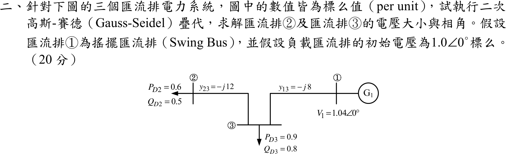

# 105 年電力系統第 2 題｜三匯流排高斯–賽德潮流迭代

## 已知與所求

標么值系統：匯流排 ① 為搖擺匯流排，\(V_1=1.04\angle0^\circ\)；線路 \(y_{13}=-j8\)（①–③）、\(y_{23}=-j12\)（②–③），①②間無線路；負載 \(S_{D2}=0.6+j0.5\)、\(S_{D3}=0.9+j0.8\)。負載匯流排初值 \(V_2^{(0)}=V_3^{(0)}=1.0\angle0^\circ\)。求二次高斯–賽德疊代後 \(V_2,V_3\) 的大小與相角。圖中未標示並聯元件，假設無（\(Y_{ii}\) 只含線路導納）。

## 考場標準作答

觀念：高斯–賽德法是把每個負載匯流排的節點方程式整理成 \(V_i=\dots\) 的形式逐點更新，且同一輪中後算的匯流排立即使用剛更新的值（有別於 Jacobi 法）。先建導納與注入，再依 ② → ③ 的順序迭代兩次。

### 1. 導納與注入

\[
Y_{22}=-j12,\quad Y_{33}=-j8-j12=-j20,\quad Y_{23}=Y_{32}=+j12,\quad Y_{31}=+j8
\]
負載為負注入：\(S_2=-0.6-j0.5\)、\(S_3=-0.9-j0.8\)，故 \(P_i-jQ_i\) 分別為 \(-0.6+j0.5\)、\(-0.9+j0.8\)。

\[
V_i^{(k+1)}=\frac1{Y_{ii}}\left[\frac{P_i-jQ_i}{(V_i^{(k)})^*}-\sum_{j<i}Y_{ij}V_j^{(k+1)}-\sum_{j>i}Y_{ij}V_j^{(k)}\right]
\]
同一輪中 \(V_3\) 立即使用剛算出的 \(V_2\)。（以下全程以完整精度運算，只顯示至小數點後第二位。）

### 2. 第一次疊代

\(V_2\)：\(V_1\) 與 \(V_2\) 無直接線路，只含 \(Y_{23}V_3^{(0)}\)：
\[
V_2^{(1)}=\frac{(-0.6+j0.5)-j12(1)}{-j12}=\frac{-0.60-j11.50}{-j12}=0.96-j0.05=0.96\angle-2.99^\circ
\]
\(V_3\)：用剛得到的 \(V_2^{(1)}\) 與搖擺匯流排 \(V_1=1.04\)。分子各項：\(\dfrac{-0.9+j0.8}{1}=-0.90+j0.80\)、\(-j12V_2^{(1)}=-0.60-j11.50\)、\(-j8(1.04)=-j8.32\)，相加得 \(-1.50-j19.02\)：
\[
V_3^{(1)}=\frac{-1.50-j19.02}{-j20}=0.95-j7.50\times10^{-2}=0.95\angle-4.51^\circ
\]

### 3. 第二次疊代

先算 \(V_2\) 的注入項：
\[
\frac{-0.6+j0.5}{(V_2^{(1)})^*}=-0.60+j5.53\times10^{-1}
\]
\[
V_2^{(2)}=\frac{(-0.60+j5.53\times10^{-1})-j12V_3^{(1)}}{-j12}=\frac{-1.50-j10.86}{-j12}
\]
\[
\boxed{V_2^{(2)}=(9.05-j1.25)\times10^{-1}=0.91\angle-7.85^\circ\ \mathrm{pu}}
\]
再算 \(V_3\)，注入項與各分子項：\(\dfrac{-0.9+j0.8}{(V_3^{(1)})^*}=-8.75\times10^{-1}+j0.91\)、\(-j12V_2^{(2)}=-1.50-j10.86\)、\(-j8(1.04)=-j8.32\)，相加得 \(-2.37-j18.27\)：
\[
V_3^{(2)}=\frac{-2.37-j18.27}{-j20}
\]
\[
\boxed{V_3^{(2)}=(9.13-j1.19)\times10^{-1}=0.92\angle-7.40^\circ\ \mathrm{pu}}
\]

## 驗算

將第二輪結果回代各更新式的等號兩側：
\[
-j12V_2^{(2)}+j12V_3^{(1)}=-0.60+j5.53\times10^{-1}=\frac{-0.6+j0.5}{(V_2^{(1)})^*},
\]
\[
-j20V_3^{(2)}+j12V_2^{(2)}+j8(1.04)=-8.75\times10^{-1}+j0.91=\frac{-0.9+j0.8}{(V_3^{(1)})^*}
\]
兩側相等。兩次疊代尚未收斂：以相同公式迭代至收斂得 \(V_2\approx0.73\angle-18.08^\circ\)、\(V_3\approx0.79\angle-13.14^\circ\)，故本題答案是「第二次疊代值」，不可寫成收斂解。

## 失分點

- 分子用 \(P_i-jQ_i\) 並除以 \(V_i^{(k)*}\)；負載若誤當正注入，會得 \(V_2^{(1)}=1.04+j0.05\)（負載匯流排電壓反高於 1 pu，相角也反號）。
- 同一輪先算 \(V_2^{(2)}\)，再把它代入 \(V_3^{(2)}\)；\(V_3^{(2)}\) 若仍用 \(V_2^{(1)}\) 即成 Jacobi 法。
- 非對角項是支路導納的負值：\(Y_{23}=+j12\)、\(Y_{31}=+j8\)；搖擺匯流排 \(V_1=1.04\) 要代入 \(V_3\) 的式子，漏掉會少 \(-j8.32\) 項。
