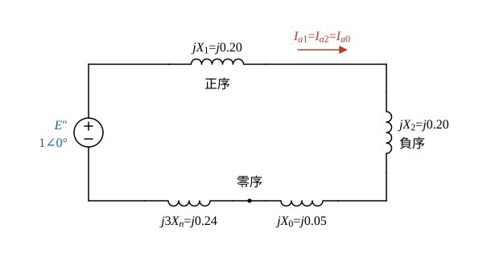

# 105 年電力系統第 3 題｜發電機中性點經電抗接地單線接地故障

## 已知與所求

發電機 100 MVA、20 kV，\(X_d''=X_1=X_2=20\%\)、\(X_0=5\%\)，中性點經 \(0.32\ \Omega\) 限流電抗器接地。無載、額定電壓運轉，輸出端發生單線接地故障（已與系統解聯，只有發電機本身），求故障相次暫態電流實際值（20 分）。故障前電壓取 \(1.0\) pu，故障阻抗為零。

## 考場標準作答

**解題邏輯**：以發電機額定（100 MVA、20 kV）為標么基準。無載額定電壓運轉，故障前端電壓 \(V_f=1.0\angle0^\circ\) pu 就等於次暫態電勢 \(E''\)；求次暫態電流，所以正序用 \(X_d''=X_1\)。單線接地時三序網路在故障點串聯，中性點電抗只出現在零序網路且要乘 3（中性點流的是 \(3I_{a0}\)）。主線：中性點電抗換成標么 → 三序阻抗相加求 \(I_{a1}\) → 故障相電流 \(I_a=3I_{a1}\) → 乘基準電流換成安培。

### 步驟 1：基準量與中性點電抗標么值

\[
Z_b=\frac{V_b^2}{S_b}=\frac{20^2}{100}=4\ \Omega
\]
\[
X_n=\frac{0.32}{4}=0.08\ \mathrm{pu}
\]
\[
I_{\mathrm{base}}=\frac{S_b}{\sqrt3\,V_b}=\frac{100}{\sqrt3\times20}=2.8868\ \mathrm{kA}
\]

### 步驟 2：三序網路串聯

- 正序：\(E''=1\angle0^\circ\) 串 \(jX_1=j0.20\)。
- 負序：只有 \(jX_2=j0.20\)，無電源。
- 零序：\(jX_0=j0.05\) 串 \(j3X_n\)；\(3X_n=3\times0.08=0.24\)。
- 單線接地（a 相）邊界條件 \(I_b=I_c=0\)、\(V_a=0\) ⇒ \(I_{a1}=I_{a2}=I_{a0}\)，三網路串聯成一個迴路。

### 故障相次暫態電流實際值

**邏輯**：串聯迴路的總電抗是 \(X_1+X_2+X_0+3X_n\)，由 \(E''\) 推動得 \(I_{a1}\)；故障相電流是三個序電流之和 \(I_a=I_{a0}+I_{a1}+I_{a2}=3I_{a1}\)，最後乘 \(I_{\mathrm{base}}\)。

\[
I_{a1}=\frac{E''}{j(X_1+X_2+X_0+3X_n)}
\]
代入：
\[
X_1+X_2+X_0+3X_n=0.20+0.20+0.05+0.24=0.69
\]
\[
I_{a1}=\frac{1.0}{j0.69}=-j1.4493\ \mathrm{pu}
\]
故障相電流：
\[
I_a=3I_{a1}=\frac{3}{j0.69}=-j4.3478\ \mathrm{pu}
\]
換成實際值：
\[
|I_a|=4.3478\times2.8868=12.551\ \mathrm{kA}
\]
\[
\boxed{|I_a|=12.55\ \mathrm{kA}}
\]

## 驗算

改用實際歐姆值：\(Z_1=Z_2=0.20\times4=0.80\ \Omega\)，\(Z_0=0.05\times4=0.20\ \Omega\)，\(3X_n=3\times0.32=0.96\ \Omega\)，相電壓 \(20/\sqrt3=11.547\) kV：
\[
I_{a1}=\frac{11\,547}{0.80+0.80+0.20+0.96}=\frac{11\,547}{2.76}=4183.7\ \mathrm{A},\qquad I_a=3\times4183.7=12\,551\ \mathrm{A}=12.55\ \mathrm{kA}
\]
與標么法一致；中性點電流等於故障電流，中性點電壓 \(=12.551\times0.32=4.02\) kV。

## 失分點

- 圖中 \(X_0=5\%\)，不是 8%；若誤用 0.08（恰與 \(X_n\) 相同）會得 \(3/0.72=4.17\) pu、12.03 kA 的錯值。
- 中性點電抗在零序網要乘 3：\(3X_n=0.24\ \mathrm{pu}\)，漏乘 3 則總阻抗 0.53、電流 16.34 kA。
- 最後電流 \(I_a=3I_{a1}\)，不是 \(I_{a1}=1.45\) pu（4.18 kA）。
