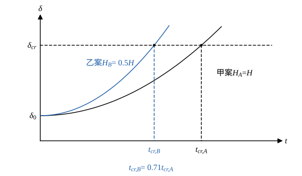

# 105 年電力系統第 4 題｜再生能源併網與暫態穩定度

## 已知與所求

獨立電力系統兩種電源規劃：甲案 100% 傳統火力同步機；乙案 50% 火力＋50% 風力、太陽能。問正常運轉下何者較易發生暫態穩定度問題，並列舉兩種提升該方案暫態穩定度的方法（20 分）。假設風光經變流器併網，本身不提供同步慣量，其餘條件相同。

## 考場標準作答

**解題邏輯**：暫態穩定度是大擾動（如短路）後同步機能否維持同步，由搖擺方程式決定——轉子角加速度與不平衡功率成正比、與慣性常數 \(H\) 成反比。主線：先比較兩案的系統等效 \(H\)（變流器併網的風光不貢獻同步慣量）→ 由搖擺方程式導出頻率變化率（RoCoF）與臨界清除時間 \(t_{cr}\) 對 \(H\) 的比例 → 判定乙案較差 → 針對「慣量少、短路容量低」提出對策。前提：兩案負載、網路、故障型態與保護清除時間相同，同步機的 \(H\)、\(P_m\)（標么）相同；估 \(t_{cr}\) 時取故障期間 \(P_e\approx0\)（機組附近三相短路）。

### 步驟 1：兩案的系統等效慣性常數

系統等效慣性常數以系統容量 \(S_{sys}\) 為基準：
\[
H_{sys}=\frac{\sum_i H_iS_i}{S_{sys}}
\]
甲案全部為同步機（每部 \(H\)）：
\[
H_A=\frac{H\times S_{sys}}{S_{sys}}=H
\]
乙案同步機占 \(0.5S_{sys}\)、變流器電源占 \(0.5S_{sys}\) 且 \(H_{ren}=0\)：
\[
H_B=\frac{H\times0.5S_{sys}+0\times0.5S_{sys}}{S_{sys}}=0.5H
\]

### 步驟 2：由搖擺方程式導出兩個指標

搖擺方程式（標么，\(\omega_s=2\pi f_0\)）：
\[
\frac{2H}{\omega_s}\frac{d^2\delta}{dt^2}=P_m-P_e
\]

- 頻率變化率：\(\dfrac{d^2\delta}{dt^2}=\dfrac{d\omega}{dt}=2\pi\dfrac{df}{dt}\)，代入得 \(\dfrac{2H}{2\pi f_0}\cdot2\pi\dfrac{df}{dt}=\Delta P\)，即
\[
\mathrm{RoCoF}=\frac{df}{dt}=\frac{f_0\,\Delta P}{2H}\qquad(\Delta P=P_m-P_e)
\]
- 臨界清除時間：故障期間 \(P_e\approx0\)，\(\dfrac{d^2\delta}{dt^2}=\dfrac{\omega_sP_m}{2H}=\dfrac{\pi f_0P_m}{H}\)；由 \(\delta(0)=\delta_0\)、\(\dot\delta(0)=0\) 積分兩次：
\[
\delta(t)=\delta_0+\frac{\pi f_0P_m}{2H}t^2
\]
令 \(\delta(t_{cr})=\delta_{cr}\)：
\[
t_{cr}=\sqrt{\frac{2H(\delta_{cr}-\delta_0)}{\pi f_0P_m}}
\]
其中 \(\delta_{cr}\) 由等面積準則決定，只與故障前後的功率–功角曲線有關、與 \(H\) 無關，所以 \(t_{cr}\propto\sqrt H\)。

### （一）判定與說明：乙案較易發生暫態穩定問題

**邏輯**：兩案只差 \(H\)，同一擾動下把步驟 1 的 \(H_A\)、\(H_B\) 代入步驟 2 的比例式比較即可；再補上變流器電源特有的兩個弱點。

1. **慣量減半**：
\[
\frac{\mathrm{RoCoF}_B}{\mathrm{RoCoF}_A}=\frac{H_A}{H_B}=\frac{H}{0.5H}=2
\]
\[
\frac{t_{cr,B}}{t_{cr,A}}=\sqrt{\frac{H_B}{H_A}}=\sqrt{0.5}=0.7071
\]
\[
\boxed{t_{cr}\ \text{約為甲案的 }1/\sqrt2=0.71\ \text{倍}}
\]
同樣的故障，乙案轉子角更快到達 \(\delta_{cr}\)，保護必須更早清除故障才不失步。

2. **短路容量與電壓支撐下降**：變流器故障電流受限（約 1.1–1.5 pu），系統變弱，故障時電壓跌落較深、較久，同步機電氣輸出 \(P_e\) 降得更多，加速功率更大。
3. **故障穿越與鎖相迴路**：風光在電壓驟降時若無法穿越會跳機，造成二次失去發電；弱電網下 PLL 也可能失穩。

\[
\boxed{\text{乙案（50\% 火力＋50\% 風光）較容易發生暫態穩定度問題}}
\]

### （二）兩種提升方法（任列兩種）

**邏輯**：對症下藥——乙案缺的是同步慣量與短路容量，以及故障瞬間的快速功率支援；方法要能增大 \(H\)（或等效 \(H\)）、提高 \(t_{cr}\)，或縮短實際清除時間。

- **加裝同步調相機**：旋轉質量直接提供慣量（提高 \(H_{sys}\)、使 \(t_{cr}\) 回升）與短路容量，故障時維持電壓。
- **虛擬慣性控制／成形電網（grid-forming）變流器，搭配電池儲能（BESS）**：依頻率變化率快速注入有功、模擬慣量，降低 RoCoF 與轉子加速。
- 另可：具故障穿越能力的變流器、STATCOM 動態無功支援、縮短故障清除時間（高速保護與斷路器）。

## 驗算

代入假設數值（非題目所給）\(H=5\ \mathrm{s}\)、\(f_0=60\ \mathrm{Hz}\)、\(\Delta P=0.1\)、\(P_m=1\)、\(\delta_{cr}-\delta_0=70^\circ=1.2217\ \mathrm{rad}\)：

- RoCoF：甲案 \(\dfrac{60\times0.1}{2\times5}=0.6\ \mathrm{Hz/s}\)，乙案 \(\dfrac{60\times0.1}{2\times2.5}=1.2\ \mathrm{Hz/s}\)，比值 2。
- \(t_{cr}\)：甲案 \(\sqrt{\dfrac{2\times5\times1.2217}{\pi\times60\times1}}=\sqrt{0.064813}=0.25458\ \mathrm{s}\)，乙案 \(\sqrt{\dfrac{2\times2.5\times1.2217}{\pi\times60}}=\sqrt{0.032406}=0.18002\ \mathrm{s}\)，比值 \(0.18002/0.25458=0.7071\)。

比例只依賴「同步慣量減半」這一題設，與所選數值無關。

## 失分點

- 結論要明確寫「乙案」，並以慣量降低（\(H\) 減半）當主因；只列方法而無判定理由會失分。
- 虛擬慣性、調相機需與題設的變流器併網假設連結；若風光採同步機型併網，結論要另行評估。
- 方法至少給兩種且各附一句作用機理（調相機補慣量與短路容量；儲能與成形變流器補快速有功）。
