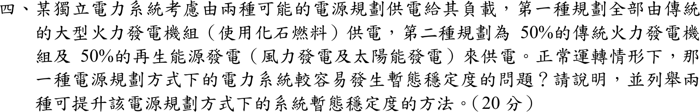
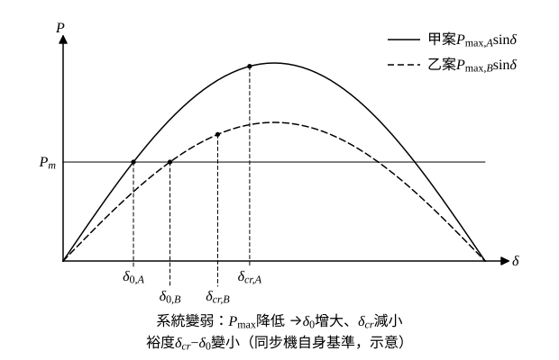

# 105 年電力系統第 4 題｜再生能源併網與暫態穩定度

## 已知與所求

獨立電力系統兩種電源規劃：甲案 100% 傳統火力同步機；乙案 50% 火力＋50% 風力、太陽能。問正常運轉下何者較易發生暫態穩定度問題，並列舉兩種提升該方案暫態穩定度的方法（20 分）。假設風光經變流器併網，本身不提供同步慣量，其餘條件相同。

## 考場標準作答

### 步驟 1：系統基準下的慣量與同步機出力

設兩案負載、網路、故障型態與保護清除時間相同；風光經變流器併網、不提供同步慣量；每部同步機在自身基準下的 \(H\) 相同。系統等效慣性常數以 \(S_{sys}\) 為基準：
\[
H_{sys}=\frac{\sum_i H_iS_i}{S_{sys}}
\]
甲案全部為同步機（每部自身基準 \(H\)）：
\[
H_A=\frac{H\times S_{sys}}{S_{sys}}=H
\]
乙案同步機占 \(0.5S_{sys}\)、變流器電源占 \(0.5S_{sys}\) 且 \(H_{ren}=0\)：
\[
H_B=\frac{H\times0.5S_{sys}+0\times0.5S_{sys}}{S_{sys}}=0.5H
\]
同步機的機械功率（同一負載 \(P_L\)，系統基準）：甲案由同步機全供，乙案同步機只供一半：
\[
P_{m,A}=P_L,\qquad P_{m,B}=0.5P_L
\]

### 步驟 2：由搖擺方程式導出兩個指標

搖擺方程式（系統基準標么，\(\omega_s=2\pi f_0\)）：
\[
\frac{2H_{sys}}{\omega_s}\frac{d^2\delta}{dt^2}=P_m-P_e
\]

- 頻率變化率：\(\dfrac{d^2\delta}{dt^2}=\dfrac{d\omega}{dt}=2\pi\dfrac{df}{dt}\)，代入得 \(\dfrac{2H_{sys}}{2\pi f_0}\cdot2\pi\dfrac{df}{dt}=\Delta P\)，即
\[
\mathrm{RoCoF}=\frac{df}{dt}=\frac{f_0\,\Delta P}{2H_{sys}}\qquad(\Delta P=P_m-P_e)
\]
- 臨界清除時間：故障期間取 \(P_e\approx0\)（機組附近三相短路），\(\dfrac{d^2\delta}{dt^2}=\dfrac{\omega_sP_m}{2H_{sys}}=\dfrac{\pi f_0P_m}{H_{sys}}\)；由 \(\delta(0)=\delta_0\)、\(\dot\delta(0)=0\) 積分兩次：
\[
\delta(t)=\delta_0+\frac{\pi f_0P_m}{2H_{sys}}t^2
\]
令 \(\delta(t_{cr})=\delta_{cr}\)：
\[
t_{cr}=\sqrt{\frac{2H_{sys}(\delta_{cr}-\delta_0)}{\pi f_0P_m}}
\]

### （一）判定與說明：乙案較易發生暫態穩定問題

1. **同一 MW 擾動下 RoCoF 加倍（量化）**：在系統基準下兩案的 \(\Delta P\)（同一 MW）相同：
\[
\frac{\mathrm{RoCoF}_B}{\mathrm{RoCoF}_A}=\frac{f_0\Delta P/(2H_B)}{f_0\Delta P/(2H_A)}=\frac{H_A}{H_B}=\frac{H}{0.5H}=2
\]
頻率變化快一倍，頻率最低點更低，轉子角偏移更快。

2. **\(t_{cr}\) 不能只由 \(H\) 判斷**：把步驟 1 代入 \(t_{cr}\) 式中的 \(H_{sys}/P_m\)：
\[
\frac{H_A}{P_{m,A}}=\frac{H}{P_L},\qquad \frac{H_B}{P_{m,B}}=\frac{0.5H}{0.5P_L}=\frac{H}{P_L}
\]
兩案相同（等同於每部同步機在自身基準下的 \(H\)、\(P_m\) 都沒變），所以 \(t_{cr}\propto\sqrt{\delta_{cr}-\delta_0}\)，差別在角度裕度。

3. **系統變弱使角度裕度 \(\delta_{cr}-\delta_0\) 變小（定性）**：以每部同步機自身基準（\(P_m\) 不變，見第 2 點；與圖 1 相同）：同步機減半 → 短路容量下降，且變流器只提供受限的故障電流（見第 4 點），故障中與故障後同步機端電壓偏低、恢復慢 → 等效功角曲線峰值 \(P_{\max}\) 降低。由 \(P_m=P_{\max}\sin\delta_0\)，\(P_{\max}\) 降低使 \(\delta_0\) 增大；減速面積變小使 \(\delta_{cr}\) 減小，所以 \(\delta_{cr}-\delta_0\) 變小，\(t_{cr}\) 縮短。

4. **變流器電源的故障行為**：變流器故障電流受限（約 1.1–1.5 pu），故障時電壓支撐不足、跌落較深較久（這正是第 3 點 \(P_{\max}\) 降低的主因）；電壓驟降時若無法低電壓穿越（LVRT）而跳脫，會造成二次失去發電；弱電網下鎖相迴路（PLL）也可能失穩。

\[
\boxed{\text{乙案（50\% 火力＋50\% 風光）較容易發生暫態穩定度問題}}
\]

### （二）兩種提升方法（任列兩種）

- **加裝同步調相機**：旋轉質量直接提供慣量（提高 \(H_{sys}\)、降低 RoCoF）與短路容量（提高 \(P_{\max}\)），故障時維持電壓。
- **虛擬慣性控制／成形電網（grid-forming）變流器，搭配電池儲能（BESS）**：依頻率變化率快速注入有功、模擬慣量，降低 RoCoF 與轉子加速。
- 另可：具故障穿越能力的變流器、STATCOM 動態無功支援、縮短故障清除時間（高速保護與斷路器）。

## 驗算

代入假設數值（非題目所給，系統基準）\(H=5\ \mathrm{s}\)、\(f_0=60\ \mathrm{Hz}\)、\(\Delta P=0.1\)、\(P_L=1\)、\(\delta_{cr}-\delta_0=70^\circ=1.2217\ \mathrm{rad}\)（兩案先取相同裕度）：

- RoCoF：甲案 \(\dfrac{60\times0.1}{2\times5}=0.6\ \mathrm{Hz/s}\)，乙案 \(\dfrac{60\times0.1}{2\times2.5}=1.2\ \mathrm{Hz/s}\)，比值 2。
- \(t_{cr}\)：甲案 \(\sqrt{\dfrac{2\times5\times1.2217}{\pi\times60\times1}}=\sqrt{0.064813}=0.25458\ \mathrm{s}\)；乙案 \(\sqrt{\dfrac{2\times2.5\times1.2217}{\pi\times60\times0.5}}=\sqrt{0.064813}=0.25458\ \mathrm{s}\)。

裕度相同時兩案 \(t_{cr}\) 相同，證實 \(t_{cr}\) 的縮短來自乙案較小的 \(\delta_{cr}-\delta_0\)（系統變弱），不是來自 \(H\) 減半本身。

## 失分點

- 結論要明確寫「乙案」，並說明理由：同步慣量減半使 RoCoF 加倍、系統變弱使角度裕度變小；只列方法而無判定理由會失分。
- 比較 \(H\) 與 \(P_m\) 要用同一基準：系統基準下 \(H\) 與同步機 \(P_m\) 同時減半，不能只把 \(H\) 減半代入 \(t_{cr}\) 式得出「\(t_{cr}\) 為 0.71 倍」。
- 方法至少給兩種且各附一句作用機理（調相機補慣量與短路容量；儲能與成形變流器補快速有功）；若風光採同步機型併網，結論要另行評估。
