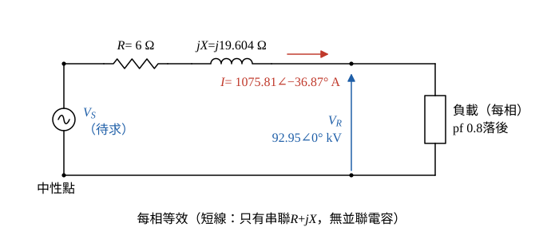

# 106 年電力系統第 1 題｜短線電壓調整率與效率

## 已知與所求

三相 60 Hz、161 kV 輸電線長 40 km，每相 \(0.15\ \Omega/\mathrm{km}\)、\(1.3\ \mathrm{mH/km}\)，並聯電容忽略（短線模型）；受電端接 161 kV、300 MVA、功因 0.8 落後的負載。求（一）送電端電壓；（二）送電端三相功率輸出；（三）電壓調整率；（四）傳輸效率。

## 考場標準作答

### 步驟 1：每相線路參數與受電端量

設三相平衡、受電端線電壓維持 161 kV。短線模型忽略並聯電容，每相只剩串聯阻抗 \(Z=R+jX\)，送電端電流等於受電端電流；化為每相 Y 等效電路，取受電端相電壓為 \(0^\circ\) 參考。

\[
R=0.15\times40=6\ \Omega
\]
\[
L\ell=1.3\ \mathrm{mH/km}\times40\ \mathrm{km}=52\ \mathrm{mH}=0.052\ \mathrm H
\]
\[
X=\omega L\ell=2\pi(60)(0.052)=376.991\times0.052=19.604\ \Omega
\]
受電端相電壓（取為參考相量）：
\[
V_R=\frac{161}{\sqrt3}=92.95\ \mathrm{kV}\ \Rightarrow\ V_R=92.95\angle0^\circ\ \mathrm{kV}
\]
線電流大小：
\[
|I|=\frac{S}{\sqrt3V_{LL}}=\frac{300\ \mathrm{MVA}}{\sqrt3\times161\ \mathrm{kV}}=1.0758\ \mathrm{kA}=1075.81\ \mathrm A
\]
功因 0.8 落後，\(\theta=\cos^{-1}0.8=36.87^\circ\)，\(\sin\theta=0.6\)，電流落後 \(V_R\)：
\[
I=|I|(\cos\theta-j\sin\theta)=1075.81(0.8-j0.6)
\]
\[
I=860.65-j645.49\ \mathrm A=1075.81\angle-36.87^\circ\ \mathrm A
\]

### （一）送電端之電壓（7 分）

\[
V_S=V_R+(R+jX)I
\]
線路壓降 \((R+jX)I=(6+j19.604)(860.65-j645.49)\)，實部與虛部分開乘：
\[
\text{實部}=R\,(860.65)+X\,(645.49)=6(860.65)+19.604(645.49)=5163.90+12654.19=17818.09\ \mathrm V
\]
\[
\text{虛部}=X\,(860.65)-R\,(645.49)=19.604(860.65)-6(645.49)=16872.18-3872.94=12999.24\ \mathrm V
\]
\[
(R+jX)I=17.82+j13.00\ \mathrm{kV}
\]
\[
V_S=92.95+(17.82+j13.00)=110.77+j13.00\ \mathrm{kV}
\]
化為極座標：
\[
|V_S|=\sqrt{110.77^2+13.00^2}=\sqrt{12269.99+169.00}=\sqrt{12438.99}=111.53\ \mathrm{kV}
\]
\[
\angle V_S=\tan^{-1}\frac{13.00}{110.77}=\tan^{-1}0.1174=6.69^\circ
\]
\[
\boxed{V_S=111.53\angle6.69^\circ\ \mathrm{kV/相}},\qquad V_{S,LL}=\sqrt3(111.53)
\]
\[
\boxed{V_{S,LL}=193.18\ \mathrm{kV}}
\]

### （二）送電端之三相功率輸出（6 分）

短線無並聯分路，沒有充電無功。負載功率：
\[
P_R=S\cos\theta=300(0.8)=240\ \mathrm{MW},\qquad Q_R=S\sin\theta=300(0.6)=180\ \mathrm{Mvar}
\]
電流平方：
\[
|I|^2=(1.07581\ \mathrm{kA})^2=1.157367\ \mathrm{kA^2}
\]
線路三相有功損失與無功消耗：
\[
P_{loss}=3|I|^2R=3(1.157367\ \mathrm{kA^2})(6\ \Omega)=20.83\ \mathrm{MW}
\]
\[
Q_{line}=3|I|^2X=3(1.157367\ \mathrm{kA^2})(19.604\ \Omega)=68.07\ \mathrm{Mvar}
\]
送電端：
\[
\boxed{P_S=P_R+P_{loss}=240+20.83=260.83\ \mathrm{MW}}
\]
\[
\boxed{Q_S=Q_R+Q_{line}=180+68.07=248.07\ \mathrm{Mvar}}
\]

### （三）電壓調整率（6 分）

短線無並聯分路，負載移除後線路無電流、無壓降，無載受電端電壓 \(=|V_S|\)：

\[
\mathrm{VR}=\frac{|V_S|-|V_R|}{|V_R|}\times100\%
\]
\[
\mathrm{VR}=\frac{111.53-92.95}{92.95}\times100\%=\frac{18.58}{92.95}\times100\%=0.1999\times100\%
\]
\[
\boxed{\mathrm{VR}=19.99\%}
\]

### （四）該傳輸線之效率（6 分）

\[
\eta=\frac{P_R}{P_S}\times100\%=\frac{240}{260.83}\times100\%=0.9201\times100\%
\]
\[
\boxed{\eta=92.01\%}
\]

## 驗算

以複功率回推送電端線電壓：
\[
|S_S|=\sqrt{260.83^2+248.07^2}=\sqrt{68032.29+61538.72}=359.96\ \mathrm{MVA}
\]
\[
V_{S,LL}=\frac{|S_S|}{\sqrt3\,|I|}=\frac{359.96\ \mathrm{MVA}}{\sqrt3\times1.07581\ \mathrm{kA}}=\frac{359.96\ \mathrm{MVA}}{1.86336\ \mathrm{kA}}=193.18\ \mathrm{kV}
\]
與相量法相同；\(P_S\) 亦等於 \(3\,\mathrm{Re}(V_SI^*)=260.83\) MW。

## 失分點

- \(X=\omega L\ell\) 要乘 40 km 並把 mH 換成 H：\(0.49\ \Omega/\mathrm{km}\times40=19.60\ \Omega\)，不是 \(0.49\ \Omega\)。
- 電壓調整率用相電壓比相電壓（或線電壓比線電壓）；以 193.18 kV 對 92.95 kV 比較會得 107.82%。
- 效率是有功比 \(P_R/P_S\)，不是視在功率比；送電端 \(Q_S\) 含線路電抗消耗，不可直接取負載 180 Mvar。
