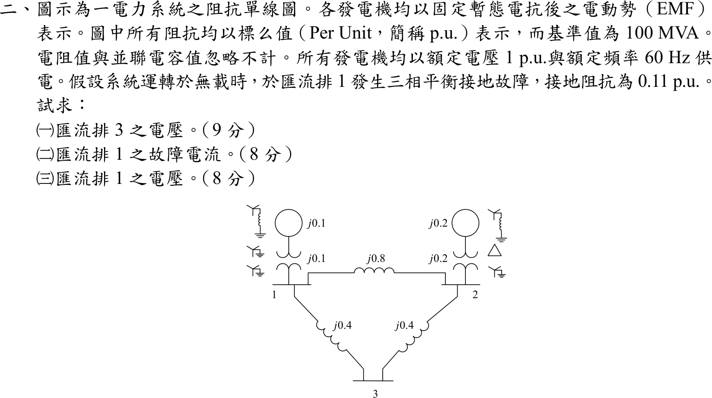
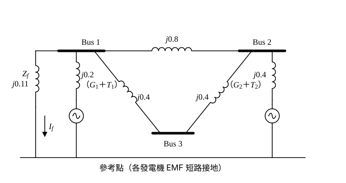
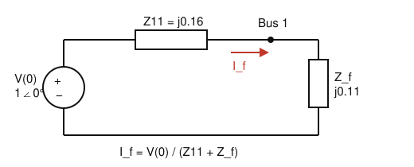

# 106 年電力系統第 2 題｜三匯流排三相故障

## 已知與所求

100 MVA 基準標么阻抗圖：發電機 \(G_1\) 的 \(j0.1\) 與變壓器 \(j0.1\) 接 Bus 1，\(G_2\) 的 \(j0.2\) 與變壓器 \(j0.2\) 接 Bus 2；線路 \(1\text{-}2\) 為 \(j0.8\)、\(1\text{-}3\) 與 \(2\text{-}3\) 各 \(j0.4\)。電阻與並聯電容忽略，發電機 EMF 為 1 p.u.。無載運轉，Bus 1 經接地阻抗 \(0.11\) p.u. 發生三相平衡接地故障（按純電抗網路取 \(Z_f=j0.11\)，見「條件與疑義」）。求（一）Bus 3 電壓；（二）Bus 1 故障電流；（三）Bus 1 電壓。

## 考場標準作答

### 步驟 1：建立正序阻抗網路

三相平衡故障只需正序網路；無載運轉，故障前各匯流排電壓皆等於 EMF：\(V^{(0)}=1\angle0^\circ\) p.u.。

- 發電機 EMF 視為短路接地（求阻抗時電壓源短路）。
- Bus 1 對地支路：\(G_1\) 與其變壓器串聯，\(j0.1+j0.1=j0.2\)。
- Bus 2 對地支路：\(G_2\) 與其變壓器串聯，\(j0.2+j0.2=j0.4\)。
- 線路：\(1\text{-}2\) 為 \(j0.8\)；\(1\text{-}3\)、\(3\text{-}2\) 各 \(j0.4\)。

（以下各阻抗皆為純電抗，計算時先略去 \(j\)，最後補回。）

### 步驟 2：求 \(Z_{11}\)（Bus 1 看入的戴維寧阻抗）

Bus 1 到 Bus 2 有兩條並聯路徑：直接線路 \(0.8\)，以及經 Bus 3 的 \(0.4+0.4=0.8\)：
\[
Z_{12,\mathrm{eq}}=0.8\parallel0.8=\frac{0.8\times0.8}{0.8+0.8}=0.4
\]
再串 Bus 2 對地支路，得 Bus 1 經網路到地的阻抗：
\[
Z_{\mathrm{net}}=0.4+0.4=0.8
\]
與 Bus 1 自身對地支路 \(0.2\) 並聯：
\[
Z_{11}=0.2\parallel0.8=\frac{0.2\times0.8}{0.2+0.8}=\frac{0.16}{1}=0.16\quad\Rightarrow\quad Z_{11}=j0.16
\]

### 步驟 3：求轉移阻抗 \(Z_{21}\)、\(Z_{31}\)

在 Bus 1 注入 1 p.u. 電流，各匯流排電壓的數值即為 \(Z_{k1}\)：

- Bus 1 電壓：\(V_1=1\times Z_{11}=0.16\)。
- 流入網路側的電流：\(I_{\mathrm{net}}=\dfrac{V_1}{Z_{\mathrm{net}}}=\dfrac{0.16}{0.8}=0.20\)。
- 這股電流經兩條並聯路徑到 Bus 2，再經 Bus 2 對地支路入地，故 \(V_2=I_{\mathrm{net}}\times0.4=0.20\times0.4=0.08\)。
- 兩條並聯路徑阻抗相等（皆 \(0.8\)），各分一半：經 Bus 3 的電流 \(0.10\)，所以 \(V_3=V_1-0.10\times0.4=0.16-0.04=0.12\)。

\[
Z_{21}=j0.08,\qquad Z_{31}=j0.12
\]

### （二）Bus 1 故障電流（8 分）

\[
I_f=\frac{V^{(0)}}{Z_{11}+Z_f}
\]
代入 \(Z_{11}=j0.16\)、\(Z_f=j0.11\)：
\[
I_f=\frac{1\angle0^\circ}{j0.16+j0.11}=\frac{1}{j0.27}=\frac{1}{0.27}\angle-90^\circ=3.70\angle-90^\circ
\]
\[
\boxed{I_f=-j3.70\ \mathrm{p.u.}=3.70\angle-90^\circ\ \mathrm{p.u.}}
\]

### （一）Bus 3 電壓（9 分）

由疊加原理，故障後狀態 = 故障前狀態 + 只有 \(-I_f\) 注入 Bus 1 的狀態：

\[
V_3=V^{(0)}-Z_{31}I_f
\]
代入：
\[
Z_{31}I_f=(j0.12)(-j3.70)=0.12\times\frac{1}{0.27}\times(j)(-j)=\frac{0.12}{0.27}=\frac{4}{9}=0.44
\]
\[
V_3=1-\frac{4}{9}=\frac{5}{9}
\]
\[
\boxed{V_3=\tfrac{5}{9}\approx0.56\angle0^\circ\ \mathrm{p.u.}}
\]

### （三）Bus 1 電壓（8 分）

Bus 1 經 \(Z_f\) 接地，其電壓即故障電流流過 \(Z_f\) 的壓降：

\[
V_1=I_fZ_f
\]
代入：
\[
V_1=(-j3.70)(j0.11)=\frac{1}{0.27}\times0.11\times(-j)(j)=\frac{0.11}{0.27}=\frac{11}{27}
\]
\[
\boxed{V_1=\tfrac{11}{27}\approx0.41\angle0^\circ\ \mathrm{p.u.}}
\]

（\(0.41\) 與 \(11/27=0.4074\) 相差 \(0.64\%\)，精確值以分數 \(\tfrac{11}{27}\) 表示。）

## 驗算

改用節點 KCL（以完整精度代入，只顯示兩位小數）：先求 Bus 2 電壓 \(V_2=V_f-Z_{21}I_f=1-\dfrac{0.08}{0.27}=\dfrac{19}{27}\approx0.70\ \mathrm{pu}\)。

Bus 1 發電機供給電流：
\[
\frac{1-0.41}{j0.2}=-j2.96
\]
流向 Bus 2 與 Bus 3 的線路電流：
\[
\frac{0.41-0.70}{j0.8}=j0.37,\qquad \frac{0.41-0.56}{j0.4}=j0.37
\]
故障電流 \(=-j2.96-j0.37-j0.37=-j3.70\)，與 \(I_f\) 相同；另 \(V_1=1-Z_{11}I_f=1-\dfrac{0.16}{0.27}=\dfrac{11}{27}\approx0.41\) 亦吻合。

## 失分點

- \(Z_{11}\) 不是只有 Bus 1 發電機支路 \(0.2\)（會得 \(I_f=3.23\)），要並聯整個其餘網路，結果為 \(0.16\)。
- \(Z_{31}\) 是 Bus 3 對 Bus 1 注入的互阻抗（\(0.12\)），不是 Bus 3 的自阻抗；電壓式為 \(V_3=V_f-Z_{31}I_f\)。
- 三相平衡故障只用正序網路；圖中變壓器接線與中性點接地僅影響不平衡故障，與本題無關。

## 條件與疑義

題面寫「接地阻抗為 0.11 p.u.」未標 \(j\)。本題網路為純電抗（電阻忽略），故取 \(Z_f=j0.11\)。若解讀為純電阻 \(0.11\) p.u.，則 \(|I_f|=1/|0.11+j0.16|=5.15\) p.u.，\(|V_1|=5.67\times10^{-1}\)、\(|V_3|=0.60\) p.u.。
