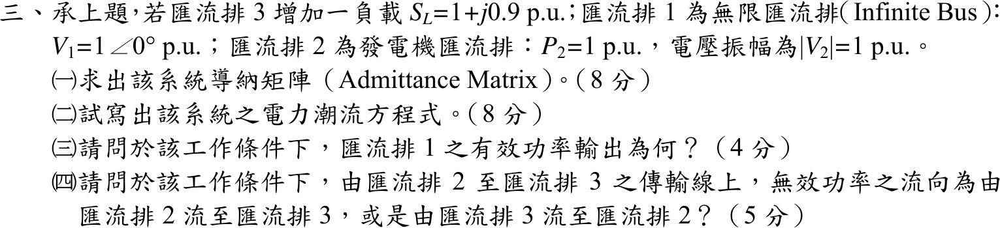
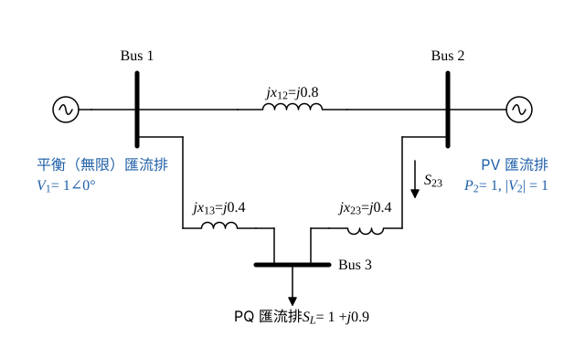

# 106 年電力系統第 3 題｜三匯流排潮流與無效功率流向

## 已知與所求

承上題的網路（線路電抗 \(x_{12}=0.8,\ x_{13}=0.4,\ x_{23}=0.4\) pu，取自上題圖），Bus 3 增加負載 \(S_L=1+j0.9\) pu；Bus 1 為無限匯流排 \(V_1=1\angle0^\circ\)；Bus 2 為發電機匯流排 \(P_2=1\) pu、\(|V_2|=1\) pu。求（一）導納矩陣（8 分）；（二）潮流方程式（8 分）；（三）Bus 1 的有功輸出（4 分）；（四）Bus 2–3 線路無效功率流向（5 分）。

## 考場標準作答

**解題邏輯**：潮流問題先建網路的 \(Y_{bus}\)，再由注入複功率 \(S_i=V_i\sum_kY_{ik}^*V_k^*\) 寫出各匯流排的 \(P_i\)、\(Q_i\)。前提：發電機與變壓器電抗在匯流排之外（Bus 1、Bus 2 的電壓直接給在匯流排上），不入潮流 \(Y_{bus}\)；線路無並聯電納。
1. 依匯流排型態決定要列哪幾條方程式：Bus 1 為平衡（無限）匯流排（\(V_1\) 已知）、Bus 2 為 PV 匯流排（\(P_2\)、\(|V_2|\) 已知）、Bus 3 為 PQ 匯流排（\(P_3=-1\)、\(Q_3=-0.9\)）。
2. 網路無電阻，所以（三）用實功守恆即可，不必解方程。
3. （四）要解出運轉點後，用線路潮流 \(Q_{23}\) 的正負號判斷方向。

### 步驟 1：網路與匯流排型態

令未知量為 \(\delta_2\)、\(\delta_3\)、\(V_3\)（\(V_3\) 表示 \(|V_3|\)），\(V_2=1\angle\delta_2\)、\(V_3=V_3\angle\delta_3\)。

### （一）導納矩陣（8 分）

**邏輯**：線路串聯導納 \(y=\dfrac{1}{jx}\)；\(Y_{ii}\) = 接在 Bus \(i\) 的支路導納之和，\(Y_{ik}=-y_{ik}\)。

\[
y_{12}=\frac{1}{j0.8}=-j1.25,\qquad y_{13}=\frac{1}{j0.4}=-j2.5,\qquad y_{23}=\frac{1}{j0.4}=-j2.5
\]
\[
Y_{11}=y_{12}+y_{13}=-j(1.25+2.5)=-j3.75
\]
\[
Y_{22}=y_{12}+y_{23}=-j(1.25+2.5)=-j3.75
\]
\[
Y_{33}=y_{13}+y_{23}=-j(2.5+2.5)=-j5
\]
\[
Y_{12}=-y_{12}=j1.25,\qquad Y_{13}=-y_{13}=j2.5,\qquad Y_{23}=-y_{23}=j2.5
\]
\[
\boxed{
Y_{bus}=\begin{bmatrix}
-j3.75&j1.25&j2.50\\
j1.25&-j3.75&j2.50\\
j2.50&j2.50&-j5.00
\end{bmatrix}\ \mathrm{pu}}
\]

### （二）潮流方程式（8 分）

**邏輯**：網路無電阻，\(Y_{ik}=jB_{ik}\)（\(B_{12}=1.25\)、\(B_{13}=B_{23}=2.5\)、\(B_{22}=-3.75\)、\(B_{33}=-5\)），代入 \(S_i=V_i\sum_kY_{ik}^*V_k^*\) 後實部只剩 \(\sin\) 項、虛部只剩 \(\cos\) 項；PV 匯流排列 \(P\) 式、PQ 匯流排列 \(P\)、\(Q\) 兩式，共三式解三個未知量。

一般式推導：\(Y_{ik}^*=-jB_{ik}\)，\(V_iV_k^*=|V_i||V_k|e^{j(\delta_i-\delta_k)}\)，而 \(-je^{j\theta}=\sin\theta-j\cos\theta\)：
\[
S_i=\sum_k(-jB_{ik})|V_i||V_k|e^{j(\delta_i-\delta_k)}
\]
\[
P_i=\sum_kB_{ik}|V_i||V_k|\sin(\delta_i-\delta_k),\qquad Q_i=-\sum_kB_{ik}|V_i||V_k|\cos(\delta_i-\delta_k)
\]
逐項代入（\(k=i\) 的 \(\sin0=0\)；\(\cos0=1\)）：

- \(P_2\)：\(k=1\) 項 \(1.25(1)(1)\sin\delta_2\)；\(k=3\) 項 \(2.5(1)V_3\sin(\delta_2-\delta_3)\)。
- \(P_3\)：\(k=1\) 項 \(2.5V_3\sin\delta_3\)；\(k=2\) 項 \(2.5V_3\sin(\delta_3-\delta_2)\)。
- \(Q_3\)：\(-[2.5V_3\cos\delta_3+2.5V_3\cos(\delta_3-\delta_2)+(-5)V_3^2]\)。

負載為負注入：\(P_3=-1\)、\(Q_3=-0.9\)。
\[
\boxed{
\begin{aligned}
P_2&=1.25\sin\delta_2+2.5V_3\sin(\delta_2-\delta_3)=1\\
P_3&=2.5V_3\sin\delta_3+2.5V_3\sin(\delta_3-\delta_2)=-1\\
Q_3&=5V_3^2-2.5V_3\cos\delta_3-2.5V_3\cos(\delta_3-\delta_2)=-0.9
\end{aligned}}
\]
解出 \(\delta_2,\delta_3,V_3\) 後，平衡匯流排的 \(P_1\)、\(Q_1\) 與 Bus 2 的 \(Q_2\) 再由同一般式算出。

### （三）Bus 1 有功輸出（4 分）

**邏輯**：網路無電阻、無有功損失，三個匯流排注入的實功總和必為 0；把 \(P_1\) 的一般式與 \(P_2\)、\(P_3\) 相加可直接看出各 \(\sin\) 項兩兩相消。

\[
P_1=1.25\sin(0-\delta_2)+2.5V_3\sin(0-\delta_3)=-1.25\sin\delta_2-2.5V_3\sin\delta_3
\]
\[
P_1+P_2+P_3=(-1.25\sin\delta_2+1.25\sin\delta_2)+(-2.5V_3\sin\delta_3+2.5V_3\sin\delta_3)+2.5V_3\big[\sin(\delta_2-\delta_3)+\sin(\delta_3-\delta_2)\big]=0
\]
\[
P_1=-(P_2+P_3)=-(1-1)
\]
\[
\boxed{P_1=0\ \mathrm{pu}}
\]
此結果與電壓根無關。

### （四）Bus 2–3 線路無效功率流向（5 分）

**邏輯**：無損線路由 Bus 2 送出的無效功率 \(Q_{23}=\dfrac{|V_2|^2-|V_2||V_3|\cos(\delta_2-\delta_3)}{x_{23}}\)，\(Q_{23}>0\) 即由 Bus 2 流向 Bus 3；需先由（二）解出運轉點（牛頓–拉夫森法，平坦起始 \(1\angle0^\circ\)）。

線路潮流公式（\(S_{23}=V_2I_{23}^*\)，\(I_{23}=\dfrac{V_2-V_3}{jx_{23}}\)）：
\[
P_{23}=\frac{|V_2||V_3|\sin(\delta_2-\delta_3)}{x_{23}},\qquad Q_{23}=\frac{|V_2|^2-|V_2||V_3|\cos(\delta_2-\delta_3)}{x_{23}}
\]
以牛頓法解（二）三式，得兩個正電壓根：

| 分支 | \(\delta_2\) | \(\delta_3\) | \(\lvert V_3\rvert\) |
| --- | --- | --- | --- |
| 高電壓 | \(13.93^\circ\) | \(-10.09^\circ\) | 0.6869 |
| 低電壓 | \(17.30^\circ\) | \(-22.01^\circ\) | 0.3967 |

高電壓根：
\[
\delta_2-\delta_3=13.93^\circ-(-10.09^\circ)=24.02^\circ,\qquad \cos24.02^\circ=0.9134,\qquad \sin24.02^\circ=0.4071
\]
\[
Q_{23}=\frac{1-0.6869\times0.9134}{0.4}=\frac{1-0.6274}{0.4}=\frac{0.3726}{0.4}=0.9315\ \mathrm{pu}
\]
\[
P_{23}=\frac{0.6869\times0.4071}{0.4}=\frac{0.2796}{0.4}=0.6991\ \mathrm{pu}
\]
低電壓根：
\[
\delta_2-\delta_3=17.30^\circ-(-22.01^\circ)=39.31^\circ,\qquad \cos39.31^\circ=0.7738
\]
\[
Q_{23}=\frac{1-0.3967\times0.7738}{0.4}=\frac{1-0.3070}{0.4}=\frac{0.6930}{0.4}=1.733\ \mathrm{pu}
\]
兩根的 \(Q_{23}\) 皆為正（\(|V_3|\cos(\delta_2-\delta_3)<|V_2|=1\)）：
\[
\boxed{\text{Bus 2–3 線路無效功率流向：由 Bus 2 流向 Bus 3}}
\]

## 驗算

回代高電壓根：\(P_2=1.25\times0.2407+2.5\times0.6869\times0.4071=0.3009+0.6991=1.0000\)；\(Q_3=5\times0.6869^2-2.5\times0.6869\times0.9845-2.5\times0.6869\times0.9134=2.3592-1.6906-1.5685=-0.8999\approx-0.9\)（\(\sin13.93^\circ=0.2407\)、\(\cos(-10.09^\circ)=0.9845\)）。全精度回代得注入功率 \(S_1=j0.85\)、\(S_2=1+j0.97\)、\(S_3=-1-j0.9\)，\(P_1=0\)、\(P_2=1\)、\(P_3=-1\) 皆成立；無效功率守恆：\(0.85+0.97-0.9=0.91=\sum|I_k|^2x_k\)（以完整精度相加）（三條線路電抗消耗）。低電壓根同樣滿足 \(P_1=0\) 與守恆（\(\sum Q=2.53\)）。

## 失分點

- \(Y_{bus}\) 以線路電抗 \(0.8/0.4/0.4\) 的倒數建立；若沿用其他電抗（如 0.2、0.25）則三個元素全錯。
- 負載為負注入：\(P_3=-1\)、\(Q_3=-0.9\)。
- \(P_1=0\) 來自無損網路的實功守恆，不需解出電壓；但 \(Q_1\)、\(V_3\) 要看採用哪一個根。

## 條件與疑義

題面未指定 Newton 初值或「正常運轉」分支，同一組方程有高、低兩個正電壓根；本題所問的 Y_bus、方程式、\(P_1=0\) 與 Bus 2–3 線路無效功率流向在兩根下相同，答案與分支無關。依通常運轉語境，高電壓根為主要候選，低電壓根亦保留作數值診斷（\(\lvert V_3\rvert\)、\(Q_1\) 才需指定分支，本題不問）。

### Jacobian 分支診斷

令 \(F=[P_2-1,\ P_3+1,\ Q_3+0.9]^T\)，\(J=\partial F/\partial(\delta_2,\delta_3,V_3)\)：

| 分支 | \(\det J\) | 最小奇異值 |
| --- | ---: | ---: |
| 高電壓 \(\lvert V_3\rvert=0.68692\) pu | \(+10.8587\) | \(1.30072\) |
| 低電壓 \(\lvert V_3\rvert=0.39673\) pu | \(-4.96510\) | \(0.99092\) |

兩根的行列式正負號相反，表示分別位於潮流可解邊界（鼻點）兩側；高電壓根 \(\det J>0\)，對應通常的穩態操作分支，低電壓根 \(\det J<0\)。這是靜態潮流的分支診斷，不等同動態穩定證明，僅用於說明兩根的位置；所問答案不依賴分支選擇。
