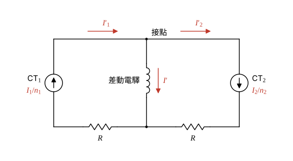

# 106 年電力系統第 4 題｜單相變壓器差動電驛 CT 匝比

## 已知與所求

單相雙繞組變壓器一次側、二次側匝數比 \(N_1:N_2\)，一次電流 \(I_1\) 流入、二次電流 \(I_2\) 流出；CT\(_1\)、CT\(_2\) 匝數比為 \(1/n_1\)、\(1/n_2\)，二次電流 \(I_1'\)、\(I_2'\) 如圖，差動電驛電流 \(I'\)。求（一）\(I'\) 以 \(I_1,I_2,n_1,n_2\) 表示（8 分）；（二）CT 匝數比應如何設定（9 分）；（三）依（二）設定，變壓器內部無故障時的 \(I'\)（8 分）。

## 考場標準作答

### （一）差動電流 \(I'\)（8 分）

設變壓器理想（忽略激磁電流）、CT 理想（無比誤差）；電流參考方向依題圖：\(I_1\) 流入一次側、\(I_2\) 流出二次側，\(I_1'\)、\(I_2'\) 在電驛上方導線皆向右，\(I'\) 向下流經電驛。CT 匝數比 \(1/n\) 表示二次電流 = 一次電流 \(/n\)；電驛接點有 \(I_1'\) 流入、\(I_2'\) 與 \(I'\) 流出。

CT 二次電流：
\[
I_1'=\frac{I_1}{n_1},\qquad I_2'=\frac{I_2}{n_2}
\]
電驛接點 KCL（流入 = 流出）：
\[
I_1'=I_2'+I'
\]
\[
I'=I_1'-I_2'
\]
\[
\boxed{I'=\frac{I_1}{n_1}-\frac{I_2}{n_2}}
\]

### （二）CT 匝數比設定（9 分）

正常運轉（內部無故障）時差動電驛不動作，即穿越電流下 \(I'=0\)。

理想變壓器安匝平衡：
\[
N_1I_1=N_2I_2\quad\Rightarrow\quad I_2=\frac{N_1}{N_2}I_1
\]
代入（一）：
\[
I'=\frac{I_1}{n_1}-\frac{N_1}{N_2}\cdot\frac{I_1}{n_2}=I_1\left(\frac{1}{n_1}-\frac{N_1}{N_2n_2}\right)
\]
對任何負載電流 \(I_1\) 都要 \(I'=0\)，括號必須為 0：
\[
\frac{1}{n_1}=\frac{N_1}{N_2n_2}\quad\Rightarrow\quad N_1n_1=N_2n_2
\]
\[
\boxed{\frac{n_1}{n_2}=\frac{N_2}{N_1}\ \ (n_1N_1=n_2N_2)}
\]
即 CT 匝比須與變壓器電流比互相補償：匝數多（高壓、電流小）的一側，其 CT 的 \(n\) 取較小值；並使兩 CT 極性讓穿越電流在電驛接點相減。

### （三）依（二）設定、內部無故障時的 \(I'\)（8 分）

由（二）\(\dfrac{1}{n_1}=\dfrac{N_1}{N_2n_2}\)：
\[
I'=I_1\left(\frac{1}{n_1}-\frac{N_1}{N_2n_2}\right)=I_1\times0
\]
\[
\boxed{I'=0\ \mathrm A}
\]
電驛不動作。一般情形（不假設安匝平衡），以 \(n_2=\dfrac{n_1N_1}{N_2}\) 代入（一）：
\[
I'=\frac{I_1}{n_1}-\frac{N_2I_2}{n_1N_1}=\frac{N_1I_1-N_2I_2}{n_1N_1}
\]
內部故障時故障電流不經二次側流出，\(N_1I_1\neq N_2I_2\)，\(I'\neq0\)，電驛動作。

## 驗算

代入假設數值（非題目所給）：\(N_1/N_2=2\)（如 22 kV/11 kV）、\(n_2=200\)，則 \(n_1=n_2N_2/N_1=200\times\tfrac12=100\)。若 \(I_1=50\) A，則 \(I_2=2\times50=100\) A，\(I_1'=50/100=0.50\) A、\(I_2'=100/200=0.50\) A，\(I'=0.50-0.50=0\)。若內部故障使 \(I_2\) 只有 80 A，則 \(I_2'=80/200=0.40\) A，\(I'=0.50-0.40=0.10\) A；以一般式 \(\dfrac{N_1I_1-N_2I_2}{n_1N_1}=\dfrac{2\times50-1\times80}{100\times2}=\dfrac{20}{200}=0.10\) A，相同，電驛動作。

## 失分點

- 圖中 \(I_1'\)、\(I_2'\) 在同一導線上皆指向右，電驛節點電流是兩者相減 \(I_1'-I_2'\)，不是相加。
- 電流比 \(I_1/I_2=N_2/N_1\)（與匝數比相反）；把它寫成 \(N_1/N_2\) 會使 \(n_1/n_2\) 條件顛倒。
- \(I'=0\) 在忽略激磁電流與 CT 誤差時成立；實務上以抽頭或輔助 CT 補償標準匝比的差異，並用百分比制動避免誤動作。
