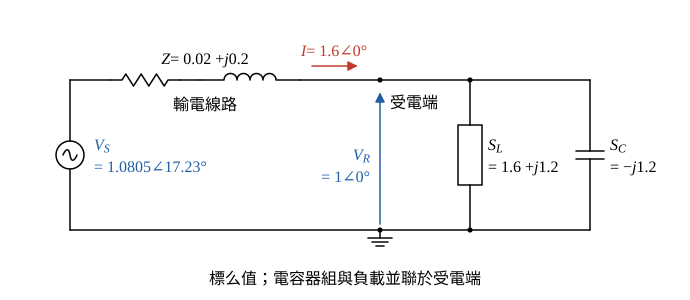

# 107 年電力系統第 1 題｜輸電線並聯電容補償

## 已知與所求

線路阻抗 \(0.02+j0.2\) pu；受電端負載 \(P=1.6\) pu、功因 0.8 落後，受電端電壓 \(|V_R|=1\) pu，電容器組補償虛功 \(Q_C=1.2\) pu（與負載並聯於受電端）。求（一）線路電流與有功損失；（二）送電端電壓；（三）電容器組阻抗；（四）送電端送出之 \(P\)、\(Q\)。

## 考場標準作答

**解題邏輯**：電容器組與負載並聯在受電端，線路電流只「看到」兩者合成的淨複功率。以受電端電壓 \(V_R=1\angle0^\circ\) 為參考相量：先求受電端淨複功率 \(S_R\)（步驟 1）→ 由 \(S_R=V_RI^*\) 得線路電流與 \(I^2R\) 損失 → 受電端電壓加線路壓降得送電端電壓 → 由電容器虛功與端電壓求其阻抗 → 送電端複功率 \(S_S=V_SI^*\)。

### 步驟 1：受電端淨複功率

功因 0.8 滯後：\(\cos\theta=0.8\)、\(\sin\theta=0.6\)、\(\tan\theta=0.6/0.8=0.75\)。負載虛功：
\[
Q_L=P\tan\theta=1.6\times0.75=1.2\ \mathrm{pu}
\]
負載複功率 \(S_L=1.6+j1.2\)；電容器供應 \(1.2\) pu 虛功，即吸收 \(S_C=-j1.2\)。受電端淨複功率：
\[
S_R=S_L+S_C=(1.6+j1.2)+(-j1.2)=1.6+j0\ \mathrm{pu}
\]

### （一）輸電線電流大小及有效功率損失（6 分）

**邏輯**：受電端電壓與淨複功率已知，由 \(S_R=V_RI^*\) 反推線路電流；有效功率損失只發生在線路電阻 \(R=0.02\)。

\[
I=\Big(\frac{S_R}{V_R}\Big)^*=\Big(\frac{1.6+j0}{1\angle0^\circ}\Big)^*=1.6\angle0^\circ\ \mathrm{pu}
\]
\[
\boxed{|I|=1.60\ \mathrm{pu}}
\]
\[
P_{loss}=|I|^2R
\]
\[
P_{loss}=1.6^2\times0.02=2.56\times0.02=0.0512\ \mathrm{pu}
\]
\[
\boxed{P_{loss}=0.0512\ \mathrm{pu}}
\]

### （二）送電端電壓大小（6 分）

**邏輯**：送電端電壓 = 受電端電壓 + 線路壓降 \(IZ\)，要用複數相加再取大小。

線路壓降：
\[
IZ=1.6(0.02+j0.2)=1.6\times0.02+j1.6\times0.2=0.032+j0.32
\]
送電端電壓（直角式相加）：
\[
V_S=V_R+IZ=(1+0.032)+j0.32=1.032+j0.32
\]
大小：
\[
|V_S|=\sqrt{1.032^2+0.32^2}=\sqrt{1.065024+0.1024}=\sqrt{1.167424}=1.0805
\]
\[
\boxed{|V_S|=1.08\ \mathrm{pu}}
\]
相角：
\[
\angle V_S=\tan^{-1}\frac{0.32}{1.032}=\tan^{-1}0.3101=17.23^\circ
\]

### （三）電容器組之阻抗（5 分）

**邏輯**：電容器吸收的複功率為 \(S_C=-jQ_C\)（對系統供應 \(Q_C\)），端電壓為 \(|V_R|=1\)，由 \(S_C=\dfrac{|V_R|^2}{Z_C^*}\) 反求阻抗。

\[
Z_C^*=\frac{|V_R|^2}{S_C}=\frac{1^2}{-j1.2}=j\frac{1}{1.2}
\]
取共軛：
\[
Z_C=-j\frac{1}{1.2}=-j\frac56
\]
\[
\boxed{Z_C=-j\tfrac56\approx-j0.83\ \mathrm{pu}}
\]

### （四）送電端送出之有效功率與無效功率（8 分）

**邏輯**：送電端複功率 \(S_S=V_SI^*\)，實部為送出有效功率、虛部為送出無效功率；\(I=1.6\angle0^\circ\) 為實數，\(I^*=1.6\)。

\[
S_S=V_SI^*=(1.032+j0.32)\times1.6
\]
實部與虛部：
\[
P_S=1.032\times1.6=1.6512,\qquad Q_S=0.32\times1.6=0.512
\]
\[
\boxed{P_S=1.65\ \mathrm{pu}},\qquad \boxed{Q_S=0.51\ \mathrm{pu}\ (\text{送出，感性})}
\]

## 驗算

功率守恆：\(S_S=S_L+S_C+|I|^2Z=(1.6+j1.2)+(-j1.2)+2.56(0.02+j0.2)=1.6+0.0512+j0.512=1.6512+j0.512\)，與 \(V_SI^*\) 相同。線路無效功率消耗 \(|I|^2X=2.56\times0.2=0.512\) pu，即 \(Q_S\) 全部消耗在線路電抗上。

## 失分點

- 電容器與負載並聯在受電端，線路電流看到的是淨功率 \(1.6+j0\)，不是 \(1.6+j1.2\)；用負載視在功率 2.0 pu 算電流會得 \(I=2\)、損失 \(0.08\) pu。
- \(Z_C=-jV_R^2/Q_C\) 為容抗（負虛數）；寫成 \(+j0.83\) 即成電感。
- 送電端電壓用 \(V_R+IZ\) 的複數和再取模，不能只加 \(IR\)。
