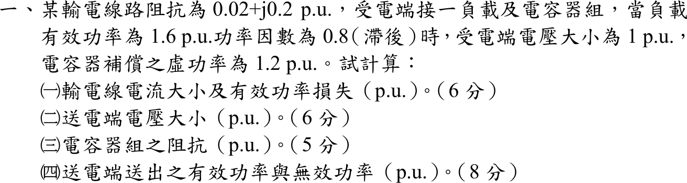

# 107 年電力系統第 1 題｜輸電線並聯電容補償

## 已知與所求

線路阻抗 \(0.02+j0.2\) pu；受電端負載 \(P=1.6\) pu、功因 0.8 落後，受電端電壓 \(|V_R|=1\) pu，電容器組補償虛功 \(Q_C=1.2\) pu（與負載並聯於受電端）。求（一）線路電流與有功損失；（二）送電端電壓；（三）電容器組阻抗；（四）送電端送出之 \(P\)、\(Q\)。

## 考場標準作答

觀念：電容器組與負載並聯在受電端，線路電流只看到兩者合成的淨複功率；先求受電端淨功率，再用複功率與相量關係逐項求電流、壓降、送電端功率。畫法：以受電端為節點，負載與電容器並聯接地，線路阻抗 \(0.02+j0.2\) 串在送電端與受電端之間；取 \(V_R=1\angle0^\circ\) 為參考相量。

### 1. 受電端淨功率

負載虛功：
\[
Q_L=P\tan(\cos^{-1}0.8)=1.6\tan(36.87^\circ)=1.60\times0.75=1.20\ \mathrm{pu}
\]
電容器供應 \(1.2\) pu 虛功，淨複功率：
\[
S_R=1.6+j(Q_L-Q_C)=1.6+j(1.20-1.2)=1.60\ \mathrm{pu}
\]

### （一）線路電流與損失

觀念：受電端電壓與淨複功率已知，由 \(S_R=V_RI^*\) 反推線路電流；有功損失只發生在線路電阻。
\[
I=\Big(\frac{S_R}{V_R}\Big)^*=\Big(\frac{1.60}{1\angle0^\circ}\Big)^*=1.60\angle0^\circ,\qquad \boxed{|I|=1.60\ \mathrm{pu}}
\]
\[
P_{loss}=I^2R
\]
\[
I^2=1.60^2=2.56,\qquad P_{loss}=2.56\times0.02
\]
\[
\boxed{P_{loss}=5.12\times10^{-2}\ \mathrm{pu}}
\]

### （二）送電端電壓

觀念：送電端電壓等於受電端電壓加線路壓降，需用複數相加再取大小。
\[
V_S=V_R+IZ=1+1.60(0.02+j0.2)
\]
線路壓降：
\[
IZ=1.60\times0.02+j1.60\times0.2=3.20\times10^{-2}+j0.32
\]
\[
V_S=(1+3.20\times10^{-2})+j0.32=1.03+j0.32=1.08\angle17.23^\circ
\]
\[
|V_S|=\sqrt{1.03^2+0.32^2}\Rightarrow\boxed{|V_S|=1.08\ \mathrm{pu}}
\]

### （三）電容器組阻抗

觀念：電容器吸收的複功率為 \(-jQ_C\)（對網路供應 \(Q_C\)），在 \(|V_R|=1\) 下由 \(S=|V|^2/Z^*\) 反求阻抗。
\[
Z_C=\frac{|V_R|^2}{(-jQ_C)^*}=\frac{1^2}{(-j1.2)^*}=\frac{1}{j1.2}
\]
\[
\boxed{Z_C=-j\frac56=-j0.83\ \mathrm{pu}}
\]

### （四）送電端功率

觀念：送電端複功率 \(S_S=V_SI^*\)，實部為送出有功、虛部為送出無功。
\[
S_S=V_SI^*=(1.03+j0.32)(1.60)
\]
各部分：\(P_S=1.03\times1.60=1.65\)，\(Q_S=0.32\times1.60=0.51\)。
\[
\boxed{P_S=1.65\ \mathrm{pu}},\qquad \boxed{Q_S=0.51\ \mathrm{pu}\ (\text{送出，感性})}
\]

## 驗算

功率守恆：\(S_S=S_{load}+S_C+I^2Z=(1.60+j1.20)+(-j1.20)+(5.12\times10^{-2}+j0.51)\)，實部 \(1.65\)、虛部 \(0.51\)，與 \(V_SI^*\) 相同。線路無效功率消耗 \(I^2X=2.56(0.2)=0.51\) pu，即 \(Q_S\) 全部消耗在線路電抗上。

## 失分點

- 電容器與負載並聯在受電端，線路電流看到的是淨功率 \(1.6+j0\)，不是 \(1.6+j1.2\)；用負載視在功率 2.0 pu 算電流會得 \(I=2\)、損失 \(8.00\times10^{-2}\) pu。
- \(Z_C=-jV_R^2/Q_C\) 為容抗（負虛數）；寫成 \(+j0.83\) 即成電感。
- 送電端電壓用 \(V_R+IZ\) 的複數和再取模，不能只加 \(IR\)。
