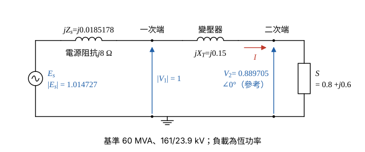

# 107 年電力系統第 2 題｜變壓器電壓調整率與短路電流

## 已知與所求

三相變壓器 161 kV/23.9 kV、60 MVA，漏電抗 15%，忽略繞組電阻與激磁電流。一次側接電源（電壓不變，源阻抗 \(j8\ \Omega\)），二次側負載 60 MVA、功因 0.8 落後時，變壓器一次側電壓為 161 kV。求（一）二次側電壓及電源電壓（kV）；（二）二次側電流（A），並判斷有無過載；（三）二次側電壓調整率（%）；（四）二次側穩態三相短路電流（A）。

## 考場標準作答

### 步驟 1：標么值基準與單相等效電路

電源電壓不變，串源阻抗 \(Z_s\) 再串變壓器漏電抗 \(X_T\) 接到二次側負載；負載為 60 MVA、pf 0.8 的恆功率負載，電壓降低時電流升高。\(V_2\) 與 \(|E_s|\) 後續多次相減、相除，計算保留 6 位有效數字。一次側基準阻抗：
\[
Z_{1b}=\frac{V_{1b}^2}{S_b}=\frac{161^2}{60}=\frac{25921}{60}=432.0167\ \Omega
\]
源阻抗標么值：
\[
Z_s=\frac{j8}{432.0167}=j0.0185178\ \mathrm{pu},\qquad X_T=0.15\ \mathrm{pu}
\]
二次側基準（額定）電流：
\[
I_{2b}=\frac{S_b}{\sqrt3V_{2b}}=\frac{60\ \mathrm{MVA}}{\sqrt3\times23.9\ \mathrm{kV}}=1.4494\ \mathrm{kA}=1449.415\ \mathrm A
\]
負載與一次側電壓：\(S=0.8+j0.6\) pu（恆功率），\(|V_1|=1\) pu。

畫法：\(E_s\) —— \(jZ_s\) —— 一次端 \(V_1\) —— \(jX_T\) —— 二次端 \(V_2\) —— 負載 \(S\)；以 \(V_2\) 為參考相量（實數），電流 \(I\) 由電源流向負載。

### （一）二次側電壓及電源電壓（10 分）

正解：雙匯流排功率潮流精確公式。取 \(V_2\) 為參考（實數），電流：
\[
I=\frac{S^*}{V_2^*}=\frac{P-jQ}{V_2}
\]
一次端電壓：
\[
V_1=V_2+jX_T\frac{P-jQ}{V_2}=\Big(V_2+\frac{QX_T}{V_2}\Big)+j\frac{PX_T}{V_2}
\]
取大小平方並乘以 \(V_2^2\)：
\[
|V_1|^2V_2^2=(V_2^2+QX_T)^2+(PX_T)^2
\]
整理成 \(V_2^2\) 的二次式：
\[
V_2^4-(|V_1|^2-2QX_T)V_2^2+(P^2+Q^2)X_T^2=0
\]
代入 \(|V_1|=1\)、\(P=0.8\)、\(Q=0.6\)、\(X_T=0.15\)：
\[
|V_1|^2-2QX_T=1-2\times0.6\times0.15=1-0.18=0.82,\qquad (P^2+Q^2)X_T^2=1\times0.15^2=0.0225
\]
\[
V_2^4-0.82V_2^2+0.0225=0
\]
公式解：
\[
V_2^2=\frac{0.82\pm\sqrt{0.82^2-4\times0.0225}}{2}=\frac{0.82\pm\sqrt{0.6724-0.09}}{2}=\frac{0.82\pm\sqrt{0.5824}}{2}=\frac{0.82\pm0.763151}{2}
\]
取高電壓根（正常運轉點）：
\[
V_2^2=\frac{1.583151}{2}=0.7915755,\qquad V_2=\sqrt{0.7915755}=0.889705\ \mathrm{pu}
\]
（另一根 \(V_2^2=0.0284245\)、\(V_2=0.1686\) pu 為低電壓不穩定解，捨去。）

換成 kV：
\[
V_2=0.889705\times23.9=21.264\ \mathrm{kV}
\]
\[
\boxed{V_2=21.26\ \mathrm{kV}}
\]
即 $21.26\text{ kV}$。

電流（直角式）：
\[
I=\frac{0.8-j0.6}{0.889705}=\frac{0.8}{0.889705}-j\frac{0.6}{0.889705}=0.899174-j0.674381\ \mathrm{pu}
\]
變壓器壓降（\(j\times(-j)=+1\)）：
\[
jX_TI=j0.15(0.899174-j0.674381)=0.15\times0.674381+j0.15\times0.899174=0.101157+j0.134876
\]
一次端電壓（驗證 \(|V_1|=1\)）：
\[
V_1=V_2+jX_TI=(0.889705+0.101157)+j0.134876=0.990862+j0.134876,\qquad |V_1|=\sqrt{0.990862^2+0.134876^2}=1.0000
\]
源阻抗壓降：
\[
jZ_sI=j0.0185178(0.899174-j0.674381)=0.0185178\times0.674381+j0.0185178\times0.899174=0.012488+j0.016651
\]
電源電壓：
\[
E_s=V_1+jZ_sI=(0.990862+0.012488)+j(0.134876+0.016651)=1.003350+j0.151527\ \mathrm{pu}
\]
大小：
\[
|E_s|=\sqrt{1.003350^2+0.151527^2}=\sqrt{1.006711+0.022960}=\sqrt{1.029671}=1.014727\ \mathrm{pu}
\]
換成 kV：
\[
|E_s|=1.014727\times161=163.371\ \mathrm{kV}
\]
\[
\boxed{E_s=163.37\ \mathrm{kV}}
\]

### （二）二次側電流及過載判斷（5 分）

\[
I_2=\frac{|S|}{V_2}I_{2b}=\frac{1}{0.889705}\times1449.415=\frac{1449.415}{0.889705}=1629.10\ \mathrm A
\]
\[
\boxed{I_2=1629.10\ \mathrm{A}}
\]
即 $1629.10\text{ A}$。與額定電流之比：
\[
\frac{I_2}{I_{2b}}=\frac{1}{0.889705}=1.1240=112.40\%
\]
大於 100%，故**過載**（超載 12.40%）。

### （三）二次側電壓調整率（5 分）

電源電壓不變，無載（\(I=0\)）時各阻抗無壓降，二次側電壓（標么值）即 \(|E_s|\)：

\[
\mathrm{VR}=\frac{|E_s|-V_2}{V_2}\times100\%
\]
\[
\mathrm{VR}=\frac{1.014727-0.889705}{0.889705}\times100\%=\frac{0.125022}{0.889705}\times100\%=0.140521\times100\%
\]
\[
\boxed{\mathrm{VR}=14.05\%}
\]

### （四）二次側穩態三相短路電流（5 分）

二次側三相短路時 \(V_2=0\)，負載被短路不再取電流，電源 \(E_s\) 只加在 \(Z_s+X_T\) 串聯電抗上。

串聯電抗：
\[
|Z_s|+X_T=0.0185178+0.15=0.1685178\ \mathrm{pu}
\]
短路電流標么值：
\[
I_{sc}=\frac{|E_s|}{|Z_s|+X_T}=\frac{1.014727}{0.1685178}=6.021483\ \mathrm{pu}
\]
換成安培：
\[
I_{sc}=6.021483\times1449.415=8727.63\ \mathrm A
\]
\[
\boxed{I_{sc}=8727.63\ \mathrm{A}}
\]

## 驗算

電源端複功率 \(E_sI^*=(1.003350+j0.151527)(0.899174+j0.674381)=0.8000+j0.8129\) pu；實功等於負載 0.8（無損），虛功等於負載 \(0.6\) 加兩個電抗吸收的 \(|I|^2(X_T+|Z_s|)=\dfrac{1}{0.7915755}\times0.1685178=1.263303\times0.1685178=0.2129\)，合計 \(0.8129\)，一致。

## 失分點

- 負載是恆功率 60 MVA，\(V_2\) 下降電流隨之上升，不可令電流固定為額定 1 pu 做壓降（得 \(V_2=0.92\) pu，約 21.94 kV，偏高）。
- 電壓調整率的無載電壓是電源電壓經變比的 \(1.01\) pu（含 \(j8\ \Omega\) 源阻抗效應），不是 23.9 kV。
- 短路電流分母要把源阻抗 \(0.0185\) 與 \(X_T=0.15\) 相加；漏掉 \(j8\ \Omega\) 會得 \(|E_s|/0.15=6.76\) 的偏大值。
