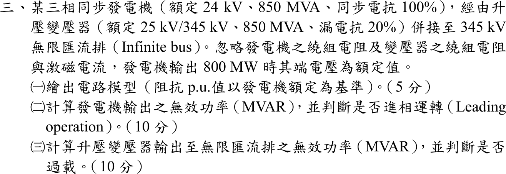
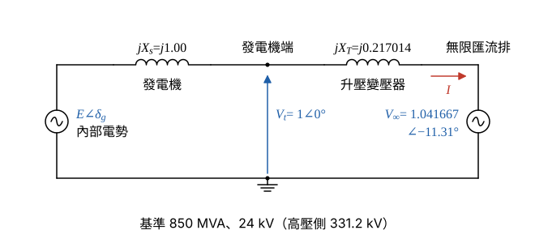

# 107 年電力系統第 3 題｜同步發電機併網

## 已知與所求

同步發電機 24 kV、850 MVA、\(X_s=100\%\)，經升壓變壓器（25 kV/345 kV、850 MVA、漏電抗 20%）併接 345 kV 無限匯流排；忽略繞組電阻與激磁電流，輸出 800 MW 時端電壓為額定值。求（一）以發電機額定為基準的電路模型；（二）發電機輸出無效功率，並判斷是否進相；（三）變壓器輸出至無限匯流排的無效功率，並判斷是否過載。

## 考場標準作答

### （一）電路模型（5 分）

設忽略繞組電阻與激磁電流，以 \(V_t=1\angle0^\circ\) 為參考相量；變壓器低壓側額定 25 kV 與基準 24 kV 不同，其漏電抗與無限匯流排電壓都要換算。

基準：\(S_b=850\) MVA，發電機側 \(V_b=24\) kV；經變壓器變比 \(25/345\)，高壓側基準：
\[
V_{b,H}=24\times\frac{345}{25}=331.2\ \mathrm{kV}
\]
發電機同步電抗（額定即基準）：
\[
X_s=1.00\ \mathrm{pu}
\]
變壓器漏電抗（舊基準 25 kV 換到 24 kV，容量相同）：
\[
X_T=0.20\Big(\frac{25}{24}\Big)^2=0.20\times\frac{625}{576}=\frac{125}{576}=0.217014\ \mathrm{pu}
\]
無限匯流排電壓：
\[
V_\infty=\frac{345}{331.2}=\frac{25}{24}=1.041667\ \mathrm{pu}
\]
輸出有功：
\[
P=\frac{800}{850}=\frac{16}{17}=0.941176\ \mathrm{pu}
\]
電路模型：內部電勢 \(E\angle\delta_g\) 串 \(jX_s\) 到發電機端（\(V_t=1\)），再串 \(jX_T\) 到無限匯流排 \(V_\infty\)。

### （二）發電機輸出之無效功率（10 分）

端點與無限匯流排之間只隔純電抗 \(X_T\)，用兩匯流排功率公式；\(X_s\) 只在內部電勢與端點之間，計算功率不需要。

由有功求相角差：
\[
\sin\delta=\frac{PX_T}{V_tV_\infty}=\frac{\frac{16}{17}\times\frac{125}{576}}{1\times\frac{25}{24}}=\frac{10}{51}=0.196078
\]
\[
\delta=\sin^{-1}0.196078=11.31^\circ
\]
\[
\cos\delta=\sqrt{1-\Big(\frac{10}{51}\Big)^2}=\frac{\sqrt{2501}}{51}=\frac{50.0100}{51}=0.980588
\]
（\(Q\) 的分子是兩個接近的數相減，這條計算鏈保留 6 位有效數字。）
\[
V_tV_\infty\cos\delta=1\times1.041667\times0.980588=1.021446
\]
發電機送出的無效功率：
\[
Q_G=\frac{V_t^2-V_tV_\infty\cos\delta}{X_T}=\frac{1-1.021446}{0.217014}=\frac{-0.021446}{0.217014}=-0.098823\ \mathrm{pu}
\]
換成 Mvar：
\[
Q_G=-0.098823\times850
\]
\[
\boxed{Q_G=-84.00\,\mathrm{Mvar}}
\]
\(Q_G<0\)：發電機自系統吸收無效功率（電流超前端電壓），為**進相（leading）運轉**。

### （三）升壓變壓器輸出至無限匯流排之無效功率與過載判斷（10 分）

同一條 \(X_T\) 支路受端無效功率 \(Q_\infty=\dfrac{V_tV_\infty\cos\delta-V_\infty^2}{X_T}\)；過載與否看變壓器兩側較大的視在功率是否超過 850 MVA。

\[
V_\infty^2=\Big(\frac{25}{24}\Big)^2=1.085069
\]
\[
Q_\infty=\frac{V_tV_\infty\cos\delta-V_\infty^2}{X_T}=\frac{1.021446-1.085069}{0.217014}=\frac{-0.063623}{0.217014}=-0.293175\ \mathrm{pu}
\]
換成 Mvar：
\[
Q_\infty=-0.293175\times850
\]
\[
\boxed{Q_\infty=-249.20\ \mathrm{MVAR}}
\]
即變壓器高壓側不是送出而是自無限匯流排吸收 249.20 MVAR（其中 84.00 MVAR 供發電機端，\(249.20-84.00=165.20\) MVAR 消耗在漏電抗）。

變壓器兩側視在功率（無損，兩側 \(P\) 皆 800 MW）：
\[
S_{LV}=\sqrt{800^2+84.00^2}=\sqrt{640000+7056}=\sqrt{647056}=804.40\ \mathrm{MVA}
\]
\[
S_{HV}=\sqrt{800^2+249.20^2}=\sqrt{640000+62100.64}=\sqrt{702100.64}
\]
\[
\boxed{S_{HV}=837.91\ \mathrm{MVA}}
\]
較大側 \(837.91<850\) MVA，負載率 \(837.91/850=98.58\%\)，**未過載**。

## 驗算

以電流相量檢查（\(V_t\) 為參考）：
\[
V_\infty\angle-\delta=1.041667(0.980588-j0.196078)=1.021446-j0.204248
\]
\[
I=\frac{V_t-V_\infty\angle-\delta}{jX_T}=\frac{-0.021446+j0.204248}{j0.217014}=\frac{0.204248}{0.217014}+j\frac{0.021446}{0.217014}=0.941174+j0.098823\ \mathrm{pu}
\]
\(V_tI^*=0.941174-j0.098823\)，與 \(P=16/17\)、\(Q_G\) 相符；\(|I|^2X_T=(0.941174^2+0.098823^2)\times0.217014=0.895574\times0.217014=0.194352\) pu \(=165.20\) MVAR，恰為 \(Q_G-Q_\infty\)（\(-84.00+249.20\)）。

## 失分點

- 變壓器低壓側額定 25 kV、發電機 24 kV：未換算而取 \(X_T=0.20\)、\(V_\infty=1\)，會得 \(Q_G\approx+75.97\) MVAR（落後），方向與結論皆反。
- \(X_s=1.00\) 屬內部電勢到端點的電抗，端點至無限匯流排的功率流不可再串入。
- 變壓器漏電抗吸收無效功率，高壓側 \(Q\)（\(-249.20\)）與低壓側（\(-84.00\)）不同；判斷過載要看較大的 837.91 MVA，不能只用 804.40 MVA。
