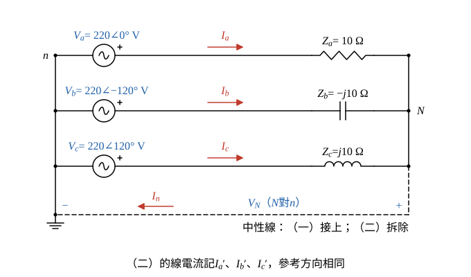

# 107 年電力系統第 4 題｜三相四線／三線不平衡負載

## 已知與所求

Y 接負載 \(Z_a=10\ \Omega\)、\(Z_b=-j10\ \Omega\)、\(Z_c=j10\ \Omega\)，由 \(V_a=220\angle0^\circ\)、\(V_b=220\angle-120^\circ\)、\(V_c=220\angle120^\circ\) V 供電（電源 Y 接、中性點接地，導線阻抗不計）。（一）3Φ4W：求正序、負序、零序電流及中性線電流大小。（二）3Φ3W：求正序、負序電流、最大導線電流及中性點電壓大小。以下取 \(a=1\angle120^\circ\)。

## 考場標準作答

設電源為理想對稱 Y 接，導線與中性線阻抗為零；\(a=1\angle120^\circ\)，\(a^2=1\angle240^\circ=1\angle-120^\circ\)。

- 三相線電流參考方向由電源流向負載；中性線電流 \(I_n\) 由 \(N\) 流回 \(n\)，KCL 得 \(I_n=I_a+I_b+I_c\)。
- \(V_N\) 為負載中性點 \(N\) 對電源中性點 \(n\) 的電壓；（一）中性線短接，\(V_N=0\)。
- 對稱分量變換：
\[
I_{a0}=\frac{I_a+I_b+I_c}{3},\qquad I_{a1}=\frac{I_a+aI_b+a^2I_c}{3},\qquad I_{a2}=\frac{I_a+a^2I_b+aI_c}{3}
\]

### （一）三相四線：正序、負序、零序電流及中性線電流（12 分）

中性線把 \(N\) 釘在 \(n\)（\(V_N=0\)），每相負載承受完整相電壓，各相電流互相獨立。

各相電流 \(I_k=V_k/Z_k\)：
\[
I_a=\frac{220\angle0^\circ}{10\angle0^\circ}=22\angle0^\circ\ \mathrm A
\]
\[
I_b=\frac{220\angle-120^\circ}{10\angle-90^\circ}=22\angle-30^\circ\ \mathrm A
\]
\[
I_c=\frac{220\angle120^\circ}{10\angle90^\circ}=22\angle30^\circ\ \mathrm A
\]

**正序**：先求旋轉後的相量：
\[
aI_b=22\angle(-30^\circ+120^\circ)=22\angle90^\circ=j22\ \mathrm A
\]
\[
a^2I_c=22\angle(30^\circ+240^\circ)=22\angle270^\circ=-j22\ \mathrm A
\]
\[
I_{a1}=\frac{I_a+aI_b+a^2I_c}{3}=\frac{22+j22-j22}{3}=\frac{22}{3}=7.333\ \mathrm A
\]
\[
\boxed{|I_{a1}|=7.33\ \mathrm A}
\]

**負序**：
\[
a^2I_b=22\angle(-30^\circ+240^\circ)=22\angle210^\circ,\qquad aI_c=22\angle(30^\circ+120^\circ)=22\angle150^\circ
\]
\(22\angle210^\circ\) 與 \(22\angle150^\circ\) 的虛部相消，實部各為 \(22\cos150^\circ=-11\sqrt3\)：
\[
I_{a2}=\frac{22+2(22\cos150^\circ)}{3}=\frac{22-22\sqrt3}{3}=\frac{22(1-\sqrt3)}{3}
\]
\[
I_{a2}=\frac{22\times(-0.7321)}{3}=\frac{-16.106}{3}=-5.369\ \mathrm A
\]
\[
\boxed{|I_{a2}|=5.37\ \mathrm A}\quad(\angle180^\circ)
\]

**零序與中性線**：\(I_b\)、\(I_c\) 的虛部相消，實部各為 \(22\cos30^\circ=11\sqrt3\)：
\[
I_a+I_b+I_c=22+2(22\cos30^\circ)=22(1+\sqrt3)=22\times2.73205=60.105\ \mathrm A
\]
\[
I_{a0}=\frac{I_a+I_b+I_c}{3}=\frac{60.105}{3}=20.035\ \mathrm A
\]
\[
\boxed{|I_{a0}|=20.04\ \mathrm A}
\]
（精確值 \(22(1+\sqrt3)/3=20.0350\)，取兩位為 20.04。）
\[
I_n=I_a+I_b+I_c=3I_{a0}=60.105\ \mathrm A
\]
\[
\boxed{|I_n|=60.11\ \mathrm A}
\]

### （二）三相三線：正序、負序電流、最大導線電流及中性點電壓（13 分）

拆除中性線後 \(N\) 浮接，三線電流之和為 0（\(I_{a0}'=0\)）；以 \(n\) 為參考，對 \(N\) 列 KCL \(\sum (V_k-V_N)Y_k=0\)（彌爾曼定理）求 \(V_N\)。

**中性點電壓**：各相導納 \(Y_k=1/Z_k\)：
\[
Y_a=\frac1{10}=0.1\ \mathrm S,\qquad Y_b=\frac1{-j10}=j0.1\ \mathrm S,\qquad Y_c=\frac1{j10}=-j0.1\ \mathrm S
\]
\[
\sum Y=0.1+j0.1-j0.1=0.1\ \mathrm S
\]
\[
V_N=\frac{V_aY_a+V_bY_b+V_cY_c}{\sum Y}
\]
分子各項：
\[
V_aY_a=220\times0.1=22\angle0^\circ\ \mathrm A
\]
\[
V_bY_b=(220\angle-120^\circ)(0.1\angle90^\circ)=22\angle-30^\circ\ \mathrm A
\]
\[
V_cY_c=(220\angle120^\circ)(0.1\angle-90^\circ)=22\angle30^\circ\ \mathrm A
\]
\[
V_aY_a+V_bY_b+V_cY_c=22+2(22\cos30^\circ)=22(1+\sqrt3)=60.105\ \mathrm A
\]
\[
V_N=\frac{60.105}{0.1}=601.05\ \mathrm V
\]
\[
\boxed{|V_N|=601.05\ \mathrm V}\quad(\angle0^\circ)
\]

**各線電流** \(I_k'=(V_k-V_N)/Z_k\)：
\[
I_a'=\frac{220-601.05}{10}=\frac{-381.05}{10}=-38.105\ \mathrm A
\]
\(V_b=220\angle-120^\circ=-110-j190.53\) V：
\[
V_b-V_N=-110-j190.53-601.05=-711.05-j190.53\ \mathrm V
\]
\[
I_b'=\frac{-711.05-j190.53}{-j10}=(-711.05-j190.53)(j0.1)=19.053-j71.105\ \mathrm A
\]
\[
|I_b'|=\sqrt{19.053^2+71.105^2}=\sqrt{363.02+5055.92}=\sqrt{5418.94}=73.613\ \mathrm A
\]
\[
\angle I_b'=-\tan^{-1}\frac{71.105}{19.053}=-\tan^{-1}3.7320=-75.00^\circ
\]
\(V_c=220\angle120^\circ=-110+j190.53\) V：
\[
V_c-V_N=-711.05+j190.53\ \mathrm V
\]
\[
I_c'=\frac{-711.05+j190.53}{j10}=(-711.05+j190.53)(-j0.1)=19.053+j71.105\ \mathrm A
\]
與 \(I_b'\) 共軛，故 \(|I_c'|=73.613\) A、\(\angle I_c'=75.00^\circ\)。檢查 KCL：實部 \(-38.105+2\times19.053=0.001\)（捨入誤差，精確為 0），虛部 \(-71.105+71.105=0\)。
\[
\boxed{I_{\max}=|I_b'|=|I_c'|=73.61\ \mathrm A}
\]

**序電流**：三線制 \(I_a'+I_b'+I_c'=0\)，故 \(I_{a0}'=0\)。
\[
aI_b'=73.613\angle(-75^\circ+120^\circ)=73.613\angle45^\circ,\qquad a^2I_c'=73.613\angle(75^\circ+240^\circ)=73.613\angle-45^\circ
\]
兩者虛部相消：
\[
I_{a1}'=\frac{-38.105+2(73.613\cos45^\circ)}{3}=\frac{-38.105+2\times52.0525}{3}=\frac{-38.105+104.105}{3}=\frac{66.000}{3}=22.000\ \mathrm A
\]
\[
\boxed{|I_{a1}'|=22.00\ \mathrm A}
\]
\[
a^2I_b'=73.613\angle(-75^\circ+240^\circ)=73.613\angle165^\circ,\qquad aI_c'=73.613\angle(75^\circ+120^\circ)=73.613\angle195^\circ
\]
兩者虛部相消：
\[
I_{a2}'=\frac{-38.105+2(73.613\cos165^\circ)}{3}=\frac{-38.105+2\times(-71.105)}{3}=\frac{-38.105-142.210}{3}=\frac{-180.315}{3}=-60.105\ \mathrm A
\]
\[
\boxed{|I_{a2}'|=60.11\ \mathrm A}
\]

## 驗算

線間電壓 KVL（與 \(V_N\) 無關）：
\[
Z_aI_a'-Z_bI_b'=10(-38.105)-(-j10)(19.053-j71.105)=-381.05+(711.05+j190.53)=330.00+j190.53\ \mathrm V
\]
等於 \(V_a-V_b=220-(-110-j190.53)=330.00+j190.53\) V。另由序分量反算 \(I_a'=I_{a0}'+I_{a1}'+I_{a2}'=0+22.000-60.105=-38.105\) A，與直接計算相同；四線制 \(I_n=3I_{a0}=3\times20.035=60.105\) A 亦一致。

## 失分點

- 四線制中性線電流是 \(3I_{a0}=60.11\) A，不是 0；每相仍分到全額 220 V，所以三相電流大小都是 22 A。
- 三線制零序電流必為 0，但中性點偏移 601.05 V（約 2.73 倍相電壓），使 b、c 相負載承受 \(|V_{b,c}-V_N|=\sqrt{711.05^2+190.53^2}=736.14\) V，電流升到 73.61 A。
- 負序是 \(I_a+a^2I_b+aI_c\)；與正序式互換會使 \(I_{a1}\)、\(I_{a2}\) 對調。
