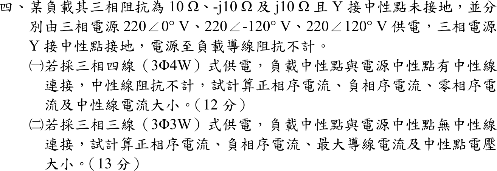

# 107 年電力系統第 4 題｜三相四線／三線不平衡負載

## 已知與所求

Y 接負載 \(Z_a=10\ \Omega\)、\(Z_b=-j10\ \Omega\)、\(Z_c=j10\ \Omega\)，由 \(V_a=220\angle0^\circ\)、\(V_b=220\angle-120^\circ\)、\(V_c=220\angle120^\circ\) V 供電（電源 Y 接、中性點接地，導線阻抗不計）。（一）3Φ4W：求正序、負序、零序電流及中性線電流大小。（二）3Φ3W：求正序、負序電流、最大導線電流及中性點電壓大小。以下取 \(a=1\angle120^\circ\)。

## 考場標準作答

### （一）三相四線（負載中性點接電源中性點）

觀念：四線制的中性線把負載中性點釘在電源中性點，每相負載承受完整的相電壓，因此各相電流互相獨立，可直接用 \(I=V/Z\)；再用對稱分量變換求序電流。畫法：三相負載各自接在 \(a,b,c\) 與共同中性線之間，電流參考方向由電源流向負載。

各相電流：
\[
I_a=\frac{220\angle0^\circ}{10}=22.00\angle0^\circ,\quad I_b=\frac{220\angle-120^\circ}{-j10}=22.00\angle-30^\circ,\quad I_c=\frac{220\angle120^\circ}{j10}=22.00\angle30^\circ\ \mathrm A
\]
正序：
\[
I_{a1}=\frac{I_a+aI_b+a^2I_c}{3}=\frac{22.00\angle0^\circ+22.00\angle90^\circ+22.00\angle-90^\circ}{3}=\frac{22.00(1+j-j)}{3}
\]
\[
\boxed{I_{a1}=7.33\ \mathrm A}
\]
負序：
\[
I_{a2}=\frac{I_a+a^2I_b+aI_c}{3}=\frac{22.00\angle0^\circ+22.00\angle210^\circ+22.00\angle150^\circ}{3}=\frac{22.00(1+2\cos150^\circ)}{3}
\]
\[
I_{a2}=\frac{22.00(-0.73)}{3}=-5.37\ \mathrm A,\qquad \boxed{|I_{a2}|=5.37\ \mathrm A}\ (\angle180^\circ)
\]
零序與中性線電流：
\[
I_{a0}=\frac{I_a+I_b+I_c}{3}=\frac{22.00(1+2\cos30^\circ)}{3}=\frac{22.00(2.73)}{3}
\]
\[
\boxed{I_{a0}=20.04\ \mathrm A}
\]
\[
\boxed{I_n=I_a+I_b+I_c=3I_{a0}=60.11\ \mathrm A}
\]

### （二）三相三線（負載中性點浮接）

觀念：三線制沒有中性線，負載中性點電位 \(V_N\) 浮動，須先用彌爾曼定理（節點電壓法，只有一個未知節點）求 \(V_N\)，再求各線電流。畫法：三相負載 Y 接，共同點 \(N\) 不接電源中性點，以電源中性點為參考節點對 \(N\) 列 KCL。

導納 \(Y_a=0.10,\ Y_b=j0.10,\ Y_c=-j0.10\) S，\(\sum Y=0.10\) S。彌爾曼定理：
\[
V_N=\frac{V_aY_a+V_bY_b+V_cY_c}{\sum Y}=\frac{22.00\angle0^\circ+22.00\angle-30^\circ+22.00\angle30^\circ}{0.10}=\frac{22.00(1+2\cos30^\circ)}{0.10}
\]
\[
\boxed{V_N=601.05\ \mathrm V}
\]
線電流 \(I_k=(V_k-V_N)/Z_k\)：
\[
I_a'=\frac{220-601.05}{10}=-38.11\ \mathrm A
\]
\[
I_b'=\frac{220\angle-120^\circ-601.05}{-j10}=\frac{-711.05-j190.53}{-j10}=19.05-j71.11=73.61\angle-75^\circ\ \mathrm A
\]
\[
I_c'=\frac{220\angle120^\circ-601.05}{j10}=\frac{-711.05+j190.53}{j10}=19.05+j71.11=73.61\angle75^\circ\ \mathrm A
\]
\[
\boxed{I_{max}=73.61\ \mathrm A}\ (b、c\text{ 相})
\]
\(\sum I'=-38.11+19.05+19.05=0\)（\(j\) 項相消），故零序為 0。序電流：
\[
I_{a1}'=\frac{I_a'+aI_b'+a^2I_c'}{3}=\frac{-38.11+73.61(\angle45^\circ+\angle-45^\circ)}{3}=\frac{-38.11+2(73.61)\cos45^\circ}{3}
\]
\[
\boxed{I_{a1}'=22.00\ \mathrm A}
\]
\[
I_{a2}'=\frac{I_a'+a^2I_b'+aI_c'}{3}=\frac{-38.11+73.61(\angle165^\circ+\angle195^\circ)}{3}=\frac{-38.11+2(73.61)\cos165^\circ}{3}
\]
\[
\boxed{|I_{a2}'|=60.11\ \mathrm A}
\]

## 驗算

線間電壓 KVL（與 \(V_N\) 無關）：\(Z_aI_a'-Z_bI_b'=-381.05-(-j10)(19.05-j71.11)=330.00+j190.53=381.05\angle30^\circ\)，等於 \(V_a-V_b=220-220\angle-120^\circ=330.00+j190.53\) V。四線制 \(I_n=3I_{a0}\)，三線制 \(I_a'+I_b'+I_c'=0\)，兩者與各自的零序結果一致。

## 失分點

- 四線制中性線電流是 \(3I_{a0}=60.11\) A，不是 0；每相仍分到全額 220 V，所以三相電流都是 22.00 A。
- 三線制零序電流必為 0，但中性點偏移 601.05 V（約 2.73 倍相電壓），使 b、c 相承受 \(|V_{b,c}-V_N|\approx736.14\) V，電流升到 73.61 A。
- 序分量變換中負序是 \(I_a+a^2I_b+aI_c\)；與正序式互換會使 \(I_{a1}\)、\(I_{a2}\) 對調。
