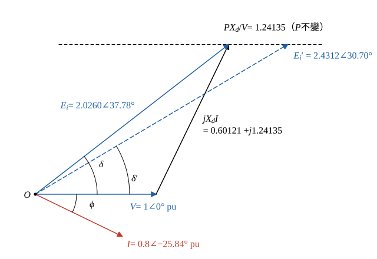

# 108 年電力系統第 1 題｜同步發電機相量圖與激磁控制

## 已知與所求

圓柱形轉子、忽略電樞電阻，\(X_d=1.7241\) pu，端電壓 \(V=1.0\angle0^\circ\) pu，電流 \(0.8\) pu、功因 0.9 落後（標么值均以機組額定為基準）。
（一）求內部電壓 \(E_i\) 的大小與角度，及送至匯流排的 \(P\)、\(Q\)。
（二）\(P\) 不變、激磁增加 20%（磁路線性，\(E_i\) 增 20%），求 \(E_i\) 與匯流排電壓的夾角 \(\delta\) 及 \(Q\)。

## 考場標準作答

**解題邏輯**：圓柱形轉子、忽略電樞電阻，發電機每相是內部電壓 \(E_i\) 串同步電抗 \(jX_d\)，接到端電壓 \(V=1\angle0^\circ\)（無限匯流排，大小與相角固定）。（一）由端電壓與電流相量，用 \(E_i=V+jX_dI\) 求內部電壓，再以 \(S=VI^*\) 求 \(P\)、\(Q\)。（二）原動機輸入不變 → \(P\) 不變；磁路線性 → \(E_i\) 隨激磁增 20%；由功率角公式反解新 \(\delta'\)，再代無效功率公式求 \(Q'\)。

### 步驟 1：每相等效電路與參考方向

- 等效電路：\(E_i\angle\delta\) —— \(jX_d=j1.7241\) —— 端點 \(V=1\angle0^\circ\)（無限匯流排）。
- 電流 \(I\) 由 \(E_i\) 經 \(jX_d\) 流向匯流排（發電機送出方向），\(S=VI^*\) 為送至匯流排的複功率。
- 落後功因：\(I\) 落後 \(V\) 一個功因角 \(\phi\)。

### （一）內部電壓與 \(P\)、\(Q\)

**邏輯**：發電機端 KVL 為 \(E_i=V+jX_dI\)，把電流相量化成直角式後與 \(V\) 相加，再換回極式即得大小與角度；送出複功率 \(S=VI^*\)。

功因角：
\[
\phi=\cos^{-1}0.9=25.84^\circ,\qquad \sin\phi=\sqrt{1-0.9^2}=\sqrt{0.19}=0.4359
\]
電流相量（極式轉直角式）：
\[
I=0.8\angle-25.84^\circ=0.8\times0.9-j0.8\times0.4359=0.72-j0.34871\ \mathrm{pu}
\]
同步電抗壓降（\(j\times(-j)=+1\)）：
\[
jX_dI=j1.7241(0.72-j0.34871)=1.7241\times0.34871+j1.7241\times0.72=0.60121+j1.24135\ \mathrm{pu}
\]
內部電壓（直角式相加）：
\[
E_i=V+jX_dI=(1+0.60121)+j1.24135=1.60121+j1.24135\ \mathrm{pu}
\]
大小：
\[
|E_i|=\sqrt{1.60121^2+1.24135^2}=\sqrt{2.56387+1.54095}=\sqrt{4.10482}=2.0260
\]
\[
\boxed{|E_i|=2.03\ \mathrm{pu}}
\]
角度：
\[
\delta=\tan^{-1}\frac{1.24135}{1.60121}=\tan^{-1}0.77526
\]
\[
\boxed{\delta=37.78^\circ}
\]

送至匯流排的複功率：
\[
S=VI^*=(1\angle0^\circ)(0.72+j0.34871)=0.72+j0.34871
\]
\[
\boxed{P=0.72\ \mathrm{pu}},\quad \boxed{Q=0.35\ \mathrm{pu}}\ (\text{發電機送出，落後})
\]

### （二）激磁增加 20%

**邏輯**：\(P=\dfrac{|E_i|V}{X_d}\sin\delta\) 中 \(P\)、\(V\)、\(X_d\) 都不變，所以 \(|E_i|\sin\delta\) 固定（相量圖上 \(E_i\) 尖端沿水平線移動）；\(|E_i|\) 增為 1.2 倍後反解 \(\sin\delta'\)，再用 \(Q=\dfrac{|E_i|V\cos\delta-V^2}{X_d}\)。

新內部電壓：
\[
|E_i'|=1.20|E_i|=1.20\times2.0260=2.4312\ \mathrm{pu}
\]
功率角方程反解：
\[
\sin\delta'=\frac{PX_d}{|E_i'|V}=\frac{0.72\times1.7241}{2.4312\times1}=\frac{1.24135}{2.4312}=0.51059
\]
\[
\boxed{\delta'=\sin^{-1}0.51059=30.70^\circ}
\]
\[
\cos\delta'=\cos30.70^\circ=0.8598
\]
無效功率：
\[
Q'=\frac{|E_i'|V\cos\delta'-V^2}{X_d}=\frac{2.4312\times1\times0.8598-1^2}{1.7241}
\]
\[
Q'=\frac{2.0903-1}{1.7241}=\frac{1.0903}{1.7241}=0.6324
\]
\[
\boxed{Q'=0.63\ \mathrm{pu}}
\]

## 驗算

改用電流相量：\(E_i'\angle\delta'=2.4312(0.8598+j0.5106)=2.0903+j1.2414\)，
\[
I'=\frac{E_i'\angle\delta'-V}{jX_d}=\frac{1.0903+j1.2414}{j1.7241}=\frac{1.2414}{1.7241}-j\frac{1.0903}{1.7241}=0.7200-j0.6324\ \mathrm{pu}
\]
\(S'=VI'^*=0.7200+j0.6324\)，實功與原值相同，\(Q'\) 與上式一致；\(|I'|=0.9583\) pu，功因 \(0.72/0.9583=0.75\) 落後。

## 失分點

- 落後功因的電流角為 \(-25.84^\circ\)；寫成 \(+25.84^\circ\) 會使 \(E_i\) 的角度與大小皆錯。
- 激磁增 20% 是 \(E_i\) 乘 1.2，不是 \(X_d\) 或 \(\delta\) 增加；固定的是 \(P\)（即 \(E_i\sin\delta\) 乘積），不是 \(\delta\)。
- 取 \(\sin\delta'=0.51059\) 的銳角解 \(30.70^\circ\)，鈍角解 \(149.30^\circ\) 屬不穩定區。
