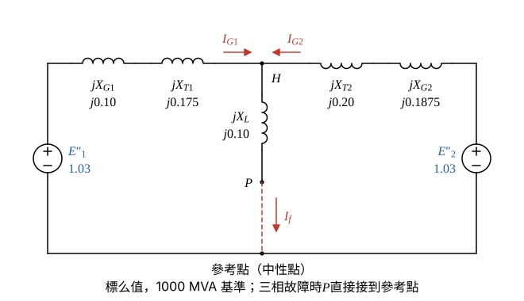
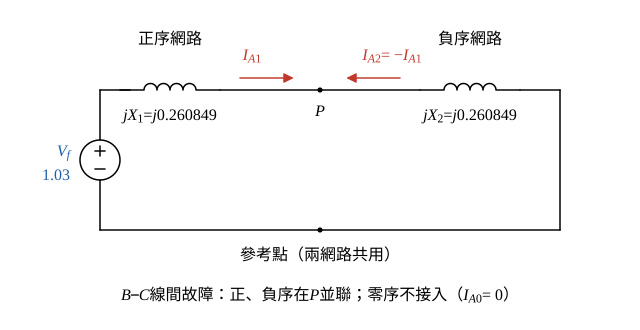

# 108 年電力系統第 3 題｜多機系統三相與線間短路

## 已知與所求

\(G_1\)：1000 MVA、20 kV，\(X_d''=X_1=X_2=10\%\)；\(G_2\)：800 MVA、22 kV，\(X_d''=X_1=X_2=15\%\)。\(T_1\)：1000 MVA、500Y/20Δ kV、17.5%；\(T_2\)：800 MVA、500Y/22Y kV、16%。線路 \(X_1=15\%\)（1500 MVA、500 kV 基準）。\(P\) 點開路電壓 515 kV，忽略故障前電流，共同基準 1000 MVA、輸電線 500 kV。求 \(P\) 點三相故障時 \(G_1\) 的 \(C\) 相次暫態電流，以及 \(B\)、\(C\) 相間故障時 \(P\) 點 \(B\) 相次暫態電流。

## 考場標準作答

### 步驟 1：換算到 1000 MVA 共同基準

求次暫態電流，發電機用 \(X_d''=X_1=X_2\)（\(X_s\) 為穩態電抗，不用）；設忽略故障前電流，兩機次暫態電勢都等於 \(P\) 點開路電壓 \(E''_1=E''_2=V_f=515/500=1.03\) pu；兩問都不經大地，零序資料（\(X_0\)、中性點接地方式）用不到。換算公式 \(X_{\mathrm{new}}=X_{\mathrm{old}}\dfrac{S_{\mathrm{new}}}{S_{\mathrm{old}}}\)（各元件額定電壓與該側基準電壓相同：\(T_1\) 低壓側基準 20 kV＝\(G_1\) 額定，\(T_2\) 低壓側基準 22 kV＝\(G_2\) 額定，故不需電壓修正）：
\[
X_{G1}=0.10\times\frac{1000}{1000}=0.10,\qquad X_{T1}=0.175\times\frac{1000}{1000}=0.175
\]
\[
X_{G2}=0.15\times\frac{1000}{800}=0.1875,\qquad X_{T2}=0.16\times\frac{1000}{800}=0.20
\]
\[
X_L=0.15\times\frac{1000}{1500}=0.10
\]
故障前電壓：
\[
V_f=\frac{515}{500}=1.03\ \mathrm{pu}
\]

### 步驟 2：\(P\) 點正序（負序）戴維寧電抗

- 兩電勢相等且同相，求戴維寧電抗時都短路：兩機支路在 \(H\) 與參考點之間並聯，再串線路 \(X_L\)。
- 負序網路結構相同（\(X_2=X_1\) 的發電機、靜止元件 \(X_2=X_1\)），只是沒有電源，故 \(X_2=X_1\)。

\[
X_a=X_{G1}+X_{T1}=0.10+0.175=0.275
\]
\[
X_b=X_{G2}+X_{T2}=0.1875+0.20=0.3875
\]
\[
X_a\parallel X_b=\frac{0.275\times0.3875}{0.275+0.3875}=\frac{0.1065625}{0.6625}=0.160849
\]
\[
X_1=X_L+X_a\parallel X_b=0.10+0.160849=0.260849\ \mathrm{pu},\qquad X_2=X_1=0.260849\ \mathrm{pu}
\]

### （一）\(P\) 點三相故障時 \(G_1\) 的 \(C\) 相次暫態電流

三相平衡故障只有正序網路；\(P\) 點故障電流流經 \(X_L\) 後在 \(H\) 點依兩支路電抗反比分給 \(G_1\)、\(G_2\)。三相對稱，\(C\) 相大小等於 \(A\) 相大小；\(T_1\) 為 Y-Δ，只使 \(G_1\) 側電流相角移 \(30^\circ\)，標么大小不變。

故障電流：
\[
I_f=\frac{V_f}{X_1}=\frac{1.03}{0.260849}=3.9486\ \mathrm{pu}
\]
分流（反比於支路電抗）：
\[
I_{G1}=I_f\frac{X_b}{X_a+X_b}=3.9486\times\frac{0.3875}{0.6625}=3.9486\times0.584906=2.3096\ \mathrm{pu}
\]
\(G_1\) 側（20 kV）基準電流：
\[
I_{\mathrm{base},20}=\frac{S_b}{\sqrt3\,V_b}=\frac{1000\ \mathrm{MVA}}{\sqrt3\times20\ \mathrm{kV}}=28.8675\ \mathrm{kA}
\]
\[
|I_{G1,C}|=2.3096\times28.8675=66.672\ \mathrm{kA}
\]
\[
\boxed{|I_{G1,C}|=2.31\ \mathrm{pu}=66.67\ \mathrm{kA}}
\]

### （二）\(B\)-\(C\) 線間故障時 \(P\) 點 \(B\) 相次暫態電流

以未故障的 \(A\) 相為基準相，線間故障邊界條件 \(I_A=0\)、\(I_B=-I_C\)、\(V_B=V_C\)，故 \(I_{A0}=0\)、\(I_{A2}=-I_{A1}\)，正、負序網路在 \(P\) 點並聯。

\[
I_{A1}=\frac{V_f}{j(X_1+X_2)}=\frac{1.03}{j(0.260849+0.260849)}=\frac{1.03}{j0.521698}=-j1.9743\ \mathrm{pu}
\]
\[
I_B=a^2I_{A1}+aI_{A2}=(a^2-a)I_{A1}
\]
\(a^2-a=(-0.5-j0.8660)-(-0.5+j0.8660)=-j\sqrt3\)：
\[
I_B=-j\sqrt3\,I_{A1}=-j\sqrt3\,(-j1.9743)=-\sqrt3\times1.9743=-3.4196\ \mathrm{pu}
\]
\(P\) 點（500 kV）基準電流：
\[
I_{\mathrm{base},500}=\frac{1000\ \mathrm{MVA}}{\sqrt3\times500\ \mathrm{kV}}=1.1547\ \mathrm{kA}
\]
\[
|I_{P,B}|=3.4196\times1.1547=3.9486\ \mathrm{kA}
\]
\[
\boxed{|I_{P,B}|=3.42\ \mathrm{pu}=3.95\ \mathrm{kA}}
\]

## 驗算

節點法驗（一）：三相故障時 \(P\) 點電壓為 0，\(H\) 點電壓
\[
V_H=X_LI_f=0.10\times3.9486=0.39486\ \mathrm{pu}
\]
\[
I_{G1}=\frac{1.03-0.39486}{0.275}=2.3096,\qquad I_{G2}=\frac{1.03-0.39486}{0.3875}=1.6391\ \mathrm{pu}
\]
\(2.3096+1.6391=3.9487\approx I_f=3.9486\)（捨入），\(G_1\) 值一致。驗（二）：\(X_1=X_2\) 時線間故障電流恆為三相故障的 \(\sqrt3/2\)：\(\tfrac{\sqrt3}{2}\times3.9486=3.4196\) pu，相同。

## 失分點

- \(G_2\)、\(T_2\) 為 800 MVA、線路為 1500 MVA 基準，百分比必須先乘 \(1000/800\)、\(1000/1500\) 再相加；直接相加會錯。
- 三相與線間故障都不含零序，\(X_0\)、中性點接地方式本題用不到；\(X_s\) 為穩態電抗，求次暫態電流也不用。
- 20 kV 側與 500 kV 側基準電流不同：\(G_1\) 電流乘 28.8675 kA，\(P\) 點電流乘 1.1547 kA。
