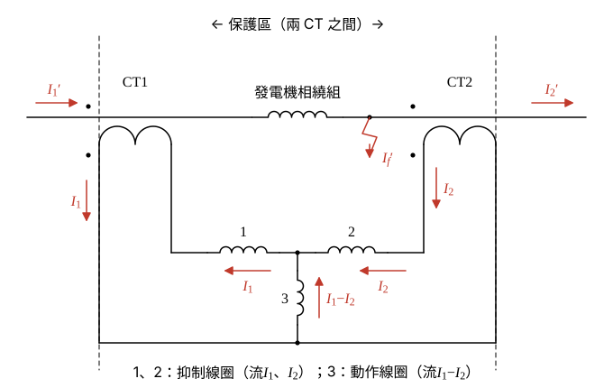
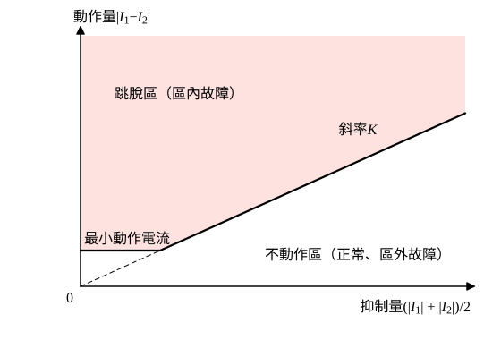

# 108 年電力系統第 4 題｜發電機繞組差動電驛保護

## 已知與所求

保護區很小時可用電流連續原理（KCL）構成保護。圖中發電機一相繞組兩端各接一具 CT；\(I_1',I_2'\) 為繞組兩端的一次電流，\(I_1,I_2\) 為 CT 二次電流，線圈 1、2 為抑制線圈，線圈 3 為動作線圈，流過 \(I_1-I_2\)；\(I_f'\) 為保護區內的故障電流。虛線之間為「跳脫」區，兩側為「閉合」（不動作）區。說明發電機繞組差動保護的動作原理。

## 考場標準作答

### 步驟 1：保護區、接線與參考方向

設兩 CT 變比相同（記為 \(n\)）、極性如題圖（同名端在左），電流參考方向依題圖。

- 兩具 CT 的位置劃定保護區（兩虛線之間）：一次側 \(I_1'\) 由左流入、\(I_2'\) 由右流出，\(I_f'\) 為區內故障點流出的電流。
- CT 二次電流（變比 \(n\)）：\(I_1=I_1'/n\)、\(I_2=I_2'/n\)。
- 兩具 CT 的一次、二次極性點都在左側（圖中一次導線左上與二次線圈左下的黑點）；二次繞組與一次導體之間只有磁耦合，沒有電氣連接。
- CT1 二次電流 \(I_1\) 由外側引線向下流入底部導線，經動作線圈 3 向上到中點，再自中點向左通過抑制線圈 1 回到 CT1 內側引線；CT2 二次電流 \(I_2\) 由內側引線向下流出，自右向左通過抑制線圈 2 到中點，經動作線圈 3 向下到底部導線，回到 CT2 外側引線。兩迴路在線圈 3 疊加，淨值向上為 \(I_1-I_2\)。
- 中點 KCL：流入中點的 \(I_2\)（線圈 2）加上線圈 3 向上的電流，等於流出的 \(I_1\)（線圈 1），所以
\[
I_{3}=I_1-I_2
\]

### 正常運轉與區外故障：不動作

保護區 KCL（無故障支路）：
\[
I_1'=I_2'
\]
除以 CT 變比：
\[
I_1=\frac{I_1'}{n}=\frac{I_2'}{n}=I_2
\]
動作線圈電流：
\[
I_{3}=I_1-I_2=0
\]
- 正常負載與區外故障的大穿越電流都屬此情況：電流只是「穿越」保護區，二次電流在抑制線圈 1、2 中同向環流，產生抑制力矩，動作線圈無電流。
- 結果：電驛不動作，斷路器維持閉合（題圖兩側「閉合」區）。

### 區內故障：跳脫

保護區 KCL（含故障支路）：
\[
I_1'=I_2'+I_f'
\]
動作線圈電流：
\[
I_{3}=I_1-I_2=\frac{I_1'-I_2'}{n}=\frac{I_f'}{n}\neq0
\]
- 單側饋入（只有發電機側供電）：\(I_2'=0\)，\(I_3=I_1=I_f'/n\)。
- 雙側饋入（系統也向故障點供電）：\(I_2'\) 實際方向與參考方向相反（\(I_2'<0\)），\(|I_1-I_2|=|I_1|+|I_2|\)，動作量更大。
- 差流流過動作線圈 3 產生動作力矩，大於抑制力矩時電驛動作，跳脫發電機出口斷路器、磁場斷路器（滅磁）並停原動機（題圖中間「跳脫」區）；必須滅磁，因為出口斷路器開啟後，發電機內部 EMF 仍會向區內故障點供電。

### 百分比差動判據

實際 CT 有比差與飽和，區外大故障電流時 \(I_1-I_2\) 不會恰為 0；抑制線圈依穿越電流大小提高動作門檻。

動作量與抑制量：
\[
I_{op}=|I_1-I_2|,\qquad I_{rt}=\frac{|I_1|+|I_2|}{2}
\]
動作條件（\(K\) 為百分比斜率設定，另設最小動作電流）：
\[
\boxed{|I_1-I_2|>K\,\frac{|I_1|+|I_2|}{2}}
\]

- 穿越電流愈大，抑制量 \(I_{rt}\) 愈大，CT 誤差造成的小差流落在斜線下方，不動作。
- 區內故障時差流約等於故障電流折算值，落在斜線上方，跳脫。
- 題目未給 CT 變比、斜率與整定值，判據只寫符號式。

## 驗算

用假設數值（非題目所給）檢查判據，取 \(K=0.20\)：

| 狀況 | \(I_1\) | \(I_2\) | 動作量 | 抑制量 | 比值 | 結果 |
| --- | --- | --- | --- | --- | --- | --- |
| 區外故障，CT 理想 | 10 | 10 | 0 | 10 | 0 | 不動作 |
| 區外故障，CT 差 5% | 10 | 9.50 | 0.50 | 9.75 | 0.0513 | 不動作 |
| 區內故障，單側饋入 | 10 | 0 | 10 | 5 | 2.00 | 動作 |
| 區內故障，雙側饋入 | 6 | \(-4\) | 10 | 5 | 2.00 | 動作 |

各情況與 KCL 預測一致（區內動作量即為 \(I_f'\) 折算值）。

## 失分點

- 差動保護比較的是兩端電流之「差」，不是電流大小：區外大穿越電流下 \(I_1=I_2\)，動作量為 0，不會誤跳。
- 線圈 3（動作）接在中點流 \(I_1-I_2\)，線圈 1、2 為抑制；功能不可對調，也要說明 CT 極性使穿越電流在動作線圈中抵消。
- 題目沒有給 CT 變比、斜率或整定值，不可編造數值門檻；判據只寫符號式。
