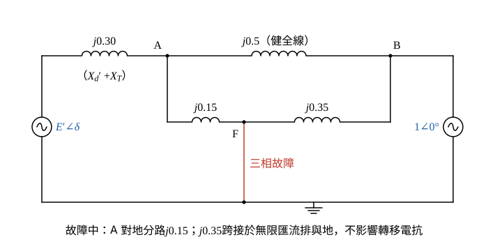

# 108 年電力系統第 5 題｜雙迴線三相故障之功率角方程式

## 已知與所求

發電機（\(X_d'=0.20\)）經 \(j0.1\) 升壓變壓器，再由兩條並聯線（各 \(j0.5\)）接至無限匯流排。\(P_e=0.8\) pu，端電壓與無限匯流排電壓均為 1.0 pu（均為共同基準標么值）。其中一條線距送電端 30% 處發生三相故障，4.5 週期後兩端斷路器同時開啟清除故障；\(H=5.0\) MJ/MVA、60 Hz。求功率-角度方程式（故障前、故障中、故障清除後）。

端電壓取發電機端（\(X_d'\) 與變壓器之間）；若取在線路送電端匯流排，結果見「條件與疑義」。\(H\)、4.5 週期供求清除角與搖擺曲線使用，本題只問功率角方程式。

## 考場標準作答

**解題邏輯**：功率角方程式為 \(P_e=\dfrac{|E'||V_\infty|}{X_{12}}\sin\delta\)，三個時段的 \(|E'|\) 與 \(V_\infty=1\) 不變，只有 \(E'\) 到無限匯流排的轉移電抗 \(X_{12}\) 改變。先用故障前的端電壓與輸出功率回推暫態電抗後的內電勢 \(|E'|\)（步驟 1），再分別求故障前（雙線並聯）、故障中（Y-Δ 轉換）、清除後（單線）的 \(X_{12}\)。共用前提：\(|V_t|=|V_\infty|=1.0\) pu，\(V_\infty=1\angle0^\circ\) 為參考相量。

### 步驟 1：故障前電流與內電勢 \(E'\)

**邏輯**：發電機端到無限匯流排間只有變壓器與兩條並聯線，已知兩端電壓大小與傳輸功率，由 \(P=\dfrac{|V_t||V_\infty|}{X}\sin\alpha\) 求端電壓相角，再以 \(E'=V_t+jX_d'I\) 加回暫態電抗壓降。

端點到無限匯流排電抗：
\[
X_{t\infty}=0.1+\frac{0.5\times0.5}{0.5+0.5}=0.1+0.25=0.35
\]
端電壓相角：
\[
0.8=\frac{1.0\times1.0}{0.35}\sin\alpha\ \Rightarrow\ \sin\alpha=0.8\times0.35=0.28,\qquad \alpha=\sin^{-1}0.28=16.26^\circ
\]
極式轉直角式（\(\cos\alpha=\sqrt{1-0.28^2}=0.96\)）：
\[
V_t=1\angle16.26^\circ=0.96+j0.28
\]
線路電流：
\[
I=\frac{V_t-V_\infty}{j0.35}=\frac{(0.96-1)+j0.28}{j0.35}=\frac{-0.04+j0.28}{j0.35}
\]
逐項相除（\(\tfrac{1}{j}=-j\)）：
\[
\frac{j0.28}{j0.35}=0.8,\qquad \frac{-0.04}{j0.35}=j\frac{0.04}{0.35}=j0.1143
\]
\[
I=0.8+j0.1143\ \mathrm{pu}
\]
暫態電抗壓降：
\[
jX_d'I=j0.2(0.8+j0.1143)=-0.2\times0.1143+j0.2\times0.8=-0.02286+j0.16
\]
內電勢（直角式相加）：
\[
E'=V_t+jX_d'I=(0.96-0.02286)+j(0.28+0.16)=0.9371+j0.44
\]
大小與相角：
\[
|E'|=\sqrt{0.9371^2+0.44^2}=\sqrt{1.0718}=1.0353,\qquad \angle E'=\tan^{-1}\frac{0.44}{0.9371}=25.15^\circ
\]
\[
E'=1.0353\angle25.15^\circ\ \mathrm{pu}
\]

### （一）故障前功率角方程式

**邏輯**：\(E'\) 到無限匯流排是 \(X_d'\)、變壓器與兩線並聯的串聯。

\[
X_{12}=0.20+0.10+0.5\parallel0.5=0.20+0.10+0.25=0.55
\]
\[
P_{e1}=\frac{|E'|\times1.0}{X_{12}}\sin\delta=\frac{1.0353}{0.55}\sin\delta
\]
\[
\boxed{P_{e1}=\frac{|E'|}{0.55}\sin\delta=1.88\sin\delta}
\]

### （二）故障中功率角方程式

**邏輯**：故障點 F 直接接地；把網路畫成以送電端匯流排 A 為中心的 Y 形（往 \(E'\)、往無限匯流排、往地），Y-Δ 轉換後連接 \(E'\) 與無限匯流排的 Δ 邊就是轉移電抗。

畫法：
- A 往 \(E'\)：\(X_d'+X_T=0.20+0.10=0.30\)。
- A 往無限匯流排 B：健全線 \(0.50\)。
- A 往故障點 F（30% 處）：\(0.30\times0.50=0.15\)，F 接地，故 A 對地分路 \(0.15\)。
- F 到 B 的 \(0.70\times0.50=0.35\)：一端接地、一端接理想電壓源 B，只增加 B 的供電電流，不影響 \(E'\) 與 B 間的轉移，可略去。

Y-Δ 轉換（中心 A，三臂 \(X_a=0.30\)、\(X_b=0.50\)、對地 \(X_c=0.15\)）：
\[
X_{12}=X_a+X_b+\frac{X_aX_b}{X_c}
\]
\[
X_{12}=0.30+0.50+\frac{0.30\times0.50}{0.15}=0.80+\frac{0.15}{0.15}=0.80+1.00=1.80\ \mathrm{pu}
\]
\[
P_{e2}=\frac{|E'|}{X_{12}}\sin\delta=\frac{1.0353}{1.80}\sin\delta
\]
\[
P_{e2}=\frac{|E'|}{1.80}\sin\delta=0.5752\sin\delta
\]
\[
\boxed{P_{e2}=\frac{|E'|}{1.80}\sin\delta}
\]
（係數取 \(0.5752\)，後續皆用此值；若只取兩位小數 \(0.58\) 會有 \(0.8\%\) 的誤差。）

### （三）故障清除後功率角方程式

**邏輯**：故障線兩端斷路器開啟，該線整條退出，\(E'\) 經 \(X_d'\)、變壓器與單一健全線到無限匯流排。

\[
X_{12}=0.20+0.10+0.50=0.80
\]
\[
P_{e3}=\frac{|E'|}{0.80}\sin\delta=\frac{1.0353}{0.80}\sin\delta
\]
\[
\boxed{P_{e3}=\frac{|E'|}{0.80}\sin\delta=1.29\sin\delta}
\]

## 驗算

故障前工作角：\(\delta_0=\sin^{-1}(0.8/1.8824)=\sin^{-1}0.4250=25.15^\circ\)，與 \(E'\) 相角 \(25.15^\circ\) 一致。
故障中改用節點消去法：A 點自導納 \(1/0.30+1/0.15+1/0.50=3.333+6.667+2=12\)，\(E'\) 與無限匯流排間的轉移導納 \(\dfrac{(1/0.30)(1/0.50)}{12}=\dfrac{6.667}{12}=0.5556\)，倒數 \(1.80\)，與 Y-Δ 結果相同。三者最大功率 \(1.88>1.29>0.5752\)，符合「正常、單線、故障中」的排序。

## 失分點

- 端電壓 1.0 是發電機端電壓，內部電勢必須用 \(V_t+jX_d'I\) 回推，不能令 \(E'=1\)。
- 30% 是故障點位置，故障點與送電端間為 \(0.30\times0.50=0.15\) pu；故障中 A 點對地分路 0.15 使轉移電抗升至 1.80。
- 清除後是單線運轉 \(0.20+0.10+0.50=0.80\)，不可沿用故障前的 \(0.25\) 並聯線路。

## 條件與疑義

題圖未標示「端電壓」所在的匯流排。若將 1.0 pu 理解為送電端（線路）匯流排電壓，則 \(\sin\alpha=0.8(0.25)=0.2\)，並須把 \(X_d'\) 與 \(j0.1\) 升壓變壓器一併串入 \(E'\) 的路徑：
\[
E'=e^{j\alpha}+j0.30\,I=0.9556+j0.4400,\qquad |E'|=1.0520
\]
此讀法下 \(P_{e1}=1.9127045\sin\delta\)、\(P_{e2}=0.5844375\sin\delta\)、\(P_{e3}=1.3149844\sin\delta\)，各段轉移電抗（0.55、1.8、0.8）不變，只有 \(|E'|\) 不同。本解依「端電壓即發電機端電壓」作答。
