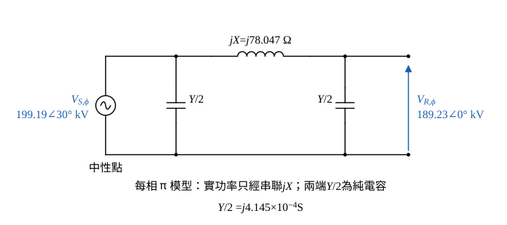

# 109 年電力系統第 2 題｜345 kV 雙分裂導線中程 π 模型與傳輸功率

## 已知與所求

三相 345 kV、60 Hz 換位線，每相兩條 Bluejay（直徑 3.195 cm、GMR 1.268 cm），子導體間隔 40 cm；水平排列相間 10 m；忽略電阻與電導；長 200 km；\(V_S=345\angle30^\circ\) kV、\(V_R=327.75\angle0^\circ\) kV（線電壓）。以 π 模型求傳輸實功率。

## 考場標準作答

**解題邏輯**：π 模型把線路畫成「串聯 \(jX\) ＋ 兩端各一個並聯 \(Y/2\)」。因電阻、電導忽略，並聯 \(Y/2\) 為純電容，只吸收（產生）無功，所以實功率全部經過串聯 \(jX\)，可用 \(P=\dfrac{V_SV_R}{X}\sin\delta\) 計算。依序：由導體幾何求 \(D_m\)、電感用的 \(D_{sL}\)、電容用的 \(D_{sC}\) → 求每相串聯電抗 \(X\) 與並聯導納 \(Y\)（建立 π 模型）→ 代入功率式。前提：換位線、每相兩分裂導線；題給 \(V_S\)、\(V_R\) 為線電壓（每相等效以 \(V/\sqrt3\) 計）；\(\omega=2\pi f\) 取 \(377\ \mathrm{rad/s}\)；\(\varepsilon_0=8.854\times10^{-12}\ \mathrm{F/m}\)。

### 步驟 1：幾何量 \(D_m\)、\(D_{sL}\)、\(D_{sC}\)

**邏輯**：水平排列三相的相間距為 10、10、20 m，取幾何平均；兩分裂導線的等效自距離為 \(\sqrt{D_s\,d}\)，電感用導體 GMR，電容用導體實際半徑。

\[
D_m=\sqrt[3]{D_{ab}D_{bc}D_{ca}}=\sqrt[3]{10\times10\times20}=\sqrt[3]{2000}=12.5992\ \mathrm m
\]
\[
D_{sL}=\sqrt{\mathrm{GMR}\times d}=\sqrt{1.268\times40}=\sqrt{50.72}=7.1218\ \mathrm{cm}=0.071218\ \mathrm m
\]
\[
r=\frac{3.195}{2}=1.5975\ \mathrm{cm},\qquad D_{sC}=\sqrt{r\times d}=\sqrt{1.5975\times40}=\sqrt{63.90}=7.9937\ \mathrm{cm}=0.079937\ \mathrm m
\]

### 步驟 2：每相串聯電抗 \(X\)

**邏輯**：換位線每相電感 \(L=2\times10^{-7}\ln(D_m/D_{sL})\) H/m，乘 \(\omega\) 與線長得總串聯電抗。（\(X\) 會直接決定 \(P\) 的末位，故本鏈保留 6 位有效數字。）

\[
\frac{D_m}{D_{sL}}=\frac{12.5992}{0.071218}=176.91,\qquad \ln176.91=5.17564
\]
\[
L=2\times10^{-7}\times5.17564=1.03513\times10^{-6}\ \mathrm{H/m}
\]
\[
X=\omega L\ell=377\times1.03513\times10^{-6}\times(200\times10^3)=78.049\ \Omega
\]

### 步驟 3：每相並聯導納 \(Y\) 與 π 模型

**邏輯**：每相對中性點電容 \(C=2\pi\varepsilon_0/\ln(D_m/D_{sC})\) F/m，總並聯導納 \(Y=j\omega C\ell\)，π 模型兩端各接 \(Y/2\)。

\[
\frac{D_m}{D_{sC}}=\frac{12.5992}{0.079937}=157.61,\qquad \ln157.61=5.0601
\]
\[
C=\frac{2\pi\varepsilon_0}{5.0601}=\frac{2\pi(8.854\times10^{-12})}{5.0601}=\frac{5.5631\times10^{-11}}{5.0601}=1.0994\times10^{-11}\ \mathrm{F/m}
\]
\[
Y=j\omega C\ell=j377\times1.0994\times10^{-11}\times(200\times10^3)=j8.2895\times10^{-4}\ \mathrm S
\]
\[
\frac{Y}{2}=j4.145\times10^{-4}\ \mathrm S
\]
每相電壓（線電壓 \(/\sqrt3\)）：
\[
V_{S,\phi}=\frac{345}{\sqrt3}\angle30^\circ=199.19\angle30^\circ\ \mathrm{kV},\qquad V_{R,\phi}=\frac{327.75}{\sqrt3}\angle0^\circ=189.23\angle0^\circ\ \mathrm{kV}
\]

### 輸電線傳輸的實功率（12 分）

**邏輯**：兩端 \(Y/2\) 為純電容，流經它們的電流與端電壓正交，不消耗實功率；串聯 \(jX\) 無電阻也不消耗實功率，所以送電端送出、受電端收到的實功率都等於流過串聯 \(jX\) 的功率。

串聯支路電流 \(I_{ser}=\dfrac{V_{S,\phi}-V_{R,\phi}}{jX}\)，受電端由串聯支路收到的每相功率取實部：
\[
P_\phi=\mathrm{Re}\{V_{R,\phi}I_{ser}^*\}=\frac{V_{S,\phi}V_{R,\phi}}{X}\sin\delta
\]
三相（\(3\times\dfrac{V_S}{\sqrt3}\times\dfrac{V_R}{\sqrt3}=V_SV_R\)，以線電壓直接代入）：
\[
P=\frac{V_SV_R}{X}\sin\delta
\]
代入 \(V_S=345\) kV、\(V_R=327.75\) kV、\(\delta=30^\circ-0^\circ=30^\circ\)、\(X=78.049\ \Omega\)：
\[
V_SV_R=345\times327.75=113073.75\ \mathrm{kV^2}
\]
\[
V_SV_R\sin\delta=113073.75\times0.5=56536.875\ \mathrm{kV^2}
\]
\[
P=\frac{56536.875}{78.049}=724.38\ \mathrm{MW}
\]
\[
\boxed{P=724.38\ \mathrm{MW}}
\]
（\(\mathrm{kV^2}/\Omega=\mathrm{MW}\)。）

## 驗算

每相複功率（以完整精度計算）：\(I_{ser}=(V_{S,\phi}-V_{R,\phi})/(jX)\)，受電端 \(I_R=I_{ser}-\tfrac Y2V_{R,\phi}\)，\(3\,\mathrm{Re}(V_{R,\phi}I_R^*)=724.38\) MW；送電端 \(I_S=I_{ser}+\tfrac Y2V_{S,\phi}\)，\(3\,\mathrm{Re}(V_{S,\phi}I_S^*)=724.38\) MW，送受兩端相等，符合無損線路且並聯 \(Y/2\) 不影響實功率。

## 失分點

- 電感用導體 GMR（1.268 cm），電容用導體實際半徑 \(3.195/2\) cm；兩者互換會使 \(L\)、\(C\) 皆錯。
- 水平排列的 \(D_{ca}=20\) m，\(D_m=\sqrt[3]{2000}\)，不是 10 m。
- 題給為線電壓，\(V_SV_R\sin\delta/X\) 已是三相功率，不可再乘 3。

## 條件與疑義

框內值依 \(\omega\approx377\ \mathrm{rad/s}\)（\(X=78.049\ \Omega\)）。若取 \(\omega=2\pi(60)=376.99\ \mathrm{rad/s}\)，\(X=78.047\ \Omega\)，\(P=724.40\ \mathrm{MW}\)，兩者僅差末位，屬 \(\omega\) 取值差異。
