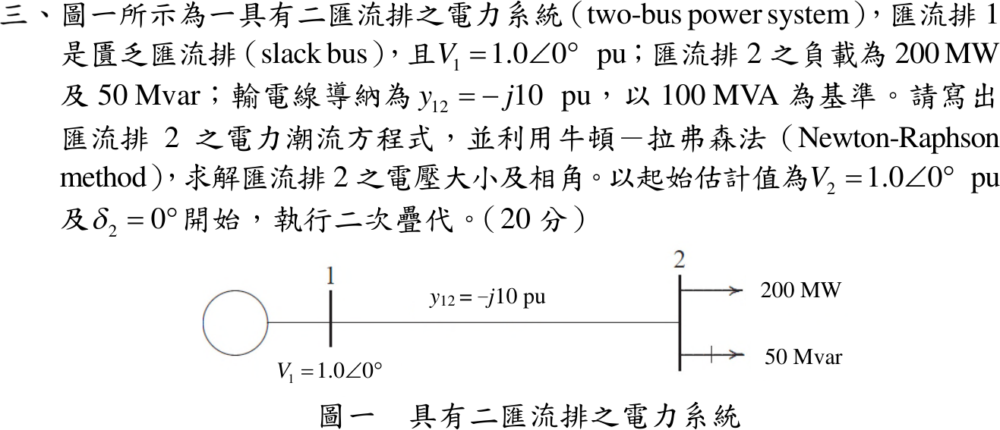

# 109 年電力系統第 3 題｜二匯流排牛頓－拉弗森法二次疊代

## 已知與所求

匯流排 1 為 slack，\(V_1=1.0\angle0^\circ\)；匯流排 2 負載 200 MW、50 Mvar；\(y_{12}=-j10\) pu，基準 100 MVA。寫出匯流排 2 潮流方程，由 \(V_2=1.0\angle0^\circ\) 起以牛頓－拉弗森法疊代兩次，求 \(|V_2|\)、\(\delta_2\)。

## 考場標準作答

觀念：牛頓－拉弗森法把非線性潮流方程 \(P_2(\delta_2,|V_2|)\)、\(Q_2(\delta_2,|V_2|)\) 在目前估計值線性化，解 \(J\,\Delta x=\Delta(P,Q)\) 得修正量，再更新估計值；每一輪都要用新的估計值重算功率差與 Jacobian。搖擺匯流排 1 的 \(V_1=1.0\angle0^\circ\) 固定，只有匯流排 2 為未知。

### 1. 潮流方程與 Jacobian

\(Y_{22}=-j10\)、\(Y_{21}=j10\)；負載為負注入：\(P_2^{sch}=-2.0\)、\(Q_2^{sch}=-0.5\) pu。由 \(S_2=V_2(Y_{21}V_1+Y_{22}V_2)^*\)：
\[
P_2=10|V_2|\sin\delta_2,\qquad Q_2=10|V_2|^2-10|V_2|\cos\delta_2
\]
\[
J=\begin{bmatrix}\partial P_2/\partial\delta_2&\partial P_2/\partial|V_2|\\\partial Q_2/\partial\delta_2&\partial Q_2/\partial|V_2|\end{bmatrix}
=\begin{bmatrix}10|V_2|\cos\delta_2&10\sin\delta_2\\10|V_2|\sin\delta_2&20|V_2|-10\cos\delta_2\end{bmatrix}
\]

### 2. 第 1 次疊代

以 \(|V_2|=1,\ \delta_2=0\) 代入：\(P_2=Q_2=0\)，功率差 \(\Delta P=-2.0-0=-2.00\)、\(\Delta Q=-0.5-0=-0.50\)；\(J=\mathrm{diag}(10,10)\)：
\[
\Delta\delta_2=\frac{-2.00}{10}=-0.20\ \mathrm{rad},\qquad \Delta|V_2|=\frac{-0.50}{10}=-0.05
\]
\[
\boxed{\delta_2^{(1)}=-0.20\ \mathrm{rad}=-11.46^\circ,\quad |V_2|^{(1)}=0.95\ \mathrm{pu}}
\]

### 3. 第 2 次疊代

以 \(\delta_2=-0.20\) rad、\(|V_2|=0.95\) 重算功率與 Jacobian：
\[
P_2=10(0.95)\sin(-0.20)=-1.89,\qquad Q_2=10(0.95)^2-10(0.95)\cos0.20=-0.29
\]
功率差：
\[
\Delta P=-2.0-(-1.89)=-0.11,\qquad \Delta Q=-0.5-(-0.29)=-0.21
\]
Jacobian 各元：\(10(0.95)\cos0.20=9.31\)、\(10\sin(-0.20)=-1.99\)、\(10(0.95)\sin(-0.20)=-1.89\)、\(20(0.95)-10\cos0.20=9.20\)。解線性方程：
\[
\begin{bmatrix}9.31&-1.99\\-1.89&9.20\end{bmatrix}
\begin{bmatrix}\Delta\delta_2\\\Delta|V_2|\end{bmatrix}=
\begin{bmatrix}-0.11\\-0.21\end{bmatrix}
\Rightarrow \Delta\delta_2=-1.79\times10^{-2}\ \mathrm{rad},\ \Delta|V_2|=-2.70\times10^{-2}
\]
更新：\(\delta_2=-0.20+(-1.79\times10^{-2})\)，\(|V_2|=0.95+(-2.70\times10^{-2})\)：
\[
\boxed{\delta_2^{(2)}=-0.22\ \mathrm{rad}=-12.48^\circ,\quad |V_2|^{(2)}=0.92\ \mathrm{pu}}
\]
（以上各行以完整精度計算，僅顯示兩位小數。）

## 驗算

兩匯流排可求精確解：由 \(|V_2|\sin\delta_2=-0.2\)、\(|V_2|\cos\delta_2=|V_2|^2+0.05\) 消去 \(\delta_2\) 得 \((u+0.05)^2+0.04=u\)（\(u=|V_2|^2\)），即 \(u^2-0.9u+4.25\times10^{-2}=0\)，取大根 \(u=0.85\)，\(|V_2|=0.92\)、\(\delta_2=-12.53^\circ\)。第二次疊代值與精確解差約 \(1.08\times10^{-3}\) pu、\(0.05^\circ\)，收斂方向正確。

## 失分點

- 負載是負注入，\(P_2^{sch}=-2.0\)、\(Q_2^{sch}=-0.5\)；寫成正值會使修正方向全反。
- \(\partial Q_2/\partial|V_2|=20|V_2|-10\cos\delta_2\)，漏掉 \(|V_2|^2\) 項的 2 倍會讓第 2 次電壓修正錯。
- 第 2 次要以 \(\delta_2=-0.2\) rad、\(|V_2|=0.95\) 重算 Jacobian，沿用初始 \(J\) 不算牛頓法。
