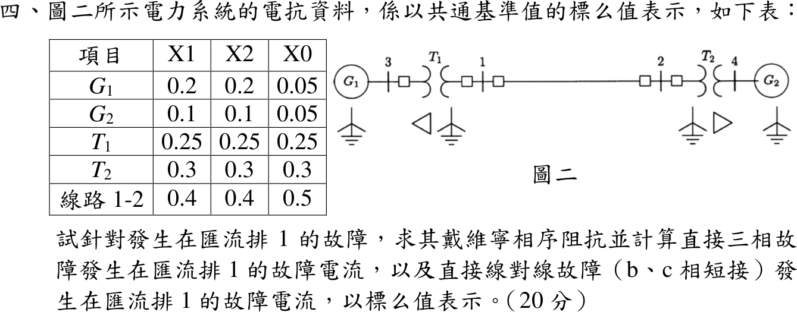
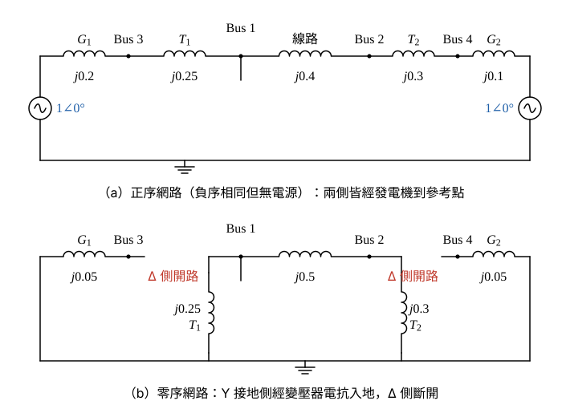
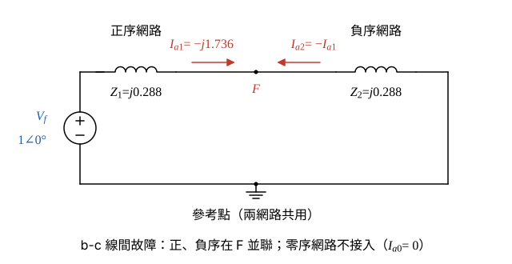

# 109 年電力系統第 4 題｜三相與線間故障電流

## 已知與所求

共同基準標么電抗（\(X_1/X_2/X_0\)）：\(G_1\) 0.2/0.2/0.05，\(G_2\) 0.1/0.1/0.05，\(T_1\) 0.25，\(T_2\) 0.3，線路 1-2 0.4/0.4/0.5。圖二：\(G_1\)–3–\(T_1\)–1–線路–2–\(T_2\)–4–\(G_2\)；\(T_1\) 在匯流排 3 側為 \(\Delta\)、匯流排 1 側 Y 接地；\(T_2\) 在匯流排 2 側 Y 接地、匯流排 4 側 \(\Delta\)；兩發電機中性點接地。求匯流排 1 的戴維寧相序阻抗、三相直接故障電流、b-c 直接線間故障電流。題目未給故障前電壓，設 \(V_f=1\angle0^\circ\) pu。

## 考場標準作答

### 步驟 1：畫正、負、零序網路

- 正序：匯流排 1 往左 \(T_1\to\) 匯流排 3 \(\to G_1\to\) 參考點；往右線路 \(\to\) 匯流排 2 \(\to T_2\to\) 匯流排 4 \(\to G_2\to\) 參考點；兩機內電勢 \(E=1\angle0^\circ\)（故障前無載）。負序同結構、無電源，表列 \(X_2=X_1\)。
- 故障點 F 取在匯流排 1。
- 零序：\(T_1\) 匯流排 1 側 Y 接地、匯流排 3 側 \(\Delta\)，故匯流排 1 經 \(X_{T1,0}=0.25\) 直接入地，\(\Delta\) 側斷開 \(G_1\)；\(T_2\) 匯流排 2 側 Y 接地、匯流排 4 側 \(\Delta\)，匯流排 2 經 \(X_{T2,0}=0.3\) 入地，斷開 \(G_2\)；線路零序電抗 \(0.5\)。

### （一）匯流排 1 的戴維寧相序阻抗

正序左支路（\(T_1+G_1\)）：
\[
X_{左}=0.25+0.2=0.45
\]
正序右支路（線路 \(+T_2+G_2\)）：
\[
X_{右}=0.4+0.3+0.1=0.80
\]
並聯：
\[
Z_1=j\frac{X_{左}X_{右}}{X_{左}+X_{右}}=j\frac{0.45\times0.80}{0.45+0.80}=j\frac{0.36}{1.25}=j0.288
\]
負序各電抗與正序相同：
\[
\boxed{Z_1=Z_2=j0.288\ \mathrm{pu}}
\]
零序左支路只剩 \(T_1\)：\(X_{左,0}=0.25\)；右支路為線路 \(+T_2\)：
\[
X_{右,0}=0.5+0.3=0.80
\]
\[
Z_0=j\frac{0.25\times0.80}{0.25+0.80}=j\frac{0.20}{1.05}=j\frac{4}{21}
\]
\[
\boxed{Z_0=j\tfrac{4}{21}\approx j0.19\ \mathrm{pu}}
\]

### （二）匯流排 1 直接三相故障電流

設故障前電壓 \(V_f=1\angle0^\circ\) pu；三相平衡故障只有正序分量，故障點經 \(Z_f=0\) 短路。

\[
I_f^{3\phi}=\frac{V_f}{Z_1}=\frac{1\angle0^\circ}{0.288\angle90^\circ}
\]
大小與相角：
\[
|I_f^{3\phi}|=\frac{1}{0.288}=3.472,\qquad \angle I_f^{3\phi}=0^\circ-90^\circ=-90^\circ
\]
\[
\boxed{I_f^{3\phi}=3.47\angle-90^\circ=-j3.47\ \mathrm{pu}}
\]

### （三）匯流排 1 直接 b-c 線間故障電流

b、c 相短接且不接地：\(I_a=0\)、\(I_b=-I_c\)、\(V_b=V_c\)，換成對稱成分得 \(I_{a0}=0\)、\(I_{a2}=-I_{a1}\)、\(V_{a1}=V_{a2}\)，即正、負序網路在故障點並聯，零序網路不接入。

序網路連接畫法：
- 正序網路以戴維寧等效表示：\(V_f\) 串 \(Z_1=j0.288\)，端點為 F。
- 負序網路只有 \(Z_2=j0.288\)（無電源），端點也接 F；兩網路的參考點相接。
- 正序流出 F 的 \(I_{a1}\) 全部流入負序網路，故 \(I_{a2}=-I_{a1}\)；零序網路開路，\(I_{a0}=0\)。

正序電流：
\[
I_{a1}=\frac{V_f}{Z_1+Z_2}=\frac{1\angle0^\circ}{j0.288+j0.288}=\frac{1\angle0^\circ}{0.576\angle90^\circ}
\]
\[
|I_{a1}|=\frac{1}{0.576}=1.736,\qquad \angle I_{a1}=-90^\circ\quad\Rightarrow\quad I_{a1}=-j1.736
\]
b 相電流（\(I_{a0}=0\)、\(I_{a2}=-I_{a1}\)）：
\[
I_b=I_{a0}+a^2I_{a1}+aI_{a2}=(a^2-a)I_{a1}
\]
\[
a^2-a=\left(-\tfrac12-j\tfrac{\sqrt3}{2}\right)-\left(-\tfrac12+j\tfrac{\sqrt3}{2}\right)=-j\sqrt3=1.732\angle-90^\circ
\]
相乘（大小相乘、角度相加）：
\[
I_b=(1.732\angle-90^\circ)(1.736\angle-90^\circ)=1.732\times1.736\angle-180^\circ=3.007\angle180^\circ
\]
\[
\boxed{I_b=-I_c=-3.01\ \mathrm{pu}\ \ (|I_f^{LL}|=3.01\ \mathrm{pu})}
\]

## 驗算

相域回代：\(V_{a1}=1-Z_1I_{a1}=1-(j0.288)(-j1.736)=1-0.5000=0.5000\)、\(V_{a2}=-Z_2I_{a2}=-(j0.288)(j1.736)=0.5000\)，得 \(V_b=V_c=-0.50\) pu、\(I_a=0\)，符合 b-c 金屬短路；且 \(|I_f^{LL}|/|I_f^{3\phi}|=3.007/3.472=0.8661\approx\sqrt3/2=0.8660\)。

## 失分點

- 零序網路須依變壓器接線判斷：\(\Delta\) 側把 \(G_1\)、\(G_2\) 的零序隔開，若直接串入 \(X_{G,0}=0.05\) 會得錯誤的 \(Z_0\)。
- 線路零序電抗是 0.5，不是正序的 0.4。
- 線間故障電流是 \(\sqrt3|I_{a1}|\)，不是 \(|I_{a1}|\)；且不經零序網路，\(Z_0\) 雖要求列出但不參與。
