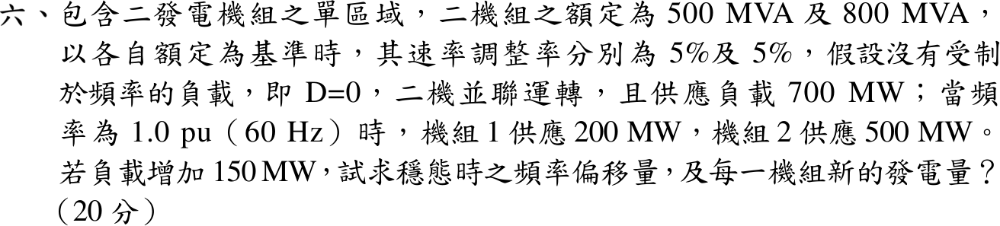
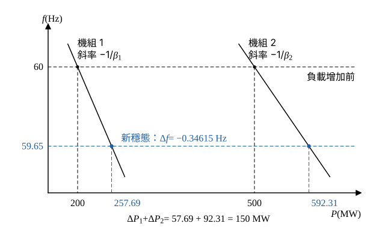

# 109 年電力系統第 6 題｜負載頻率控制與穩態頻率偏差

## 已知與所求

單區域兩機組 500 MVA、800 MVA，各以自身額定為基準的速率調整率 \(R=5\%\)；\(D=0\)；60 Hz 時機組 1 供 200 MW、機組 2 供 500 MW（共 700 MW）。負載增加 150 MW，求穩態頻率偏移及兩機組新發電量。

## 考場標準作答

**解題邏輯**：負載突增後，兩機調速器依下垂特性（droop）增加出力，穩態時兩機同在一個頻率。主線：把各機的速率調整率 \(R_i\)（以自身額定為基準）換成以 MW/Hz 表示的頻率響應 \(\beta_i\) → 系統總響應 \(\beta=\beta_1+\beta_2+D\) → 由「發電增量 = 負載增量」求 \(\Delta f\) → 各機增量 \(\Delta P_i=-\beta_i\Delta f\)，加回原出力。前提：只有一次（調速器）控制、無二次控制（AGC）把頻率拉回；\(D=0\)；\(f_0=60\) Hz。

### 步驟 1：各機頻率響應 \(\beta_i\)

速率調整率以自身額定 \(S_i\) 為基準：\(R_i=-\dfrac{\Delta f/f_0}{\Delta P_i/S_i}\)，移項得
\[
\Delta P_i=-\frac{S_i}{R_if_0}\Delta f=-\beta_i\Delta f,\qquad \beta_i=\frac{S_i}{R_if_0}
\]
代入：
\[
\beta_1=\frac{500}{0.05\times60}=\frac{500}{3}=166.67\ \mathrm{MW/Hz}
\]
\[
\beta_2=\frac{800}{0.05\times60}=\frac{800}{3}=266.67\ \mathrm{MW/Hz}
\]
\[
\beta=\beta_1+\beta_2+D=\frac{500}{3}+\frac{800}{3}+0=\frac{1300}{3}=433.33\ \mathrm{MW/Hz}
\]

### 穩態頻率偏移量

**邏輯**：穩態時兩機出力增量之和等於負載增量（\(D=0\) 時負載不隨頻率變），\(\Delta P_L=\Delta P_1+\Delta P_2=-\beta\Delta f\)。

\[
\Delta f=-\frac{\Delta P_L}{\beta}
\]
代入（用精確分數 \(\beta=1300/3\)）：
\[
\Delta f=-\frac{150}{1300/3}=-\frac{450}{1300}=-\frac{9}{26}=-0.34615\ \mathrm{Hz}
\]
\[
f=60-0.34615=59.65385\ \mathrm{Hz}
\]
\[
\boxed{\Delta f=-346.15\ \mathrm{mHz}\ \ (f=59.65\ \mathrm{Hz})}
\]

### 每一機組新的發電量

**邏輯**：兩機在同一頻率偏移 \(\Delta f\) 下各依自己的 \(\beta_i\) 增加出力，新發電量 = 原出力 + 增量。

\[
\Delta P_1=-\beta_1\Delta f=\frac{500}{3}\times\frac{9}{26}=\frac{4500}{78}=57.692\ \mathrm{MW}
\]
\[
\Delta P_2=-\beta_2\Delta f=\frac{800}{3}\times\frac{9}{26}=\frac{7200}{78}=92.308\ \mathrm{MW}
\]
\[
P_1=200+57.692=257.692\ \mathrm{MW},\qquad P_2=500+92.308=592.308\ \mathrm{MW}
\]
\[
\boxed{P_1=257.69\ \mathrm{MW}},\qquad \boxed{P_2=592.31\ \mathrm{MW}}
\]

## 驗算

改用 1000 MVA 共同基準：
\[
R_1=0.05\times\frac{1000}{500}=0.10,\qquad R_2=0.05\times\frac{1000}{800}=0.0625\ \mathrm{pu}
\]
\[
\frac1{R_1}+\frac1{R_2}=10+16=26,\qquad \Delta P_L=\frac{150}{1000}=0.15\ \mathrm{pu}
\]
\[
\Delta f=-\frac{0.15}{26}=-0.0057692\ \mathrm{pu}=-0.0057692\times60=-0.34615\ \mathrm{Hz}
\]
相同。兩機增量比 \(57.692:92.308=500:800\)（同 \(R\) 時依額定容量分攤），且 \(257.692+592.308=850=700+150\) MW。

## 失分點

- \(R=5\%\) 是以各自額定為基準，須先換成 MW/Hz（或同一基準）再相加，不能直接把兩個 0.05 並聯。
- 負載增加使頻率下降，\(\Delta f\) 為負；兩機出力依容量比分攤，不是依原出力 200:500。
