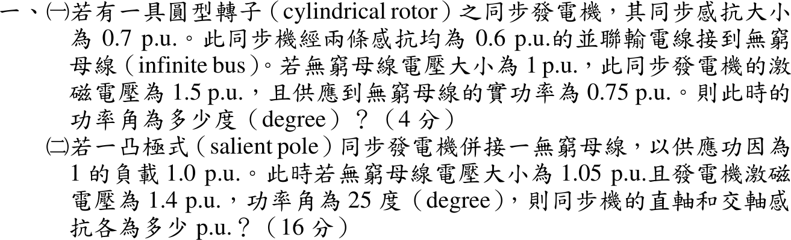
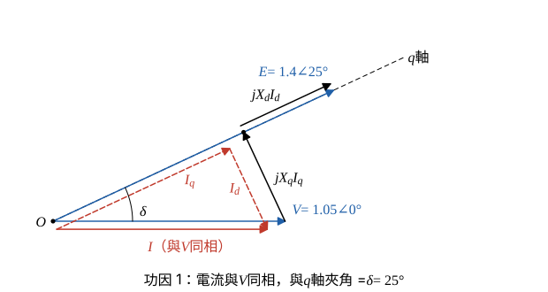

# 110 年電力系統第 1 題｜同步發電機功角與雙反應理論

## 已知與所求

（一）圓型轉子機 \(X_s=0.7\)，經兩條 \(0.6\) pu 並聯線接無窮母線，\(V=1\)、\(E=1.5\)、\(P=0.75\) pu，求功率角 \(\delta\)。（二）凸極機接無窮母線，pf 1、\(P=1.0\)，\(V=1.05\)、\(E=1.4\) pu、\(\delta=25^\circ\)，求 \(X_d\)、\(X_q\)。

## 考場標準作答

**解題邏輯**：兩小題都忽略電阻。（一）圓型轉子機只有一個同步電抗，\(E\) 與無窮母線 \(V\) 之間的總串聯電抗 \(X\)（同步電抗 + 兩線並聯）決定功率傳輸 \(P=\dfrac{EV}{X}\sin\delta\)，反求 \(\delta\)。（二）凸極機用雙反應理論：電流分成 q 軸分量 \(I_q\) 與 d 軸分量 \(I_d\)，相量關係 \(E=V+jX_dI_d+jX_qI_q\)；功因 1 時電流與 \(V\) 同相，所以電流與 q 軸（\(E\) 的方向）夾角就是 \(\delta\)。把相量圖分別投影到「垂直 q 軸」與「沿 q 軸」兩個方向，各得一條只含 \(X_q\) 或 \(X_d\) 的方程。

### （一）圓型轉子機的功率角（4 分）

**邏輯**：兩條 0.6 pu 線路並聯後與同步電抗串聯，得總電抗；再由功率角方程式解 \(\sin\delta\)。

\[
X=X_s+\frac{X_{\ell}X_{\ell}}{X_{\ell}+X_{\ell}}=0.7+\frac{0.6\times0.6}{0.6+0.6}=0.7+\frac{0.36}{1.2}=0.7+0.30=1.00\ \mathrm{pu}
\]
\[
P=\frac{EV}{X}\sin\delta\ \Rightarrow\ \sin\delta=\frac{PX}{EV}
\]
\[
\sin\delta=\frac{0.75\times1.00}{1.5\times1}=\frac{0.75}{1.5}=0.50
\]
\[
\boxed{\delta=\sin^{-1}0.50=30^\circ}
\]

### （二）凸極機的直軸與交軸電抗（16 分）

**邏輯**：\(jX_qI_q\) 垂直 q 軸、\(jX_dI_d\) 平行 q 軸，所以「垂直 q 軸方向」只有 \(V\sin\delta\) 與 \(X_qI_q\)，可先解 \(X_q\)；「沿 q 軸方向」為 \(E=V\cos\delta+X_dI_d\)，再解 \(X_d\)。

- 以 \(V\) 為參考：\(V=1.05\angle0^\circ\)，\(E=1.4\angle25^\circ\)，q 軸沿 \(E\) 方向。
- 功因 1：\(I\) 與 \(V\) 同相（圖中電流相量平移繪出，以免與 \(V\) 重疊）。
- \(I\) 分解為沿 q 軸的 \(I_q\) 與垂直 q 軸的 \(I_d\)；從 \(V\) 尖端依序接 \(jX_qI_q\)、\(jX_dI_d\) 到達 \(E\)。

電流大小：
\[
I=\frac{P}{V\times\mathrm{pf}}=\frac{1.0}{1.05\times1}=0.952381\ \mathrm{pu},\qquad I=0.952381\angle0^\circ
\]
三角函數值：\(\cos25^\circ=0.906308\)，\(\sin25^\circ=0.422618\)。電流分量：
\[
I_q=I\cos\delta=0.952381\times0.906308=0.863151\ \mathrm{pu}
\]
\[
I_d=I\sin\delta=0.952381\times0.422618=0.402493\ \mathrm{pu}
\]

**交軸電抗**（垂直 q 軸方向：\(V\sin\delta=X_qI_q\)）：
\[
X_q=\frac{V\sin\delta}{I_q}
\]
\[
V\sin\delta=1.05\times0.422618=0.443749
\]
\[
X_q=\frac{0.443749}{0.863151}=0.514103\ \mathrm{pu}
\]
\[
\boxed{X_q=0.51\ \mathrm{pu}}
\]

**直軸電抗**（沿 q 軸方向：\(E=V\cos\delta+X_dI_d\)）：
\[
X_d=\frac{E-V\cos\delta}{I_d}
\]
\[
V\cos\delta=1.05\times0.906308=0.951623
\]
\[
E-V\cos\delta=1.4-0.951623=0.448377
\]
\[
X_d=\frac{0.448377}{0.402493}=1.1140\ \mathrm{pu}
\]
\[
\boxed{X_d=1.11\ \mathrm{pu}}
\]

## 驗算

代回凸極機功率式（\(1/X_q=1/0.514103=1.9451\)、\(1/X_d=1/1.1140=0.8977\)、\(EV/X_d=1.47/1.1140=1.3196\)、\(\sin50^\circ=0.76604\)）：
\[
P=\frac{EV}{X_d}\sin\delta+\frac{V^2}{2}\Big(\frac1{X_q}-\frac1{X_d}\Big)\sin2\delta=1.3196\times0.42262+0.55125\times1.0474\times0.76604=0.5577+0.4423=1.0000
\]
\[
Q=\frac{EV}{X_d}\cos\delta-V^2\Big(\frac{\cos^2\delta}{X_d}+\frac{\sin^2\delta}{X_q}\Big)=1.1960-1.1025\times(0.7374+0.3474)=1.1960-1.1960=0
\]
與題給 \(P=1.0\)、功因 1 相符。

## 失分點

- （一）兩條線是並聯，等效 0.3 pu；誤加成 1.2 pu 會得 \(X=1.9\)、\(\delta\) 錯誤。
- （二）\(X_q\) 由垂直 q 軸的分量 \(V\sin\delta=X_qI_q\) 求得，不可把 \(E=1.4\) 代入 \(X_q\) 式。
- \(X_d\) 分子是 \(E-V\cos\delta\)；漏乘 \(\cos\delta\) 寫成 \(1.4-1.05\) 會得 \(X_d=0.87\) pu。
