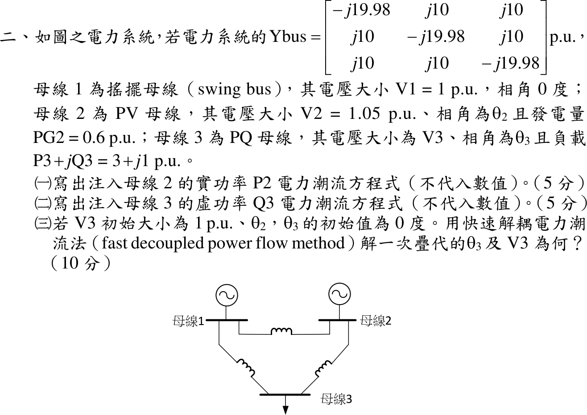

# 110 年電力系統第 2 題｜三匯流排快速解耦電力潮流

## 已知與所求

\(Y_{\mathrm{bus}}\)：對角 \(-j19.98\)、非對角 \(j10\) pu（\(G=0\)，\(B_{ii}=-19.98\)、\(B_{ik}=10\)）。母線 1 搖擺 \(1\angle0^\circ\)；母線 2 PV，\(|V_2|=1.05\)、\(P_{G2}=0.6\)；母線 3 PQ，負載 \(3+j1\) pu。求（一）\(P_2\) 潮流方程；（二）\(Q_3\) 潮流方程（皆不代數值）；（三）\(V_3=1\)、\(\theta_2=\theta_3=0\) 起始，快速解耦法一次疊代的 \(\theta_3\)、\(V_3\)。

## 考場標準作答

**解題邏輯**：（一）（二）由母線注入複功率 \(S_i=V_iI_i^*\) 與 \(I_i=\sum_kY_{ik}V_k\) 展開，取實部得 \(P_2\)、取虛部得 \(Q_3\)。（三）快速解耦法把 Jacobian 換成常數電納矩陣：\(B'\)（PV、PQ 母線的角度方程）與 \(B''\)（PQ 母線的電壓方程），依序算起始點的功率 → 不平衡量 → 解 \(B'\Delta\boldsymbol\theta=\Delta\mathbf P/|V|\) 與 \(B''\Delta|V_3|=\Delta Q_3/|V_3|\)。前提：標么值以題給 \(Y_{\mathrm{bus}}\) 的系統共同基準；\(G_{ik}=0\)（純電納網路）；平坦起始 \(\theta_2=\theta_3=0\)、\(|V_3|=1\)；本題「一次疊代」的兩組修正量都用起始點的不平衡量計算（同時求解）；角度以 rad 計算。

### 步驟 1：符號與注入功率通式

- \(Y_{ik}=|Y_{ik}|\angle\gamma_{ik}=G_{ik}+jB_{ik}\)，\(V_i=|V_i|\angle\theta_i\)，\(\theta_{ik}=\theta_i-\theta_k\)。
- 本題 \(G_{ik}=0\)；\(B_{ii}=-19.98\)、\(B_{ik}=10\)（\(i\ne k\)）。
- 注入功率以「流入母線為正」：發電為正、負載為負。

母線 \(i\) 注入複功率：
\[
P_i-jQ_i=V_i^*I_i=V_i^*\sum_{k=1}^{3}Y_{ik}V_k=\sum_{k=1}^{3}|V_i||V_k||Y_{ik}|\angle(\gamma_{ik}-\theta_i+\theta_k)
\]

### （一）\(P_2\) 潮流方程（5 分）

**邏輯**：取上式實部，\(i=2\)；\(P_2\) 由 \(Y_{2k}\) 與各母線電壓的大小、相角差決定。

\[
\boxed{P_2=\sum_{k=1}^{3}|V_2||V_k||Y_{2k}|\cos(\gamma_{2k}-\theta_2+\theta_k)=|V_2|\sum_{k=1}^{3}|V_k|\big[G_{2k}\cos\theta_{2k}+B_{2k}\sin\theta_{2k}\big]}
\]
本題 \(G=0\)，且 \(k=2\) 項 \(\sin\theta_{22}=0\)：
\[
P_2=|V_2||V_1|B_{21}\sin\theta_{21}+|V_2||V_3|B_{23}\sin\theta_{23}
\]

### （二）\(Q_3\) 潮流方程（5 分）

**邏輯**：取同一式虛部（注意 \(P_i-jQ_i\) 的負號），\(i=3\)；母線 3 為 PQ 母線，\(Q_3\) 方程用來解 \(|V_3|\)。

\[
\boxed{Q_3=-\sum_{k=1}^{3}|V_3||V_k||Y_{3k}|\sin(\gamma_{3k}-\theta_3+\theta_k)=|V_3|\sum_{k=1}^{3}|V_k|\big[G_{3k}\sin\theta_{3k}-B_{3k}\cos\theta_{3k}\big]}
\]
本題 \(G=0\)，\(k=3\) 項 \(\cos\theta_{33}=1\)：
\[
Q_3=-|V_3||V_1|B_{31}\cos\theta_{31}-|V_3||V_2|B_{32}\cos\theta_{32}-|V_3|^2B_{33}
\]

### 步驟 2：指定值、起始點功率與不平衡量

**邏輯**：PV 母線 2 只有 \(\theta_2\) 未知，只列 \(\Delta P_2\)；PQ 母線 3 列 \(\Delta P_3\)、\(\Delta Q_3\)；搖擺母線 1 不列方程。

指定值（負載為負注入）：
\[
P_2^{sp}=P_{G2}=0.6,\qquad P_3^{sp}=-3,\qquad Q_3^{sp}=-1
\]
平坦起始所有 \(\theta_{ik}=0\)，\(\sin\theta_{ik}=0\)，故
\[
P_2^{(0)}=0,\qquad P_3^{(0)}=0
\]
\(\cos\theta_{ik}=1\)，代入（二）的展開式：
\[
Q_3^{(0)}=-(1)(1)(10)-(1)(1.05)(10)-(1)^2(-19.98)
\]
\[
Q_3^{(0)}=-10-10.5+19.98=-0.52
\]
不平衡量：
\[
\Delta P_2=0.6-0=0.6,\qquad \Delta P_3=-3-0=-3
\]
\[
\Delta Q_3=-1-(-0.52)=-0.48
\]

### 步驟 3：\(B'\) 與 \(B''\)

**邏輯**：\(\Delta P/|V|\approx-B\,\Delta\theta\)、\(\Delta Q/|V|\approx-B\,\Delta|V|\)，故取 \(-\mathrm{Im}(Y_{\mathrm{bus}})\) 的子矩陣：\(B'\) 刪去搖擺母線 1 的列與行，\(B''\) 只留 PQ 母線 3。

\[
B'=\begin{bmatrix}-B_{22}&-B_{23}\\-B_{32}&-B_{33}\end{bmatrix}=\begin{bmatrix}19.98&-10\\-10&19.98\end{bmatrix},\qquad B''=[\,-B_{33}\,]=[\,19.98\,]
\]

### （三）快速解耦一次疊代的 \(\theta_3\)、\(|V_3|\)（10 分）

**邏輯**：右端是不平衡量除以目前的電壓大小；\(2\times2\) 的 \(B'\) 以克拉瑪法則解 \(\Delta\theta_2\)、\(\Delta\theta_3\)，\(1\times1\) 的 \(B''\) 直接相除得 \(\Delta|V_3|\)；新值 = 起始值 + 修正量。

P–θ 方程右端：
\[
\frac{\Delta P_2}{|V_2|}=\frac{0.6}{1.05}=0.5714,\qquad \frac{\Delta P_3}{|V_3|}=\frac{-3}{1}=-3
\]
\[
\begin{bmatrix}19.98&-10\\-10&19.98\end{bmatrix}
\begin{bmatrix}\Delta\theta_2\\\Delta\theta_3\end{bmatrix}=
\begin{bmatrix}0.5714\\-3\end{bmatrix}
\]
行列式：
\[
\det B'=19.98^2-(-10)(-10)=399.2004-100=299.2004
\]
克拉瑪法則分子：
\[
D_2=\begin{vmatrix}0.5714&-10\\-3&19.98\end{vmatrix}=0.5714(19.98)-(-10)(-3)=11.417-30=-18.583
\]
\[
D_3=\begin{vmatrix}19.98&0.5714\\-10&-3\end{vmatrix}=19.98(-3)-0.5714(-10)=-59.94+5.714=-54.226
\]
角度修正量：
\[
\Delta\theta_2=\frac{D_2}{\det B'}=\frac{-18.583}{299.2004}=-0.06211\ \mathrm{rad}
\]
\[
\Delta\theta_3=\frac{D_3}{\det B'}=\frac{-54.226}{299.2004}=-0.1812\ \mathrm{rad}
\]
新角度（起始 \(\theta_3^{(0)}=0\)），換成度：
\[
\theta_3^{(1)}=0+(-0.1812)=-0.1812\ \mathrm{rad}
\]
\[
\theta_3^{(1)}=-0.1812\times\frac{180^\circ}{\pi}=-10.38^\circ
\]
\[
\boxed{\theta_3^{(1)}=-0.18\ \mathrm{rad}=-10.38^\circ}
\]
Q–V 方程：
\[
B''\,\Delta|V_3|=\frac{\Delta Q_3}{|V_3|}
\]
\[
\Delta|V_3|=\frac{-0.48/1}{19.98}=-0.02402\ \mathrm{pu}
\]
\[
|V_3|^{(1)}=1+(-0.02402)=0.97598\ \mathrm{pu}
\]
\[
\boxed{|V_3|^{(1)}=0.98\ \mathrm{pu}}
\]

## 驗算

回代 \(B'\)（用 5 位有效數字 \(\Delta\theta_2=-0.062110\)、\(\Delta\theta_3=-0.18124\)）：\(19.98(-0.062110)-10(-0.18124)=-1.2410+1.8124=0.5714\)、\(-10(-0.062110)+19.98(-0.18124)=0.6211-3.6212=-3.0001\approx-3\)，與右端一致。另以完整 Newton–Raphson 從同一起點走一步得 \(\theta_3=-10.14^\circ\)、\(|V_3|=0.97533\) pu，與解耦結果差 \(0.24^\circ\)、\(0.00064\) pu，屬解耦近似的合理差距。

## 失分點

- \(Q_3\) 的計算值含自導納項 \(-|V_3|^2B_{33}=+19.98\)，漏掉會得 \(Q_3^{(0)}=-20.5\)、\(\Delta Q_3=19.5\)，方向全錯。
- \(B'\) 的符號：\(\Delta P/|V|=-B\,\Delta\theta\)，取 \(-\mathrm{Im}\,Y_{\mathrm{bus}}\) 為正定矩陣；直接用 \(\mathrm{Im}\,Y_{\mathrm{bus}}\) 會使 \(\theta_3\) 變號。
- 母線 2 為 PV，不列 \(\Delta Q_2\) 方程，\(B''\) 只剩 \(1\times1\) 的 \(19.98\)；\(\Delta P_2\) 要除以 \(|V_2|=1.05\)。

## 條件與疑義

本解採「同一次疊代的 \(\Delta P\)、\(\Delta Q\) 都以起始點計算」的一次疊代口徑（與驗算腳本一致）。若改用先更新角度、再以新角度算 \(Q_3\) 的序列式半步，\(Q_3=-0.2818\)、\(\Delta Q_3=-0.7182\)，得 \(|V_3|^{(1)}=0.96\) pu；\(\theta_3\) 不受影響。
