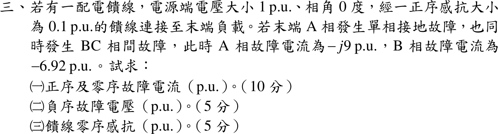

# 110 年電力系統第 3 題｜同時故障對稱成分分析

## 已知與所求

電源 \(1\angle0^\circ\) pu，經正序感抗 \(X_1=0.1\) pu 的饋線接末端負載。末端 A 相接地，同時 BC 相間故障；\(I_a=-j9\)、\(I_b=-6.92\) pu。求（一）正序、零序故障電流；（二）負序故障電壓；（三）饋線零序感抗。題目未給負序感抗。

## 考場標準作答

用對稱成分法：把故障邊界條件寫成相量式，再以 Fortescue 轉換求序電流，然後由序網路求序電壓。A 相接地 \(V_a=0\)；BC 金屬相間短路（不接地）\(V_b=V_c\)、\(I_b+I_c=0\Rightarrow I_c=+6.92\) pu。

### （一）正序與零序電流

\(a=1\angle120^\circ\)，\(a-a^2=j\sqrt3\)，\(6.92\sqrt3=11.99\)：
\[
\boxed{I_{a0}=\frac{I_a+I_b+I_c}{3}=\frac{-j9-6.92+6.92}{3}=-j3.00\ \mathrm{pu}}
\]
\[
\boxed{I_{a1}=\frac{I_a+aI_b+a^2I_c}{3}=\frac{-j9-j6.92\sqrt3}{3}=\frac{-j(9+11.99)}{3}=-j7.00\ \mathrm{pu}}
\]
（負序 \(I_{a2}=\dfrac{-j9+j6.92\sqrt3}{3}=\dfrac{j(-9+11.99)}{3}=+j1.00\) pu，供後兩小題使用。）

### （二）負序故障電壓

由 \(V_b-V_c=(a^2-a)(V_{a1}-V_{a2})=0\) 得 \(V_{a2}=V_{a1}\)（正、負序電壓相等）。正序網路 \(V_{a1}=E-jX_1I_{a1}\)：
\[
V_{a1}=1-(j0.1)(-j7.00)=1-0.70=0.30\ \mathrm{pu}
\]
\[
\boxed{V_{a2}=V_{a1}=0.30\ \mathrm{pu}}
\]

### （三）饋線零序感抗

由 \(V_a=V_{a0}+V_{a1}+V_{a2}=0\) 得 \(V_{a0}=-2V_{a1}=-0.60\) pu。零序網路 \(V_{a0}=-jX_0I_{a0}=-jX_0(-j3)=-3X_0\)：
\[
\boxed{X_0=\frac{0.60}{3}=0.20\ \mathrm{pu}}
\]
（以上均以完整精度計算後再顯示兩位小數。）

## 驗算

以 \(V_{012}=(-0.60,\,0.30,\,0.30)\)、\(I_{012}=(-j3.00,\,-j7.00,\,j1.00)\) 反轉換回相量：\(V_a=0\)、\(V_b=V_c=V_{a0}+(a^2+a)V_{a1}=-0.60-0.30=-0.90\) pu、\(I_a=-j9\)、\(I_b=-6.92=-I_c\)，三個故障條件全部成立。隱含負序阻抗 \(-V_{a2}/I_{a2}=j0.30\) pu，與 \(I_1\approx-j7,\ I_2\approx j1,\ I_0=-j3\) 搭配 \(X_1=0.1,\ X_2\approx0.3,\ X_0\approx0.2\) 的整數設計一致（\(6.92\approx4\sqrt3\)）。

## 失分點

- 漏用 BC 相間短路的電壓條件 \(V_b=V_c\)，另假設 \(X_2=X_1=0.1\) 會得 \(V_{a2}=0.10\)、\(X_0=0.133\)，同時違反 \(V_b=V_c\)。
- BC 故障不接地，\(I_c=-I_b=+6.92\)；若把 \(I_c\) 當未知或取 \(-6.92\)，\(I_0\) 會錯。
- \(a^2-a=-j\sqrt3\) 的符號決定 \(I_{a1}\)、\(I_{a2}\) 哪個大；記反會把正、負序對調。
