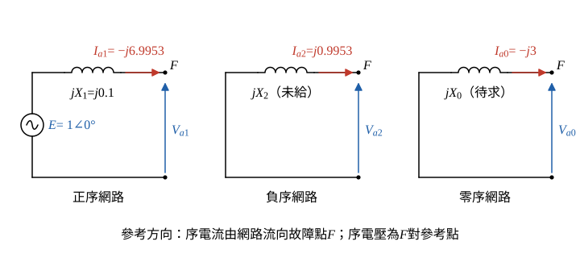

# 110 年電力系統第 3 題｜同時故障對稱成分分析

## 已知與所求

電源 \(1\angle0^\circ\) pu，經正序感抗 \(X_1=0.1\) pu 的饋線接末端負載。末端 A 相接地，同時 BC 相間故障；\(I_a=-j9\)、\(I_b=-6.92\) pu。求（一）正序、零序故障電流；（二）負序故障電壓；（三）饋線零序感抗。題目未給負序感抗。

## 考場標準作答

**解題邏輯**：同時發生「A 相接地＋BC 相間」兩種故障，序網路不能套單一種接法，改走「相量邊界條件 → 序量」；前提為標么值；故障前電壓 = 電源 \(E=1\angle0^\circ\)，負載電流相對故障電流忽略；兩故障皆為金屬性（無故障阻抗）；正序網路為 \(E\) 串 \(jX_1\)，負序網路只有 \(jX_2\)（題未給，不需用到），零序網路只有饋線 \(jX_0\)（電源側零序阻抗不計）。
1. 先寫出故障點的三個相量邊界條件。
2. 以 Fortescue 轉換由已知相電流求序電流（一）。
3. 由 \(V_b=V_c\) 得 \(V_{a1}=V_{a2}\)，再用正序網路求 \(V_{a1}\)（二）。
4. 由 \(V_a=0\) 得 \(V_{a0}\)，用零序網路反求 \(X_0\)（三）。

### 步驟 1：故障邊界條件與運算子 \(a\)

**邏輯**：A 相直接接地，故障點 A 相電壓為 0；BC 兩相短接但不接地，兩相電壓相等、電流大小相等方向相反。

\[
V_a=0,\qquad V_b=V_c,\qquad I_b+I_c=0
\]
由 \(I_b+I_c=0\)：
\[
I_c=-I_b=-(-6.92)=6.92\ \mathrm{pu}
\]
運算子：
\[
a=1\angle120^\circ=-0.5+j0.8660,\qquad a^2=1\angle240^\circ=-0.5-j0.8660
\]
\[
a-a^2=j1.7321=j\sqrt3
\]

### （一）正序及零序故障電流（10 分）

**邏輯**：Fortescue 轉換 \(I_{a0}=\tfrac13(I_a+I_b+I_c)\)、\(I_{a1}=\tfrac13(I_a+aI_b+a^2I_c)\) 只需三相電流，已全部已知。

零序：
\[
I_{a0}=\frac{I_a+I_b+I_c}{3}=\frac{-j9+(-6.92)+6.92}{3}=\frac{-j9}{3}=-j3\ \mathrm{pu}
\]
\[
\boxed{I_{a0}=-j3.00\ \mathrm{pu}=3.00\angle-90^\circ\ \mathrm{pu}}
\]
正序：先合併 \(I_b\)、\(I_c\) 兩項（\(I_c=-I_b\)）：
\[
aI_b+a^2I_c=aI_b-a^2I_b=(a-a^2)I_b=(j\sqrt3)(-6.92)=-j11.986\ \mathrm{pu}
\]
\[
I_{a1}=\frac{I_a+aI_b+a^2I_c}{3}=\frac{-j9-j11.986}{3}=\frac{-j20.986}{3}=-j6.9953\ \mathrm{pu}
\]
\[
\boxed{I_{a1}=-j7.00\ \mathrm{pu}=7.00\angle-90^\circ\ \mathrm{pu}}
\]
（負序供後兩小題檢查：\(a^2I_b+aI_c=(a^2-a)I_b=(-j\sqrt3)(-6.92)=+j11.986\ \mathrm{pu}\)，
\(I_{a2}=\dfrac{-j9+j11.986}{3}=\dfrac{j2.986}{3}=j0.9953\) pu。）

### 步驟 2：序網路與參考方向

**邏輯**：每個序網路由故障點 \(F\) 看入；序電流以「由網路流出、流向故障點」為正，序電壓為 \(F\) 對參考點，故三個序網路方程式為 \(V_{a1}=E-jX_1I_{a1}\)、\(V_{a2}=-jX_2I_{a2}\)、\(V_{a0}=-jX_0I_{a0}\)。

### （二）負序故障電壓（5 分）

**邏輯**：BC 相間短路的電壓條件 \(V_b=V_c\) 換成序量後，直接給出 \(V_{a2}=V_{a1}\)；而 \(V_{a1}\) 可由正序網路（\(E\)、\(X_1\) 已知）求得，不需要負序阻抗。

相電壓以序量表示：
\[
V_b=V_{a0}+a^2V_{a1}+aV_{a2},\qquad V_c=V_{a0}+aV_{a1}+a^2V_{a2}
\]
相減：
\[
V_b-V_c=(a^2-a)V_{a1}-(a^2-a)V_{a2}=(a^2-a)(V_{a1}-V_{a2})=0
\]
因 \(a^2-a=-j\sqrt3\neq0\)，得 \(V_{a2}=V_{a1}\)。正序網路：
\[
V_{a1}=E-jX_1I_{a1}=1-(j0.1)(-j6.9953)
\]
\[
(j0.1)(-j6.9953)=0.1\times6.9953\times(j)(-j)=0.69953\ \mathrm{pu}
\]
\[
V_{a1}=1-0.69953=0.30047\ \mathrm{pu}
\]
\[
\boxed{V_{a2}=V_{a1}=0.30\ \mathrm{pu}\ (\angle0^\circ)}
\]

### （三）饋線零序感抗（5 分）

**邏輯**：A 相接地的條件 \(V_a=0\) 換成序量是 \(V_{a0}+V_{a1}+V_{a2}=0\)，由此得到 \(V_{a0}\)；再由零序網路 \(V_{a0}=-jX_0I_{a0}\) 反求 \(X_0\)。

\[
V_{a0}=-(V_{a1}+V_{a2})=-(0.30047+0.30047)=-0.60094\ \mathrm{pu}
\]
零序網路代入 \(I_{a0}=-j3\ \mathrm{pu}\)：
\[
V_{a0}=-jX_0I_{a0}=-jX_0(-j3)=3X_0(j)(j)=-3X_0
\]
\[
-3X_0=-0.60094\ \mathrm{pu}
\]
\[
X_0=\frac{0.60094}{3}=0.20031\ \mathrm{pu}
\]
\[
\boxed{X_0=0.20\ \mathrm{pu}}
\]

## 驗算

以 \(V_{012}=(-0.60094,\,0.30047,\,0.30047)\) pu、\(I_{012}=(-j3,\,-j6.9953,\,j0.9953)\) pu 反轉換回相量：

- \(V_a=-0.60094+0.30047+0.30047=0\) pu；\(V_b=V_c=V_{a0}+(a^2+a)V_{a1}=-0.60094-0.30047=-0.90\) pu，兩個電壓條件成立。
- \(I_a=-j3-j6.9953+j0.9953=-j9\) pu，與題給相同；\(I_b=-I_c=-6.92\) pu。
- 隱含負序阻抗 \(-V_{a2}/I_{a2}=-0.30047/(j0.9953)=j0.30\) pu，為正電抗，物理上合理；整組數據對應 \(X_1=0.1\) pu、\(X_2\approx0.3\) pu、\(X_0\approx0.2\) pu 的設計（\(6.92\approx4\sqrt3\)）。

## 失分點

- 漏用 BC 相間短路的電壓條件 \(V_b=V_c\)，另假設 \(X_2=X_1=0.1\) 會得 \(V_{a2}=0.10\)、\(X_0=0.133\)，同時違反 \(V_b=V_c\)。
- BC 故障不接地，\(I_c=-I_b=+6.92\)；若把 \(I_c\) 當未知或取 \(-6.92\)，\(I_{a0}\) 會錯。
- \(a-a^2=+j\sqrt3\) 的符號決定 \(I_{a1}\)、\(I_{a2}\) 哪個大；記反會把正、負序對調。
