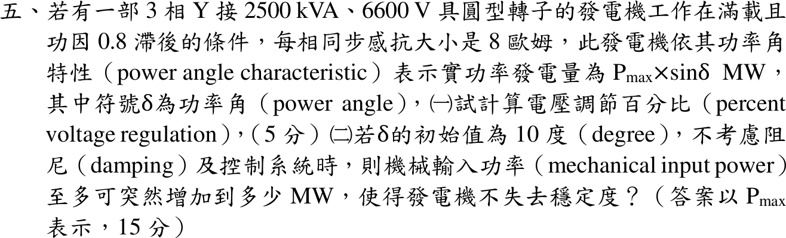
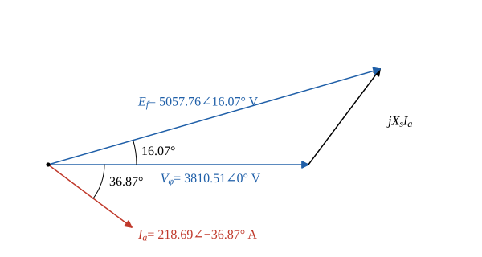
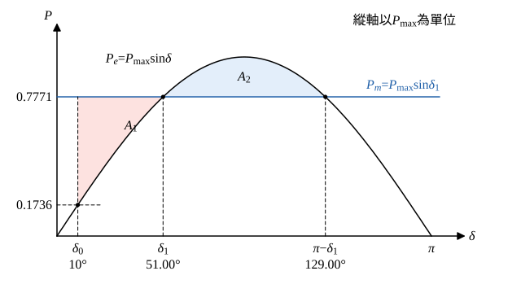

# 110 年電力系統第 5 題｜發電機電壓調整率與暫態穩定

## 已知與所求

三相 Y 接 2500 kVA、6600 V 圓型轉子發電機，\(X_s=8\ \Omega\)/相，滿載 pf 0.8 滯後；\(P=P_{\max}\sin\delta\) MW。求（一）電壓調整率；（二）\(\delta_0=10^\circ\)、不計阻尼與控制時，機械輸入功率至多可突增到多少 MW（以 \(P_{\max}\) 表示）。

## 考場標準作答

### （一）電壓調整率（5 分）

設圓型轉子、不計電樞電阻；每相為內電勢 \(E_f\) 串同步電抗 \(jX_s\)。無載時電樞電流為零、\(jX_s\) 無壓降，端電壓等於 \(|E_f|\)；以額定為基準，滿載 \(|V_\phi|=1\)、\(|I_a|=1\) pu，比值與用伏特計算相同。

基準取額定：\(S_b=2500\) kVA、\(V_b=6600\) V（線電壓，Y 接相電壓基準 \(6600/\sqrt3\) V），基準阻抗：
\[
Z_b=\frac{V_b^2}{S_b}=\frac{(6.6\ \mathrm{kV})^2}{2.5\ \mathrm{MVA}}=\frac{43.56\ \mathrm{kV^2}}{2.5\ \mathrm{MVA}}=17.424\ \Omega
\]
同步電抗標么值：
\[
X_s=\frac{8}{17.424}=0.4591\ \mathrm{pu}
\]
滿載額定電壓、額定電流，相電壓取為參考相量：
\[
V_\phi=1\angle0^\circ\ \mathrm{pu}
\]
功因 0.8 滯後，\(\cos^{-1}0.8=36.87^\circ\)，電流落後：
\[
I_a=1\angle-36.87^\circ=0.8-j0.6\ \mathrm{pu}
\]
同步電抗壓降（\(j\times(-j)=+1\)）：
\[
jX_sI_a=j0.4591(0.8-j0.6)=0.4591\times0.6+j0.4591\times0.8=0.2755+j0.3673\ \mathrm{pu}
\]
內電勢：
\[
E_f=V_\phi+jX_sI_a=1+(0.2755+j0.3673)=1.2755+j0.3673\ \mathrm{pu}
\]
大小與相角：
\[
|E_f|=\sqrt{1.2755^2+0.3673^2}=\sqrt{1.6269+0.1349}=\sqrt{1.7618}=1.3273\ \mathrm{pu}
\]
\[
\angle E_f=\tan^{-1}\frac{0.3673}{1.2755}=\tan^{-1}0.2880=16.07^\circ
\]

\[
VR=\frac{|E_f|-|V_\phi|}{|V_\phi|}\times100\%
\]
\[
VR=\frac{1.3273-1}{1}\times100\%=0.3273\times100\%
\]
\[
\boxed{VR=32.73\%}
\]
（換回伏特：無載相電壓 \(1.3273\times\tfrac{6600}{\sqrt3}=5058\) V，滿載 \(3811\) V。）

### （二）機械輸入功率可突增的上限（15 分）

設不計阻尼與控制，\(E_f\) 與 \(P_{\max}\) 不變。\(P_m\) 突增後，\(\delta_0\to\delta_1\) 間 \(P_m>P_e\) 轉子加速（面積 \(A_1\)），越過 \(\delta_1\) 後 \(P_e>P_m\) 減速（面積 \(A_2\)）；減速區最遠到 \(\delta_{\max}=\pi-\delta_1\)，臨界條件 \(A_1=A_2\)。

新平衡角 \(\delta_1\) 定義：
\[
P_m=P_{\max}\sin\delta_1
\]
加速面積：
\[
A_1=\int_{\delta_0}^{\delta_1}(P_m-P_{\max}\sin\delta)\,d\delta=P_m(\delta_1-\delta_0)+P_{\max}(\cos\delta_1-\cos\delta_0)
\]
減速面積（\(\delta_{\max}=\pi-\delta_1\)，\(\cos\delta_{\max}=-\cos\delta_1\)）：
\[
A_2=\int_{\delta_1}^{\pi-\delta_1}(P_{\max}\sin\delta-P_m)\,d\delta=P_{\max}(\cos\delta_1+\cos\delta_1)-P_m(\pi-2\delta_1)
\]
令 \(A_1=A_2\)，移項：
\[
P_m(\delta_1-\delta_0)+P_m(\pi-2\delta_1)=P_{\max}(\cos\delta_1+\cos\delta_1)-P_{\max}(\cos\delta_1-\cos\delta_0)
\]
\[
P_m(\pi-\delta_0-\delta_1)=P_{\max}(\cos\delta_0+\cos\delta_1)
\]
代入 \(P_m=P_{\max}\sin\delta_1\)，兩邊除以 \(P_{\max}\)：
\[
\sin\delta_1(\pi-\delta_0-\delta_1)=\cos\delta_0+\cos\delta_1
\]
\(\delta_0=10^\circ=0.1745\) rad（弧度代入），\(\cos\delta_0=0.9848\)。令 \(f(\delta_1)=\sin\delta_1(\pi-\delta_0-\delta_1)-\cos\delta_0-\cos\delta_1\)，試值求根：
\[
f(50^\circ)=-0.0232,\qquad f(52^\circ)=0.0224
\]
根在 \(50^\circ\) 與 \(52^\circ\) 之間。直線內插：
\[
\delta_1\approx50^\circ+2^\circ\times\frac{0.0232}{0.0232+0.0224}=50^\circ+2^\circ\times0.5088=51.02^\circ
\]
在 \(51^\circ\) 附近再細分試值：
\[
f(50.9^\circ)=-0.0023,\qquad f(51.1^\circ)=0.0022
\]
\[
\delta_1\approx50.9^\circ+0.2^\circ\times\frac{0.0023}{0.0023+0.0022}=50.9^\circ+0.2^\circ\times0.5111=51.00^\circ
\]
檢查：\(f(51.00^\circ)=0.7771\times2.0770-0.9848-0.6293=1.6140-1.6141=-0.0001\approx0\)，根即
\[
\delta_1=51.00^\circ=0.8901\ \mathrm{rad},\qquad \sin\delta_1=0.7771
\]
最大機械輸入功率：
\[
P_{m,\max}=P_{\max}\sin\delta_1=P_{\max}\sin51.00^\circ
\]
\[
\boxed{P_{m,\max}=P_{\max}\sin51.00^\circ=0.78\,P_{\max}\ \mathrm{MW}}
\]
即較原來 \(P_{\max}\sin10^\circ=0.1736P_{\max}\) 最多增加 \(0.7771P_{\max}-0.1736P_{\max}=0.6035P_{\max}\approx0.60P_{\max}\) MW。

## 驗算

回代等面積式：左 \(0.7771(\pi-0.1745-0.8901)=0.7771\times2.0770=1.6140\)，右 \(\cos10^\circ+\cos51.00^\circ=0.9848+0.6293=1.6141\)，兩側相差 \(0.0001\)（四捨五入誤差）。另以擺動方程數值積分：\(P_m=99.50\%\times0.78P_{\max}\) 時轉子在 \(\pi\) 前折返，\(P_m=100.50\%\times0.78P_{\max}\) 時越過 \(\pi-\delta_1\) 後持續加速而失步，臨界值夾在兩者之間。

## 失分點

- 等面積式中的 \(\pi-\delta_0-\delta_1\) 必須以弧度代入，以度數代入結果完全錯。
- 臨界最大擺角是 \(\pi-\delta_1\)（新功率線與正弦曲線的另一交點），不是 \(90^\circ\)。
- 基準阻抗用線電壓平方除三相容量：\(Z_b=(6.6\ \mathrm{kV})^2/2.5\ \mathrm{MVA}=17.424\ \Omega\)；若改用伏特計算，6600 V 是線電壓須先除以 \(\sqrt3\)；滯後功因電流角取 \(-36.87^\circ\)。
