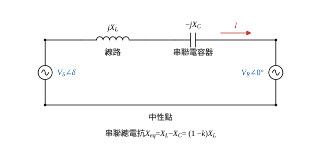
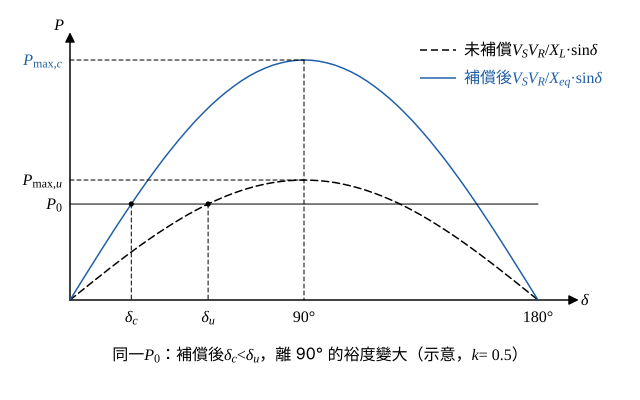

# 111 年第 1 題｜輸電線路串聯補償與最大傳送功率

## 已知與所求

概念題，無數值。求（一）串聯補償的定義（15 分）；（二）串聯補償能提高線路最大傳送實功率的原因（10 分）。

## 考場標準作答

### （一）串聯補償的定義（15 分）

**定義**：在輸電線路的各相導線上**串接電容器組**（通常裝在線路中點或兩端變電所），用電容器的容抗 \(X_C=\dfrac{1}{\omega C}\) 抵銷一部分線路串聯感抗 \(X_L\)，使線路的電氣長度縮短（圖 1）。

補償度定義為電容器容抗與線路感抗的比：
\[
k=\frac{X_C}{X_L}\quad\Rightarrow\quad X_C=kX_L
\]
同一條電流路徑上的串聯阻抗相加：
\[
jX_L+(-jX_C)=j(X_L-X_C)
\]
所以等效串聯電抗：
\[
X_{eq}=X_L-X_C
\]
代入 \(X_C=kX_L\)：
\[
\boxed{X_{eq}=X_L-kX_L=(1-k)X_L}
\]
例：\(X_L=0.50\) pu、\(k=0.50\)，則 \(X_C=0.50\times0.50=0.25\) pu，\(X_{eq}=0.50-0.25=0.25\) pu。

**作用**：提高傳輸容量與穩定度裕度（見（二））；減少線路的無效功率損失 \(I^2X\) 與電壓降，改善電壓調整；調整並聯線路間的潮流分配。

**實施要點**：補償度採部分補償（實務約 \(k=0.25\sim0.70\)）；電容器組並接金屬氧化物變阻器（MOV）、火花間隙與旁路開關，故障時限制電容器過電壓並可旁路；補償度高時須檢討與汽輪發電機軸系的次同步共振（SSR）及距離電驛的量測誤差。

### （二）能增加最大傳送實功率的原因（10 分）

以每相短線模型說明，忽略線路電阻與並聯充電電容；兩端電壓大小 \(V_S,V_R\) 固定，送電端領先受電端功率角 \(\delta\)。

依圖 1 的參考方向，線路電流由送電端流向受電端：
\[
I=\frac{V_S\angle\delta-V_R\angle0^\circ}{jX_{eq}}
\]
受電端複數功率 \(S_R=V_RI^*\)，取共軛（\((jX_{eq})^*=-jX_{eq}\)）：
\[
S_R=V_R\cdot\frac{V_S\angle-\delta-V_R}{-jX_{eq}}=\frac{jV_R\left(V_S\cos\delta-jV_S\sin\delta-V_R\right)}{X_{eq}}
\]
展開 \(j(\cdots)\)：
\[
S_R=\frac{V_SV_R\sin\delta}{X_{eq}}+j\,\frac{V_SV_R\cos\delta-V_R^2}{X_{eq}}
\]
取實部得傳輸實功率：
\[
P=\frac{V_SV_R}{X_{eq}}\sin\delta
\]
\(\sin\delta\) 最大為 1（\(\delta=90^\circ\)），故
\[
P_{\max}=\frac{V_SV_R}{X_{eq}}
\]
未補償時 \(X_{eq}=X_L\)，補償後 \(X_{eq}=(1-k)X_L\)，分別代入：
\[
P_{\max,u}=\frac{V_SV_R}{X_L},\qquad P_{\max,c}=\frac{V_SV_R}{(1-k)X_L}
\]
兩式相除：
\[
\boxed{P_{\max,c}=\frac{1}{1-k}\,P_{\max,u}}
\]
因 \(0<k<1\)，\(\dfrac{1}{1-k}>1\)，最大傳送實功率（靜態穩定極限）提高；例如 \(k=0.5\) 時為 \(\dfrac{1}{1-0.5}=2\) 倍。

另一方面，傳送同一功率 \(P_0\) 時 \(\sin\delta=\dfrac{P_0X_{eq}}{V_SV_R}\) 隨 \(X_{eq}\) 變小，功率角由 \(\delta_u\) 降為 \(\delta_c\)，距離 \(90^\circ\) 的裕度變大，暫態穩定度也改善（圖 2）。

## 驗算

數值例：\(V_S=V_R=1\) pu、\(X_L=0.50\) pu，傳送 1 pu。未補償：\(\sin\delta_u=\dfrac{1\times0.50}{1\times1}=0.50\)，\(\delta_u=30^\circ\)，\(P_{\max,u}=\dfrac{1}{0.50}=2\) pu。補償 50% 後 \(X_{eq}=0.25\) pu：\(\sin\delta_c=0.25\)，\(\delta_c=14.48^\circ\)，\(P_{\max,c}=\dfrac{1}{0.25}=4\) pu，恰為 \(\dfrac{1}{1-0.50}=2\) 倍。

## 失分點

- 串聯補償是**串接電容**降低 \(X_L\)；並聯電抗器／電容器是並聯補償，主要調節電壓與無效功率，不改變線路串聯電抗。
- （二）須寫出 \(P_{\max}=V_SV_R/X\) 並指出 \(X\) 減小，只寫「改善電壓」不足以說明實功率極限提高。
