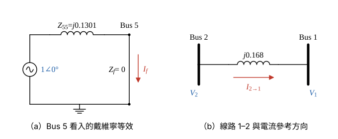

# 111 年第 2 題｜五匯流排三相短路之故障電壓與線路電流

## 已知與所求

五匯流排系統，標示值皆為 pu；匯流排 1、3 經次暫態電抗 \(j0.1111\)、\(j0.1333\) 接 \(1.0\angle0^\circ\) 電源。線路：1–2 \(j0.168\)、2–3 \(j0.126\)、1–5 \(j0.126\)、5–3 \(j0.210\)、5–4 \(j0.252\)、4–3 \(j0.336\)。題給 \(Z_{bus}\) 第 5 行：\(Z_{15}=j0.0608\)、\(Z_{25}=j0.0605\)、\(Z_{35}=j0.0603\)、\(Z_{45}=j0.1002\)、\(Z_{55}=j0.1301\)。故障前電流忽略、各節點 1 pu。匯流排 5 直接接地三相短路，求 \(V_3\) 與由 2 流至 1 的故障電流。

## 考場標準作答

### 步驟 1：Bus 5 的戴維寧等效與故障電流

題給 \(Z_{bus}\) 已含兩部發電機的次暫態電抗，故 Bus 5 看入的戴維寧阻抗即 \(Z_{55}\)。設故障前電流忽略，各匯流排 \(V_i^{(0)}=1\angle0^\circ\) pu；直接接地 \(Z_f=0\)。

- 戴維寧電壓：故障前 Bus 5 電壓 \(V_5^{(0)}=1\angle0^\circ\)。
- 戴維寧阻抗：\(Z_{bus}\) 對角元 \(Z_{55}=j0.1301\)（已含 \(j0.1111\)、\(j0.1333\)，不可再串）。
- 直接接地：\(Z_f=0\)。

\[
I_f=\frac{V_5^{(0)}}{Z_{55}+Z_f}
\]
代入（分母 \(j0.1301=0.1301\angle90^\circ\)）：
\[
I_f=\frac{1\angle0^\circ}{0.1301\angle90^\circ}
\]
大小與相角：
\[
|I_f|=\frac{1}{0.1301}=7.686,\qquad \angle I_f=0^\circ-90^\circ=-90^\circ
\]
\[
I_f=7.686\angle-90^\circ=-j7.686\ \mathrm{pu}
\]

### 步驟 2：故障後電壓的通式

重疊定理：故障後狀態 = 故障前狀態（各點 1 pu）+ 只在 Bus 5 注入 \(-I_f\) 的狀態，後者在 Bus \(i\) 造成的電壓變化為 \(-Z_{i5}I_f\)：
\[
V_i=V_i^{(0)}-Z_{i5}I_f
\]
代入 \(I_f=\dfrac{1}{Z_{55}}\)：
\[
V_i=1-Z_{i5}\cdot\frac{1}{Z_{55}}=1-\frac{Z_{i5}}{Z_{55}}
\]
\(Z_{i5}\) 與 \(Z_{55}\) 都是純虛數，\(j\) 相消，比值為純實數，所以各點電壓都是 \(\angle0^\circ\)。

### （一）匯流排 3 的電壓

\[
V_3=1-\frac{Z_{35}}{Z_{55}}
\]
代入：
\[
\frac{Z_{35}}{Z_{55}}=\frac{j0.0603}{j0.1301}=\frac{0.0603}{0.1301}=0.4635
\]
\[
V_3=1-0.4635=0.5365
\]
\[
\boxed{V_3=1-\frac{0.0603}{0.1301}\approx0.54\angle0^\circ\ \mathrm{pu}}
\]
（\(0.54\) 與 \(0.5365\) 相差 \(0.65\%\)，精確值以分式 \(1-0.0603/0.1301\) 表示。）

### （二）由匯流排 2 流至匯流排 1 的故障電流

方向 2→1，分子取 \(V_2-V_1\)；兩端電壓只差在第三位小數，先用 \(Z\) 比值相減保留精度。

兩端電壓（步驟 2 通式）：
\[
V_1=1-\frac{0.0608}{0.1301}=1-0.4673=0.5327,\qquad V_2=1-\frac{0.0605}{0.1301}=1-0.4650=0.5350\ \mathrm{pu}
\]
電壓差直接由比值相減：
\[
V_2-V_1=\left(1-\frac{Z_{25}}{Z_{55}}\right)-\left(1-\frac{Z_{15}}{Z_{55}}\right)=\frac{Z_{15}-Z_{25}}{Z_{55}}
\]
\[
V_2-V_1=\frac{0.0608-0.0605}{0.1301}=\frac{0.0003}{0.1301}=0.002306\ \mathrm{pu}
\]
線路 1–2 電抗 \(jX_{12}=j0.168=0.168\angle90^\circ\)：
\[
I_{2\to1}=\frac{V_2-V_1}{jX_{12}}=\frac{0.002306\angle0^\circ}{0.168\angle90^\circ}
\]
大小與相角：
\[
|I_{2\to1}|=\frac{0.002306}{0.168}=0.01373,\qquad \angle I_{2\to1}=0^\circ-90^\circ=-90^\circ
\]
\[
\boxed{I_{2\to1}=0.0137\angle-90^\circ=-j0.0137\ \mathrm{pu}}
\]
（量值小於 0.1，取三位有效數字；兩位小數只剩 0.01，誤差過大。）

## 驗算

由單線圖自行組 \(Y_{bus}\)（兩發電機電抗接地）再求反矩陣，所得 \(Z_{bus}\) 與題給值在第四位小數內一致，\(V_3\) 差 \(<0.0005\)；且匯流排 5 的 KCL：三條線路流入電流之和 \((V_1-V_5)/j0.126+(V_3-V_5)/j0.210+(V_4-V_5)/j0.252=I_f\) 成立（\(V_5=0\)）。代入 \(V_1=0.5327\)、\(V_3=0.5365\)、\(V_4=1-0.1002/0.1301=0.2298\)：
\[
\frac{0.5327}{j0.126}+\frac{0.5365}{j0.210}+\frac{0.2298}{j0.252}=-j(4.228+2.555+0.9119)=-j7.695\approx-j7.686
\]
（差 \(0.1\%\) 來自題給 \(Z_{bus}\) 只有四位小數。）

## 失分點

- \(Z_{bus}\) 已含發電機次暫態電抗，故障電流直接用 \(1/Z_{55}\)，不可再串入 \(j0.1111\)、\(j0.1333\)。
- \(V_i=1-Z_{i5}I_f\) 中 \(j\cdot(-j)=+1\)，扣除量為正，誤寫成 \(1+0.4635\) 會得 1.46 pu。
- 方向指定 2→1，用 \(V_2-V_1\)；寫成 \(V_1-V_2\) 符號相反。
