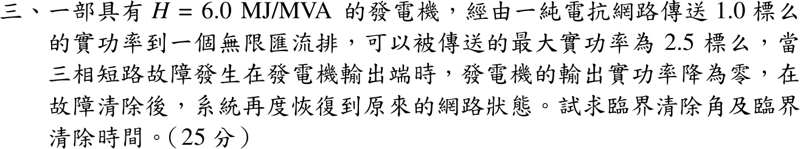
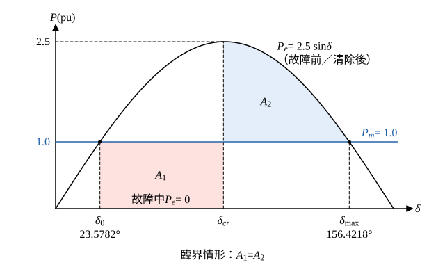

# 111 年第 3 題｜三相短路之臨界清除角與清除時間

## 已知與所求

\(H=6.0\) MJ/MVA，經純電抗網路送 \(P_m=1.0\) pu 至無限匯流排，\(P_{\max}=2.5\) pu；發電機出口三相短路期間 \(P_e=0\)，清除後恢復原網路。求臨界清除角 \(\delta_{cr}\) 與臨界清除時間 \(t_{cr}\)（合計 25 分，未分配子題配分）。題面未給系統頻率 \(f\)。

## 考場標準作答

**解題邏輯**：用等面積準則；前提為古典模型（暫態電勢與 \(P_m\) 不變、忽略阻尼）；標么值以發電機額定為基準（\(H\) 亦同基準）；故障前轉子以同步速運轉（相對轉速 0）；角度以 rad 代入公式。
1. 故障期間 \(P_e=0\)，轉子以固定的 \(P_m\) 加速（加速面積 \(A_1\)）；清除後回到原功率曲線 \(P_{\max}\sin\delta\)，轉子減速（減速面積 \(A_2\)），最遠可擺到 \(\delta_{\max}=\pi-\delta_0\)。
2. 依序求 \(\delta_0\)、\(\delta_{\max}\)。
3. 令 \(A_1=A_2\) 解 \(\delta_{cr}\)。
4. 故障期間 \(P_e=0\) 使擺動方程可直接積分，得 \(t_{cr}\)。
5. \(\cos\delta_{cr}\) 由兩個相近量相減，中間值保留 6–7 位有效數字。

### 步驟 1：初始角與最大擺角

**邏輯**：故障前穩態 \(P_m=P_{\max}\sin\delta_0\)；清除後網路與故障前相同，減速區的終點是同一條曲線上另一個 \(P_e=P_m\) 的角度 \(\pi-\delta_0\)。

\[
\delta_0=\sin^{-1}\frac{P_m}{P_{\max}}=\sin^{-1}\frac{1.0}{2.5}=\sin^{-1}0.4=23.5782^\circ=0.4115168\ \mathrm{rad}
\]
\[
\delta_{\max}=\pi-\delta_0=3.1415927-0.4115168=2.7300759\ \mathrm{rad}=156.4218^\circ
\]
\[
\cos\delta_0=\sqrt{1-0.4^2}=\sqrt{0.84}=0.9165151
\]

### （一）臨界清除角

**邏輯**：故障期間 \(P_e=0\)，加速面積是 \(P_m\) 下方的矩形；清除後減速面積是 \(P_{\max}\sin\delta\) 高出 \(P_m\) 的部分；臨界時兩者相等，擺幅恰到 \(\delta_{\max}\)。

加速面積：
\[
A_1=\int_{\delta_0}^{\delta_{cr}}(P_m-0)\,d\delta=P_m(\delta_{cr}-\delta_0)
\]
減速面積：
\[
A_2=\int_{\delta_{cr}}^{\delta_{\max}}(P_{\max}\sin\delta-P_m)\,d\delta=P_{\max}(\cos\delta_{cr}-\cos\delta_{\max})-P_m(\delta_{\max}-\delta_{cr})
\]
令 \(A_1=A_2\)，\(P_m\delta_{cr}\) 兩邊相消：
\[
P_m(\delta_{\max}-\delta_0)=P_{\max}(\cos\delta_{cr}-\cos\delta_{\max})
\]
代入 \(\delta_{\max}=\pi-\delta_0\)、\(\cos\delta_{\max}=-\cos\delta_0\)，解出：
\[
\cos\delta_{cr}=\frac{P_m}{P_{\max}}(\pi-2\delta_0)-\cos\delta_0
\]
代入（弧度）：
\[
\pi-2\delta_0=3.1415927-2(0.4115168)=3.1415927-0.8230336=2.3185591
\]
\[
\frac{P_m}{P_{\max}}(\pi-2\delta_0)=0.4\times2.3185591=0.9274236
\]
\[
\cos\delta_{cr}=0.9274236-0.9165151=0.0109085
\]
\[
\delta_{cr}=\cos^{-1}0.0109085=89.37498^\circ=1.559888\ \mathrm{rad}
\]
\[
\boxed{\delta_{cr}=89.37^\circ\ (1.56\ \mathrm{rad})}
\]
（\(89.37498^\circ\) 取兩位小數為 \(89.37^\circ\)，不可先寫成 \(89.375^\circ\) 再進位。）

### （二）臨界清除時間

**邏輯**：故障期間 \(P_e=0\)，擺動方程右邊是常數 \(P_m\)，角加速度固定，積分兩次即得 \(\delta(t)\)；令 \(\delta(t_{cr})=\delta_{cr}\) 反解時間。

擺動方程（\(\delta\) 為電機角 rad，\(\omega_s=2\pi f\)）：
\[
\frac{2H}{\omega_s}\frac{d^2\delta}{dt^2}=P_m-P_e=P_m
\]
初值 \(\delta(0)=\delta_0\)、\(\dfrac{d\delta}{dt}(0)=0\)，積分一次：
\[
\frac{d\delta}{dt}=\frac{\omega_sP_m}{2H}t
\]
再積分一次：
\[
\delta(t)=\delta_0+\frac{\omega_sP_m}{4H}t^2
\]
令 \(\delta(t_{cr})=\delta_{cr}\)：
\[
t_{cr}=\sqrt{\frac{4H(\delta_{cr}-\delta_0)}{2\pi fP_m}}
\]
代入：
\[
\delta_{cr}-\delta_0=1.559888-0.4115168=1.148371\ \mathrm{rad}
\]
\[
4H(\delta_{cr}-\delta_0)=4(6.0)(1.148371)=27.56090
\]
\[
t_{cr}=\sqrt{\frac{27.56090}{2\pi f(1.0)}}=\sqrt{\frac{4.386453}{f}}\ \mathrm{s}
\]
題面未給 \(f\)，寫成以 60 Hz 為參考的通式：
\[
\sqrt{\frac{4.386453}{60}}=\sqrt{0.07310755}=0.2704\ \mathrm{s}
\]
\[
\boxed{t_{cr}=0.27\sqrt{60/f}\ \mathrm{s}\ \ (f=60\ \mathrm{Hz}\text{ 時 }0.27\ \mathrm{s})}
\]

## 驗算

回代面積：\(A_1=1.0(1.148371)=1.148371\)；\(A_2=2.5(0.0109085+0.9165151)-1.0(2.7300759-1.559888)=2.5(0.9274236)-1.170188=2.318559-1.170188=1.148371\)，兩面積相等。另以 \(\ddot\delta=(\pi f/H)P_m\)、\(f=60\) 數值積分擺動方程，\(\delta\) 由 \(23.58^\circ\) 到 \(89.37^\circ\) 歷時 0.27 s，與封閉解相同。

## 失分點

- \(\cos\delta_{cr}\) 式中的 \(\pi-2\delta_0\) 必須用弧度；以度數代入會得到無意義的餘弦值；且兩項相近相減，不可先四捨五入成兩位小數。
- 故障在發電機出口，故障期間 \(P_e=0\)，\(t_{cr}\) 才有封閉解；若誤用部分功率曲線則需數值解。
- \(t_{cr}\) 公式中是 \(\omega_s=2\pi f\)（電氣角速度），不是 \(f\) 本身。

## 條件與疑義

官方裁切圖未提供頻率，\(\delta_{cr}\) 由題目唯一決定，但 \(t_{cr}\propto1/\sqrt f\)。依經濟部「電業供電電壓及頻率標準」第三條，交流電頻率定為 $f=60\,\mathrm{Hz}$（<https://www.moeaea.gov.tw/ECW/populace/news/wHandNews_File.ashx?file_id=7592>），台灣考試情境下作答寫 \(t_{cr}=0.27\) s；保守寫法同時列出通式 $t_{cr}=0.27\sqrt{60/f}\,\mathrm{s}$（\(f=50\) Hz 時為 296.19 ms）。
