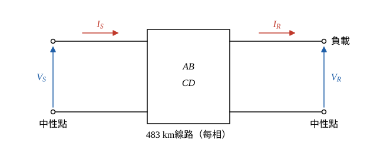

# 111 年第 4 題｜長程輸電線 ABCD 參數與送受電端量

## 已知與所求

483 km 三相線路，受電端 345 kV、400 MVA、pf 0.8 落後。\(A=D=0.8180\angle1.3^\circ\)，\(B=172.2\angle84.2^\circ\ \Omega\)，\(C=0.001933\angle90.4^\circ\ \mathrm S\)。求（一）滿載送電端相電壓、送電端電流、百分比電壓降（12 分）；（二）無載受電端相電壓、無載送電端電流、電壓調整率（13 分）。

## 考場標準作答

### 步驟 1：受電端每相電壓與電流

以 Y 接每相計算，受電端相電壓為參考相量（\(0^\circ\)）；題給 ABCD 常數直接使用；電壓降與調整率都以滿載受電端相電壓為分母；中間值以 kV、A 保留到小數點後三位。題給 345 kV 是線電壓、400 MVA 是三相視在功率，換成每相量：

\[
V_R=\frac{345}{\sqrt3}=199.186\ \mathrm{kV}\quad\Rightarrow\quad V_R=199.186\angle0^\circ\ \mathrm{kV}
\]
\[
|I_R|=\frac{S_{3\phi}}{\sqrt3V_{LL}}=\frac{400\ \mathrm{MVA}}{\sqrt3\times345\ \mathrm{kV}}=0.66939\ \mathrm{kA}=669.39\ \mathrm A
\]
功因 0.8 落後，電流落後電壓：
\[
\theta=\cos^{-1}0.8=36.87^\circ\quad\Rightarrow\quad I_R=669.39\angle-36.87^\circ\ \mathrm A
\]

### （一）滿載送電端電壓、電流與電壓降（12 分）

**送電端相電壓**：
\[
V_S=AV_R+BI_R
\]
第一項：
\[
|AV_R|=0.8180\times199.186=162.934\ \mathrm{kV},\qquad \angle AV_R=1.3^\circ+0^\circ=1.3^\circ
\]
\[
AV_R=162.934\cos1.3^\circ+j162.934\sin1.3^\circ=162.892+j3.697\ \mathrm{kV}
\]
第二項：
\[
|BI_R|=172.2\ \Omega\times0.66939\ \mathrm{kA}=115.269\ \mathrm{kV},\qquad \angle BI_R=84.2^\circ-36.87^\circ=47.33^\circ
\]
\[
BI_R=115.269\cos47.33^\circ+j115.269\sin47.33^\circ=78.126+j84.754\ \mathrm{kV}
\]
相加：
\[
V_S=(162.892+78.126)+j(3.697+84.754)=241.018+j88.451\ \mathrm{kV}
\]
換成極座標：
\[
|V_S|=\sqrt{241.018^2+88.451^2}=256.736\ \mathrm{kV}
\]
\[
\angle V_S=\tan^{-1}\frac{88.451}{241.018}=20.15^\circ
\]
\[
\boxed{V_S=256.74\angle20.15^\circ\ \mathrm{kV}}
\]
（線電壓 \(\sqrt3\times256.736=444.68\ \mathrm{kV}\)。）

**送電端電流**：
\[
I_S=CV_R+DI_R
\]
第一項（\(V_R\) 換成 V）：
\[
|CV_R|=0.001933\times199186=385.027\ \mathrm A,\qquad \angle CV_R=90.4^\circ+0^\circ=90.4^\circ
\]
\[
CV_R=385.027\cos90.4^\circ+j385.027\sin90.4^\circ=-2.688+j385.017\ \mathrm A
\]
第二項：
\[
|DI_R|=0.8180\times669.39=547.561\ \mathrm A,\qquad \angle DI_R=1.3^\circ-36.87^\circ=-35.57^\circ
\]
\[
DI_R=547.561\cos(-35.57^\circ)+j547.561\sin(-35.57^\circ)=445.389-j318.515\ \mathrm A
\]
相加：
\[
I_S=(-2.688+445.389)+j(385.017-318.515)=442.701+j66.502\ \mathrm A
\]
換成極座標：
\[
|I_S|=\sqrt{442.701^2+66.502^2}=447.67\ \mathrm A
\]
\[
\angle I_S=\tan^{-1}\frac{66.502}{442.701}=8.54^\circ
\]
\[
\boxed{I_S=447.67\angle8.54^\circ\ \mathrm A}
\]

**滿載百分比電壓降**（以受電端相電壓為基準）：
\[
\%VD=\frac{|V_S|-|V_R|}{|V_R|}\times100\%
\]
\[
\%VD=\frac{256.74-199.19}{199.19}\times100\%
\]
\[
256.74-199.19=57.55\ \mathrm{kV},\qquad \frac{57.55}{199.19}=0.28892
\]
\[
\%VD=0.28892\times100\%=28.89\%
\]
\[
\boxed{\%VD=28.89\%}
\]

### （二）無載受電端電壓、送電端電流與電壓調整率（13 分）

無載 \(I_R=0\)，送電端電壓維持（一）的 \(V_S\) 不變，兩埠方程式只剩 \(V_S=AV_{R,NL}\)、\(I_{S,NL}=CV_{R,NL}\)。

**無載受電端相電壓**：
\[
V_{R,NL}=\frac{V_S}{A}=\frac{256.74\angle20.15^\circ}{0.8180\angle1.3^\circ}
\]
相量除法：大小相除、角度相減：
\[
|V_{R,NL}|=\frac{256.74}{0.8180}=313.86\ \mathrm{kV},\qquad \angle V_{R,NL}=20.15^\circ-1.3^\circ=18.85^\circ
\]
\[
\boxed{V_{R,NL}=313.86\angle18.85^\circ\ \mathrm{kV}}
\]
（線電壓 \(\sqrt3\times313.86=543.62\ \mathrm{kV}\)。）

**無載送電端電流**（此時 \(I_R=0\)，只剩充電電流）：
\[
I_{S,NL}=CV_{R,NL}=1.933\ \mathrm{mS}\angle90.4^\circ\times313.86\ \mathrm{kV}\angle18.85^\circ
\]
\[
|I_{S,NL}|=1.933\ \mathrm{mS}\times313.86\ \mathrm{kV}=606.69\ \mathrm A,\qquad \angle I_{S,NL}=90.4^\circ+18.85^\circ=109.25^\circ
\]
\[
\boxed{I_{S,NL}=606.69\angle109.25^\circ\ \mathrm A}
\]

**電壓調整率**（分母為滿載受電端電壓 \(|V_{R,FL}|=199.19\ \mathrm{kV}\)）：
\[
VR=\frac{|V_{R,NL}|-|V_{R,FL}|}{|V_{R,FL}|}\times100\%
\]
\[
VR=\frac{313.86-199.19}{199.19}\times100\%
\]
\[
313.86-199.19=114.67\ \mathrm{kV},\qquad \frac{114.67}{199.19}=0.57568
\]
\[
VR=0.57568\times100\%=57.57\%
\]
\[
\boxed{VR=57.57\%}
\]

## 驗算

互易線路 \(AD-BC=1.00-j0.000972\approx1.00\)。以反矩陣 \(V_R=DV_S-BI_S\)、\(I_R=-CV_S+AI_S\) 回代滿載結果，得 \(199.15\angle-0.0557^\circ\) kV 與 \(669.27\angle-36.93^\circ\) A，與給定的 \(199.19\angle0^\circ\) kV、\(669.39\angle-36.87^\circ\) A 相符（差異來自 ABCD 常數本身的有效位數）。送電端三相實功率 \(3\,\mathrm{Re}(V_SI_S^*)=337.75\) MW 大於受電端 \(400\times0.8=320\) MW，差值 \(17.75\) MW 為線路損失，方向合理。

## 失分點

- \(V_R\) 必須用相電壓 \(345/\sqrt3\)；直接代 345 kV 會把 \(V_S\) 放大 \(\sqrt3\) 倍。
- 無載時送電端電壓不變，\(V_{R,NL}=V_S/A\)，不是 \(V_S\) 本身；長線路的 \(|A|<1\) 使無載受電端電壓升高（Ferranti 效應）。
- 落後功因的 \(I_R\) 角度為 \(-36.87^\circ\)，取正號會使 \(|V_S|\) 明顯偏小。
