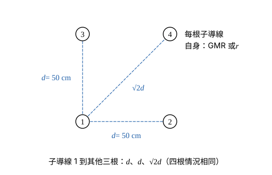

# 112 年電力系統第 1 題｜四分裂換位線的電感與電容

## 已知與所求

單回路三相換位線，每相四分裂正方形束線，間距 \(d=50\) cm；導線直徑 3.5103 cm（\(r=1.75515\) cm）、GMR \(=1.4173\) cm；水平排列 \(D_{ab}=D_{bc}=15\) m、\(D_{ac}=30\) m。求每相每公里電感與電容（25 分）。

## 考場標準作答

### 步驟 1：相間等效距離 GMD

設線路完全換位；相間距離取各相束線中心距（束線內 50 cm 的偏移相對 15 m 可忽略）；忽略大地與架空地線的影響；\(\varepsilon_0=8.854\times10^{-12}\ \mathrm{F/m}\)。題給「ACSR 1,272,000 cmil」只用於查導線表，題中已直接給直徑與 GMR，不必使用。換位線三相輪流佔據三個位置，等效距離為三個相間距離的幾何平均：

\[
\mathrm{GMD}=\sqrt[3]{D_{ab}D_{bc}D_{ac}}
\]
\[
\mathrm{GMD}=\sqrt[3]{15\times15\times30}=\sqrt[3]{6750}=18.8988\ \mathrm m=1889.88\ \mathrm{cm}
\]

### 步驟 2：束線等效半徑 \(D_{sL}\)、\(D_{sC}\)

束線等效半徑為每根子導線自身半徑（電感用 GMR、電容用實際半徑 \(r\)）與到其他三根距離的幾何平均；正方形四分裂中，每根到其他三根的距離為 \(d,d,\sqrt2d\)（圖 1），四根情況相同，16 個距離相乘開 16 次方即化成一根的 4 個量開 4 次方。

\[
D_s=\left(\rho\cdot d\cdot d\cdot\sqrt2d\right)^{1/4}=\left(\rho\cdot\sqrt2\,d^3\right)^{1/4}\qquad(\rho=\mathrm{GMR}\ \text{或}\ r)
\]
以 cm 計，先算共用項：
\[
\sqrt2\,d^3=\sqrt2\times50^3=\sqrt2\times125000=176776.7\ \mathrm{cm^3}
\]
電感用 GMR \(=1.4173\) cm：
\[
D_{sL}=(1.4173\times176776.7)^{1/4}=(250545.6)^{1/4}=22.373\ \mathrm{cm}
\]
電容用實際半徑 \(r=\dfrac{3.5103}{2}=1.75515\) cm：
\[
D_{sC}=(1.75515\times176776.7)^{1/4}=(310269.6)^{1/4}=23.601\ \mathrm{cm}
\]

### 步驟 3：每相每公里電感

分子分母同以 cm 計，比值無單位；\(2\times10^{-7}\ \mathrm{H/m}=0.2\ \mu\mathrm{H/m}\)，再乘 1000 m/km。

\[
L=2\times10^{-7}\ln\frac{\mathrm{GMD}}{D_{sL}}\ \mathrm{H/m}
\]
\[
\frac{\mathrm{GMD}}{D_{sL}}=\frac{1889.88}{22.373}=84.471
\]
\[
\ln84.471=4.4364
\]
\[
L=0.2\times4.4364=0.88728\ \mu\mathrm{H/m}
\]
\[
L=0.88728\times1000\ \mathrm{m/km}=887.28\ \mu\mathrm{H/km}
\]
\[
\boxed{L=887.28\ \mu\mathrm{H/km}}
\]

### 步驟 4：每相每公里電容

電容對中性點，用實際半徑求得的 \(D_{sC}\)；\(1\ \mathrm{pF/m}\times1000\ \mathrm{m/km}=1\ \mathrm{nF/km}\)。

\[
C=\frac{2\pi\varepsilon_0}{\ln(\mathrm{GMD}/D_{sC})}\ \mathrm{F/m}
\]
\[
2\pi\varepsilon_0=2\pi\times8.854\times10^{-12}=55.631\ \mathrm{pF/m}
\]
\[
\frac{\mathrm{GMD}}{D_{sC}}=\frac{1889.88}{23.601}=80.076
\]
\[
\ln80.076=4.3830
\]
\[
C=\frac{55.631}{4.3830}=12.692\ \mathrm{pF/m}
\]
\[
C=12.692\times1000\ \mathrm{pF/km}=12692\ \mathrm{pF/km}
\]
\[
\boxed{C=12.69\ \mathrm{nF/km}}
\]

## 驗算

- 以 12 條子導線逐對距離直接求幾何平均（含束線內偏移），所得 \(L,C\) 與上式差異小於 0.5%。
- 量級：\(\omega L=2\pi(60)(887.28\ \mu\mathrm H)=334.50\ \mathrm{m\Omega/km}\)；\(1/\sqrt{LC}=1/\sqrt{887.28\times10^{-6}\times12.69\times10^{-9}}=2.98\times10^{5}\) km/s，接近光速，符合架空線。

## 失分點

- 電容須用實際半徑 \(r\)，不可用 GMR；混用會使電容偏小。
- 水平排列 \(D_{ac}=30\) m，GMD 為 18.90 m，不是 15 m。
- 正方形四分裂的對角距離是 \(\sqrt2d\)，漏乘 \(\sqrt2\) 會使 \(D_s\) 偏小。
