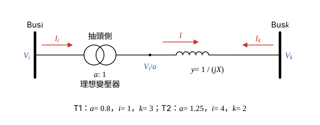

# 112 年電力系統第 3 題｜含分接頭變壓器之 Ybus

## 已知與所求

T1：Bus 1–Bus 3，\(X_{T1}=j0.01\)，抽頭 \(0.8:1\)（箭頭在 Bus 1 側）；Bus 3–Bus 4 兩條並聯線 \(j0.1\)、\(j0.2\)；T2：Bus 4–Bus 2，\(X_{T2}=j0.2\)，抽頭 \(1.25:1\)（箭頭在 Bus 4 側）。電抗為共同基準標么值。求 \(Y_{bus}\)。

## 考場標準作答

**解題邏輯**：\(Y_{bus}\) 由各支路逐一「蓋印」相加。普通線路的蓋印是 \(Y_{ii}\mathrel{+}=y\)、\(Y_{kk}\mathrel{+}=y\)、\(Y_{ik}\mathrel{+}=-y\)；含非標稱抽頭的變壓器要先用「理想變壓器 \(a:1\) 串聯導納 \(y\)」的模型推出它自己的蓋印式。依序：求各支路串聯導納 → 推抽頭支路蓋印式 → T1、3–4 線路、T2 逐一蓋印 → 彙整成 \(4\times4\) 矩陣。前提：電抗皆為題給共同 MVA 基準的標么值；電阻、並聯電納忽略；抽頭比為實數（無相移）；依題圖，抽頭（箭頭）在 Bus 1 側與 Bus 4 側，串聯電抗歸在另一側。

### 步驟 1：各支路串聯導納

**邏輯**：導納 = 阻抗倒數；兩條並聯線的導納直接相加。

\[
y_{T1}=\frac{1}{j0.01}=-j100
\]
\[
y_{T2}=\frac{1}{j0.2}=-j5
\]
\[
y_{34}=\frac{1}{j0.1}+\frac{1}{j0.2}=-j10+(-j5)=-j15
\]

### 步驟 2：抽頭支路的蓋印式

**邏輯**：理想變壓器兩側電壓比為 \(a:1\)、複功率相等（電流比為 \(1:a\)），由此寫出 \(I_i\)、\(I_k\) 對 \(V_i\)、\(V_k\) 的關係，係數即為蓋印值。

- 理想變壓器另一側（內部節點）電壓：\(V_i/a\)。
- 串聯電流（由內部節點流向 Bus \(k\)）：\(I=y\left(\dfrac{V_i}{a}-V_k\right)\)。
- 無損：\(V_iI_i^*=\dfrac{V_i}{a}I^*\)，且 \(a\) 為實數，故 \(I_i=\dfrac{I}{a}\)；Bus \(k\) 側 \(I_k=-I\)。

展開：
\[
I_i=\frac{1}{a}\,y\left(\frac{V_i}{a}-V_k\right)=\frac{y}{a^2}V_i-\frac{y}{a}V_k
\]
\[
I_k=-y\left(\frac{V_i}{a}-V_k\right)=-\frac{y}{a}V_i+yV_k
\]
所以
\[
Y_{ii}\mathrel{+}=\frac{y}{a^2},\qquad Y_{ik}=Y_{ki}\mathrel{+}=-\frac{y}{a},\qquad Y_{kk}\mathrel{+}=y
\]
（\(a=1\) 時即回到普通線路的蓋印。）

### 步驟 3：逐支路蓋印

**邏輯**：T1 取 \(a=0.8\)、\(i=1\)、\(k=3\)；T2 取 \(a=1.25\)、\(i=4\)、\(k=2\)；3–4 線路視為 \(a=1\)。

T1：
\[
\frac{y_{T1}}{a^2}=\frac{-j100}{0.8^2}=\frac{-j100}{0.64}=-j156.25\quad(\text{加到 }Y_{11})
\]
\[
-\frac{y_{T1}}{a}=-\frac{-j100}{0.8}=+j125\quad(\text{加到 }Y_{13}=Y_{31})
\]
\[
y_{T1}=-j100\quad(\text{加到 }Y_{33})
\]
3–4 線路：
\[
y_{34}=-j15\ (\text{加到 }Y_{33}\text{、}Y_{44}),\qquad -y_{34}=+j15\ (\text{加到 }Y_{34}=Y_{43})
\]
T2：
\[
\frac{y_{T2}}{a^2}=\frac{-j5}{1.25^2}=\frac{-j5}{1.5625}=-j3.2\quad(\text{加到 }Y_{44})
\]
\[
-\frac{y_{T2}}{a}=-\frac{-j5}{1.25}=+j4\quad(\text{加到 }Y_{42}=Y_{24})
\]
\[
y_{T2}=-j5\quad(\text{加到 }Y_{22})
\]

### \(Y_{bus}\)（25 分）

**邏輯**：把步驟 3 的蓋印值逐元素相加；沒有支路直接相連的匯流排（1–2、1–4、2–3）互導納為 0。

自導納：
\[
Y_{11}=-j156.25,\qquad Y_{22}=-j5
\]
\[
Y_{33}=-j100+(-j15)=-j115
\]
\[
Y_{44}=-j15+(-j3.2)=-j18.20
\]
互導納：
\[
Y_{13}=Y_{31}=+j125,\qquad Y_{24}=Y_{42}=+j4,\qquad Y_{34}=Y_{43}=+j15
\]
\[
\boxed{Y_{bus}=\begin{bmatrix}
-j156.25&0&+j125&0\\
0&-j5&0&+j4\\
+j125&0&-j115&+j15\\
0&+j4&+j15&-j18.20
\end{bmatrix}\ \mathrm{pu}}
\]

## 驗算

π 等效分路檢查（抽頭支路的列和 = 該側對地分路）：Bus 1 列和 \(-j156.25+j125=-j31.25\)，而 \(y_{T1}\left(\dfrac{1}{0.8^2}-\dfrac{1}{0.8}\right)=-j100(1.5625-1.25)=-j31.25\)，一致；Bus 2 列和 \(-j5+j4=-j1\)，而 \(y_{T2}\left(1-\dfrac{1}{1.25}\right)=-j5(0.2)=-j1\)，一致。矩陣對稱（\(Y_{13}=Y_{31}\)、\(Y_{24}=Y_{42}\)），符合實數抽頭理想變壓器的互易性。

## 失分點

- 把 T2 的 \(1.25\) 放到 Bus 2 側，會得 \(Y_{22}=-j3.20\)、\(Y_{44}=-j20\)。
- 兩條 3–4 線路應先並聯成 \(-j15\)（導納相加），不是串聯。
- 有分接頭時列和不為零，不能用「每列和為零」檢查。
