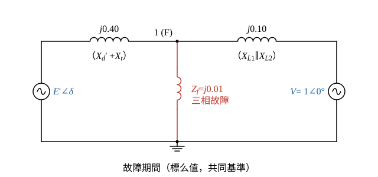
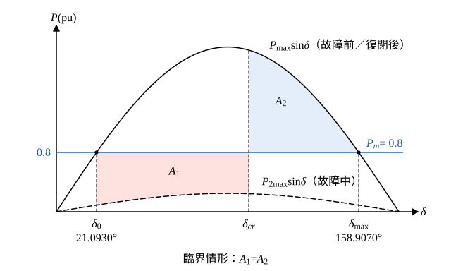

# 112 年電力系統第 4 題｜三相故障之臨界清除角

## 已知與所求

60 Hz，\(H=5\) MJ/MVA，\(X_d'=0.2\)、\(X_t=0.2\)，兩條並聯線 \(X_{L1}=X_{L2}=0.2\) pu；送至無限匯流排 \(V=1\angle0^\circ\) 的 \(P_e=0.8\)、\(Q=0.074\) pu。線路 2 送電端 F 經 0.01 pu 三相故障，清除後線路復閉回原狀態。求臨界清除角 \(\delta_{cr}\)。

## 考場標準作答

**解題邏輯**：暫態穩定度用等面積準則；前提為古典模型（\(X_d'\) 後的 \(|E'|\) 與 \(P_m=0.8\) 不變、忽略阻尼）；標么值以題圖的共同基準；無限匯流排 \(V=1\angle0^\circ\) 為參考相量；F 在線路 2 送電端，視為 Bus 1 經 \(Z_f\) 接地（主解取 \(Z_f=j0.01\)，見「條件與疑義」）；復閉後網路與故障前相同。
1. 由故障前潮流求暫態電勢 \(E'\) 與初始角 \(\delta_0\)。
2. 求「故障前／復閉後」的轉移電抗 \(X_1\) 與 \(P_{\max}\)。
3. 求「故障期間」的轉移電抗 \(X_2\) 與 \(P_{2\max}\)。
4. 令加速面積 \(A_1\) 等於減速面積 \(A_2\)，解 \(\cos\delta_{cr}\)。
5. \(\delta_{cr}\) 距兩位小數的進位界很近，本題中間值保留 6–7 位有效數字。

### 步驟 1：故障前／復閉後的轉移電抗 \(X_1\)

**邏輯**：\(E'\) 到無限匯流排是 \(X_d'\)、\(X_t\) 與兩條並聯線串聯。

\[
X_{L1}\parallel X_{L2}=\frac{0.2\times0.2}{0.2+0.2}=\frac{0.04}{0.4}=0.10
\]
\[
X_1=X_d'+X_t+X_{L1}\parallel X_{L2}=0.20+0.20+0.10=0.50\ \mathrm{pu}
\]

### 步驟 2：暫態電勢 \(E'\)、初始角 \(\delta_0\) 與 \(P_{\max}\)

**邏輯**：送到無限匯流排的複功率 \(S=VI^*\)，故 \(I=(P-jQ)/V^*\)；再由 \(E'=V+jX_1I\) 得 \(E'\)，其相角即 \(\delta_0\)。

\[
I=\frac{P-jQ}{V^*}=\frac{0.8-j0.074}{1}=0.8-j0.074\ \mathrm{pu}
\]
\[
jX_1I=j0.50(0.8-j0.074)=0.037+j0.40\ \mathrm{pu}
\]
\[
E'=V+jX_1I=1+0.037+j0.40=1.037+j0.40\ \mathrm{pu}
\]
大小與相角：
\[
|E'|=\sqrt{1.037^2+0.40^2}=\sqrt{1.075369+0.16}=\sqrt{1.235369}=1.111471\ \mathrm{pu}
\]
\[
\delta_0=\tan^{-1}\frac{0.40}{1.037}=\tan^{-1}0.385728=21.0930^\circ=0.368143\ \mathrm{rad}
\]
故障前／復閉後功率曲線峰值：
\[
P_{\max}=\frac{|E'|V}{X_1}=\frac{1.111471\times1}{0.50}=2.222942\ \mathrm{pu}
\]

### 步驟 3：故障期間的轉移電抗 \(X_2\) 與 \(P_{2\max}\)

**邏輯**：故障期間 Bus 1 多一條對地支路 \(Z_f\)；以 Bus 1 為中心的 Y 形（\(j0.40\)、\(j0.10\)、\(j0.01\)）做 Y→Δ，\(E'\) 與 \(V\) 之間的 Δ 支路即轉移電抗（另兩條 Δ 支路接地，不傳送功率）。

\[
X_2=\frac{X_aX_b+X_bX_f+X_fX_a}{X_f},\qquad X_a=0.40,\ X_b=0.10,\ X_f=0.01
\]
\[
X_aX_b+X_bX_f+X_fX_a=0.40(0.10)+0.10(0.01)+0.01(0.40)=0.04+0.001+0.004=0.045
\]
\[
X_2=\frac{0.045}{0.01}=4.5\ \mathrm{pu}
\]
\[
P_{2\max}=\frac{|E'|V}{X_2}=\frac{1.111471}{4.5}=0.246994\ \mathrm{pu}
\]

### （一）臨界清除角（25 分）

**邏輯**：故障期間 \(P_m>P_{2\max}\sin\delta\)，轉子由 \(\delta_0\) 加速到 \(\delta_{cr}\)（\(A_1\)）；復閉後回到 \(P_{\max}\sin\delta\)，減速到最遠 \(\delta_{\max}=\pi-\delta_0\)（\(A_2\)）；臨界時 \(A_1=A_2\)。

加速面積：
\[
A_1=\int_{\delta_0}^{\delta_{cr}}(P_m-P_{2\max}\sin\delta)\,d\delta=P_m(\delta_{cr}-\delta_0)+P_{2\max}(\cos\delta_{cr}-\cos\delta_0)
\]
減速面積：
\[
A_2=\int_{\delta_{cr}}^{\delta_{\max}}(P_{\max}\sin\delta-P_m)\,d\delta=P_{\max}(\cos\delta_{cr}-\cos\delta_{\max})-P_m(\delta_{\max}-\delta_{cr})
\]
令 \(A_1=A_2\)，\(P_m\delta_{cr}\) 兩邊相消，移項解 \(\cos\delta_{cr}\)：
\[
\cos\delta_{cr}=\frac{P_m(\delta_{\max}-\delta_0)+P_{\max}\cos\delta_{\max}-P_{2\max}\cos\delta_0}{P_{\max}-P_{2\max}}
\]
所需角度量（弧度）：
\[
\delta_{\max}=\pi-\delta_0=3.141593-0.368143=2.773450\ \mathrm{rad}\ (158.9070^\circ)
\]
\[
\delta_{\max}-\delta_0=2.773450-0.368143=2.405307\ \mathrm{rad}
\]
\[
\cos\delta_0=\cos(0.368143)=0.932997,\qquad \cos\delta_{\max}=-\cos\delta_0=-0.932997
\]
分子三項：
\[
P_m(\delta_{\max}-\delta_0)=0.8\times2.405307=1.924246
\]
\[
P_{\max}\cos\delta_{\max}=2.222942\times(-0.932997)=-2.073998
\]
\[
P_{2\max}\cos\delta_0=0.246994\times0.932997=0.230445
\]
\[
\text{分子}=1.924246-2.073998-0.230445=-0.380197
\]
分母：
\[
P_{\max}-P_{2\max}=2.222942-0.246994=1.975948
\]
\[
\cos\delta_{cr}=\frac{-0.380197}{1.975948}=-0.192412
\]
\[
\delta_{cr}=\cos^{-1}(-0.192412)=101.0936^\circ=1.764416\ \mathrm{rad}
\]
\[
\boxed{\delta_{cr}=1.76\ \mathrm{rad}=101.09^\circ}
\]

## 驗算

以 Bus 1 節點 KCL 直接求故障期間輸出 \(P_e(\delta)=\mathrm{Re}\{E'I_g^*\}\)（不經 Y–Δ），再以數值積分令加速面積 \(\int_{\delta_0}^{\delta_{cr}}(P_m-P_e)\,d\delta\) 等於減速面積 \(\int_{\delta_{cr}}^{\delta_{\max}}(P_{\max}\sin\delta-P_m)\,d\delta\)，二分法求根得 \(101.09^\circ\)；另 \(P_{\max}\sin\delta_0=2.222942\times\sin(0.368143)=2.222942\times0.359883=0.8000\)，與 \(P_m\) 相符；且 \(\delta_0<\delta_{cr}<\delta_{\max}\)（\(21.09^\circ<101.09^\circ<158.91^\circ\)）。

## 失分點

- 故障期間把 \(P_e\) 設為 0；有限故障阻抗與健全線路使 \(P_{2\max}=0.246994\) pu。
- 兩條 0.2 pu 線路在故障前後是並聯（0.1 pu），不是只算一條。
- 等面積式中的 \(\delta_{\max}-\delta_0\) 必須用弧度；\(\cos\delta_{cr}\) 由相近量相減，中間值不可先四捨五入成兩位小數。

## 條件與疑義

題面只寫「故障阻抗為 0.01 標么」未標 \(j\)。主解：等效接地電抗 \(Z_f=j0.01\) pu（與公開更正解答一致），得 \(\delta_{cr}=101.09^\circ\)。若依字面視為純電阻 0.01 pu，故障期間曲線含電阻損耗項，數值等面積求得 \(\delta_{cr}=102.08^\circ\)，僅作敏感度對照。
