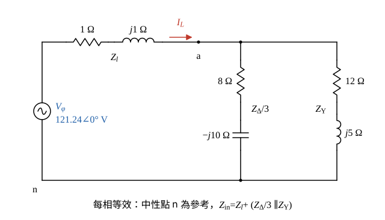

# 113 年電力系統第 1 題｜三相並聯負載與複數功率

## 已知與所求

平衡三相電源線電壓 210 V；線路每相 \(Z_l=1+j1\ \Omega\)；\(\Delta\) 負載每相 \(Z_\Delta=24-j30\ \Omega\)；Y 負載每相 \(Z_Y=12+j5\ \Omega\)。求由電源端看入的 Y 等效每相阻抗、線電流大小，以及電源送出的總 \(P\)、\(Q\)、\(|S|\)、\(S\)、功率因數。

## 考場標準作答

**解題邏輯**：平衡三相電路取一相（單相等效）計算：把 \(\Delta\) 負載轉成等效 Y（每相阻抗除以 3）→ 與 Y 負載並聯得合併負載 \(Z_L\) → 串線路阻抗得電源端看入的 \(Z_{in}\) → 相電壓 ÷ \(|Z_{in}|\) 得線電流 → 三相總複功率 \(S=3|I_L|^2Z_{in}\)，由其實部、虛部求 \(P\)、\(Q\)、\(|S|\)、功因。共用前提：電源線電壓 210 V，Y 等效每相電壓 \(V_\phi=210/\sqrt3\)。

### 步驟 1：單相等效電路

- 以電源中性點 n 為參考，每相為「\(Z_l\) 串（\(Z_\Delta/3\) 並聯 \(Z_Y\)）」。
- 平衡負載的 Y 中性點與電源中性點同電位，可直接連到 n。

### 由電源端看入之 Y 連接合併負載每相等效阻抗

**邏輯**：平衡 \(\Delta\) 負載的等效 Y 每相阻抗為 \(Z_\Delta/3\)；兩組 Y 負載每相並聯，再與線路阻抗串聯。

\(\Delta\to\mathrm Y\)：
\[
\frac{Z_\Delta}{3}=\frac{24-j30}{3}=8-j10\ \Omega
\]
與 \(Z_Y\) 並聯，分子、分母分別計算：
\[
(8-j10)(12+j5)=96+j40-j120-j^2 50=146-j80
\]
\[
(8-j10)+(12+j5)=20-j5
\]
分母有理化（乘 \(20+j5\)，\(|20-j5|^2=400+25=425\)）：
\[
Z_L=\frac{146-j80}{20-j5}=\frac{(146-j80)(20+j5)}{425}=\frac{2920+j730-j1600+400}{425}=\frac{3320-j870}{425}
\]
\[
\boxed{Z_L=7.81-j2.05\ \Omega}
\]
由電源端看入再串線路阻抗：
\[
\boxed{Z_{in}=Z_l+Z_L=(1+j1)+(7.81-j2.05)=8.81-j1.05\ \Omega}
\]
極式（供下一小題用）：
\[
|Z_{in}|=\sqrt{8.81^2+1.05^2}=8.87\ \Omega,\qquad \angle Z_{in}=\tan^{-1}\frac{-1.05}{8.81}=-6.78^\circ
\]

### 流經合併負載的線電流大小

**邏輯**：Y 接時線電流 = 相電流 = 相電壓 ÷ 每相看入阻抗。

\[
V_\phi=\frac{210}{\sqrt3}=121.24\ \mathrm V
\]
\[
\boxed{|I_L|=\frac{V_\phi}{|Z_{in}|}=\frac{121.24}{8.87}=13.66\ \mathrm A}
\]

### 電源流入之總實功、總虛功、總視在功率、總複數功率、總功率因數

**邏輯**：每相複功率 \(V_\phi I_L^*=|I_L|^2Z_{in}\)，三相合計乘 3；電源端看入的 \(Z_{in}\) 已含線路，所以這就是電源送出的總功率。

\[
|I_L|^2=13.66^2=186.68\ \mathrm{A^2},\qquad 3|I_L|^2=3\times186.68=560.05\ \mathrm{A^2}
\]
\[
S=3|I_L|^2Z_{in}=560.05\,(8.81-j1.05)
\]
實部、虛部分別相乘（以完整精度）：
\[
P=560.05\times8.81=4934.99\ \mathrm W,\qquad Q=560.05\times(-1.05)=-586.40\ \mathrm{var}
\]
\[
\boxed{P=4934.99\ \mathrm W},\quad \boxed{Q=-586.40\ \mathrm{var}}
\]
視在功率與複數功率：
\[
\boxed{|S|=\sqrt{P^2+Q^2}=4969.71\ \mathrm{VA}},\qquad \boxed{S=4934.99-j586.40\ \mathrm{VA}}
\]
功率因數（\(Q<0\)：電源端看入為容性，電流超前電壓）：
\[
\boxed{\mathrm{pf}=\frac{P}{|S|}=\frac{4934.99}{4969.71}=0.99\ \text{超前}}
\]
（以完整精度計算後顯示兩位小數；\(\cos(-6.78^\circ)=0.99\) 亦同。）

## 驗算

- 分項功率守恆：負載 \(3|I_L|^2Z_L=4374.95-j1146.45\) VA，線路 \(3|I_L|^2Z_l=560.05+j560.05\) VA，相加 \(4934.99-j586.40\) VA（顯示值相加有 0.01 的捨入差）。
- 完整三相節點分析（A、B、C 三節點加 Y 中性點，\(\Delta\) 負載不轉換）解得線電流 13.66 A、\(S\) 相同。

## 失分點

- \(\Delta\) 負載忘記除以 3，直接以 \(24-j30\) 與 \(12+j5\) 並聯。
- 求電源送出功率時漏掉線路阻抗，只算負載 \(4374.95\) W。
- \(Q<0\) 為容性，功率因數應標「超前」。

## 條件與疑義

「由電源端看入之 Y 連接合併負載每相等效阻抗」可讀為只含負載（\(Z_L\)）或含線路（\(Z_{in}\)）；兩者都列出。線電流與電源功率均以含線路的 \(Z_{in}\) 計算，不受此讀法影響。
