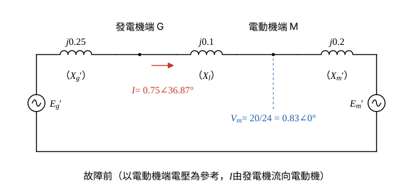
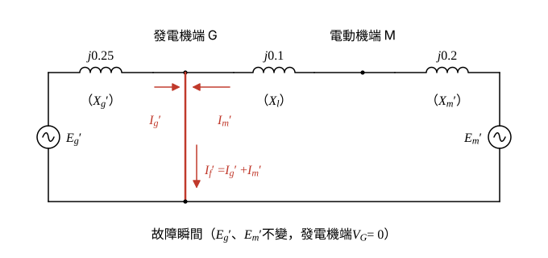

# 113 年電力系統第 2 題｜發電機端三相短路的暫態電流

## 已知與所求

基準 100 MVA、24 kV。發電機 \(X_g'=0.25\)，線路 \(X_l=0.1\)，電動機 \(X_m'=0.2\) pu。電動機端電壓 20 kV、吸收 50 MW、pf 0.8 超前。發電機端點三相短路，求兩機暫態電流與故障點暫態電流。

## 考場標準作答

### 步驟 1：故障前電路與負載電流

暫態電流用暫態電抗後的內電勢 \(E'\)，\(E'\) 在故障瞬間保持故障前的值。兩機額定與基準相同（100 MVA、24 kV），電抗不需換算基準；以電動機端電壓為相角參考。

- 等效電路：\(E_g'\) 串 \(j0.25\) 到發電機端 G，經線路 \(j0.1\) 到電動機端 M，再串 \(j0.2\) 到 \(E_m'\)；電流 \(I\) 由發電機流向電動機。

電動機端電壓（標么）：
\[
V_m=\frac{20}{24}=\frac{5}{6}\approx0.8333\angle0^\circ\ \mathrm{pu}
\]
吸收功率：\(P=50/100=0.50\) pu；pf 0.8 超前表示電動機吸收的 \(Q<0\)，\(\tan\theta=0.6/0.8=0.75\)：
\[
Q=-P\tan\theta=-0.50\times0.75=-0.375\ \mathrm{pu},\qquad S_m=0.50-j0.375\ \mathrm{pu}
\]
負載電流（由 \(S_m=V_mI^*\) 解出）：
\[
I=\frac{S_m^*}{V_m^*}=\frac{0.50+j0.375}{5/6}=(0.50+j0.375)\times1.2=0.60+j0.45\ \mathrm{pu}
\]
大小與相角：
\[
|I|=\sqrt{0.60^2+0.45^2}=0.75,\qquad \angle I=\tan^{-1}\frac{0.45}{0.60}=36.87^\circ\ \Rightarrow\ I=0.75\angle36.87^\circ\ \mathrm{pu}
\]

### 步驟 2：兩機暫態內電勢

**發電機**（由 \(E_g'\) 出發，經 \(j0.25\) 與 \(j0.1\) 到 M 點，電流 \(I\) 同向，所以 \(E_g'=V_m+j(0.25+0.1)I\)）：
\[
j0.35I=j0.35(0.60+j0.45)=j0.21+j^2(0.1575)=-0.1575+j0.21
\]
\[
E_g'=V_m+j0.35I=0.8333+(-0.1575+j0.21)=0.6758+j0.21\ \mathrm{pu}
\]
**電動機**（電流 \(I\) 流入電動機，內電勢比端電壓少一個電抗壓降，\(E_m'=V_m-j0.2I\)）：
\[
j0.20I=j0.20(0.60+j0.45)=-0.09+j0.12
\]
\[
E_m'=V_m-j0.20I=0.8333-(-0.09+j0.12)=0.9233-j0.12\ \mathrm{pu}
\]

### 步驟 3：故障瞬間的電路

- 發電機端 G 三相短路接地，\(V_G=0\)；\(E_g'\)、\(E_m'\) 維持步驟 2 的值。
- 發電機支路只剩 \(j0.25\)；電動機支路為 \(j0.2+j0.1=j0.30\)（含線路）。兩支路電流都定為流向故障點。

### 每部電機的暫態電流

故障時發電機端電壓為 0，每條支路電流 = 該支路內電勢 ÷ 支路電抗，兩支路互不影響。

發電機暫態電流（除以 \(j0.25\) 等於乘 \(-j4\)）：
\[
I_g'=\frac{E_g'}{j0.25}=(0.6758+j0.21)(-j4)=-j(0.6758\times4)+(-j)(j)(0.21\times4)=0.84-j2.7032
\]
大小與相角（第四象限）：
\[
|I_g'|=\sqrt{0.84^2+2.7032^2}=2.8307,\qquad \angle I_g'=-\tan^{-1}\frac{2.7032}{0.84}=-72.74^\circ
\]
\[
\boxed{I_g'=\frac{E_g'}{j0.25}=0.84-j2.70=2.83\angle-72.74^\circ\ \mathrm{pu}}
\]
電動機暫態電流（除以 \(j0.30\) 等於乘 \(-j\tfrac{10}{3}\)）：
\[
I_m'=\frac{E_m'}{j0.30}=(0.9233-j0.12)\left(-j\tfrac{10}{3}\right)=-j(0.9233)\left(\tfrac{10}{3}\right)+j^2(0.12)\left(\tfrac{10}{3}\right)
\]
\[
(0.9233)\left(\tfrac{10}{3}\right)=3.0777,\qquad (0.12)\left(\tfrac{10}{3}\right)=0.40\ \Rightarrow\ I_m'=-0.40-j3.0777
\]
大小與相角（第三象限，角度 \(=-180^\circ+\tan^{-1}\frac{3.0777}{0.40}\)）：
\[
|I_m'|=\sqrt{0.40^2+3.0777^2}=3.1036,\qquad \angle I_m'=-180^\circ+82.59^\circ=-97.40^\circ
\]
\[
\boxed{I_m'=\frac{E_m'}{j(0.2+0.1)}=-0.40-j3.08=3.10\angle-97.40^\circ\ \mathrm{pu}}
\]

### 短路故障點的暫態電流

故障點 KCL：流入故障點的總電流為兩支路電流的相量和（不是幅值和）。

\[
I_f'=I_g'+I_m'=(0.84-0.40)+j(-2.7032-3.0777)=0.44-j5.7809
\]
大小與相角：
\[
|I_f'|=\sqrt{0.44^2+5.7809^2}=5.7976,\qquad \angle I_f'=-\tan^{-1}\frac{5.7809}{0.44}=-85.65^\circ
\]
\[
\boxed{I_f'=I_g'+I_m'=0.44-j5.78=5.80\angle-85.65^\circ\ \mathrm{pu}}
\]

### 換算成安培

基準電流取故障所在 24 kV 側：

\[
I_B=\frac{S_B}{\sqrt3V_B}=\frac{100\times10^6}{\sqrt3(24\times10^3)}=2405.63\ \mathrm A
\]
各標么值乘基準電流：
\[
|I_g'|=2.8307\times2405.63=6810\ \mathrm A
\]
\[
|I_m'|=3.1036\times2405.63=7466\ \mathrm A
\]
\[
|I_f'|=5.7976\times2405.63=13947\ \mathrm A
\]
\[
\boxed{|I_g'|=6.81\ \mathrm{kA}},\qquad \boxed{|I_m'|=7.47\ \mathrm{kA}},\qquad \boxed{|I_f'|=13.95\ \mathrm{kA}}
\]

## 驗算

戴維寧疊加：故障前發電機端電壓 \(V_f=V_m+j0.1I=0.8333+(-0.045+j0.06)=0.7883+j0.06\)，\(Z_{th}=j0.25\parallel j0.30=j\tfrac{3}{22}\approx j0.136\)，\(I_f'=V_f/Z_{th}=(0.7883+j0.06)\left(-j\tfrac{22}{3}\right)=0.44-j5.7809\)；依電抗分流再疊加負載電流：\(I_g'=I+I_f'\frac{0.30}{0.55}=(0.60+0.24)+j(0.45-3.1532)=0.84-j2.7032\)、\(I_m'=-I+I_f'\frac{0.25}{0.55}=(-0.60+0.20)+j(-0.45-2.6277)=-0.40-j3.0777\)，與上相同。

## 失分點

- 超前功率因數表示電動機吸收 \(Q<0\)，\(S_m=0.50-j0.375\)；符號弄反則兩個電勢都錯。
- 電動機端電壓是 20 kV（0.8333 pu），不可當 1.0 pu。
- 故障電流為相量和 \(5.80\) pu，不是幅值和 \(2.83+3.10\)。
