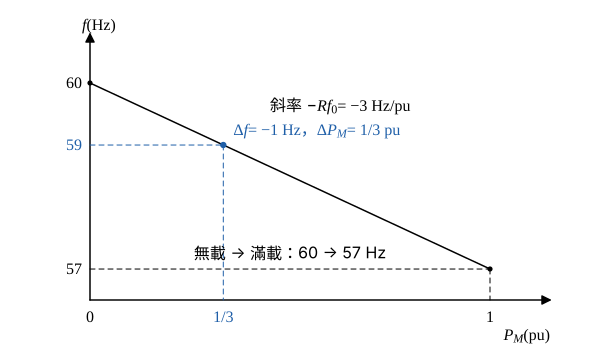

# 113 年電力系統第 4 題｜速度調節率

## 已知與所求

500 MW 同步發電機，速度調節率 \(R=0.05\) pu，關係式 \(\Delta\omega/\omega=-0.05\,\Delta P_M\)（\(\Delta P_M\) 為標么值）。頻率由 60 Hz 降至 59 Hz，求 \(P_M\) 的增加量（pu）；並求 \(P_M\) 由 0 變至 1 pu 時的頻率變動範圍（Hz）。（合計 25 分，未分配子題配分。）

## 考場標準作答

**解題邏輯**：速度調節率描述調速機的下垂特性：轉速（頻率）分數偏差與機械功率偏差成正比、方向相反，\(\Delta\omega/\omega=-R\,\Delta P_M\)。同步機轉速與電氣頻率成正比，故 \(\Delta\omega/\omega=\Delta f/f_0\)。（一）由頻率偏差反求 \(\Delta P_M\)；（二）由 \(\Delta P_M=1\) 求 \(\Delta f\)。前提：\(P_M\) 標么值以發電機額定 500 MW 為基準；分數偏差的分母取額定頻率 \(f_0=60\) Hz；下垂特性為直線、調速機無死區且不做補充（二次）控制。

### （一）機械輸入功率 \(P_M\) 的增加量

**邏輯**：把頻率偏差換成轉速分數偏差，代入題給下垂式，一次方程解 \(\Delta P_M\)。

轉速分數偏差：
\[
\frac{\Delta\omega}{\omega}=\frac{\Delta f}{f_0}=\frac{59-60}{60}=-\frac{1}{60}=-0.01667
\]
代入 \(\Delta\omega/\omega=-0.05\,\Delta P_M\)：
\[
-\frac{1}{60}=-0.05\,\Delta P_M
\]
\[
\Delta P_M=\frac{1/60}{0.05}=\frac{1}{60\times0.05}=\frac{1}{3}
\]
\[
\boxed{\Delta P_M=\tfrac13\approx0.33\ \mathrm{pu}}\ \left(=\tfrac13\times500=166.67\ \mathrm{MW}\right)
\]

### （二）無載至滿載的頻率變動範圍

**邏輯**：同一條下垂線上，\(P_M\) 由 0 增至 1 pu 即 \(\Delta P_M=1\)，反解 \(\Delta f=f_0\,\Delta\omega/\omega\)。

\[
\frac{\Delta f}{f_0}=-R\,\Delta P_M
\]
\[
\Delta f=-R\,\Delta P_M\,f_0=-0.05\times1\times60=-3\ \mathrm{Hz}
\]
\[
\boxed{|\Delta f|=3\ \mathrm{Hz}}
\]
若無載運轉於 60 Hz，滿載降至 \(60-3=57\) Hz，故頻率變動範圍為 57–60 Hz。

## 驗算

下垂斜率 \(Rf_0=0.05\times60=3\) Hz/pu；（一）降 1 Hz 對應 \(1/3\approx0.33\) pu，與 \(\Delta P_M=\tfrac13\) 一致；（二）\(1\) pu 對應 \(3\) Hz，兩問落在同一條直線上。

## 失分點

- 偏差量是 \((59-60)/60=-1/60\)，不是 \(-1\)；漏除 \(f_0\) 會得 \(\Delta P_M=20\) pu。
- 無載到滿載是 \(\Delta P_M=1\) pu，頻率範圍用 \(0.05\times60=3\) Hz，不是 \(0.05\times59\)。
- \(R\) 為負斜率：頻率下降時 \(P_M\) 增加，答案要寫「增加 \(1/3\) pu」而非負值。
